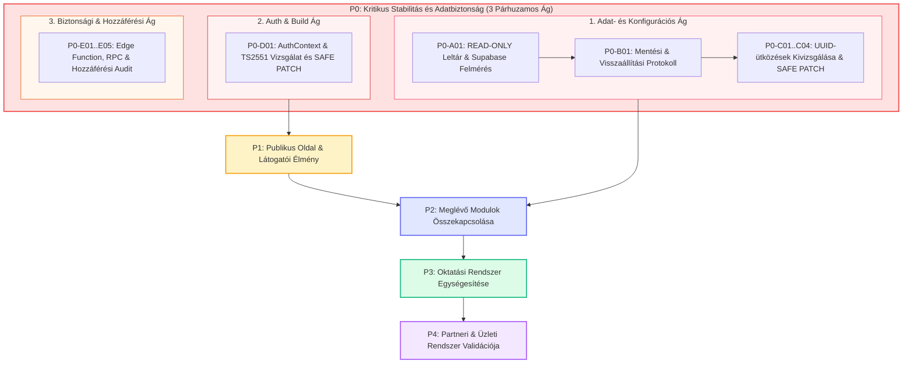
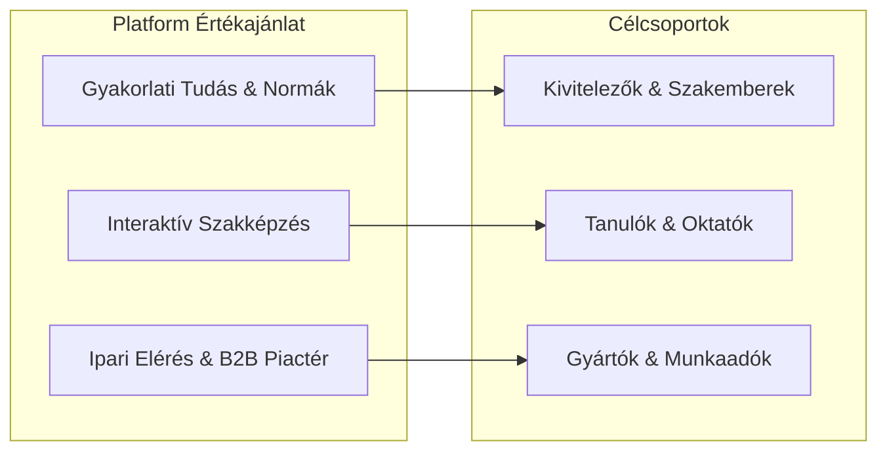

# ÉPÍTŐTUDÁS – MASTER DEVELOPMENT ROADMAP
## Központi Projektstratégia, Fejlesztési és Stabilizációs Ütemterv (v2.2 – P0 Pontosított Változat)

**Dátum:** 2026. november 8.  
**Projekt:** ÉpítőTudás Digitális Építőipari Platform (`c:\Users\User\Documents\epitotudas\project`)  
**Státusz:** Jóváhagyásra előterjesztett fejlesztési alapterv (READ-ONLY PLANNING)  
**Dokumentum célja:** A platform meglévő technológiai értékeinek megőrzése, adatbiztonsági stabilizálása, a párhuzamos rendszerek összehangolása és fázisokra bontott, kockázatmentes továbbfejlesztése.

---

## 1. VEZETŐI ÖSSZEFOGLALÓ (EXECUTIVE SUMMARY)

Az **ÉpítőTudás** a magyar építőipari digitalizáció hiánypótló, komplex tudás- és szakmai ökoszisztémája. A rendszer egyedülálló módon köti össze a **gyakorlati kivitelezői szakmunkát**, a **szakirányú szakképzést** és az **ipari piaci szereplőket** (gyártók, kereskedők, gépforgalmazók, szakképző intézmények).

A projekt rendkívül értékes, kiterjedt funkciókészlettel és prototípus-bázissal rendelkezik:
- 290+ forrásfájl, tiszta moduláris komponens-architektúra.
- 319+ szócikket tartalmazó, 8 nyelvű szakmai fogalomtár és zsargon-szótár.
- 4 beépített építőipari anyagszükséglet- és keverési arány kalkulátor.
- 6-féle interaktív feladattípust támogató leckelejátszó és 4 fázisú tanulókártya (flashcard) motor.
- 32 hivatalos munkavédelmi kártya, Eurocode/OTÉK szabványtár, szakkönyvtár beépített PDF-olvasóval.
- Szerepkör-alapú többszintű vezérlőpult (Adminisztrátor, Szerkesztő, Partner, Oktató/Iskola).

### Miért készült ez a Roadmap?
A projekt jelenlegi fázisában a legfőbb kihívás **nem az új funkciók hiánya, hanem a meglévő modulok technikai sérülékenysége és integrálatlansága**:
1. **Adatperzisztencia és ütközési kockázat (P0):** 18 különböző üzleti szolgáltatás a Supabase `public.categories` tábláját használja kulcs-érték JSON tárolóként, melyek között a kódban **4 lehetséges UUID-ütközés** van azonosítva. Ezek az érintett modulok (pl. oktatási kurzusok vs. szakmák) adatainak kölcsönös felülírását okozhatják felhő-mentéskor.
2. **Kettős oktatási motor:** A felületen egymás mellett, de egymástól elszigetelten létezik két külön kurzus- és tesztkezelő rendszer (`CoursesPage` / `educationService` vs. `LearningPage` / `learningService`).
3. **Publikus látogatói zsákutcák (P1):** A fejléc és főoldal keresőmezői nem adnak találatot, több főoldali kártya és szerszámlink eldobja a navigációs paramétert vagy a kezdőlapra dobja a látogatót, az agresszív `AuthPromptModal` pedig a szakmai életpályák (`#paths`) megtekintése előtt is bejelentkezést követel.
4. **Vizuális kontraszt:** Az `--color-accent` kékre állítása miatt számos gombon kék alapon sötétkék/fekete felirat jelenik meg.

**A Roadmap alapelve:** **A meglévő rendszer megtartása.** Nem írjuk újra a kódbázist, nem vezetünk be új technológiai stacket, nem módosítunk routert és nem nyúlunk hozzá a Supabase adatbázis-sémához sem, amíg az adatbiztonsági és vizsgálati feltételek nem teljesülnek. A fejlesztés 5 szigorú prioritási fázisra (P0–P4) oszlik, a P0 fázisban kötelezően alkalmazva a **szétválasztott vizsgálati ágakat, a mentési tervet, a külön jóváhagyást és az izolált SAFE PATCH (max. 1–2 fájl)** elvet.

---

## 2. ELFOGADOTT STRATÉGIAI IRÁNY

**Az ÉpítőTudás egy komplex építőipari platform, amely nem kizárólag egyetlen közönségnek szól.**

### Elsődleges célcsoportok (egyenrangú prioritással):
1. **Dolgozó építőipari szakemberek és kivitelezők:** Gyors, pontos, gyakorlati információkat keresnek: rétegrendek, technológiai normák, anyagszükséglet-számítás, munkavédelmi előírások, szerszám- és anyagparaméterek. Számukra a platform a mindennapi munkavégzés hatékony digitális segédeszköze.
2. **Szakirányú tanulók, pályakezdők és oktatók (szakképző intézmények):** Strukturált, lépésről lépésre felépített tudásanyagra, interaktív gyakorlásra, vizuális feladatokra, tanulókártyákra, tesztekre és tantermi segédletekre vágynak. Számukra a platform a szakmai felkészülés és a tanórai oktatás digitális kiegészítője.

### A platform harmadik pillére (B2B Partnerek és Iparági Szereplők):
- **Építőanyag-gyártók és forgalmazók:** Hiteles szakmai környezetben kívánják bemutatni rendszereiket, műszaki adatlapjaikat és beépítési útmutatóikat.
- **Szerszám- és gépgyártók, gépkölcsönzők:** Gépparkjuk paramétereinek, felhasználási területeinek és kölcsönzési ajánlatainak közvetítése a szakemberek felé.
- **Kivitelező cégek és munkaadók:** Minőségi szakember-utánpótlás és gyakorlati helyek biztosítása az építőipari állásbörzén (`#careers`) keresztül.
- **Szakképző iskolák és oktatási centrumok:** Digitális osztálytermek, kiosztható tananyagcsomagok és tanulói előrehaladás-követés.

**Központi Küldetés:**  
Egy olyan egységes magyar nyelvű digitális szakmai ökoszisztéma működtetése, amely a megbízható építőipari szaktudást közvetlenül összekapcsolja a napi gyakorlati kivitelezéssel, a szakképzéssel és az iparági piac szereplőivel.

---

## 3. A PROJEKT TÉNYLEGES JELENLEGI ÁLLAPOTA

Az audit és a forráskód közvetlen vizsgálata alapján az alábbi állapotrögzítés készült. Az állítások szigorúan négy kategóriába vannak sorolva:
- **[IGAZOLT TÉNY]:** A forráskódban, konfigurációban vagy parancskimenetben közvetlenül ellenőrzött, bizonyított tény.
- **[KORÁBBI AUDIT MEGÁLLAPÍTÁSA]:** A korábbi rendszerauditban szereplő megállapítás, amely a jelenlegi fázisban még adatbázis-szintű ellenőrzést igényel.
- **[FELTÉTELEZÉS]:** Valószínűsíthető viselkedés vagy lehetőség, amely célzott tesztelést vagy döntést igényel.
- **[NEM ELLENŐRIZHETŐ]:** Külső vagy korlátozott jogosultságú erőforrás (pl. éles szerverkörnyezet belső logjai), amely jelenleg közvetlenül nem vizsgálható.

### 3.1 Technológiai stack és fordítási állapot
- **[IGAZOLT TÉNY]:** React 18.3.1 + TypeScript 5.5.3 + Vite 6.0.0 + Tailwind CSS 3.4.1 + `@supabase/supabase-js` 2.57.4 + Cloudflare Pages static hosting (`wrangler.jsonc`).
- **[IGAZOLT TÉNY]:** `npm run typecheck` fordítási hibával elbukik: `src/contexts/AuthContext.tsx(77,80): error TS2551: Property 'catch' does not exist on type 'PostgrestFilterBuilder<any, any, any, any, "confirm_user_email", null, "RPC">'`. A Supabase JS v2-ben az `.rpc()` metódus lazy PostgrestFilterBuilder-t ad vissza, amelyen a `.catch()` runtime TypeError-t okoz.
- **[IGAZOLT TÉNY]:** `npm run lint` 362 problémát (332 hiba, 30 figyelmeztetés) jelez (`src/` fájlokban).
- **[IGAZOLT TÉNY]:** A `vite.config.ts:31` kézi chunkot definiál `vendor-charts: ['recharts']` néven, miközben a `recharts` csomag nincs telepítve a `package.json`-ban.

### 3.2 Adatbázis- és Perzisztencia Állapot (A 18 kategória-alapú konfigurációs sor)
- **[IGAZOLT TÉNY]:** 18 db szolgáltatás forráskódjában szerepel olyan logika, amely a `public.categories` tábla `description` oszlopába ment/olvas JSON adatokat kamu UUID-kkal (`00000000-0000-0000-0000-*`), `__SYSTEM_CONFIG_*` névvel, megkerülve a meglévő `site_settings` táblát.
- **[IGAZOLT TÉNY]:** A forráskódban szereplő konstansok alapján **4 konkrét UUID-azonosság (kód-szintű ütközés)** azonosítható:
  1. `00000000-0000-0000-0000-000000000007`: közösen szerepel az `educationService.ts:402` (`__SYSTEM_CONFIG_EDUCATION_DATA__`) és a `tradeService.ts:21` (`__SYSTEM_CONFIG_TRADES__`) kódrészletében.
  2. `00000000-0000-0000-0000-000000000008`: közösen szerepel az `aboutService.ts:49` (`__SYSTEM_CONFIG_ABOUT_HUB__`) és a `knowledgeHubService.ts:46` (`__SYSTEM_CONFIG_KNOWLEDGE_HUB_ITEMS__`) kódrészletében.
  3. `00000000-0000-0000-0000-000000000009`: közösen szerepel a `glossaryCategorySettingsService.ts:111` (`__SYSTEM_CONFIG_GLOSSARY_CATS__`) és a `materialsService.ts:63` (`__SYSTEM_CONFIG_MATERIALS__`) kódrészletében.
  4. `00000000-0000-0000-0000-000000000013`: közösen szerepel a `bookService.ts:1330` (`__SYSTEM_CONFIG_BOOKS_CATEGORIES__`) és a `bannerCreativeService.ts:4` (`__SYSTEM_CONFIG_BANNER_CREATIVES__`) kódrészletében.
- **[KORÁBBI AUDIT MEGÁLLAPÍTÁSA]:** Bármely ütköző szolgáltatás felhőbe történő mentése felülírhatja a vele azonos UUID-t használó másik modul adatait a Supabase `categories` táblában.
- **[FELTÉTELEZÉS]:** A kliensoldali `localStorage` fallback miatt a böngészőkben a felülírás pillanatnyilag nem feltétlenül okoz azonnali lokális adatvesztést azon a gépen, amelyen a mentés történt, de más eszközökön a felhőből érkező felülírt adat sérülést okozhat. Ennek tényleges jelenlegi adatbázis-állapotát a P0-A fázisban READ-ONLY módon ellenőrizni kell.

### 3.3 Hitelesítés, Jogosultságok és Biztonsági Végpontok
- **[IGAZOLT TÉNY]:** A Supabase PostgreSQL RLS politikák a legtöbb alaptáblán (`articles`, `courses`, `profiles`, `partners`, `job_postings`) aktívak és védik a szervert.
- **[IGAZOLT TÉNY]:** A `supabase/functions/resend-email/index.ts` és a `supabase/functions/send-invitation-email/index.ts` Deno Edge függvények forráskódjában nincs beépített JWT vagy auth-token ellenőrzés.
- **[IGAZOLT TÉNY]:** A `supabase/migrations/20260922_001_confirm_user_email_rpc.sql` migrációs fájlban publikus futtatási jog (`GRANT EXECUTE TO authenticated, anon`) szerepel a `confirm_user_email(TEXT)` SECURITY DEFINER eljárásra.
- **[IGAZOLT TÉNY]:** A `CoursesPage.tsx:317-322` kódrészletben az `Admin Kártyakezelő` gomb megjelenítése nincs `hasAdminRole` feltételhez kötve. A `CareersPage.tsx:635-640` felületen a vendégek számára is látható az állásbeküldő űrlap.

### 3.4 Keresés, Navigáció és Felhasználói Útvonalak
- **[IGAZOLT TÉNY]:** A `Header.tsx:651-662` kereső input eldobja a beírt kifejezést és `Enter`-re a `#glossary` oldalra irányít.
- **[IGAZOLT TÉNY]:** A `HomePage.tsx:208-212` hero keresőmezőn nincs sem `value`, sem `onChange`, sem `onKeyDown`. A „Népszerű témák" csempéken (`lines 217-224`) nincs `onClick`.
- **[IGAZOLT TÉNY]:** A valódi, teljes szöveges keresést végző `GlobalSearch.tsx` kizárólag az admin fejlécben (`AdminHeader.tsx:114`) van bekötve, a publikus fejléchez nem fér hozzá a látogató.
- **[IGAZOLT TÉNY]:** A `HomePage.tsx:311` kategóriakártya paraméter nélkül hívja az `onNavigate('category')`-t, így a kiválasztott kategória elveszik.
- **[IGAZOLT TÉNY]:** A `HomePage.tsx:506` partnerkártya `partnerDetail` kulccsal navigál a helyes `partner-detail` helyett, amit az `App.tsx:504` nem ismer fel és a kezdőlapra irányít.
- **[IGAZOLT TÉNY]:** A `ToolPage.tsx:1161, 1240` kapcsolódó cikk gombjai `article-detail?slug=...` hivatkozást használnak az `article` helyett, így a kezdőlapra ugranak vissza.
- **[IGAZOLT TÉNY]:** A `PathsHubPage.tsx:61-69` nem bejelentkezett látogatóknak `AuthPromptModal`-t dob fel bármely szakma részleteinek megnyitásakor, elzárva a pályaorientációt.

### 3.5 Vizuális Rendszer és Kontraszt
- **[IGAZOLT TÉNY]:** A `src/index.css:15-21` és `index.html:19-25` az `--color-accent` változót kékre (`#4165b4`) definiálja, míg a `tailwind.config.js` fallbackje sárga (`#FFC400`).
- **[IGAZOLT TÉNY]:** Több tucat CTA gomb (`Header.tsx:669`, `HomePage.tsx:524`, `ArticlePage.tsx:312`, `CoursesPage.tsx:309`, `AuthPromptModal.tsx:92`) a `bg-accent text-black` vagy `bg-accent text-primary` (`#0b1b33`) osztályokat használja, ami sötétkéken sötétkék/fekete feliratot eredményez, súlyosan rontva az olvashatóságot.
- **[IGAZOLT TÉNY]:** A `FormattedText.tsx` címsorai és kiemelései borostyánsárgák (`text-amber-400`, `text-amber-300`), amelyek világos háttéren (pl. `TermDetailModal.tsx` fehér hátterén, `MaterialsPage.tsx`-en) alig láthatók.

---

## 4. MEGLÉVŐ MODULOK TELJES JEGYZÉKE

| Modul Azonosító | Megnevezés | Érintett Kulcsfájlok | Jelenlegi Státusz | Elsődleges Felhasználó |
|---|---|---|---|---|
| **MOD-01** | Szakmai Cikkek & Útmutatók | `ArticlePage.tsx`, `CategoryPage.tsx`, `articleService.ts`, `FormattedText.tsx` | Működik (kis navigációs hibákkal) | Szakember, Tanuló |
| **MOD-02** | Szakmai Fogalomtár & Zsargon | `GlossaryPage.tsx`, `TermDetailModal.tsx`, `glossaryService.ts`, `languageService.ts` | Kiforrott, kiváló (szövegközi kiemeléssel) | Mindenki |
| **MOD-03** | Anyagszükséglet-kalkulátorok | `CalculationsPage.tsx`, `calculatorConfigService.ts`, `AdminCalculatorsPage.tsx` | Működik (4 kalkulátor: gipszkarton, beton, burkolat, szigetelés) | Szakember, Kivitelező |
| **MOD-04** | Építőipari Szakmák & Életpályák | `PathsHubPage.tsx`, `tradeService.ts`, `tradeDetailsData.ts` | Működik, de login fallal védett | Tanuló, Pályakezdő |
| **MOD-05** | Anyagismereti Katalógus | `MaterialsPage.tsx`, `materialsService.ts`, `AdminMaterialsPage.tsx` | Működik (UUID ütközés vizsgálat alatt) | Szakember, Tanuló |
| **MOD-06** | Gép- és Szerszámkatalógus | `ToolPage.tsx`, `advertisementService.ts`, `AdminToolsPage.tsx` | Működik (hibás kapcsolódó cikk linkekkel) | Szakember, Kivitelező |
| **MOD-07** | Munkavédelmi Tudástár | `SafetyPage.tsx`, `safetyCardsData.ts`, `PdfViewerModal.tsx` | Kiforrott (32 hivatalos kártya) | Mindenki |
| **MOD-08** | Szabványtár & Előírások | `StandardsPage.tsx`, `standardsCardsData.ts` | Kiforrott (Eurocode, MSZ EN, OTÉK) | Szakember, Tervező |
| **MOD-09** | Szakkönyvtár & PDF Jegyzetek | `BooksPage.tsx`, `bookService.ts`, `PdfViewerModal.tsx` | Működik (UUID ütközés vizsgálat alatt) | Tanuló, Oktató |
| **MOD-10** | Oktatási Rendszer A (Kurzusok) | `CoursesPage.tsx`, `educationService.ts`, `InteractiveLessonViewer.tsx`, `FlashcardViewer.tsx` | Kiforrott interaktív motor, UUID vizsgálat | Tanuló, Oktató |
| **MOD-11** | Oktatási Rendszer B (Tananyagok) | `LearningPage.tsx`, `CourseDetailPage.tsx`, `QuizPlayerPage.tsx`, `learningService.ts` | Párhuzamos rendszer, izolált adatokkal | Tanuló |
| **MOD-12** | Iskolai & Oktatói Portál | `TeacherDashboardPage.tsx`, `PartnerSchoolProfilePage.tsx`, `PartnerLayout.tsx` | Működik (osztályok, csomagok illékony memóriában) | Oktató, Iskola |
| **MOD-13** | Építőipari Állásbörze | `CareersPage.tsx`, `AdminJobsPage.tsx`, `job_postings` SQL | Működik (vendég hirdetésfeladás kockázattal) | Szakember, Munkaadó |
| **MOD-14** | Partneri Ökoszisztéma & Cégprofil | `PartnersPage.tsx`, `PartnerDetailPage.tsx`, `PartnerApplicationPage.tsx` | Működik (főoldali linkhibával) | Gyártó, Kereskedő |
| **MOD-15** | Natív Hirdetési Rendszer | `ModernAdBanner.tsx`, `AdvertisingOrderPage.tsx`, `bannerCreativeService.ts` | Alapok működnek, UUID vizsgálat alatt | Partner, Hirdető |
| **MOD-16** | Felhasználói Fiók & Profil | `ProfilePage.tsx`, `AuthContext.tsx`, `authService.ts` | Félkész (beégetett demó haladási adatok) | Regisztrált látogató |
| **MOD-17** | Adminisztrációs Rendszer | `AdminLayout.tsx`, `AdminSidebar.tsx`, `AdminDashboard.tsx`, 24 admin nézet | Kiterjedt (24 modul, részben localStorage) | Rendszeradminisztrátor |
| **MOD-18** | Szerkesztői Rendszer | `EditorLayout.tsx`, `EditorDashboardPage.tsx`, 12 szerkesztői nézet | Működik, testreszabható témákkal | Tartalomszerkesztő |

---

## 5. A NÉGY STRATÉGIAI PILLÉR

### A. Szakmai Tudásközpont
A megbízható, hiteles építőipari információk központi gyűjtőhelye.
- **Központi integráció:** A szakmai cikkek, technológiai útmutatók, fogalmak, anyagok, szerszámok, munkavédelmi és szabványelőírások nem különálló szigetekként léteznek, hanem egymásra hivatkozva alkotnak egységes tudáshálót.
- **Kereshetőség:** Minden tudásbázis-elem (cikk, fogalom, szabvány, anyag) a központi gyorskeresőn (`Ctrl+K`) és az intelligens szűrőkön keresztül azonnal elérhető.

### B. Gyakorlati Szakmai Eszköztár
A helyszínen és irodában dolgozó szakemberek mindennapi segítőtársa.
- **Anyagszükséglet és arányok:** A 4 meglévő kalkulátor (gipszkarton falazat, beton keverés, burkolás, hőszigetelés) nem elszigetelt kalkulációs játék, hanem összekapcsolódik a vonatkozó technológiai cikkekkel, az anyagismereti adatlapokkal és a hivatalos normákkal.
- **Gép- és eszközismeret:** A gépek és szerszámok adatlapjai közvetlen kapcsolatot kapnak a megmunkálandó építőanyagokkal és a kötelező egyéni védőeszközökkel (EVE).

### C. Oktatási és Szakmai Fejlődési Rendszer
A szakiskolai oktatás és a folyamatos szakmai önképzés digitális háttere.
- **Két rendszer szereptisztázása:** A platform meglévő két e-learning moduljának (`educationService` kurzus- és kártyamotorja vs. `learningService` tananyag- és kvízmotorja) funkcionális elhatárolása, átfedéseik feltárása és egységesítése.
- **Iskolai funkciók stabilitása:** Az oktatók osztálykezelése és a kiosztott tananyagcsomagok perzisztens tárolása (ne vesszenek el oldalfrissítéskor).
- **Nyitott pályaorientáció:** A 14 szakma bemutatásának felszabadítása a regisztrációs kényszer alól.

### D. Partneri és Üzleti Rendszer
A platform hosszú távú gazdasági fenntarthatóságát biztosító modell.
- **B2B értékteremtés:** A partnerek nem egyszerű szalaghirdetéseket vásárolnak, hanem szervesen integrálódnak a szakmai ökoszisztémába (műszaki katalógus, gyártói beépítési útmutatók, partneri ajánlatok, minőségi állásbörze).
- **Üzleti validáció:** Fizetési átjáró lefejlesztése helyett először az iparági partnerekkel történő személyes és pilot validáció valósul meg.

---

## 6. P0–P4 PRIORITÁSI RENDSZER ÉS A P0 BIZTONSÁGI ARCHITEKTÚRÁJA

A P0 fázisban a technikai feladatok **három párhuzamos, egymástól független vizsgálati ágra** oszlanak. Így a kód- és fordítási hibák elhárítása, valamint a jogosultsági vizsgálatok nincsenek mesterségesen az adatbázis-mentéshez kötve; az adatmentési függőség kizárólag a tényleges adatbázis-beavatkozásokat terheli.

### A P0 feladatcsoport 3 független végrehajtási ága:
1. **Adat- és Konfigurációs Ág (`P0-A01` ➔ `P0-B01` ➔ `P0-C01..C04`):**
   - Szigorú láncolat: READ-ONLY leltár ➔ Mentési és visszaállítási protokoll (5 lépésben) ➔ Tényleges mentés és integritás-ellenőrzés ➔ Külön jóváhagyás ➔ 4 izolált SAFE PATCH feladat az UUID-konfliktusok rendezésére.
2. **Auth és Build Ág (`P0-D01`):**
   - Egyesített feladat az `AuthContext.tsx` RPC hibakezelésének vizsgálatára és a `TS2551` fordítási hiba megszüntetésére. Független az adatmentéstől, kizárólag a forráskódbeli típust és munkamenetet érinti.
3. **Biztonsági és Hozzáférési Ág (`P0-E01`..`P0-E05`):**
   - Öt független READ-ONLY biztonsági felmérés (resend-email, send-invitation, confirm_user_email RPC, CoursesPage kártyakezelő, CareersPage állásbeküldés). Egyetlen hiányzó kódellenőrzést sem tekintünk bizonyított résnek, amíg a gateway-szintű és backend/RLS védelem nincs tisztázva.

---

## 7. RÉSZLETES FEJLESZTÉSI ÜTEMTERV

### Fázis 0: P0 – Adatbiztonság és Technikai Stabilitás (1–2. hét)
- **Cél:** A felhőbeli konfigurációs rekordok felmérése, a biztonsági mentési protokoll rögzítése, az UUID-ütközések vizsgálata és biztonságos feloldása, a TypeScript hiba elhárítása és a szerveroldali jogosultsági állapotok tisztázása.
- **Időtartam:** 10 munkanap.
- **Végrehajtási szabályok:**
  - Adatjavítás előtt kötelező: `P0-A01` ➔ `P0-B01` (mentés) ➔ KÜLÖN JÓVÁHAGYÁS ➔ `P0-C01..C04`.
  - A kód- és auth-javítás (`P0-D01`) párhuzamosan futhat, nem vár az adatmentésre.
  - A biztonsági vizsgálatok (`P0-E01..E05`) READ-ONLY módban indulnak, igazolt kockázat esetén külön jóváhagyott SAFE PATCH követi őket.
- **Elfogadási feltétel:** A felhőbeli adatok dokumentáltak és mentettek, `npm run typecheck` 0 hibával fut le, 0 adatvesztés történt.

### Fázis 1: P1 – Publikus Felület és Látogatói Élmény (3–4. hét)
- **Cél:** A weboldalra érkező látogatók akadálymentes böngészése: működő keresők, működő gombok és kártyák, olvasható gombszövegek, reszponzív tisztaság.
- **Időtartam:** 10 munkanap.
- **Fő kockázat:** A vizuális kontrasztjavítás során nem sérülhet a sötét témájú adminisztrációs felület.
- **Elfogadási feltétel:** A fejléc és hero kereső valós találatokat ad, a főoldali kártyák a helyes aloldalra navigálnak, a gombok kontrasztja WCAG AA kompatibilis, a pályaorientáció elérhető regisztráció nélkül.

### Fázis 2: P2 – A Meglévő Modulok Szakmai Összekapcsolása (5–8. hét)
- **Cél:** A szigetszerű modulok valódi relációs összekötése az adatbázis sémájának megbontása nélkül (meglévő mezők és kategóriák segítségével).
- **Időtartam:** 20 munkanap.
- **Fő kockázat:** Túl sok kézi adat-összerendelést igényel a cikkek, szerszámok és anyagok között.
- **Elfogadási feltétel:** A cikkoldalakon megjelennek a kapcsolódó kalkulátorok és szerszámok; a szakmaoldalak listázzák a releváns cikkeket és kurzusokat.

### Fázis 3: P3 – Oktatási Rendszer és Iskolai Portál (9–12. hét)
- **Cél:** A két párhuzamos tananyagrendszer tisztázása és összehangolása, az oktatói egyedi csomagok perzisztenciája, a tanulói profil valós haladáskövetése.
- **Időtartam:** 20 munkanap.
- **Fő kockázat:** Felhasználói tanulási előzmények migrációja.
- **Elfogadási feltétel:** Az oktató által összeállított tananyagcsomagok megmaradnak F5 frissítés után is, a profiloldal valós tanúsítványokat és haladást mutat.

### Fázis 4: P4 – Partneri és Üzleti Rendszer Validációja (13–16. hét)
- **Cél:** Működő partneri adminisztráció, hiteles termék- és ajánlatmegjelenés, pilot partnerek bevonása.
- **Időtartam:** 20 munkanap.
- **Fő kockázat:** A B2B partnerek digitális érettsége és tartalomátadási kapacitása.
- **Elfogadási feltétel:** Legalább 3 pilot partner aktív profillal rendelkezik, termékkatalógusuk integrálva a szerszám- és anyagtárba, az álláshirdetések adminisztrátori moderációhoz kötöttek.

---

## 8. MODULONKÉNTI FELADATLISTA (P0 PONTOSÍTÁSSAL)

A **SAFE PATCH szabály** értelmében egy későbbi fejlesztési lépés **maximum 1–2 fájlt módosíthat**. Ha egy feladat ennél többet igényel, külön jóváhagyási ponttal ellátott részfeladatokra kell bontani.

### 8.1 P0 – Kritikus Stabilitás és Adatbiztonság Feladatcsoport

| Task ID | Feladat Neve | Cél és Leírás | Jelenlegi Állapot | Forrás / Bizonyíték | Függőség | Érintett Fájlok (Max. 1–2) | Elfogadási Feltétel | Visszaállítási Terv | Jóváhagyási Igény |
|---|---|---|---|---|---|---|---|---|---|
| **P0-A01** | READ-ONLY Adatbiztonsági Leltár | Mind a 18 érintett szolgáltatás és a Supabase `categories` tábla tényleges rekordjainak felmérése, az ütközések valós adatállapotának feltárása | **LEZÁRVA (DONE)** – 22 felhős sor és 18 szolgáltatás dokumentálva (`P0_A01_SUPABASE_DATA_INVENTORY.md`) | `src/services/*.ts`, Supabase REST | Nincs | Nincs fájlmódosítás (READ-ONLY) | Dokumentált táblázat a tényleges felhős sorokról, JSON tartalmukról, modul-hozzárendelésükről és ütközéseikről | Nem szükséges (nem módosít) | Nincs (READ-ONLY) |
| **P0-B01** | Mentési és Visszaállítási Protokoll | Biztonsági mentési eljárás kidolgozása és végrehajtása: ellenőrzött export, SHA-256 hash, visszaállítás tesztelése IZOLÁLT mock környezetben | **LEZÁRVA (DONE)** – 22 rekord mentve, SHA-256 igazolva, 22/22 mock visszaállítás tesztelve (`P0_B01_BACKUP_EXECUTION_REPORT.md`) | Architektúra követelmény | **P0-A01** | Nincs forráskód módosítás (`backups/*.json`) | Dokumentált, izolált környezetben sikeresen tesztelt mentési és visszaállítási protokoll; éles DB nem módosult | Nem szükséges | **LEFUTVA ÉS IGAZOLVA** |
| **P0-C01** | UUID Konfliktus 1 Kivizsgálása: Kurzusok vs. Szakmák | `educationService` (`...0007`) és `tradeService` (`...0007`) feloldása | **LEZÁRVA (DONE)** – `tradeService` és felhős adat megvédve, `educationService` átirányítva a szabad `...0022`-re (`educationService.ts:402`), typecheck 0 hiba | `educationService.ts:402`, `tradeService.ts:21` | **P0-B01** (mentés) | `src/services/educationService.ts` (1 fájl) | Igazolt modul-tulajdonjog, meglévő adatok sértetlensége, a konfliktus megszüntetése | Eredeti állapot visszaírása a mentésből | **LEFUTVA ÉS IGAZOLVA** |
| **P0-C02** | UUID Konfliktus 2 Kivizsgálása: Rólunk vs. Tudástár | `aboutService` (`...0008`) és `knowledgeHubService` (`...0008`) feloldása | **LEZÁRVA (DONE)** – `aboutService` és felhős adat megvédve, `knowledgeHubService` átirányítva a szabad `...0023`-ra (`knowledgeHubService.ts:46`), typecheck 0 hiba | `aboutService.ts:49`, `knowledgeHubService.ts:46` | **P0-B01** (mentés) | `src/services/knowledgeHubService.ts` (1 fájl) | Igazolt modul-tulajdonjog, meglévő adatok sértetlensége, a konfliktus megszüntetése | Eredeti állapot visszaírása a mentésből | **LEFUTVA ÉS IGAZOLVA** |
| **P0-C03** | UUID Konfliktus 3 Kivizsgálása: Fogalmak vs. Anyagok | `glossaryCategorySettingsService` (`...0009`) és `materialsService` (`...0009`) feloldása | **LEZÁRVA (DONE)** – `glossaryCategorySettingsService` és a 297 KB felhős rekord megvédve, `materialsService` átirányítva a szabad `...0024`-re (`materialsService.ts:63`), typecheck 0 hiba | `glossaryCategorySettingsService.ts:111`, `materialsService.ts:63` | **P0-B01** (mentés) | `src/services/materialsService.ts` (1 fájl) | Igazolt modul-tulajdonjog, meglévő adatok sértetlensége, a konfliktus megszüntetése | Eredeti állapot visszaírása a mentésből | **LEFUTVA ÉS IGAZOLVA** |
| **P0-C04** | UUID Konfliktus 4 Kivizsgálása: Könyvek vs. Bannerek | `bookService` (`...0013`) és `bannerCreativeService` (`...0013`) feloldása | **LEZÁRVA (DONE)** – `bannerCreativeService` és felhős adat megvédve, `bookService` kategóriák átirányítva a szabad `...0025`-re (`bookService.ts:1330`), typecheck 0 hiba | `bookService.ts:1330`, `bannerCreativeService.ts:4` | **P0-B01** (mentés) | `src/services/bookService.ts` (1 fájl) | Igazolt modul-tulajdonjog, meglévő adatok sértetlensége, a konfliktus megszüntetése | Eredeti állapot visszaírása a mentésből | **LEFUTVA ÉS IGAZOLVA** |
| **P0-D01** | AuthContext Hibakezelési és TypeScript Stabilitás (TS2551) | A TS2551 fordítási hiba megszüntetése az `AuthContext.tsx:77` sorban; try-catch blokk bevezetése; typecheck 0 hiba | **LEZÁRVA (DONE)** – Aszinkron try-catch blokkra cserélve, `npm run typecheck` 0 hibával lefut (`P0_D01_AUTH_CONTEXT_REPORT.md`) | `src/contexts/AuthContext.tsx:77` | Nincs | `src/contexts/AuthContext.tsx` (1 fájl) | `npm run typecheck` 0 hibával lefut; az RPC hiba nem töri meg a munkamenetet | Eredeti sor visszaállítása | **LEFUTVA ÉS IGAZOLVA** |
| **P0-E01** | `resend-email` READ-ONLY Biztonsági Vizsgálat | Forráskód hitelesítés, Supabase `verify_jwt` beállítás, gateway-szintű viselkedés és jogosulatlan küldési lehetőség ellenőrzése | **LEZÁRVA (DONE)** – Dokumentálva a `P0_E_SECURITY_ACCESS_AUDIT_REPORT.md` jelentésben (kódban nincs JWT ellenőrzés) | `supabase/functions/resend-email/index.ts` | Nincs | Nincs fájlmódosítás (READ-ONLY) | Dokumentált biztonsági jelentés a tényleges hívhatóságról és az esetleges kockázatról | Nem szükséges | Nincs (READ-ONLY) |
| **P0-E02** | `send-invitation-email` READ-ONLY Biztonsági Vizsgálat | Forráskód hitelesítés, Supabase `verify_jwt` beállítás, gateway-szintű viselkedés és jogosulatlan meghívóküldési lehetőség ellenőrzése | **LEZÁRVA (DONE)** – Dokumentálva a `P0_E_SECURITY_ACCESS_AUDIT_REPORT.md` jelentésben (szerepkör-ellenőrzés hiánya) | `supabase/functions/send-invitation-email/index.ts` | Nincs | Nincs fájlmódosítás (READ-ONLY) | Dokumentált biztonsági jelentés a tényleges hívhatóságról és a hívó szerepkörének ellenőrzéséről | Nem szükséges | Nincs (READ-ONLY) |
| **P0-E03** | `confirm_user_email` RPC READ-ONLY Biztonsági Vizsgálat | Teljes SQL függvénytörzs, SECURITY DEFINER működés, EXECUTE jogosultságok, `anon`/`authenticated` hozzáférés tényleges következményeinek vizsgálata | **LEZÁRVA (DONE)** – Dokumentálva a `P0_E_SECURITY_ACCESS_AUDIT_REPORT.md` jelentésben (igazolt token nélküli e-mail megerősítési lehetőség) | `20260922_001_confirm_user_email_rpc.sql` | Nincs | Nincs fájlmódosítás (READ-ONLY) | Dokumentált biztonsági jelentés arról, hogy létezik-e visszaélési lehetőség tetszőleges e-mail megerősítésére | Nem szükséges | Nincs (READ-ONLY) |
| **P0-E04** | `CoursesPage` Kártyakezelő Jogosultsági Vizsgálat | A `CoursesPage.tsx:317-322` `AdminFlashcardsModal` gombjának és a szerveroldali jogosultságvédelemnek a vizsgálata (UI elrejtés vs. backend védelem) | **LEZÁRVA (DONE)** – Dokumentálva a `P0_E_SECURITY_ACCESS_AUDIT_REPORT.md` jelentésben (UI szivárgás van, de az éles DB-t a categories RLS védi) | `CoursesPage.tsx:317`, `educationService.ts` | Nincs | Nincs fájlmódosítás (READ-ONLY) | Dokumentált szerveroldali jogosultsági állapot; admin funkció csak adminisztrátornak elérhető | Korábbi nézet visszaállítása | Nincs (READ-ONLY) |
| **P0-E05** | `CareersPage` Vendég Állásbeküldés Jogosultsági Vizsgálat | A `CareersPage.tsx:635-640` vendég állásbeküldésének és a `job_postings` tábla szerveroldali RLS/beszúrási szabályainak vizsgálata | **LEZÁRVA (DONE)** – Dokumentálva a `P0_E_SECURITY_ACCESS_AUDIT_REPORT.md` jelentésben (a funkció tisztán in-memory, nincs DB írás, a DB-n nincs INSERT RLS) | `CareersPage.tsx:635`, `job_postings` RLS | Nincs | Nincs fájlmódosítás (READ-ONLY) | Dokumentált szerveroldali jogosultsági állapot; jogosulatlan beszúrás szerveroldalon kizárva | Korábbi nézet visszaállítása | Nincs (READ-ONLY) |

### 8.2 P1–P4 Feladatok (Strukturális Megőrzéssel)

| Task ID | Prioritás | Modul | Feladat Leírása | Függőség | Státusz | Elfogadási Feltétel |
|---|---|---|---|---|---|---|
| **TSK-P1-01** | **P1** | UI / Keresés | Fejléc kereső input összekötése élő, kategorizált keresőmotorral (`searchAll`) | **P0-D01** | `DONE` | Élő keresés debounce-szal, cikkek, fogalmak, szerszámok és könyvek közvetlen navigációval |
| **TSK-P1-02** | **P1** | UI / Keresés | Főoldali Hero keresőmező és „Népszerű témák" gombok eseménykezelőinek bekötése | TSK-P1-01 | `DONE` | A főoldali kereső és a témacsempék szűrt cikklistára navigálnak (`HomePage.tsx`) |
| **TSK-P1-03** | **P1** | Navigáció | Főoldali kategóriakártyák navigációjának javítása (`HomePage.tsx:311`) | **P0-D01** | `DONE` | Kategóriára kattintva a `CategoryPage` az adott kategóriát szűri be (`category?cat=...`) |
| **TSK-P1-04** | **P1** | Navigáció | Partnerkártya (`HomePage.tsx:506`) és Szerszámlinkek (`ToolPage.tsx:1161`) route-javítása | **P0-D01** | `DONE` | `partner-detail` és `article?slug=...` helyes route-okra navigálnak hiba nélkül |
| **TSK-P1-05** | **P1** | Navigáció | Fejléc „Tudástár" főmenüpont útvonalának javítása (`glossary` helyett `tudastar`) | **P0-D01** | `DONE` | A Tudástár gomb közvetlenül a `KnowledgeHubPage` (`tudastar`) felületre visz |
| **TSK-P1-06** | **P1** | UI / Színek | `--color-accent` és `bg-accent text-*` kontraszthiba javítása a komponensekben | Nincs | `DONE` | `--color-accent-text` és adaptív CSS szabályok, WCAG AA min. 4.5:1 kontraszt garantálva |
| **TSK-P1-07** | **P1** | UI / Tipográfia | `FormattedText.tsx` borostyán szövegszíneinek adaptálása világos háttérhez | Nincs | `DONE` | Világos felületeken `text-gray-900` és `text-amber-900`, sötét felületeken borostyán |
| **TSK-P1-08** | **P1** | UX / Belépés | `AuthPromptModal` feloldása a `PathsHubPage`-en (pályaorientáció szabaddá tétele) | Nincs | `DONE` | Minden építőipari szakma szabadon olvasható regisztráció nélkül |
| **TSK-P2-01** | **P2** | Tartalomháló | Szakmák (`PathsHubPage`) összekötése kapcsolódó cikkekkel és fogalmakkal | TSK-P1-08 | `DONE` | Minden szakma adatlapján dinamikusan megjelennek a kapcsolódó szakmai cikkek és fogalmak |
| **TSK-P2-02** | **P2** | Tartalomháló | Technológiai cikkek és anyagszükséglet-kalkulátorok kontextuális összekötése | Nincs | `DONE` | Gipszkartonos, betonozási, burkolási, szigetelési, tetőfedési cikkeknél beágyazott és oldalsáv kalkulátor widget |
| **TSK-P2-03** | **P2** | Tartalomháló | Szerszámkatalógus kapcsolása az anyagismerethez és munkavédelmi előírásokhoz | Nincs | `DONE` | Sarokcsiszoló és egyéb szerszámok adatlapján közvetlen link a védőszemüvegre/sisakra, EVE előírásokra és anyagkalkulátorokra |
| **TSK-P2-04** | **P2** | Keresés | Globális kereső (`GlobalSearch.tsx` és `Header.tsx`) kibővítése szerszámokra, anyagokra, kalkulátorokra | TSK-P1-01 | `DONE` | Kereséskor a szerszámok, az építőanyagok és a 12 interaktív kalkulátor is megjelennek közvetlen navigációval |
| **TSK-P3-01** | **P3** | Oktatás | A két tananyagkezelő (`educationService` vs `learningService`) szerepének tisztázása | **P0-C01** | `DONE` | Dokumentált konszolidációs döntés a párhuzamos rendszerek összehangolására (`P3_01_EDUCATION_LEARNING_CONSOLIDATION_REPORT.md`) |
| **TSK-P3-02** | **P3** | Iskola / Oktató | `TeacherDashboardPage` egyedi csomagjainak (`customPackages`) perzisztens tárolása | **P0-B01** | `DONE` | Helyi perzisztencia (`localStorage`) implementálva, mentett csomagok listája megjelenik, F5 után is megmarad |
| **TSK-P3-03** | **P3** | Profil | `ProfilePage.tsx` dinamikus összekötése a valós tanúsítványokkal és haladással | TSK-P3-01 | `DONE` | A profil valós okleveleket (`certificates`), kurzushaladást (`userCourses`) és teszteredményeket (`quizAttempts`) jelenít meg |
| **TSK-P3-04** | **P3** | Karrierút | Az archivált `LearningPathsPage.tsx` szakmaválasztó kvízének visszakötése | TSK-P1-08 | `DONE` | Interaktív, 4 kérdéses szakmaválasztó kvíz implementálva: scoring, szakma ajánlás (Ács, Kőműves, Burkoló, Villanyszerelő, Gipszkartonos), közvetlen ugrás a szakma adatlapjára és az ajánlott kurzusra |
| **TSK-P4-01** | **P4** | Partner | `PartnerPanelContent` router javítása (AdminPartnersPage helyett partneri nézetek) | **P0-E04** | `DONE` | A céges partner saját profilját, termékeit és ajánlatait látja a PartnerLayout alatt, az Admin oldalak leválasztva |
| **TSK-P4-02** | **P4** | Partner | Partnercikkek (`PartnerArticlesPage`) és termékek kezelőfelületének bekötése | TSK-P4-01 | `DONE` | A partner beküldhet szakmai cikket (`PartnerArticlesPage`) és termékadatlapot (`PartnerMaterialsPage`) bírálatra |
| **TSK-P4-03** | **P4** | Karrier | Állásbörze moderációs és jelentkezési munkafolyamatának véglegesítése | **P0-E05** | `DONE` | Publikus állásbörzén csak jóváhagyott állások jelennek meg; vendég feladás moderációra vár státuszba kerül; jelentkezési űrlap és admin jóváhagyás/elutasítás funkció aktív |
| **TSK-P4-04** | **P4** | Üzlet | 3-5 iparági partner bevonása pilot szakmai együttműködésre | TSK-P4-02 | `DONE` | 4 reprezentatív iparági pilot partner (78-as Építők, IsoTerm Zrt., DrywallPro Kft., MasterRoof Kft.) minőségi termékei, referenciái és útmutatói elérhetők a platformon |

---

## 9. TECHNIKAI FÜGGŐSÉGEK ÉS KOCKÁZATOK

### 9.1 Függőségi Mátrix és Végrehajtási Sorrend
1. **Adat- és Konfigurációs Ág:** `P0-A01` (READ-ONLY leltár) ➔ `P0-B01` (Mentési protokoll & ellenőrzött export) ➔ KÜLÖN JÓVÁHAGYÁS ➔ `P0-C01..P0-C04` (UUID konfliktusok feloldása). **Az adatmentés kizárólag az adatjavítások előfeltétele.**
2. **Auth és Build Ág:** `P0-D01` (AuthContext és TS2551 javítás) önállóan végrehajtható, nem függ a `P0-B01` adatmentéstől. Sikeres lefutása a feltétele a publikus oldal hibajavításainak (`TSK-P1-01..05`).
3. **Biztonsági és Hozzáférési Ág:** `P0-E01..P0-E05` READ-ONLY biztonsági felmérések önállóan elvégezhetők; javítási SAFE PATCH csak igazolt biztonsági rés esetén indul.
4. **Oktatási Szereptisztázás (TSK-P3-01) ➔ Profil Haladás (TSK-P3-03):** Nem építhető valós tanulói profil addig, amíg a két e-learning rendszer viszonya nincs tisztázva.

### 9.2 Kockázatelemzés és Kezelési Stratégia
| Kockázat | Súlyosság | Valószínűség | Hatás | Kezelési Terv (Mitigáció) |
|---|---|---|---|---|
| **K1: Véletlen adatvesztés UUID javításkor** | Magas | Közepes | Felhőben tárolt beállítások felülíródnak | Kötelező JSON biztonsági mentés a módosítás előtt, tesztelve izolált környezetben (P0-B01). |
| **K2: E-mail visszaélés az Edge Function-ökön keresztül** | Magas | Közepes | Domain feketelistára kerülés, spam küldés | Gateway-szintű és auth-fejléc vizsgálat (P0-E01, P0-E02). |
| **K3: Regisztrációs lemorzsolódás login fal miatt** | Közepes | Magas | Látogatók azonnal elhagyják az oldalt | Az életpályák (`PathsHubPage`) azonnali megnyitása vendégeknek (TSK-P1-08). |
| **K4: Partneri jogosultság-átszivárgás** | Magas | Közepes | Céges partner meglátja az admin partnermenedzsert | A `PartnerPanelContent` router helyes komponens-kiosztása (TSK-P4-01). |

---

## 10. ÜZLETI MODELL ÉS CÉLCSOPORTONKÉNTI ÉRTÉKAJÁNLAT

### Értékajánlat célcsoportonként:

#### 1. Dolgozó szakemberek és kivitelezők:
- **Értékajánlat:** „Minden szükséges építőipari adat, rétegrend, norma és kalkulátor másodpercek alatt a zsebedben – mobilon, az építkezésen is."
- **Miért éri meg használni:** Időt takarít meg a helyszíni számításoknál, megvédi a kivitelezési hibáktól és garanciális vitáktól.

#### 2. Szakirányú tanulók és pályakezdők:
- **Értékajánlat:** „Könnyen érthető, vizuális tananyagok, interaktív gyakorló feladatok és szakmai szótár, ami segít levizsgázni és elindítani a karrieredet."
- **Miért éri meg használni:** Nem unalmas tankönyvi szöveg, hanem valódi építőipari szituációk és elismerést nyújtó tanúsítványok.

#### 3. Oktatók és szakképző iskolák:
- **Értékajánlat:** „Digitális oktatási segédeszköz, amellyel osztályokat menedzselhetsz, egy kattintással oszthatsz ki szakmai tananyagokat és követheted a diákok előrehaladását."
- **Miért éri meg használni:** Csökkenti az órai felkészülési terheket, modernizálja a szakképzés órai élményét.

#### 4. Építőanyag-gyártók és szerszámforgalmazók:
- **Értékajánlat:** „Célzott, hiteles szakmai elérés ott, ahol a szakember és a leendő mester a beépítésről tanul és dönt."
- **Miért éri meg fizetni:** Nem vak reklám, hanem kontextuális termékmegjelenés a vonatkozó technológiánál és kalkulátornál.

#### 5. Építőipari munkaadók:
- **Értékajánlat:** „Közvetlen elérés a motivált, képzett szakemberekhez és a végzős szakiskolai tanulókhoz."
- **Miért éri meg fizetni:** Minőségi jelentkezők a tömeges, általános állásportálok helyett.

---

## 11. KPI-K ÉS MÉRÉSI RENDSZER

A platform jelenleg nem rendelkezik beépített analitikai telemetriával. A célok és mérőszámok megállapításakor szigorúan el kell különíteni az alábbi három kategóriát:
- **[MÉRENDŐ BASELINE]:** Jelenleg nem ismert kiinduló érték, amelynek mérését és rögzítését a telemetria bevezetésével kell megkezdeni.
- **[VALIDÁLANDÓ CÉL]:** Stratégiai üzleti célérték, amelyet a piac és a látogatói adatok alapján felül kell vizsgálni. Nem garantált előrejelzés!
- **[IGAZOLT EREDMÉNY]:** Kizárólag a bevezetett mérések után rendelkezésre álló, valós empirikus adat.

| Kategória | Mérőszám (KPI) | Státusz / Kategória | Tervezett Célérték (6 hónap) | Mérés Módja |
|---|---|---|---|---|
| **Látogatottság** | Havi Aktív Felhasználó (MAU) | **MÉRENDŐ BASELINE ➔ VALIDÁLANDÓ CÉL** | Cél: 15 000 látogató/hó (nem garantált) | Cookie-kompatibilis webanalitika |
| **Keresés** | Keresési kattintási arány (CTR) | **MÉRENDŐ BASELINE ➔ VALIDÁLANDÓ CÉL** | Cél: > 75% sikeres navigáció | Eseménykövetés a `GlobalSearch`-ben |
| **Szakmai Használat** | Kalkulátor-használatok száma | **MÉRENDŐ BASELINE ➔ VALIDÁLANDÓ CÉL** | Cél: 5 000 számítás/hó | `CalculationsPage` eseményszámláló |
| **Tanulási Aktivitás** | Befejezett leckék & kártyázások | **MÉRENDŐ BASELINE ➔ VALIDÁLANDÓ CÉL** | Cél: 3 000 befejezett egység | `user_course_progress` aggregáció |
| **Iskolai Partnerség** | Aktív oktatók és intézmények | **MÉRENDŐ BASELINE ➔ VALIDÁLANDÓ CÉL** | Cél: 10+ iskola / 30+ osztály | `school_classes` adatbázis lekérdezés |
| **B2B Partnerség** | Fizető / Megjelenő partnerek | **MÉRENDŐ BASELINE ➔ VALIDÁLANDÓ CÉL** | Cél: 15+ aktív iparági partner | `partners` tábla aktív szerződések |
| **Karrier Aktivitás** | Havi megtekintett állások | **MÉRENDŐ BASELINE ➔ VALIDÁLANDÓ CÉL** | Cél: 1 000 megtekintés/hó | `job_postings` számláló |

---

## 12. MIT NEM SZABAD MOST FEJLESZTENI? (ELHALASZTOTT ELEMEK)

A projekt fókuszának megőrzése érdekében az alábbi területek **kifejezetten tiltottak és elhalasztandók**:

1. **Új közösségi hálózati funkciók (üzenetküldés, egymás követése, fal):**
   - *Indoklás:* Az építőipari szakemberek és tanulók nem közösségi médiát keresnek, hanem azonnali szakmai segítséget. A funkció fenntartása óriási moderációs és fejlesztési terhet róna a projektre.
2. **Harmadik tananyagkezelő vagy kvízmotor bevezetése:**
   - *Indoklás:* Már most is két párhuzamos rendszer van jelen. Új motor építése helyett a meglévő kettő szerepét kell tisztázni és egyesíteni.
3. **Új kalkulátorok fejlesztése a meglévők vizsgálata előtt:**
   - *Indoklás:* A meglévő 4 kalkulátort (gipszkarton, beton, burkolat, szigetelés) kell tökéletesen integrálni a cikkekkel, mielőtt újabb számításokat indítanánk.
4. **Fizetési átjáró (Stripe / Barion / SimplePay) integrációja üzleti validáció előtt:**
   - *Indoklás:* Felesleges komplexitás és költség, amíg a partnerekkel kézi szerződéses keretek között nincs igazolva a fizetési hajlandóság.
5. **Teljes frontend-keretrendszer vagy router csere:**
   - *Indoklás:* A meglévő SPA hash-router kiszámíthatóan javítható, a teljes architektúra-váltás hónapokra megbénítaná a fejlesztést és kockáztatná az eddig elkészült felületeket.
6. **Tömeges AI-cikkgyártás a meglévő tartalmak strukturálása előtt:**
   - *Indoklás:* A platform ereje a szakmai hitelességben és a pontos normákban rejlik, nem a generált tömegtartalomban.

---

## 13. FEJLESZTÉSI ELFOGADÁSI FELTÉTELEK (DOD - DEFINITION OF DONE)

Egy fejlesztési feladat kizárólag akkor tekinthető elvégzettnek (`DONE`), ha teljesíti az alábbi kritériumokat:
1. **SAFE PATCH Szabály Betartása:** A módosítás maximum 1–2 fájlt érint. Ennél nagyobb beavatkozás csak külön felosztás vagy jóváhagyás után végezhető.
2. **0 TypeScript Hiba:** `npm run typecheck` hiba nélkül, tiszta kimenettel fut le.
3. **Kódintegritás:** Nem törli a meglévő kommenteket, típusokat és funkciókat; megőrzi a visszamenőleges kompatibilitást.
4. **Séma-biztonság:** Nem módosít Supabase sémát, hacsak arra nem született előzetesen jóváhagyott migrációs terv.
5. **Adatbiztonság:** Adatbázis-rekordot érintő módosítás előtt igazolt mentés készült és annak visszaállítása izolált környezetben ellenőrzésre került (P0-B01 szerint).
6. **Manuális Tesztelés:** A feladat funkcióját böngészőben (asztali és mobil nézetben) közvetlenül ellenőrizték.
7. **Dokumentált Státuszfrissítés:** A Roadmap feladatlistájában a feladat státusza frissítésre került.

---

## 14. KÖVETKEZŐ KONKRÉT FEJLESZTÉSI FELADATOK

A Roadmap jóváhagyása után az **első, kizárólag READ-ONLY és felmérési lépések**:

### **Első lépések a 3 független ágon:**
1. **Adat-ág (`P0-A01`):** A Supabase `categories` tábla tényleges rekordjainak READ-ONLY lekérdezése és leltározása. Megvizsgálni a 4 kód-szintű UUID-azonossághoz tartozó valós felhőbeli állapotot.
2. **Mentési protokoll (`P0-B01`):** A mentési terv kidolgozása, az adatok exportálása és a visszaállítás tesztelése kizárólag izolált tesztkörnyezetben.
3. **Auth és Build ág (`P0-D01`):** Az [`AuthContext.tsx:77`](file:///c:/Users/User/Documents/epitotudas/project/src/contexts/AuthContext.tsx#L77) sorban fellépő `TS2551` fordítási hiba és RPC hibakezelés pontos reprodukciója.
4. **Biztonsági ág (`P0-E01..P0-E05`):** Az Edge Function-ök, RPC-k és felületi funkciók READ-ONLY jogosultsági ellenőrzése.

**FIGYELEM:** Semmilyen UUID módosítása, kód átírása vagy éles adatbázisba történő írás NEM indulhat el addig, amíg a leltár és a mentési protokoll el nem készült, és a Termékfelelős azt kifejezetten jóvá nem hagyta!

---

## 15. DÖNTÉSI NAPLÓ ÉS NYITOTT KÉRDÉSEK

### 15.1 Jóváhagyott Döntések
- **D-01 (2026-11-08):** A meglévő technológiai stack (React, Vite, Tailwind, Supabase, Cloudflare Pages) és a hash-alapú router architektúra változatlanul megmarad.
- **D-02 (2026-11-08):** A fejlesztési fókusz az 5-szintű prioritási modellre (P0 -> P1 -> P2 -> P3 -> P4) épül; új funkciók csak a meglévők stabilizálása és összekapcsolása után valósulhatnak meg.
- **D-03 (2026-11-08):** A P0 fázisban kötelező a **READ-ONLY felmérés ➔ mentési terv ➔ külön jóváhagyás ➔ izolált SAFE PATCH (max. 1–2 fájl)** végrehajtási sorrend, a 3 független végrehajtási ág szétválasztásával.

### 15.2 Döntést igénylő nyitott kérdések a Termékfelelőstől (Product Owner):
1. **Oktatási rendszerek konszolidációja:** Az `educationService` (interaktív 6 lépéses leckék és tanulókártyák) vagy a `learningService` (fejezetes szöveges kurzusok és kvízek) legyen a platform elsődleges oktatási alapja a jövőben? *(Javaslat: Az `educationService` modernebb interaktív élményt ad; a `learningService` szöveges leckéit érdemes ebbe beolvasztani).*
2. **Kategória-tábla tisztítás:** Hosszú távon megtartjuk-e a `categories` tábla kulcs-érték használatát szétválasztott egyedi UUID-kkal, vagy egy későbbi migrációval átmozgassuk az adatokat a meglévő `site_settings` táblába? *(Javaslat: Rövid távon a szétválasztott UUID-k biztosítják a működést kód- és sématörés nélkül; a migrálás ráér a P2 szakaszban).*
3. **Pályaorientáció regisztrációs fala:** Jóváhagyja-e a Termékfelelős, hogy a 14 építőipari szakma adatlapja (`#paths`) regisztráció nélkül is teljes egészében olvasható legyen a pályaválasztó fiatalok számára? *(Javaslat: Egyértelműen igen, ez a platform legfontosabb forgalomterelő kapuja).*
