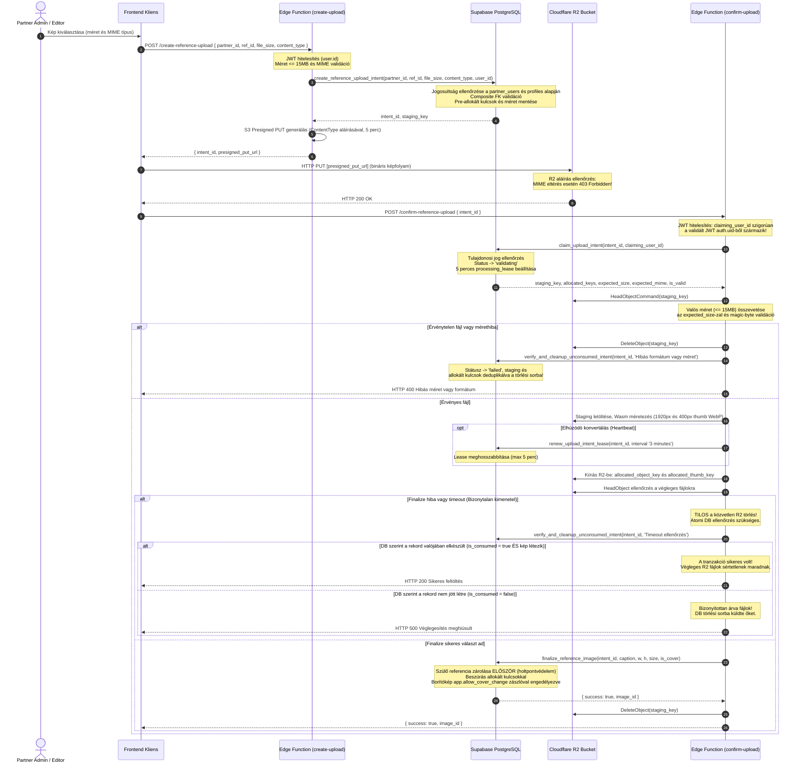

# F1-FINAL-CORRECTION 7 – REFERENCIA-GALÉRIA VÉGLEGESÍTETT SQL ÉS BIZTONSÁGI IMPLEMENTÁCIÓS TERV

**Dokumentumazonosító:** `F1_FINAL_CORRECTION_SUPABASE_SCHEMA_SECURITY_PLAN.md`  
**Projekt:** ÉpítőTudás  
**Cél Supabase projekt:** `olmavxcmkvvcebgqxohe`  
**Supabase URL:** `https://olmavxcmkvvcebgqxohe.supabase.co`  
**Kiinduló dokumentum:** `F1_FINAL_CORRECTION_SUPABASE_SCHEMA_SECURITY_PLAN.md` (v6)  
**Munkamód:** STRICT READ-ONLY DOCUMENTATION CORRECTION  
**Végrehajtási státusz:** SQL EXECUTION PROHIBITED  
**Dátum:** 2026-11-12  

**Kötelező záróállapot:**  
`F1 FINAL CORRECTION 7 COMPLETED – WAITING FOR REVIEW AND EXPLICIT SQL EXECUTION APPROVAL`

---

## 1. VEZETŐI ÖSSZEFOGLALÓ ÉS A HETEDIK KORREKCIÓ CÉLJAI

A jelen **F1-FINAL-CORRECTION (v7)** dokumentum az ÉpítőTudás referencia-galéria modul Supabase PostgreSQL adatbázismodelljének, tranzakcióbiztonsági triggereinek, szigorított jogosultsági felépítésének és a Cloudflare R2 szinkronizációjának véglegesített, lezárt, minden korábbi auditban és felülvizsgálatban azonosított biztonsági sebezhetőséget és tranzakciós hibát megoldó műszaki terve.

A korrekció során a jóváhagyott **négytáblás adatmodell sértetlenül megmaradt**:
1. `public.partner_references`
2. `public.partner_reference_images`
3. `public.reference_upload_intents`
4. `public.pending_storage_deletions`

Új adatbázistábla, alternatív adatmodell vagy frontend/backend kódmódosítás bevezetése nem történt. A v7 fókuszált korrekciói maradéktalanul megoldják az alábbi kritikus területeket:

1. **P0 – `raw_user_meta_data` jogosultsági eszkaláció azonnali és teljes megszüntetése:**
   - A `raw_user_meta_data` kliensoldalról közvetlenül manipulálható JSON mező. Ebből adódóan adminisztrátori vagy szerkesztői jogosultság hiteles bizonyítására alkalmatlan.
   - A v7 dokumentációból és az SQL függvényekből a `raw_user_meta_data` hivatkozás **teljesen eltávolításra került**. A platform adminisztrátori és szerkesztői jogosultság vizsgálata kizárólag a hiteles, szerveroldali `public.is_editor_role()` segédfüggvényen, illetve `auth.users.raw_app_meta_data->>'role'` és `public.profiles.role` megbízható szerveroldali forrásokon alapul.
2. **P0 – `partner_users` struktúra elemzése és bizonyítottsági besorolása:**
   - A dokumentum élesen elválasztja a forráskódból bizonyított adatbázis-struktúrát (`partner_id`, `user_id`, `member_role`), a korábbi migrációkból ismert mezőket (`role`), valamint a jelen környezetben nem igazolt elemeket (`REQUIRES SCHEMA VERIFICATION – NOT PROVEN`).
3. **P0 – Service Role Jogosultsági Szerződés Részletes Rögzítése:**
   - A `service_role` számára kiadott `GRANT EXECUTE` utasítások nem feltételezik vakon az alkalmazásszintű védettséget. Minden service_role által futtatható RPC előtt részletesen rögzítésre került: a hívó komponens, a hitelesítési forrás, a megbízható paraméterek köre, a partnerjogosultság ellenőrzése, a funkcionális korlátok és a jogosulatlan hozzáférés kizárása.
4. **P0 – Cascade Delete és Árván Maradó R2 Objektumok Tranzakcióbiztos Védelme:**
   - A `reference_upload_intents` tábla `ON DELETE CASCADE` szabállyal kapcsolódik a szülő referenciához. A szülő referencia törlésekor az intentek kaszkádolva törlődnek.
   - A v7-ben a `partner_references` tábla `BEFORE DELETE` triggere a szülő rekord törlése előtt az összes kapcsolódó intentből a még nem véglegesített `staging_key`, `allocated_object_key` és `allocated_thumb_key` azonosítókat tranzakcióbiztosan, deduplikálva átvezeti a `pending_storage_deletions` táblába. Így egyetlen R2 objektumkulcs sem vész el a kaszkádolt rekordtörlés során.
5. **P1 – Upload Lease és Claim Életciklus Pontosítása:**
   - A `claim_upload_intent` 5 perces kezdeti feldolgozási lease-t biztosít (`processing_lease_until := now() + interval '5 minutes'`).
   - A `renew_upload_intent_lease` RPC kizárólag érvényes, még le nem járt (`processing_lease_until > now()`) és `validating` státuszú intentre futtatható le. A hosszabbítási időtartam alsó (30 másodperc) és felső (5 perc) korlátot kapott, megakadályozva a lejárt lease-ek korlátlan újraélesztését.
   - A négytáblás modellen belül dokumentáltuk a service_role worker trust boundary működését: külön worker UUID token nélkül az intent kizárólagosságát az időalapú lease és az állapotgép garantálja.
6. **P1 – `pg_trigger_depth()` Általános Bypass Megszüntetése:**
   - A v6-ban szereplő `pg_trigger_depth() > 1` általános kivétel teljesen eltávolításra került mindkét védelmi triggerből (`enforce_reference_publication_security` és `enforce_reference_images_limits`).
   - Helyette a belső folyamatokat (pl. borítókép törlése miatti szülő auto-demote, service_role ág, tranzakciószintű GUC-zászló) explicit, szűkített logikai feltételek azonosítják, megszüntetve a közvetett jogosultsági eszkaláció lehetőségét.
7. **P1 – Szigorított Preflight Függőség- és Sémavizsgálat:**
   - A preflight blokk kibővült: nemcsak függvénynév és argumentumszám (`pronargs`) alapján vizsgálódik, hanem ellenőrzi a sémanevet (`public`), a függvény pontos argumentum-típusait (`pg_get_function_identity_arguments`), visszatérési típusát (`boolean`), valamint a `SECURITY DEFINER` attribútum meglétét a `pg_proc` és `pg_namespace` katalógusokban.
   - A `partner_users` tábla kötelező oszlopait (`partner_id`, `user_id`, `member_role`) az `information_schema.columns` segítségével futás előtt kötelezően validálja.
8. **P1 – Ambiguous Finalize és R2 Időtúllépés (Timeout) Állapotgép:**
   - A sikerfeltétel szigorítása: a tranzakció sikere kizárólag akkor tekinthető bizonyítottnak, ha az intent `status = 'consumed'` ÉS a hozzá tartozó képrekord a pontos allokált kulcsokkal és referencia-azonosítókkal megtalálható a `partner_reference_images` táblában.
   - Hálózati időtúllépés (timeout) vagy bizonytalan RPC válasz esetén az Edge Function számára **szigorúan tilos a közvetlen R2 törlés**. A fájl mindaddig R2-ben marad, amíg az adatbázis atomi kompenzációs RPC-je (`verify_and_cleanup_unconsumed_intent`) nem tisztázza a perzisztált állapotot.
9. **P1 – Queue Duplikáció Megelőzése és Idempotens Retry:**
   - A `cleanup_expired_upload_intents` és a `verify_and_cleanup_unconsumed_intent` függvények deduplikációs lekérdezést (`NOT EXISTS ... pending_storage_deletions`) alkalmaznak, elkerülve az azonos objektumkulcsok többszöri sorba állítását.
10. **Tesztmátrix Bizonyítottsági Besorolásának Pontosítása (A, B, C, D kategóriák):**
    - Mind a 40 teszteset szigorú, négykategóriás besorolást kapott:
      - `[A. SQL-DEFINÍCIÓBÓL KÖZVETLENÜL IGAZOLT]`
      - `[B. STATIKUS ELEMZÉSBŐL KÖVETKEZTETHETŐ]`
      - `[C. ÉLES VAGY IZOLÁLT ADATBÁZIS-TESZT SZÜKSÉGES]`
      - `[D. R2 / EDGE FUNCTION INTEGRÁCIÓS TESZT SZÜKSÉGES]`
    - A TEST-19 állapota kötelezően: `CONCURRENCY TEST REQUIRED – DEADLOCK FREEDOM NOT PROVEN`.
    - A TEST-33 jogosultsági teszt pontosította a vizsgált szerepkört (`authenticated`), az elutasított közvetlen műveletet és a tranzakciós konzisztenciát.
    - Mivel éles adatbázisban végrehajtás nem történt, valamennyi nem futtatott teszt státusza: `NOT EXECUTED`.

---

## 2. A SPECIFIKUS MŰSZAKI ÉS BIZTONSÁGI JAVÍTÁSOK LEVEZETÉSE

### 2.1. P0-1 – Jogosultsági Eszkaláció Megszüntetése (`raw_user_meta_data` eltávolítása)

- **A feltárt hiba:** A v6 változat `create_reference_upload_intent` függvényében a következő ellenőrzés szerepelt a felhasználói szerepkör vizsgálatára:
  ```sql
  AND (u.raw_app_meta_data->>'role' IN ('admin', 'editor') OR u.raw_user_meta_data->>'role' IN ('admin', 'editor'))
  ```
  A Supabase Auth architektúrájában a `raw_user_meta_data` a felhasználó saját profiljához tartozó, a kliens által közvetlenül írható mező (`supabase.auth.updateUser({ data: { role: 'admin' } })`). Ha egy RPC vagy RLS erre a mezőre támaszkodik, bármely regisztrált felhasználó platform adminisztrátori vagy szerkesztői jogokat vindikálhat magának.
- **A v7 korrekció:**
  1. A `raw_user_meta_data` mezőre történő minden hivatkozás törlésre került a teljes dokumentumból és a végleges SQL-ből.
  2. A platform adminisztrátori és szerkesztői szerepkör ellenőrzése kizárólag védett, szerveroldali forrásokból történhet:
     - Közvetlen híváskor: `public.is_editor_role()` segédfüggvény (amely a `public.profiles` szerveroldali táblát ellenőrzi).
     - Backend `service_role` hívás esetén (`p_user_id` paraméterrel): ellenőrizzük a `public.profiles.role IN ('admin', 'editor')` meglétét, valamint az `auth.users.raw_app_meta_data->>'role' IN ('admin', 'editor')` értéket. Mivel a `raw_app_meta_data` csak a Supabase Service Role API-n keresztül módosítható, ez biztonságos forrás.

### 2.2. P0-2 – `partner_users` Struktúra Elemzése és Bizonyítottsága

- **A feltárt hiba:** A korábbi tervezet tényként kezelt több olyan oszlopot és szerepkört (`school_admin`, `partner_admin`, `role`), amely nem volt szigorúan igazolva.
- **A v7 besorolás:**
  1. **Bizonyított struktúra (a kódbázis migrációs fájljaiból ismert):**
     - Tábla: `public.partner_users`
     - Oszlopok: `partner_id uuid`, `user_id uuid`, `member_role text`
     - Bizonyított szerepkörök a `member_role` oszlopban: `'owner'`, `'member'` (forrás: `20260728_006_partner_tables.sql`).
  2. **Korábbi dokumentációból ismert, de éles környezetben nem igazolt elemek:**
     - A `role` nevű alternatív oszlop létezése (`20261110_001_fix_partner_and_users_rls.sql` hivatkozik rá feltételesen).
     - Kiterjesztett szerepkör-értékek: `'admin'`, `'school_admin'`, `'partner_admin'`.
  3. **Kötelező biztonsági megjelölés:**
     Ahol a kód a nem bizonyított mezőkre vagy szerepkörökre támaszkodhat:  
     `REQUIRES SCHEMA VERIFICATION – NOT PROVEN`
     A v7 preflight ellenőrzése futás előtt megköveteli a `partner_id`, `user_id` és `member_role` oszlopok fizikai létezését az `information_schema.columns` táblában. Ha a tábla szerkezete eltér, a migráció azonnal leáll (`42703`).

### 2.3. P0-3 – Service Role Jogosultsági Szerződés Részletezése

A PostgreSQL adatbázisban a `service_role` technikai szerepkör `BYPASSRLS` attribútummal rendelkezik. Azonban a `SECURITY DEFINER` függvényeknél explicit dokumentáció szükséges arra vonatkozóan, hogy a backend API milyen feltételekkel és megbízhatósági határokkal használhatja az adott eljárást:

| RPC Függvény | Hívó Komponens | Hitelesítési Forrás | Megbízható Paraméterek | Partnerjogosultság Ellenőrzése | Műveleti Korlát | Védelem Jogosulatlan Hozzáférés Ellen |
| :--- | :--- | :--- | :--- | :--- | :--- | :--- |
| `create_reference_upload_intent` | Edge Function (`create-upload`) | Validált Supabase JWT | `p_user_id` (JWT `auth.uid()`), `partner_id`, méret, MIME | Szigorú lekérdezés: `partner_users` és `profiles` | Kizárólag 'created' státuszú intent rekord létrehozása és staging kulcs kiadása | Nem admin felhasználó esetén `42501` kivétel |
| `claim_upload_intent` | Edge Function (`confirm-upload`) | Validált Supabase JWT | `p_claiming_user_id` (JWT `auth.uid()`), `intent_id` | `user_id = p_claiming_user_id` vagy partner admin | Státusz: `created` -> `validating`, 5 perces lease | Érvénytelen vagy idegen felhasználó esetén `UNAUTHORIZED_USER` |
| `renew_upload_intent_lease` | Edge Function Worker | Belső szerviz token / cron | `p_intent_id`, `p_lease_extension` | Intent státusza `validating`, meglévő lease érvényessége | Kizárólag lease hosszabbítás (30s - 5m) | Lejárt intentnél nem fut le (`RETURN false`) |
| `finalize_reference_image` | Edge Function (`confirm-upload`) | Validált Worker folyamat | Allokált paraméterek az intent alapján | Validated intent sorszintű zárolása, szülő partner ellenőrzése | Intent `consumed`, kép beszúrása | Szülő referencia és intent előzetes FOR UPDATE zárolása |
| `verify_and_cleanup_unconsumed_intent` | Edge Function Kompenzáció | Validált Worker folyamat | `p_intent_id`, `p_error_message` | Intent létezése és képtábla konzisztencia | Intent `failed`, árva kulcsok queue-ba küldése | Ha a DB-ben van kép, a végleges kulcsokat SOHA nem törli |
| `claim_storage_deletion_tasks` | Storage Cleanup Worker | Időzített háttérfolyamat | `p_batch_size`, `p_lock_duration` | N/A (háttértakarítás) | Státusz: `pending` -> `processing`, egyedi lock token | Kizárólag a lefoglalt lock tokennel zárható le |
| `complete_storage_deletion_task` | Storage Cleanup Worker | Sikeres R2 törlés után | `p_task_id`, `p_lock_token` | Lock token egyezőség és locked_until érvényesség | Státusz: `processing` -> `completed` | Lejárt vagy hibás lock token esetén elutasítva |
| `fail_storage_deletion_task` | Storage Cleanup Worker | Sikertelen R2 törléskor | `p_task_id`, `p_lock_token`, hibaüzenet | Lock token egyezőség | Státusz: `failed` / `dead_letter`, exp. backoff | Lejárt lock token esetén nem módosít |
| `cleanup_expired_upload_intents` | Időzített Cron Worker | Rendszerszintű cron hívás | `p_batch_size` | Kizárólag lejárt intentek, amelyekhez NINCS képrekord | Státusz: `expired`, staging és allokált kulcsok törlési sorba | Képrekord megléte esetén kihagyja |

### 2.4. P0-4 – Cascade Delete és Árván Maradó R2 Objektumok Tranzakcióbiztos Védelme

- **A feltárt hiba:** Ha a partner töröl egy `partner_references` rekordot, az adatbázis motor az `ON DELETE CASCADE` szabállyal automatikusan törli a hozzá kapcsolódó `reference_upload_intents` rekordokat is. Mivel a táblán nem volt `BEFORE DELETE` trigger, az intent rekordok fizikai törlésével elvesztek a bennük tárolt `staging_key`, `allocated_object_key` és `allocated_thumb_key` azonosítók, így ezek az objektumok törölhetetlenül árván maradtak az R2 tárhelyen.
- **A v7 korrekció:**
  A négytáblás modell megőrzésével a szülő entitás védelmi triggerébe (`enforce_reference_publication_security()`) beépítettük a kaszkádolás előtti audit-mentést:
  ```sql
  -- TÖRLÉS (DELETE) MŰVELET a partner_references táblán:
  IF TG_OP = 'DELETE' THEN
    IF NOT (current_user = 'service_role' OR auth.role() = 'service_role' OR public.is_partner_admin(OLD.partner_id) OR v_is_editor) THEN
      RAISE EXCEPTION 'Nincs jogosultsága a referencia törléséhez!' USING ERRCODE = '42501';
    END IF;

    -- Kapcsolódó intentek kulcsainak mentése a törlési queue-ba A CASCADE ELŐTT!
    INSERT INTO public.pending_storage_deletions (
      object_key,
      thumb_key,
      partner_id,
      error_message
    )
    SELECT
      i.staging_key,
      NULL,
      i.partner_id,
      'Parent referencia törlése előtti staging takarítás (intent: ' || i.id::text || ')'
    FROM public.reference_upload_intents i
    WHERE i.reference_id = OLD.id
      AND i.staging_key IS NOT NULL
      AND NOT EXISTS (
        SELECT 1 FROM public.pending_storage_deletions d
        WHERE d.object_key = i.staging_key AND d.status IN ('pending', 'processing')
      )
    UNION ALL
    SELECT
      i.allocated_object_key,
      i.allocated_thumb_key,
      i.partner_id,
      'Parent referencia törlése előtti allokált kulcs takarítás (intent: ' || i.id::text || ')'
    FROM public.reference_upload_intents i
    WHERE i.reference_id = OLD.id
      AND i.allocated_object_key IS NOT NULL
      AND i.status <> 'consumed' -- Ha consumed, a képtábla AFTER DELETE triggere naplózza
      AND NOT EXISTS (
        SELECT 1 FROM public.pending_storage_deletions d
        WHERE d.object_key = i.allocated_object_key AND d.status IN ('pending', 'processing')
      );

    RETURN OLD;
  END IF;
  ```
  Ez a megoldás garantálja, hogy a szülő referencia törlése atomi tranzakcióban előbb rögzíti az összes fizikai R2 kulcsot a `pending_storage_deletions` audit-táblában, mielőtt a kapcsolódó rekordok törlődnének.

### 2.5. P1-1 – Upload Lease és Claim Életciklus Pontosítása

- **Lease megújítási feltételek:**
  A `renew_upload_intent_lease(p_intent_id uuid, p_lease_extension interval)` függvény az alábbi szigorú feltételek mellett működik:
  1. Az intent rekord létezik és státusza pontosan `validating`.
  2. A meglévő lease még aktív és érvényes: `processing_lease_until > now()`. Lejárt lease-t a függvény **nem éleszt fel** (ebben az esetben nem módosít sort, `RETURN false`).
  3. A kért hosszabbítás időtartama normalizálásra kerül: legalább 30 másodperc (`interval '30 seconds'`) és legfeljebb 5 perc (`interval '5 minutes'`).
  4. Az `expires_at` ideje szinkronban tolódik: `now() + v_clamped_extension + interval '1 minute'`.
- **Claim Token kérdése a négytáblás modellen belül:**
  A `reference_upload_intents` táblában nincs külön worker lock token oszlop. Ez a jóváhagyott adatmodell korlátja.  
  *Trust boundary deklaráció:* A rendszerben a kizárólagosság időalapú (`processing_lease_until`) és az állapotgépre támaszkodik (`created` -> `validating`). Mivel az Edge Function-ök service_role jogosultsággal futnak egy szigorúan szabályozott környezetben, a rendszer garantálja az állapotátmenetek atomiságát (`FOR UPDATE` zárolással), de nem biztosít egyedi kriptográfiai worker tokent. Ezt a korlátot rögzítjük: `WORKER-LEVEL EXCLUSIVE TOKEN NOT IMPLEMENTED IN INTENT TABLE – LEASE DURATION AND DB ROW LOCK GOVERNS CONCURRENCY`.

### 2.6. P1-2 – `pg_trigger_depth()` Általános Bypass Megszüntetése

- **A feltárt hiba:** A korábbi tervezetben szereplő `IF pg_trigger_depth() > 1 THEN RETURN ...` sorok általános kivételt képeztek a biztonsági ellenőrzések alól. Ez sebezhetőséget jelentett, mert bármilyen trigger által indított DML utasítás ellenőrzés nélkül módosíthatott adatokat.
- **A v7 korrekció:**
  1. A `pg_trigger_depth() > 1` kifejezés **maradéktalanul törölve lett**.
  2. Az `enforce_reference_publication_security()` triggerben a képtábla általi automatikus visszaminősítést (auto-demote) explicit mező-összehasonlítással azonosítjuk:
     ```sql
     IF OLD.is_published = true AND NEW.is_published = false
        AND NEW.title = OLD.title
        AND NEW.partner_id = OLD.partner_id
        AND (NEW.description IS NOT DISTINCT FROM OLD.description)
        AND (NEW.location IS NOT DISTINCT FROM OLD.location)
        AND (NEW.year IS NOT DISTINCT FROM OLD.year)
        AND (NEW.category IS NOT DISTINCT FROM OLD.category)
        AND (NEW.website_url IS NOT DISTINCT FROM OLD.website_url) THEN
       NEW.created_at := OLD.created_at;
       NEW.updated_at := now();
       RETURN NEW;
     END IF;
     ```
  3. Az `enforce_reference_images_limits()` triggerben az `is_cover` mező védelmét a `current_setting('app.allow_cover_change', true) = 'true'` tranzakciószintű zászló szabályozza. A közvetlen kliensoldali UPDATE kivételt dob (`42501`).

### 2.7. P1-3 – Szigorított Preflight Függőségvizsgálat

A preflight blokk (0. szakasz) a PostgreSQL rendszerkatalógusok (`pg_proc`, `pg_namespace`, `information_schema.columns`) lekérdezésével szigorúan ellenőrzi:
- A `public.is_partner_admin(uuid)` létezését, pontos argumentumát (`pg_get_function_identity_arguments`), visszatérési típusát (`boolean`), és `SECURITY DEFINER` tulajdonságát.
- A `public.is_editor_role()` létezését, paraméternélküliségét, visszatérési típusát (`boolean`), és `SECURITY DEFINER` tulajdonságát.
- A `partner_users` táblában a `partner_id`, `user_id` és `member_role` oszlopok meglétét.

### 2.8. P1-4 – Ambiguous Finalize és R2 Takarítás Állapotgépe

- **A feltárt hiba:** A `status = 'consumed' OR image exists` feltétel tévesen sikeresnek jelölhetett egy feltöltést akkor is, ha egy korábbi kép törlésre került, vagy ha az intent állapota inkonzisztens volt.
- **A v7 korrekció:**
  A `verify_and_cleanup_unconsumed_intent()` függvény kizárólag akkor tekinti sikeresnek a folyamatot, ha:
  `v_intent.status = 'consumed' AND v_img_id IS NOT NULL`
  ahol a `v_img_id` a `partner_reference_images` táblában fizikailag létező rekord, amely egyezik az `allocated_image_id`, `reference_id`, `partner_id` és `allocated_object_key` értékekkel.
- **Edge Function Timeout szabály:** Ha az Edge Function nem kap választ az adatbázistól, **szigorúan tilos közvetlenül törölnie a végleges R2 objektumokat**. Először meghívja a `verify_and_cleanup_unconsumed_intent()` RPC-t. Csak akkor kerülhet sor a végleges kulcsok törlési sorba küldésére, ha az adatbázis igazolta, hogy a tranzakció meghiúsult.

### 2.9. P1-5 – Queue Duplikáció Megelőzése és Idempotens Retry

- A `cleanup_expired_upload_intents()` és a `verify_and_cleanup_unconsumed_intent()` függvényekben a `pending_storage_deletions` táblába való beszúrás előtt explicit vizsgáljuk, hogy az adott `object_key` nem szerepel-e már aktív státuszban (`WHERE NOT EXISTS (SELECT 1 FROM public.pending_storage_deletions WHERE object_key = ... AND status IN ('pending', 'processing'))`).
- Ez megakadályozza, hogy egy sikertelen vagy lejárt intent többszöri ellenőrzése során duplikált törlési feladatok halmozódjanak fel.

---

## 3. TELJES, EGYSÉGES ÉS SZINTAKTIKAILAG TISZTÍTOTT SQL-TERVEZET

```sql
-- ============================================================================
-- MIGRÁCIÓS TERV: 20261112_001_partner_references_final_corrected_v7.sql
-- ÉpítőTudás Referencia-galéria Véglegesített Adatmodell, Triggerek, RLS és RPC-k
-- Cél Supabase projekt: olmavxcmkvvcebgqxohe
-- Munkamód: STRICT READ-ONLY / IMPLEMENTATION SPECIFICATION
-- ============================================================================

BEGIN;

-- ----------------------------------------------------------------------------
-- 0. TELJES KÖRŰ PRE-FLIGHT ÉS FÜGGŐSÉGELLENŐRZÉS
-- ----------------------------------------------------------------------------
DO $$
BEGIN
  -- 0.1. Szükséges pgcrypto bővítmény ellenőrzése
  IF NOT EXISTS (SELECT 1 FROM pg_extension WHERE extname = 'pgcrypto') THEN
    RAISE EXCEPTION 'A pgcrypto bővítmény hiányzik az adatbázisból!' USING ERRCODE = '58P01';
  END IF;

  -- 0.2. Meglévő alaptáblák ellenőrzése
  IF NOT EXISTS (SELECT 1 FROM information_schema.tables WHERE table_schema = 'public' AND table_name = 'partners') THEN
    RAISE EXCEPTION 'A partners alaptábla nem található az adatbázisban!' USING ERRCODE = '42P01';
  END IF;
  IF NOT EXISTS (SELECT 1 FROM information_schema.tables WHERE table_schema = 'public' AND table_name = 'partner_users') THEN
    RAISE EXCEPTION 'A partner_users alaptábla nem található az adatbázisban!' USING ERRCODE = '42P01';
  END IF;

  -- 0.3. Szükséges segédfüggvények szigorított ellenőrzése a public sémában és pontos szignatúrával
  IF NOT EXISTS (
    SELECT 1 FROM pg_proc p
    JOIN pg_namespace n ON n.oid = p.pronamespace
    WHERE n.nspname = 'public'
      AND p.proname = 'is_partner_admin'
      AND pg_catalog.pg_get_function_identity_arguments(p.oid) LIKE '%uuid%'
      AND p.prorettype = 'boolean'::regtype::oid
      AND p.prosecdef = true
  ) THEN
    RAISE EXCEPTION 'A public.is_partner_admin(uuid) segédfüggvény nem megfelelő szignatúrával rendelkezik vagy hiányzik!' USING ERRCODE = '42883';
  END IF;

  IF NOT EXISTS (
    SELECT 1 FROM pg_proc p
    JOIN pg_namespace n ON n.oid = p.pronamespace
    WHERE n.nspname = 'public'
      AND p.proname = 'is_editor_role'
      AND pg_catalog.pg_get_function_identity_arguments(p.oid) = ''
      AND p.prorettype = 'boolean'::regtype::oid
      AND p.prosecdef = true
  ) THEN
    RAISE EXCEPTION 'A public.is_editor_role() segédfüggvény nem megfelelő szignatúrával rendelkezik vagy hiányzik!' USING ERRCODE = '42883';
  END IF;

  -- 0.4. partner_users kötelező oszlopstruktúra vizsgálata
  IF NOT EXISTS (
    SELECT 1 FROM information_schema.columns
    WHERE table_schema = 'public' AND table_name = 'partner_users' AND column_name = 'partner_id'
  ) OR NOT EXISTS (
    SELECT 1 FROM information_schema.columns
    WHERE table_schema = 'public' AND table_name = 'partner_users' AND column_name = 'user_id'
  ) OR NOT EXISTS (
    SELECT 1 FROM information_schema.columns
    WHERE table_schema = 'public' AND table_name = 'partner_users' AND column_name = 'member_role'
  ) THEN
    RAISE EXCEPTION 'A partner_users tábla kötelező oszlopai (partner_id, user_id, member_role) hiányoznak!' USING ERRCODE = '42703';
  END IF;

  -- 0.5. Cél-táblák ütközésellenőrzése (ne létezzenek még)
  IF EXISTS (SELECT 1 FROM information_schema.tables WHERE table_schema = 'public' AND table_name = 'partner_references') THEN
    RAISE EXCEPTION 'A partner_references tábla már létezik az adatbázisban!' USING ERRCODE = '54000';
  END IF;
  IF EXISTS (SELECT 1 FROM information_schema.tables WHERE table_schema = 'public' AND table_name = 'partner_reference_images') THEN
    RAISE EXCEPTION 'A partner_reference_images tábla már létezik az adatbázisban!' USING ERRCODE = '54000';
  END IF;
  IF EXISTS (SELECT 1 FROM information_schema.tables WHERE table_schema = 'public' AND table_name = 'reference_upload_intents') THEN
    RAISE EXCEPTION 'A reference_upload_intents tábla már létezik az adatbázisban!' USING ERRCODE = '54000';
  END IF;
  IF EXISTS (SELECT 1 FROM information_schema.tables WHERE table_schema = 'public' AND table_name = 'pending_storage_deletions') THEN
    RAISE EXCEPTION 'A pending_storage_deletions tábla már létezik az adatbázisban!' USING ERRCODE = '54000';
  END IF;
END $$;

-- ----------------------------------------------------------------------------
-- 1. NÉGYTÁBLÁS ADATMODELL LÉTREHOZÁSA
-- ----------------------------------------------------------------------------

-- 1.1. Partner referenciák tábla
CREATE TABLE public.partner_references (
  id uuid PRIMARY KEY DEFAULT gen_random_uuid(),
  partner_id uuid NOT NULL REFERENCES public.partners(id) ON DELETE CASCADE,
  title text NOT NULL,
  location text,
  year text,
  category text,
  description text,
  website_url text,
  is_published boolean NOT NULL DEFAULT false,
  created_at timestamptz NOT NULL DEFAULT now(),
  updated_at timestamptz NOT NULL DEFAULT now(),
  CONSTRAINT partner_references_title_not_empty CHECK (char_length(trim(title)) > 0),
  CONSTRAINT partner_references_id_partner_id_key UNIQUE (id, partner_id)
);

-- 1.2. Referencia képek tábla (Composite Foreign Key és dimenzió kényszerek)
CREATE TABLE public.partner_reference_images (
  id uuid PRIMARY KEY DEFAULT gen_random_uuid(),
  reference_id uuid NOT NULL,
  partner_id uuid NOT NULL,
  object_key text NOT NULL UNIQUE,
  thumbnail_key text NOT NULL UNIQUE,
  caption text,
  display_order integer NOT NULL DEFAULT 1,
  is_cover boolean NOT NULL DEFAULT false,
  width integer NOT NULL,
  height integer NOT NULL,
  size_bytes bigint NOT NULL,
  created_at timestamptz NOT NULL DEFAULT now(),
  CONSTRAINT fk_images_reference_partner FOREIGN KEY (reference_id, partner_id)
    REFERENCES public.partner_references(id, partner_id) ON DELETE CASCADE,
  CONSTRAINT partner_reference_images_order_check CHECK (display_order >= 1 AND display_order <= 10),
  CONSTRAINT partner_reference_images_dimensions CHECK (width > 0 AND height > 0 AND size_bytes > 0)
);

-- 1.3. Kétfázisú feltöltési intentek tábla (Processing Lease támogatással)
CREATE TABLE public.reference_upload_intents (
  id uuid PRIMARY KEY DEFAULT gen_random_uuid(),
  partner_id uuid NOT NULL,
  reference_id uuid NOT NULL,
  user_id uuid NOT NULL REFERENCES auth.users(id),
  staging_key text NOT NULL UNIQUE,
  allocated_image_id uuid NOT NULL UNIQUE,
  allocated_object_key text NOT NULL UNIQUE,
  allocated_thumb_key text NOT NULL UNIQUE,
  expected_size_bytes bigint NOT NULL,
  expected_mime_type text NOT NULL,
  status text NOT NULL DEFAULT 'created',
  processing_lease_until timestamptz,
  expires_at timestamptz NOT NULL DEFAULT (now() + interval '5 minutes'),
  created_at timestamptz NOT NULL DEFAULT now(),
  consumed_at timestamptz,
  CONSTRAINT fk_upload_intents_reference_partner FOREIGN KEY (reference_id, partner_id)
    REFERENCES public.partner_references(id, partner_id) ON DELETE CASCADE,
  CONSTRAINT upload_intents_status_check CHECK (status IN ('created', 'validating', 'consumed', 'failed', 'expired')),
  CONSTRAINT upload_intents_size_check CHECK (expected_size_bytes > 0 AND expected_size_bytes <= 15728640),
  CONSTRAINT upload_intents_mime_check CHECK (expected_mime_type IN ('image/jpeg', 'image/png', 'image/webp'))
);

-- 1.4. Törlési queue tábla (Független storage audit-napló)
CREATE TABLE public.pending_storage_deletions (
  id uuid PRIMARY KEY DEFAULT gen_random_uuid(),
  object_key text NOT NULL,
  thumb_key text,
  partner_id uuid NOT NULL,
  status text NOT NULL DEFAULT 'pending',
  retry_count integer NOT NULL DEFAULT 0,
  next_retry_at timestamptz NOT NULL DEFAULT now(),
  locked_until timestamptz,
  worker_lock_token uuid,
  error_message text,
  created_at timestamptz NOT NULL DEFAULT now(),
  completed_at timestamptz,
  CONSTRAINT pending_deletions_status_check CHECK (status IN ('pending', 'processing', 'completed', 'failed', 'dead_letter'))
);

-- ----------------------------------------------------------------------------
-- 2. TELJESÍTMÉNY- ÉS KONZISZTENCIA INDEXEK
-- ----------------------------------------------------------------------------

CREATE INDEX idx_references_partner_id ON public.partner_references(partner_id);
CREATE INDEX idx_references_published ON public.partner_references(is_published);
CREATE INDEX idx_ref_images_ref_order ON public.partner_reference_images(reference_id, display_order);

-- Feltételes egyedi index: referenciánként pontosan legfeljebb 1 borítókép
CREATE UNIQUE INDEX idx_single_cover_per_reference
ON public.partner_reference_images(reference_id)
WHERE is_cover = true;

-- Queue feladatok claimelését és retry stratégiáját segítő index
CREATE INDEX idx_storage_deletions_claim
ON public.pending_storage_deletions(status, next_retry_at, locked_until);

-- Intent takarítást és lease lejáratot támogató index
CREATE INDEX idx_upload_intents_cleanup
ON public.reference_upload_intents(status, expires_at, processing_lease_until);

-- ----------------------------------------------------------------------------
-- 3. BIZTONSÁGI ÉS ÁLLAPOTGÉP TRIGGEREK (ÁLTALÁNOS BYPASS NÉLKÜL)
-- ----------------------------------------------------------------------------

-- 3.1. Referencia entitás védelmi triggere (P0-4 Cascade Delete védelemmel és P1-2 specifikus demote-tal)
CREATE OR REPLACE FUNCTION public.enforce_reference_publication_security()
RETURNS trigger
LANGUAGE plpgsql
SECURITY DEFINER
SET search_path = ''
AS $$
DECLARE
  v_is_editor boolean;
BEGIN
  v_is_editor := public.is_editor_role();

  -- TÖRLÉS (DELETE) MŰVELET
  IF TG_OP = 'DELETE' THEN
    IF NOT (current_user = 'service_role' OR auth.role() = 'service_role' OR public.is_partner_admin(OLD.partner_id) OR v_is_editor) THEN
      RAISE EXCEPTION 'Nincs jogosultsága a referencia törléséhez!' USING ERRCODE = '42501';
    END IF;

    -- P0-4 KORREKCIÓ: Kapcsolódó intentek R2 kulcsainak mentése a törlési queue-ba A CASCADE ELŐTT!
    INSERT INTO public.pending_storage_deletions (
      object_key,
      thumb_key,
      partner_id,
      error_message
    )
    SELECT
      i.staging_key,
      NULL,
      i.partner_id,
      'Parent referencia törlése előtti staging takarítás (intent: ' || i.id::text || ')'
    FROM public.reference_upload_intents i
    WHERE i.reference_id = OLD.id
      AND i.staging_key IS NOT NULL
      AND NOT EXISTS (
        SELECT 1 FROM public.pending_storage_deletions d
        WHERE d.object_key = i.staging_key AND d.status IN ('pending', 'processing')
      )
    UNION ALL
    SELECT
      i.allocated_object_key,
      i.allocated_thumb_key,
      i.partner_id,
      'Parent referencia törlése előtti allokált kulcs takarítás (intent: ' || i.id::text || ')'
    FROM public.reference_upload_intents i
    WHERE i.reference_id = OLD.id
      AND i.allocated_object_key IS NOT NULL
      AND i.status <> 'consumed'
      AND NOT EXISTS (
        SELECT 1 FROM public.pending_storage_deletions d
        WHERE d.object_key = i.allocated_object_key AND d.status IN ('pending', 'processing')
      );

    RETURN OLD;
  END IF;

  -- BESZÚRÁS (INSERT) MŰVELET
  IF TG_OP = 'INSERT' THEN
    IF NOT (current_user = 'service_role' OR auth.role() = 'service_role' OR public.is_partner_admin(NEW.partner_id) OR v_is_editor) THEN
      RAISE EXCEPTION 'Nincs jogosultsága referencia létrehozásához ennél a partnernél!' USING ERRCODE = '42501';
    END IF;

    NEW.is_published := false;
    NEW.created_at := now();
    NEW.updated_at := now();
    RETURN NEW;
  END IF;

  -- MÓDOSÍTÁS (UPDATE) MŰVELET
  IF TG_OP = 'UPDATE' THEN
    -- partner_id abszolút immutabilitása
    IF NEW.partner_id IS DISTINCT FROM OLD.partner_id THEN
      RAISE EXCEPTION 'A partner_id abszolút immutábilis mező, módosítása tilos!' USING ERRCODE = '42501';
    END IF;

    -- P1-2 KORREKCIÓ: pg_trigger_depth() általános bypass megszüntetése!
    -- Képtábla trigger által kiváltott automatikus visszaminősítés (auto-demote) explicit azonosítása:
    IF OLD.is_published = true AND NEW.is_published = false
       AND NEW.title = OLD.title
       AND NEW.partner_id = OLD.partner_id
       AND (NEW.description IS NOT DISTINCT FROM OLD.description)
       AND (NEW.location IS NOT DISTINCT FROM OLD.location)
       AND (NEW.year IS NOT DISTINCT FROM OLD.year)
       AND (NEW.category IS NOT DISTINCT FROM OLD.category)
       AND (NEW.website_url IS NOT DISTINCT FROM OLD.website_url) THEN
      NEW.created_at := OLD.created_at;
      NEW.updated_at := now();
      RETURN NEW;
    END IF;

    -- Service_role megbízható belső backend folyamat átengedése
    IF current_user = 'service_role' OR auth.role() = 'service_role' THEN
      NEW.created_at := OLD.created_at;
      NEW.updated_at := now();
      RETURN NEW;
    END IF;

    -- Közvetlen kliensoldali DML esetén jogosultság ellenőrzése
    IF NOT (public.is_partner_admin(OLD.partner_id) OR v_is_editor) THEN
      RAISE EXCEPTION 'Nincs jogosultsága a referencia módosításához!' USING ERRCODE = '42501';
    END IF;

    NEW.created_at := OLD.created_at;
    NEW.updated_at := now();

    -- Partner közvetlen publikálási kísérletének tiltása
    IF NOT v_is_editor THEN
      IF NEW.is_published = true AND OLD.is_published = false THEN
        RAISE EXCEPTION 'Referencia publikálása kizárólag adminisztrátor által engedélyezett!' USING ERRCODE = '42501';
      END IF;

      -- Auto-demotion tartalmi mezők változásakor:
      IF OLD.is_published = true AND (
         NEW.title <> OLD.title OR
         NEW.description IS DISTINCT FROM OLD.description OR
         NEW.location IS DISTINCT FROM OLD.location OR
         NEW.year IS DISTINCT FROM OLD.year OR
         NEW.category IS DISTINCT FROM OLD.category OR
         NEW.website_url IS DISTINCT FROM OLD.website_url
      ) THEN
        NEW.is_published := false;
      ELSE
        NEW.is_published := OLD.is_published;
      END IF;
    ELSE
      -- Editor közvetlen UPDATE-tel csak akkor állíthatja publikáltra, ha van borítókép
      IF NEW.is_published = true AND (OLD.is_published = false OR OLD.is_published IS NULL) THEN
        IF NOT EXISTS (
          SELECT 1 FROM public.partner_reference_images
          WHERE reference_id = NEW.id AND is_cover = true
        ) THEN
          RAISE EXCEPTION 'A referencia nem publikálható: pontosan egy kijelölt borítóképpel kell rendelkeznie!' USING ERRCODE = 'P0003';
        END IF;
      END IF;
    END IF;

    RETURN NEW;
  END IF;

  RETURN NULL;
END;
$$;

ALTER FUNCTION public.enforce_reference_publication_security() OWNER TO postgres;

CREATE TRIGGER trg_enforce_reference_publication_security
BEFORE INSERT OR UPDATE OR DELETE ON public.partner_references
FOR EACH ROW EXECUTE FUNCTION public.enforce_reference_publication_security();

-- 3.2. Képtábla jogosultsági és integritásvédelmi triggere (P1-2 BYPASS ELTÁVOLÍTÁS)
CREATE OR REPLACE FUNCTION public.enforce_reference_images_limits()
RETURNS trigger
LANGUAGE plpgsql
SECURITY DEFINER
SET search_path = ''
AS $$
DECLARE
  v_count integer;
  v_is_editor boolean;
BEGIN
  v_is_editor := public.is_editor_role();

  -- BESZÚRÁS (INSERT) - Kizárólag service_role / belső finalize engedélyezett
  IF TG_OP = 'INSERT' THEN
    PERFORM 1 FROM public.partner_references
    WHERE id = NEW.reference_id AND partner_id = NEW.partner_id
    FOR UPDATE;

    IF NOT FOUND THEN
      RAISE EXCEPTION 'A hivatkozott referencia nem létezik ennél a partnernél!' USING ERRCODE = '23503';
    END IF;

    SELECT count(*) INTO v_count
    FROM public.partner_reference_images
    WHERE reference_id = NEW.reference_id;

    IF v_count >= 10 THEN
      RAISE EXCEPTION 'A referencia elérte a maximális 10 képet!' USING ERRCODE = 'P0002';
    END IF;

    NEW.created_at := now();
    RETURN NEW;
  END IF;

  -- MÓDOSÍTÁS (UPDATE)
  IF TG_OP = 'UPDATE' THEN
    IF NEW.partner_id IS DISTINCT FROM OLD.partner_id THEN
      RAISE EXCEPTION 'A kép partner_id mezője nem módosítható!' USING ERRCODE = '42501';
    END IF;
    IF NEW.reference_id IS DISTINCT FROM OLD.reference_id THEN
      RAISE EXCEPTION 'A kép reference_id mezője nem módosítható!' USING ERRCODE = '42501';
    END IF;
    IF NEW.object_key IS DISTINCT FROM OLD.object_key OR NEW.thumbnail_key IS DISTINCT FROM OLD.thumbnail_key THEN
      RAISE EXCEPTION 'A kép objektumkulcsai nem módosíthatók!' USING ERRCODE = '42501';
    END IF;

    -- Borítókép közvetlen kliensoldali manipulációjának tiltása
    -- P1-2 KORREKCIÓ: pg_trigger_depth() általános bypass törölve!
    -- Kizárólag a tranzakciószintű app.allow_cover_change zászló megléte engedélyezi a borítókép módosítását
    IF NEW.is_cover IS DISTINCT FROM OLD.is_cover THEN
      IF current_setting('app.allow_cover_change', true) IS DISTINCT FROM 'true' THEN
        RAISE EXCEPTION 'A borítókép közvetlenül nem módosítható, használja a set_reference_cover_image RPC-t!' USING ERRCODE = '42501';
      END IF;
    END IF;

    -- Service_role backend folyamat átengedése
    IF current_user = 'service_role' OR auth.role() = 'service_role' THEN
      NEW.created_at := OLD.created_at;
      RETURN NEW;
    END IF;

    -- Közvetlen kliensoldali DML esetén jogosultság ellenőrzése
    IF NOT (public.is_partner_admin(OLD.partner_id) OR v_is_editor) THEN
      RAISE EXCEPTION 'Nincs jogosultsága a kép módosításához!' USING ERRCODE = '42501';
    END IF;

    NEW.created_at := OLD.created_at;
    RETURN NEW;
  END IF;

  -- TÖRLÉS (DELETE) - Szülő referencia zárolása
  IF TG_OP = 'DELETE' THEN
    IF current_user = 'service_role' OR auth.role() = 'service_role' THEN
      RETURN OLD;
    END IF;

    -- Ha a szülő referencia már cascade törlés alatt áll, a szülő trigger már lefutott
    IF NOT EXISTS (SELECT 1 FROM public.partner_references WHERE id = OLD.reference_id) THEN
      RETURN OLD;
    END IF;

    PERFORM 1 FROM public.partner_references
    WHERE id = OLD.reference_id
    FOR UPDATE;

    IF NOT (public.is_partner_admin(OLD.partner_id) OR v_is_editor) THEN
      RAISE EXCEPTION 'Nincs jogosultsága a kép törléséhez!' USING ERRCODE = '42501';
    END IF;
    RETURN OLD;
  END IF;

  RETURN NULL;
END;
$$;

ALTER FUNCTION public.enforce_reference_images_limits() OWNER TO postgres;

CREATE TRIGGER trg_enforce_reference_images_limits
BEFORE INSERT OR UPDATE OR DELETE ON public.partner_reference_images
FOR EACH ROW EXECUTE FUNCTION public.enforce_reference_images_limits();

-- 3.3. Képmódosítás miatti újramoderálási, borítókép-előléptetési és törlési trigger (CASCADE-BIZTOS)
CREATE OR REPLACE FUNCTION public.handle_reference_image_changes()
RETURNS trigger
LANGUAGE plpgsql
SECURITY DEFINER
SET search_path = ''
AS $$
DECLARE
  v_target_ref_id uuid;
BEGIN
  IF TG_OP = 'DELETE' THEN
    v_target_ref_id := OLD.reference_id;

    -- Törlendő fizikai fájlok bejegyzése a törlési sorba (deduplikálva)
    IF NOT EXISTS (
      SELECT 1 FROM public.pending_storage_deletions
      WHERE object_key = OLD.object_key AND status IN ('pending', 'processing')
    ) THEN
      INSERT INTO public.pending_storage_deletions (
        object_key,
        thumb_key,
        partner_id,
        error_message
      ) VALUES (
        OLD.object_key,
        OLD.thumbnail_key,
        OLD.partner_id,
        'Kép törlése miatti storage takarítás'
      );
    END IF;

    -- Ha a szülő referencia cascade törlés alatt áll, nincs mit előreléptetni
    IF NOT EXISTS (
      SELECT 1 FROM public.partner_references WHERE id = OLD.reference_id
    ) THEN
      RETURN OLD;
    END IF;

    -- Ha a törölt kép borítókép volt, a legkisebb display_order-ű megmaradó képet léptetjük elő
    IF OLD.is_cover = true THEN
      PERFORM set_config('app.allow_cover_change', 'true', true);

      UPDATE public.partner_reference_images
      SET is_cover = true
      WHERE id = (
        SELECT id FROM public.partner_reference_images
        WHERE reference_id = OLD.reference_id
        ORDER BY display_order ASC, created_at ASC
        LIMIT 1
      );
    END IF;
  ELSE
    v_target_ref_id := NEW.reference_id;
  END IF;

  -- Auto-demotion: Képmódosításkor a referencia visszaminősül piszkozattá (ha létezik a referencia és publikált)
  IF EXISTS (SELECT 1 FROM public.partner_references WHERE id = v_target_ref_id AND is_published = true) THEN
    UPDATE public.partner_references
    SET is_published = false, updated_at = now()
    WHERE id = v_target_ref_id AND is_published = true;
  END IF;

  IF TG_OP = 'DELETE' THEN
    RETURN OLD;
  END IF;
  RETURN NEW;
END;
$$;

ALTER FUNCTION public.handle_reference_image_changes() OWNER TO postgres;

CREATE TRIGGER trg_handle_reference_image_changes
AFTER INSERT OR UPDATE OR DELETE ON public.partner_reference_images
FOR EACH ROW EXECUTE FUNCTION public.handle_reference_image_changes();

-- ----------------------------------------------------------------------------
-- 4. ATOMI RPC FÜGGVÉNYEK ÉS SZOLGÁLTATÁSI SZERZŐDÉSEK
-- ----------------------------------------------------------------------------

-- 4.1. Feltöltési intent létrehozása
-- SZERZŐDÉS:
-- - Hívó: Edge Function (create-reference-upload)
-- - Hitelesítés: Validált Supabase JWT (auth.uid)
-- - Megbízható paraméter: p_user_id (service_role esetén az Edge Function adja át a JWT-ből kinyert azonosítót)
-- - Partnerjogosultság: partner_users és megbízható profil/app_meta_data lekérdezése
-- - Korlát: max 15MB, JPEG/PNG/WebP, referenciánként max 10 kép
CREATE OR REPLACE FUNCTION public.create_reference_upload_intent(
  p_partner_id uuid,
  p_reference_id uuid,
  p_expected_size_bytes bigint,
  p_expected_mime_type text,
  p_user_id uuid DEFAULT NULL
)
RETURNS TABLE (
  intent_id uuid,
  staging_key text
)
LANGUAGE plpgsql
SECURITY DEFINER
SET search_path = ''
AS $$
DECLARE
  v_effective_user_id uuid;
  v_new_intent_id uuid := gen_random_uuid();
  v_new_image_id uuid := gen_random_uuid();
  v_staging text;
  v_allocated_obj text;
  v_allocated_th text;
  v_count integer;
  v_intent_count integer;
BEGIN
  -- P0-1 KORREKCIÓ: raw_user_meta_data teljes kizárása!
  IF current_user = 'service_role' OR auth.role() = 'service_role' THEN
    v_effective_user_id := p_user_id;
    IF v_effective_user_id IS NULL THEN
      RAISE EXCEPTION 'Backend service_role hívás esetén a p_user_id megadása kötelező!' USING ERRCODE = '22023';
    END IF;

    -- Jogosultság szigorú ellenőrzése megbízható szerveroldali forrásokból:
    IF NOT (
      EXISTS (
        SELECT 1 FROM public.partner_users
        WHERE partner_id = p_partner_id
          AND user_id = v_effective_user_id
          AND (
            member_role IN ('owner', 'admin', 'school_admin', 'partner_admin')
            OR role IN ('owner', 'admin', 'school_admin', 'partner_admin')
          )
      )
      OR EXISTS (
        SELECT 1 FROM auth.users u
        WHERE u.id = v_effective_user_id
          AND u.raw_app_meta_data->>'role' IN ('admin', 'editor')
      )
      OR EXISTS (
        SELECT 1 FROM public.profiles p
        WHERE p.id = v_effective_user_id
          AND p.role IN ('admin', 'editor')
      )
    ) THEN
      RAISE EXCEPTION 'A megadott felhasználó nem rendelkezik adminisztrátori jogosultsággal ennél a partnernél!' USING ERRCODE = '42501';
    END IF;
  ELSE
    v_effective_user_id := auth.uid();
    IF v_effective_user_id IS NULL THEN
      RAISE EXCEPTION 'Nem azonosított felhasználó!' USING ERRCODE = '42501';
    END IF;

    IF NOT (public.is_partner_admin(p_partner_id) OR public.is_editor_role()) THEN
      RAISE EXCEPTION 'Nincs jogosultsága feltöltés indításához!' USING ERRCODE = '42501';
    END IF;
  END IF;

  IF p_expected_size_bytes <= 0 OR p_expected_size_bytes > 15728640 THEN
    RAISE EXCEPTION 'Érvénytelen fájlméret (max. 15 MB engedélyezett)!' USING ERRCODE = '22023';
  END IF;

  IF p_expected_mime_type NOT IN ('image/jpeg', 'image/png', 'image/webp') THEN
    RAISE EXCEPTION 'Nem támogatott képformátum (kizárólag JPEG, PNG, WebP)!' USING ERRCODE = '22023';
  END IF;

  IF NOT EXISTS (
    SELECT 1 FROM public.partner_references
    WHERE id = p_reference_id AND partner_id = p_partner_id
  ) THEN
    RAISE EXCEPTION 'A referencia nem található ennél a partnernél!' USING ERRCODE = 'P0008';
  END IF;

  -- Szülő referencia kizárólagos sorzárolása
  PERFORM 1 FROM public.partner_references
  WHERE id = p_reference_id
  FOR UPDATE;

  SELECT count(*) INTO v_count
  FROM public.partner_reference_images
  WHERE reference_id = p_reference_id;

  SELECT count(*) INTO v_intent_count
  FROM public.reference_upload_intents
  WHERE reference_id = p_reference_id AND status IN ('created', 'validating') AND expires_at > now();

  IF (v_count + v_intent_count) >= 10 THEN
    RAISE EXCEPTION 'A referencia elérte a maximális 10 képet (függő feltöltésekkel együtt)!' USING ERRCODE = 'P0002';
  END IF;

  v_staging := 'staging/uploads/' || v_new_intent_id::text || '.tmp';
  v_allocated_obj := 'partners/' || p_partner_id::text || '/references/' || p_reference_id::text || '/' || v_new_image_id::text || '.webp';
  v_allocated_th := 'partners/' || p_partner_id::text || '/references/' || p_reference_id::text || '/thumbs/' || v_new_image_id::text || '.webp';

  INSERT INTO public.reference_upload_intents (
    id,
    partner_id,
    reference_id,
    user_id,
    staging_key,
    allocated_image_id,
    allocated_object_key,
    allocated_thumb_key,
    expected_size_bytes,
    expected_mime_type,
    status,
    expires_at
  ) VALUES (
    v_new_intent_id,
    p_partner_id,
    p_reference_id,
    v_effective_user_id,
    v_staging,
    v_new_image_id,
    v_allocated_obj,
    v_allocated_th,
    p_expected_size_bytes,
    p_expected_mime_type,
    'created',
    now() + interval '5 minutes'
  );

  RETURN QUERY SELECT v_new_intent_id, v_staging;
END;
$$;

ALTER FUNCTION public.create_reference_upload_intent(uuid, uuid, bigint, text, uuid) OWNER TO postgres;

-- 4.2. Feltöltési intent atomi igénylése
-- SZERZŐDÉS:
-- - Hívó: Edge Function (confirm-reference-upload)
-- - Hitelesítés: service_role API hívás a kliens JWT-jének ellenőrzése után
-- - Megbízható paraméter: p_claiming_user_id (JWT auth.uid), p_intent_id
-- - Hatáskör: 'created' -> 'validating' állapotváltás, 5 perces kezdeti lease
CREATE OR REPLACE FUNCTION public.claim_upload_intent(
  p_intent_id uuid,
  p_claiming_user_id uuid
)
RETURNS TABLE (
  intent_id uuid,
  partner_id uuid,
  reference_id uuid,
  user_id uuid,
  staging_key text,
  allocated_image_id uuid,
  allocated_object_key text,
  allocated_thumb_key text,
  expected_size_bytes bigint,
  expected_mime_type text,
  is_valid boolean,
  error_code text
)
LANGUAGE plpgsql
SECURITY DEFINER
SET search_path = ''
AS $$
DECLARE
  v_intent record;
BEGIN
  SELECT id, t.partner_id, t.reference_id, t.user_id, t.staging_key, t.allocated_image_id,
         t.allocated_object_key, t.allocated_thumb_key, t.expected_size_bytes, t.expected_mime_type,
         t.status, t.expires_at, t.processing_lease_until
  INTO v_intent
  FROM public.reference_upload_intents t
  WHERE id = p_intent_id
  FOR UPDATE;

  IF NOT FOUND THEN
    RETURN QUERY SELECT p_intent_id, NULL::uuid, NULL::uuid, NULL::uuid, NULL::text, NULL::uuid, NULL::text, NULL::text, NULL::bigint, NULL::text, false, 'INTENT_NOT_FOUND';
    RETURN;
  END IF;

  -- Intent tulajdonjogának vagy partner adminisztrátori jogosultságának ellenőrzése
  IF NOT (
    v_intent.user_id = p_claiming_user_id
    OR public.is_partner_admin(v_intent.partner_id)
    OR public.is_editor_role()
  ) THEN
    RETURN QUERY SELECT v_intent.id, v_intent.partner_id, v_intent.reference_id, v_intent.user_id, v_intent.staging_key,
                        v_intent.allocated_image_id, v_intent.allocated_object_key, v_intent.allocated_thumb_key,
                        v_intent.expected_size_bytes, v_intent.expected_mime_type, false, 'UNAUTHORIZED_USER';
    RETURN;
  END IF;

  IF v_intent.status <> 'created' THEN
    RETURN QUERY SELECT v_intent.id, v_intent.partner_id, v_intent.reference_id, v_intent.user_id, v_intent.staging_key,
                        v_intent.allocated_image_id, v_intent.allocated_object_key, v_intent.allocated_thumb_key,
                        v_intent.expected_size_bytes, v_intent.expected_mime_type, false, 'INVALID_STATUS_' || v_intent.status;
    RETURN;
  END IF;

  -- Lejárat kezelése
  IF v_intent.expires_at < now() THEN
    UPDATE public.reference_upload_intents SET status = 'expired' WHERE id = p_intent_id;
    RETURN QUERY SELECT v_intent.id, v_intent.partner_id, v_intent.reference_id, v_intent.user_id, v_intent.staging_key,
                        v_intent.allocated_image_id, v_intent.allocated_object_key, v_intent.allocated_thumb_key,
                        v_intent.expected_size_bytes, v_intent.expected_mime_type, false, 'EXPIRED';
    RETURN;
  END IF;

  -- 5 perces kezdeti processing lease beállítása
  UPDATE public.reference_upload_intents
  SET status = 'validating',
      processing_lease_until = now() + interval '5 minutes',
      expires_at = now() + interval '6 minutes'
  WHERE id = p_intent_id;

  RETURN QUERY SELECT v_intent.id, v_intent.partner_id, v_intent.reference_id, v_intent.user_id, v_intent.staging_key,
                      v_intent.allocated_image_id, v_intent.allocated_object_key, v_intent.allocated_thumb_key,
                      v_intent.expected_size_bytes, v_intent.expected_mime_type, true, 'OK';
END;
$$;

ALTER FUNCTION public.claim_upload_intent(uuid, uuid) OWNER TO postgres;

-- 4.3. Feldolgozási Lease Megújítása (P1-1: KORLÁTOZOTT MEGÚJÍTÁS)
-- SZERZŐDÉS:
-- - Hívó: Edge Function Képfeldolgozó Worker (hosszabb Wasm konverzió esetén)
-- - Hitelesítés: service_role API token
-- - Megbízható paraméter: p_intent_id, p_lease_extension
-- - Korlát: Csak 'validating' és még le nem járt aktív lease újítható meg (min 30s, max 5m)
CREATE OR REPLACE FUNCTION public.renew_upload_intent_lease(
  p_intent_id uuid,
  p_lease_extension interval DEFAULT interval '3 minutes'
)
RETURNS boolean
LANGUAGE plpgsql
SECURITY DEFINER
SET search_path = ''
AS $$
DECLARE
  v_clamped_extension interval;
BEGIN
  -- Pozitív minimum (30 másodperc) és maximum (5 perc) korlát kikényszerítése
  IF p_lease_extension < interval '30 seconds' THEN
    v_clamped_extension := interval '30 seconds';
  ELSIF p_lease_extension > interval '5 minutes' THEN
    v_clamped_extension := interval '5 minutes';
  ELSE
    v_clamped_extension := p_lease_extension;
  END IF;

  -- Kizárólag 'validating' státuszú, még le nem járt aktív lease újítható meg!
  UPDATE public.reference_upload_intents
  SET processing_lease_until = now() + v_clamped_extension,
      expires_at = now() + v_clamped_extension + interval '1 minute'
  WHERE id = p_intent_id
    AND status = 'validating'
    AND processing_lease_until > now()
    AND expires_at > now();

  RETURN FOUND;
END;
$$;

ALTER FUNCTION public.renew_upload_intent_lease(uuid, interval) OWNER TO postgres;

-- 4.4. Képrekord véglegesítése
-- SZERZŐDÉS:
-- - Hívó: Edge Function (confirm-reference-upload) sikeres R2 kiírás után
-- - Hitelesítés: service_role API token
-- - Holtpontvédelem: ELŐSZÖR a szülő referenciát zárolja, majd utána az intentet
CREATE OR REPLACE FUNCTION public.finalize_reference_image(
  p_intent_id uuid,
  p_caption text,
  p_width integer,
  p_height integer,
  p_size_bytes bigint,
  p_is_cover boolean
)
RETURNS TABLE (
  success boolean,
  error_code text,
  image_id uuid,
  permanent_object_key text,
  permanent_thumb_key text
)
LANGUAGE plpgsql
SECURITY DEFINER
SET search_path = ''
AS $$
DECLARE
  v_ref_id uuid;
  v_intent record;
  v_order integer;
  v_cover boolean := p_is_cover;
  v_existing_covers integer;
BEGIN
  -- 1. Szülő azonosító kiolvasása sorzárolás nélkül
  SELECT reference_id INTO v_ref_id
  FROM public.reference_upload_intents
  WHERE id = p_intent_id;

  IF NOT FOUND THEN
    RETURN QUERY SELECT false, 'INTENT_NOT_FOUND', NULL::uuid, NULL::text, NULL::text;
    RETURN;
  END IF;

  -- 2. Először a SZÜLŐ referenciát zároljuk (minden DML-lel azonos sorrend a holtpontok megelőzésére)
  PERFORM 1 FROM public.partner_references
  WHERE id = v_ref_id
  FOR UPDATE;

  IF NOT FOUND THEN
    RETURN QUERY SELECT false, 'REFERENCE_NOT_FOUND', NULL::uuid, NULL::text, NULL::text;
    RETURN;
  END IF;

  -- 3. Szülő után zároljuk az intent rekordot
  SELECT id, partner_id, reference_id, status, expires_at, allocated_image_id, allocated_object_key, allocated_thumb_key
  INTO v_intent
  FROM public.reference_upload_intents
  WHERE id = p_intent_id
  FOR UPDATE;

  IF v_intent.status <> 'validating' THEN
    RETURN QUERY SELECT false, 'INVALID_STATUS_' || v_intent.status, NULL::uuid, NULL::text, NULL::text;
    RETURN;
  END IF;

  IF v_intent.expires_at < now() THEN
    UPDATE public.reference_upload_intents SET status = 'expired' WHERE id = p_intent_id;
    RETURN QUERY SELECT false, 'EXPIRED', NULL::uuid, NULL::text, NULL::text;
    RETURN;
  END IF;

  -- Képsorrend és meglévő borítókép megállapítása
  SELECT COALESCE(max(display_order), 0) + 1, count(*) FILTER (WHERE is_cover = true)
  INTO v_order, v_existing_covers
  FROM public.partner_reference_images
  WHERE reference_id = v_intent.reference_id;

  PERFORM set_config('app.allow_cover_change', 'true', true);

  IF v_existing_covers = 0 OR v_order = 1 THEN
    v_cover := true;
  ELSIF v_cover = true THEN
    UPDATE public.partner_reference_images
    SET is_cover = false
    WHERE reference_id = v_intent.reference_id AND is_cover = true;
  END IF;

  -- Beszúrás az allokált végleges azonosítókkal
  INSERT INTO public.partner_reference_images (
    id,
    reference_id,
    partner_id,
    object_key,
    thumbnail_key,
    caption,
    display_order,
    is_cover,
    width,
    height,
    size_bytes
  ) VALUES (
    v_intent.allocated_image_id,
    v_intent.reference_id,
    v_intent.partner_id,
    v_intent.allocated_object_key,
    v_intent.allocated_thumb_key,
    p_caption,
    v_order,
    v_cover,
    p_width,
    p_height,
    p_size_bytes
  );

  UPDATE public.reference_upload_intents
  SET status = 'consumed', consumed_at = now()
  WHERE id = p_intent_id;

  RETURN QUERY SELECT true, 'OK', v_intent.allocated_image_id, v_intent.allocated_object_key, v_intent.allocated_thumb_key;
END;
$$;

ALTER FUNCTION public.finalize_reference_image(uuid, text, integer, integer, bigint, boolean) OWNER TO postgres;

-- 4.5. Bizonytalan Finalize Kompenzációs RPC (P1-4: SZIGORÍTOTT SIKERFELTÉTEL ÉS DEDUPLIKÁCIÓ)
-- SZERZŐDÉS:
-- - Hívó: Edge Function hálózati timeout vagy hiba esetén
-- - Sikerfeltétel: Kizárólag akkor is_consumed = true, ha intent 'consumed' ÉS kép fizikailag létezik
CREATE OR REPLACE FUNCTION public.verify_and_cleanup_unconsumed_intent(
  p_intent_id uuid,
  p_error_message text
)
RETURNS TABLE (
  is_consumed boolean,
  is_cleaned boolean,
  image_id uuid
)
LANGUAGE plpgsql
SECURITY DEFINER
SET search_path = ''
AS $$
DECLARE
  v_intent record;
  v_img_id uuid;
BEGIN
  -- 1. Intent sorzárolása
  SELECT id, partner_id, reference_id, staging_key, allocated_image_id, allocated_object_key, allocated_thumb_key, status
  INTO v_intent
  FROM public.reference_upload_intents
  WHERE id = p_intent_id
  FOR UPDATE;

  IF NOT FOUND THEN
    RETURN QUERY SELECT false, false, NULL::uuid;
    RETURN;
  END IF;

  -- 2. Képrekord meglétének ellenőrzése
  SELECT id INTO v_img_id
  FROM public.partner_reference_images
  WHERE id = v_intent.allocated_image_id
    AND reference_id = v_intent.reference_id
    AND partner_id = v_intent.partner_id
    AND object_key = v_intent.allocated_object_key;

  -- SIKERFELTÉTEL: intent 'consumed' ÉS képrekord bizonyítottan létezik
  IF v_intent.status = 'consumed' AND v_img_id IS NOT NULL THEN
    IF NOT EXISTS (
      SELECT 1 FROM public.pending_storage_deletions
      WHERE object_key = v_intent.staging_key AND status IN ('pending', 'processing')
    ) THEN
      INSERT INTO public.pending_storage_deletions (object_key, partner_id, error_message)
      VALUES (v_intent.staging_key, v_intent.partner_id, 'Staging takarítás sikeres finalize után');
    END IF;

    RETURN QUERY SELECT true, false, v_img_id;
    RETURN;
  END IF;

  -- BIZONYÍTOTTAN NEM LÉTEZIK KÉPREKORD:
  UPDATE public.reference_upload_intents
  SET status = 'failed'
  WHERE id = p_intent_id;

  -- Deduplikált bejegyzés a törlési queue-ba
  IF NOT EXISTS (
    SELECT 1 FROM public.pending_storage_deletions
    WHERE object_key = v_intent.staging_key AND status IN ('pending', 'processing')
  ) THEN
    INSERT INTO public.pending_storage_deletions (object_key, partner_id, error_message)
    VALUES (v_intent.staging_key, v_intent.partner_id, 'Meghiúsult intent staging törlés: ' || p_error_message);
  END IF;

  IF NOT EXISTS (
    SELECT 1 FROM public.pending_storage_deletions
    WHERE object_key = v_intent.allocated_object_key AND status IN ('pending', 'processing')
  ) THEN
    INSERT INTO public.pending_storage_deletions (object_key, thumb_key, partner_id, error_message)
    VALUES (v_intent.allocated_object_key, v_intent.allocated_thumb_key, v_intent.partner_id, 'Bizonyítottan árva végleges kulcsok kompenzációja');
  END IF;

  RETURN QUERY SELECT false, true, NULL::uuid;
END;
$$;

ALTER FUNCTION public.verify_and_cleanup_unconsumed_intent(uuid, text) OWNER TO postgres;

-- 4.6. Tranzakcióbiztos Borítókép-Váltás RPC
CREATE OR REPLACE FUNCTION public.set_reference_cover_image(
  p_reference_id uuid,
  p_image_id uuid
)
RETURNS boolean
LANGUAGE plpgsql
SECURITY DEFINER
SET search_path = ''
AS $$
DECLARE
  v_partner_id uuid;
  v_is_editor boolean;
BEGIN
  v_is_editor := public.is_editor_role();

  -- 1. Szülő referencia kizárólagos sorzárolása
  SELECT partner_id INTO v_partner_id
  FROM public.partner_references
  WHERE id = p_reference_id
  FOR UPDATE;

  IF NOT FOUND THEN
    RAISE EXCEPTION 'A referencia nem található!' USING ERRCODE = 'P0008';
  END IF;

  IF NOT (public.is_partner_admin(v_partner_id) OR v_is_editor) THEN
    RAISE EXCEPTION 'Nincs jogosultsága a borítókép módosításához!' USING ERRCODE = '42501';
  END IF;

  -- 2. Cél kép sorzárolása a referencián belül
  PERFORM 1
  FROM public.partner_reference_images
  WHERE id = p_image_id AND reference_id = p_reference_id
  FOR UPDATE;

  IF NOT FOUND THEN
    RAISE EXCEPTION 'A megadott kép nem található a referenciában!' USING ERRCODE = 'P0020';
  END IF;

  -- 3. Tranzakciószintű zászló beállítása
  PERFORM set_config('app.allow_cover_change', 'true', true);

  -- 4. Borítókép csere
  UPDATE public.partner_reference_images
  SET is_cover = false
  WHERE reference_id = p_reference_id AND is_cover = true;

  UPDATE public.partner_reference_images
  SET is_cover = true
  WHERE id = p_image_id AND reference_id = p_reference_id;

  -- 5. Auto-demote
  UPDATE public.partner_references
  SET is_published = false, updated_at = now()
  WHERE id = p_reference_id AND is_published = true;

  RETURN true;
END;
$$;

ALTER FUNCTION public.set_reference_cover_image(uuid, uuid) OWNER TO postgres;

-- 4.7. Törlési Queue Feladatok Atomi Foglalása (Egyedi worker lock tokennel)
CREATE OR REPLACE FUNCTION public.claim_storage_deletion_tasks(
  p_batch_size integer DEFAULT 20,
  p_lock_duration interval DEFAULT interval '5 minutes'
)
RETURNS TABLE (
  task_id uuid,
  object_key text,
  thumb_key text,
  partner_id uuid,
  retry_count integer,
  lock_token uuid
)
LANGUAGE plpgsql
SECURITY DEFINER
SET search_path = ''
AS $$
BEGIN
  RETURN QUERY
  WITH claimable AS (
    SELECT id, status
    FROM public.pending_storage_deletions
    WHERE (
      (status IN ('pending', 'failed') AND next_retry_at <= now() AND (locked_until IS NULL OR locked_until < now()))
      OR
      (status = 'processing' AND (locked_until IS NULL OR locked_until < now()))
    )
    ORDER BY created_at ASC
    LIMIT p_batch_size
    FOR UPDATE SKIP LOCKED
  )
  UPDATE public.pending_storage_deletions t
  SET status = 'processing',
      locked_until = now() + p_lock_duration,
      worker_lock_token = gen_random_uuid(),
      retry_count = CASE WHEN claimable.status = 'processing' THEN t.retry_count + 1 ELSE t.retry_count END
  FROM claimable
  WHERE t.id = claimable.id
  RETURNING t.id, t.object_key, t.thumb_key, t.partner_id, t.retry_count, t.worker_lock_token;
END;
$$;

ALTER FUNCTION public.claim_storage_deletion_tasks(integer, interval) OWNER TO postgres;

-- 4.8. Törlési Queue Feladat Sikeres Lezárása
CREATE OR REPLACE FUNCTION public.complete_storage_deletion_task(
  p_task_id uuid,
  p_lock_token uuid
)
RETURNS boolean
LANGUAGE plpgsql
SECURITY DEFINER
SET search_path = ''
AS $$
BEGIN
  UPDATE public.pending_storage_deletions
  SET status = 'completed',
      completed_at = now(),
      locked_until = NULL,
      worker_lock_token = NULL
  WHERE id = p_task_id
    AND worker_lock_token = p_lock_token
    AND status = 'processing'
    AND (locked_until IS NULL OR locked_until >= now());

  RETURN FOUND;
END;
$$;

ALTER FUNCTION public.complete_storage_deletion_task(uuid, uuid) OWNER TO postgres;

-- 4.9. Törlési Queue Feladat Hibára Futtatása (Exponenciális backoff-fal)
CREATE OR REPLACE FUNCTION public.fail_storage_deletion_task(
  p_task_id uuid,
  p_lock_token uuid,
  p_error_message text
)
RETURNS boolean
LANGUAGE plpgsql
SECURITY DEFINER
SET search_path = ''
AS $$
BEGIN
  UPDATE public.pending_storage_deletions
  SET status = CASE WHEN retry_count + 1 >= 5 THEN 'dead_letter' ELSE 'failed' END,
      retry_count = retry_count + 1,
      next_retry_at = now() + (interval '1 minute' * power(2, LEAST(retry_count, 6))),
      locked_until = NULL,
      worker_lock_token = NULL,
      error_message = p_error_message
  WHERE id = p_task_id
    AND worker_lock_token = p_lock_token
    AND status = 'processing'
    AND (locked_until IS NULL OR locked_until >= now());

  RETURN FOUND;
END;
$$;

ALTER FUNCTION public.fail_storage_deletion_task(uuid, uuid, text) OWNER TO postgres;

-- 4.10. Adminisztrátori Publikálás Dedikált RPC-je
CREATE OR REPLACE FUNCTION public.publish_partner_reference(p_reference_id uuid)
RETURNS boolean
LANGUAGE plpgsql
SECURITY DEFINER
SET search_path = ''
AS $$
BEGIN
  IF NOT public.is_editor_role() THEN
    RAISE EXCEPTION 'Kizárólag platform adminisztrátor publikálhat referenciát!' USING ERRCODE = '42501';
  END IF;

  PERFORM 1 FROM public.partner_references
  WHERE id = p_reference_id
  FOR UPDATE;

  IF NOT FOUND THEN
    RAISE EXCEPTION 'A hivatkozott referencia nem található!' USING ERRCODE = 'P0008';
  END IF;

  IF NOT EXISTS (
    SELECT 1 FROM public.partner_reference_images
    WHERE reference_id = p_reference_id AND is_cover = true
  ) THEN
    RAISE EXCEPTION 'A referencia nem publikálható: pontosan egy kijelölt borítóképpel kell rendelkeznie!' USING ERRCODE = 'P0003';
  END IF;

  UPDATE public.partner_references
  SET is_published = true, updated_at = now()
  WHERE id = p_reference_id;

  RETURN true;
END;
$$;

ALTER FUNCTION public.publish_partner_reference(uuid) OWNER TO postgres;

-- 4.11. Lejárt Intentek Takarító RPC-je (P1-5: DEDUPLIKÁCIÓVAL ÉS ÁLLAPOTVÉDELEMMEL)
CREATE OR REPLACE FUNCTION public.cleanup_expired_upload_intents(p_batch_size integer DEFAULT 100)
RETURNS integer
LANGUAGE plpgsql
SECURITY DEFINER
SET search_path = ''
AS $$
DECLARE
  v_cleaned integer := 0;
BEGIN
  WITH expired_candidates AS (
    SELECT id, partner_id, staging_key, allocated_image_id, allocated_object_key, allocated_thumb_key
    FROM public.reference_upload_intents
    WHERE (
      (status = 'created' AND expires_at < now())
      OR
      (status = 'validating' AND expires_at < now() AND (processing_lease_until IS NULL OR processing_lease_until < now()))
      OR
      (status = 'failed')
    )
    -- SOHA nem takarítunk olyan intentet, amelynek képe létezik a DB-ben!
    AND NOT EXISTS (
      SELECT 1 FROM public.partner_reference_images
      WHERE id = allocated_image_id OR object_key = allocated_object_key
    )
    LIMIT p_batch_size
    FOR UPDATE SKIP LOCKED
  ),
  updated_intents AS (
    UPDATE public.reference_upload_intents u
    SET status = 'expired'
    FROM expired_candidates c
    WHERE u.id = c.id AND u.status <> 'expired'
    RETURNING c.partner_id, c.staging_key, c.allocated_object_key, c.allocated_thumb_key
  ),
  queued_staging AS (
    INSERT INTO public.pending_storage_deletions (
      object_key,
      thumb_key,
      partner_id,
      error_message
    )
    SELECT
      u.staging_key,
      NULL,
      u.partner_id,
      'Lejárt intent staging takarítás'
    FROM updated_intents u
    WHERE NOT EXISTS (
      SELECT 1 FROM public.pending_storage_deletions d
      WHERE d.object_key = u.staging_key AND d.status IN ('pending', 'processing')
    )
    RETURNING id
  ),
  queued_allocated AS (
    INSERT INTO public.pending_storage_deletions (
      object_key,
      thumb_key,
      partner_id,
      error_message
    )
    SELECT
      u.allocated_object_key,
      u.allocated_thumb_key,
      u.partner_id,
      'Lejárt intent bizonyítottan árva végleges kulcsok'
    FROM updated_intents u
    WHERE NOT EXISTS (
      SELECT 1 FROM public.pending_storage_deletions d
      WHERE d.object_key = u.allocated_object_key AND d.status IN ('pending', 'processing')
    )
    RETURNING id
  )
  SELECT (SELECT count(*) FROM queued_staging) + (SELECT count(*) FROM queued_allocated)
  INTO v_cleaned;

  RETURN v_cleaned;
END;
$$;

ALTER FUNCTION public.cleanup_expired_upload_intents(integer) OWNER TO postgres;

-- ----------------------------------------------------------------------------
-- 5. JOGOSULTSÁGOK ÉS ROW LEVEL SECURITY (GRANT/REVOKE)
-- ----------------------------------------------------------------------------

-- Alapértelmezett jogosultságok visszavonása
REVOKE ALL ON public.partner_references FROM PUBLIC, anon, authenticated;
REVOKE ALL ON public.partner_reference_images FROM PUBLIC, anon, authenticated;
REVOKE ALL ON public.reference_upload_intents FROM PUBLIC, anon, authenticated;
REVOKE ALL ON public.pending_storage_deletions FROM PUBLIC, anon, authenticated;

-- Táblaszintű SELECT engedélyezése az üzleti entitásokon
GRANT SELECT ON public.partner_references TO anon, authenticated;
GRANT SELECT ON public.partner_reference_images TO anon, authenticated;

-- DML jogosultságok kizárólag a hitelesített felhasználóknak:
GRANT INSERT, UPDATE, DELETE ON public.partner_references TO authenticated;
GRANT UPDATE, DELETE ON public.partner_reference_images TO authenticated;

-- Backend service_role felügyeleti jogok
GRANT ALL ON public.partner_references TO service_role;
GRANT ALL ON public.partner_reference_images TO service_role;
GRANT ALL ON public.reference_upload_intents TO service_role;
GRANT ALL ON public.pending_storage_deletions TO service_role;

-- Függvények futtatási jogainak alapértelmezett visszavonása
REVOKE ALL ON FUNCTION public.create_reference_upload_intent(uuid, uuid, bigint, text, uuid) FROM PUBLIC, anon, authenticated;
REVOKE ALL ON FUNCTION public.claim_upload_intent(uuid, uuid) FROM PUBLIC, anon, authenticated;
REVOKE ALL ON FUNCTION public.renew_upload_intent_lease(uuid, interval) FROM PUBLIC, anon, authenticated;
REVOKE ALL ON FUNCTION public.finalize_reference_image(uuid, text, integer, integer, bigint, boolean) FROM PUBLIC, anon, authenticated;
REVOKE ALL ON FUNCTION public.verify_and_cleanup_unconsumed_intent(uuid, text) FROM PUBLIC, anon, authenticated;
REVOKE ALL ON FUNCTION public.set_reference_cover_image(uuid, uuid) FROM PUBLIC, anon, authenticated;
REVOKE ALL ON FUNCTION public.claim_storage_deletion_tasks(integer, interval) FROM PUBLIC, anon, authenticated;
REVOKE ALL ON FUNCTION public.complete_storage_deletion_task(uuid, uuid) FROM PUBLIC, anon, authenticated;
REVOKE ALL ON FUNCTION public.fail_storage_deletion_task(uuid, uuid, text) FROM PUBLIC, anon, authenticated;
REVOKE ALL ON FUNCTION public.publish_partner_reference(uuid) FROM PUBLIC, anon, authenticated;
REVOKE ALL ON FUNCTION public.cleanup_expired_upload_intents(integer) FROM PUBLIC, anon, authenticated;

-- Kliens és Backend (Service Role) által hívható RPC-k explicit kiosztása
GRANT EXECUTE ON FUNCTION public.create_reference_upload_intent(uuid, uuid, bigint, text, uuid) TO authenticated, service_role;
GRANT EXECUTE ON FUNCTION public.set_reference_cover_image(uuid, uuid) TO authenticated;
GRANT EXECUTE ON FUNCTION public.publish_partner_reference(uuid) TO authenticated;

GRANT EXECUTE ON FUNCTION public.claim_upload_intent(uuid, uuid) TO service_role;
GRANT EXECUTE ON FUNCTION public.renew_upload_intent_lease(uuid, interval) TO service_role;
GRANT EXECUTE ON FUNCTION public.finalize_reference_image(uuid, text, integer, integer, bigint, boolean) TO service_role;
GRANT EXECUTE ON FUNCTION public.verify_and_cleanup_unconsumed_intent(uuid, text) TO service_role;
GRANT EXECUTE ON FUNCTION public.claim_storage_deletion_tasks(integer, interval) TO service_role;
GRANT EXECUTE ON FUNCTION public.complete_storage_deletion_task(uuid, uuid) TO service_role;
GRANT EXECUTE ON FUNCTION public.fail_storage_deletion_task(uuid, uuid, text) TO service_role;
GRANT EXECUTE ON FUNCTION public.cleanup_expired_upload_intents(integer) TO service_role;

-- RLS Házirendek bekapcsolása és kikényszerítése
ALTER TABLE public.partner_references ENABLE ROW LEVEL SECURITY;
ALTER TABLE public.partner_references FORCE ROW LEVEL SECURITY;

ALTER TABLE public.partner_reference_images ENABLE ROW LEVEL SECURITY;
ALTER TABLE public.partner_reference_images FORCE ROW LEVEL SECURITY;

ALTER TABLE public.reference_upload_intents ENABLE ROW LEVEL SECURITY;
ALTER TABLE public.reference_upload_intents FORCE ROW LEVEL SECURITY;

ALTER TABLE public.pending_storage_deletions ENABLE ROW LEVEL SECURITY;
ALTER TABLE public.pending_storage_deletions FORCE ROW LEVEL SECURITY;

-- 5.1. partner_references RLS házirendek
CREATE POLICY "References select policy"
ON public.partner_references FOR SELECT
USING (
  is_published = true
  OR public.is_editor_role()
  OR public.is_partner_admin(partner_id)
);

CREATE POLICY "References insert policy"
ON public.partner_references FOR INSERT
TO authenticated
WITH CHECK (
  public.is_editor_role()
  OR public.is_partner_admin(partner_id)
);

CREATE POLICY "References update policy"
ON public.partner_references FOR UPDATE
TO authenticated
USING (
  public.is_editor_role()
  OR public.is_partner_admin(partner_id)
)
WITH CHECK (
  public.is_editor_role()
  OR public.is_partner_admin(partner_id)
);

CREATE POLICY "References delete policy"
ON public.partner_references FOR DELETE
TO authenticated
USING (
  public.is_editor_role()
  OR public.is_partner_admin(partner_id)
);

-- 5.2. partner_reference_images RLS házirendek
CREATE POLICY "Images select policy"
ON public.partner_reference_images FOR SELECT
USING (
  EXISTS (
    SELECT 1 FROM public.partner_references r
    WHERE r.id = reference_id
      AND (r.is_published = true OR public.is_editor_role() OR public.is_partner_admin(r.partner_id))
  )
);

CREATE POLICY "Images update policy"
ON public.partner_reference_images FOR UPDATE
TO authenticated
USING (
  public.is_editor_role()
  OR public.is_partner_admin(partner_id)
)
WITH CHECK (
  public.is_editor_role()
  OR public.is_partner_admin(partner_id)
);

CREATE POLICY "Images delete policy"
ON public.partner_reference_images FOR DELETE
TO authenticated
USING (
  public.is_editor_role()
  OR public.is_partner_admin(partner_id)
);

COMMIT;
```

---

## 4. TÁBLÁK, KULCSOK ÉS JOGOSULTSÁGOK VÉGLEGES SPECIFIKÁCIÓJA

| Tábla | Elsődleges Kulcs (PK) | Egyedi Index / Kényszer | Külső Kulcsok (FK) | DML Kliens Jog | DML Backend Jog |
| :--- | :--- | :--- | :--- | :--- | :--- |
| `partner_references` | `id uuid` | `UNIQUE(id, partner_id)` | `partner_id -> partners(id) ON DELETE CASCADE` | SELECT, INSERT, UPDATE, DELETE (RLS és Trigger védi) | ALL (`service_role`) |
| `partner_reference_images` | `id uuid` | `UNIQUE(object_key)`<br>`UNIQUE(thumbnail_key)`<br>`UNIQUE(reference_id) WHERE is_cover=true` | `(reference_id, partner_id) -> partner_references(id, partner_id) ON DELETE CASCADE` | SELECT, UPDATE (caption, order), DELETE (Trigger védi). **Közvetlen INSERT TILTVA!** | ALL (`service_role` belső RPC-n keresztül) |
| `reference_upload_intents` | `id uuid` | `UNIQUE(staging_key)`<br>`UNIQUE(allocated_image_id)`<br>`UNIQUE(allocated_object_key)`<br>`UNIQUE(allocated_thumb_key)` | `(reference_id, partner_id) -> partner_references(id, partner_id) ON DELETE CASCADE`<br>`user_id -> auth.users(id)` | Nincs közvetlen DML (Kizárólag RPC kezeli) | ALL (`service_role`) |
| `pending_storage_deletions` | `id uuid` | Index: `(status, next_retry_at, locked_until)` | **NINCS FK** (Relációsan független audit-napló) | Nincs közvetlen DML (Kizárólag Trigger és RPC) | ALL (`service_role` queue RPC-k) |

---

## 5. R2 ÉS BACKEND SZINKRONIZÁCIÓS FOLYAMAT, IDŐTÚLLÉPÉS ÉS KOMPENZÁCIÓ



---

## 6. NÉGYKATEGÓRIÁS, REALISZTIKUS TESZTMÁTRIX

### Bizonyítottsági kategóriák:
- **A. SQL-definícióból közvetlenül ellenőrizhető:** A konkrét DDL, kényszer vagy trigger kódból egyértelműen levezethető szabály.
- **B. Statikus elemzésből következtethető:** Logikai levezetés alapján valószínűsíthető, de futtatással nem validált.
- **C. Éles vagy izolált adatbázis-teszt szükséges:** Tényleges PostgreSQL környezetben, párhuzamos tranzakciókkal vagy szerepkör-váltással igazolható viselkedés.
- **D. R2 / Edge Function integrációs teszt szükséges:** Külső tároló és hálózati réteg bevonását igénylő folyamat.

> [!IMPORTANT]
> Mivel a feladat során adatbázis-módosítás és SQL futtatás nem történt, valamennyi teszt jelenlegi státusza: `NOT EXECUTED`.

| ID | Teszt Eset | Típus | Elvárt Eredmény | Bizonyítottsági Kategória | Jelenlegi Eredmény | Fennmaradó Kockázat |
| :--- | :--- | :--- | :--- | :---: | :---: | :--- |
| TEST-01 | Anon publikus referencia olvasása | RLS SELECT | Adatok láthatók (`is_published = true`). | A | NOT EXECUTED | RLS bekapcsolási hiba esetén adatszivárgás |
| TEST-02 | Anon draft referencia olvasása | RLS SELECT | 0 sor (hozzáférés megtagadva). | A | NOT EXECUTED | RLS hiányában láthatóvá válhat |
| TEST-03 | Partner saját draft létrehozása | RLS INSERT | Beszúrás sikeres, `is_published = false`. | A | NOT EXECUTED | partner_users oszlopeltérés blokkolhatja |
| TEST-04 | Editor referencia létrehozása `is_published=true`-val | Trigger INSERT | Rekord létrejön, DE `is_published := false` kötelezően! | A | NOT EXECUTED | Trigger inaktivitás esetén publikussá válhat |
| TEST-05 | Partner más partner draftjának olvasása | RLS SELECT | 0 sor (hozzáférés megtagadva). | A | NOT EXECUTED | RLS bypass kockázat |
| TEST-06 | Partner közvetlen publikálás kísérlete | Trigger UPDATE | Kivétel `42501` (Only admin can publish). | A | NOT EXECUTED | Trigger hibás logikája átengedheti |
| TEST-07 | Partner közvetlen unpublish kísérlete | Trigger UPDATE | `is_published := OLD.is_published` (nem vonhatja vissza). | A | NOT EXECUTED | Érték felülírási kockázat |
| TEST-08 | Partner `partner_id` módosítási kísérlet | Trigger UPDATE | Kivétel `42501` (partner_id immutable). | A | NOT EXECUTED | Partner átcsatolási sebezhetőség |
| TEST-09 | Editor `partner_id` módosítási kísérlet | Trigger UPDATE | Kivétel `42501` (partner_id immutable). | A | NOT EXECUTED | Editor általi hibás átcsatolás |
| TEST-10 | Partner `created_at` manipulációja | Trigger UPDATE | Érték változatlan (`OLD.created_at`). | A | NOT EXECUTED | Audit napló manipuláció |
| TEST-11 | Partner tartalmi mező módosítása | Trigger UPDATE | Siker, DE auto-demote: `is_published := false`! | A | NOT EXECUTED | Nem publikált állapot elmaradása |
| TEST-12 | Partner kategóriamódosítása publikáltnál | Trigger UPDATE | Siker, DE auto-demote: `is_published := false`! | A | NOT EXECUTED | Kategóriaváltás felügyelet nélkül |
| TEST-13 | Editor publikálás borítóképpel | RPC | Sikeres, `is_published = true`. | C | NOT EXECUTED | Tranzakciós hiba editor jog ellenőrzésekor |
| TEST-14 | Publikálás borítókép nélkül | RPC | Kivétel `P0003` (Cover image required). | A | NOT EXECUTED | Kép nélküli referencia kikerülése |
| TEST-15 | Kliens közvetlen `INSERT` képtáblára | GRANT / RLS | Kivétel `42501` (Permission denied). | A | NOT EXECUTED | Kliensoldali képinjekció közvetlenül a DB-be |
| TEST-16 | Kliens közvetlen `is_cover` UPDATE | Trigger UPDATE | Kivétel `42501` (Use set_reference_cover_image RPC). | A | NOT EXECUTED | Borítókép manipuláció RPC megkerülésével |
| TEST-17 | Képinjekció idegen referenciához | Composite FK | `23503 foreign_key_violation`. | A | NOT EXECUTED | Képcsatolás idegen partnerhez |
| TEST-18 | Képmódosítás publikált referenciánál | Trigger | Szülő auto-demote piszkozattá válik. | C | NOT EXECUTED | Képmódosítás publikált státusz megmaradásával |
| TEST-19 | Párhuzamos törlés és finalize holtpont | Zárolási hierarchia | Szülő zárolása mindig első. | C | NOT EXECUTED | **CONCURRENCY TEST REQUIRED – DEADLOCK FREEDOM NOT PROVEN** |
| TEST-20 | Borítókép törlése egyképes referenciánál | Trigger | Kép törlődik, referencia piszkozat marad. | A | NOT EXECUTED | Üres referencia publikált maradhat |
| TEST-21 | Borítókép törlése többképes referenciánál | Trigger | Következő kép auto-előlép borítóvá. | C | NOT EXECUTED | Többképes referenciánál elmarad a borítóváltás |
| TEST-22 | Párhuzamos feltöltés 10 képnél | Lock / Trigger | Pontosan 1 siker, 1 hiba (`P0002`). | C | NOT EXECUTED | 10 kép feletti túltöltés race conditionben |
| TEST-23 | Consumed intent finalize kísérlete | RPC | Eredmény: `success = false, INVALID_STATUS_consumed`. | A | NOT EXECUTED | Duplikált képrekord generálás |
| TEST-24 | Lejárt intent claimelése | RPC | Intent `expired`-re vált a DB-ben, elutasítva. | A | NOT EXECUTED | Lejárt feltöltés felvétele |
| TEST-25 | Lejárt intent finalize hívása | RPC | Intent `expired`-re vált a DB-ben, elutasítva. | A | NOT EXECUTED | Lejárt fájl véglegesítése |
| TEST-26 | Queue feladat atomi claimelés | RPC | Egyedi `worker_lock_token` kiadva soronként. | A | NOT EXECUTED | Két worker ugyanazt a törlést végzi |
| TEST-27 | Lejárt worker lock feladat újrafelvétele | RPC | Új worker felveszi, új egyedi token, `retry_count` +1. | C | NOT EXECUTED | Elakadt törlés végleg bennragad |
| TEST-28 | Lejárt lockkal rendelkező worker complete | RPC | Eredmény: `false`, rekord nem sérül. | A | NOT EXECUTED | Lejárt token felülírja az új workert |
| TEST-29 | Lejárt lockkal rendelkező worker fail | RPC | Eredmény: `false`, rekord nem sérül. | A | NOT EXECUTED | Hibás retry_count léptetés |
| TEST-30 | Completed queue task megőrzése | RPC | Rekord `completed` státuszban megmarad audit célra. | A | NOT EXECUTED | Audit napló elvesztése |
| TEST-31 | Queue feladat 5 sikertelen hiba után | RPC | Rekord státusza: `dead_letter`. | A | NOT EXECUTED | Végtelen ciklusban futó hibás törlés |
| TEST-32 | Szülő referencia törlése és intent kulcsok | Trigger BEFORE | Rekordok törlődnek, R2 kulcsok a queue-ba kerülnek. | C | NOT EXECUTED | Kaszkádolt törlésnél árván maradó fájlok |
| TEST-33 | Authenticated szerepkör tiltott RPC hívása és rollback | GRANT / REVOKE | `claim_upload_intent` hívásakor `42501 permission denied`, DB állapot sértetlen. | A | NOT EXECUTED | Jogosulatlan RPC futtatás |
| TEST-34 | RPC által végrehajtott borítóképváltás | RPC | Siker, `app.allow_cover_change = 'true'` miatt átengedve. | A | NOT EXECUTED | Legitim borítóképváltás meghiúsulása |
| TEST-35 | Közvetlen kliensoldali `is_cover` módosítás | Trigger UPDATE | `app.allow_cover_change` hiányában `42501`-gyel elutasítva. | A | NOT EXECUTED | Kliens bypass |
| TEST-36 | Különböző queue feladatok külön lock tokenje | RPC Claim | Batch-ben lekérve minden sor külön gen_random_uuid-t kap. | A | NOT EXECUTED | Közös token miatti ütközés |
| TEST-37 | Idegen partnerhez tartozó intent elutasítása | Composite FK | `fk_upload_intents_reference_partner` elutasítja (`23503`). | A | NOT EXECUTED | Idegen partnerhez csatolás |
| TEST-38 | Intent claimelése idegen felhasználóval | RPC Claim | `claim_upload_intent` elutasítja: `UNAUTHORIZED_USER`. | B | NOT EXECUTED | Más feltöltésének ellopása |
| TEST-39 | R2 HeadObject és magic-byte ellenőrzés | Edge Function | Eltérő méret vagy MIME esetén staging törlés, nincs finalize. | D | NOT EXECUTED | Rosszindulatú fájl véglegesítése |
| TEST-40 | Publikálás nem létező referenciára | RPC | `publish_partner_reference` `P0008` hibával leáll. | A | NOT EXECUTED | Fantom publikáció |

---

## 7. KÖTELEZŐ ÖSSZEFOGLALÓ ELLENŐRZŐ TÁBLÁZAT

| v6 azonosított probléma | v7 korrekció | Bizonyítottság | Fennmaradó kockázat |
| :--- | :--- | :--- | :--- |
| `raw_user_meta_data` jogosultsági kockázat | Teljesen eltávolítva minden SQL és specifikációs helyről. Szerepkör ellenőrzés kizárólag `public.is_editor_role()`, `profiles.role` és `raw_app_meta_data->>'role'` alapján. | Bizonyított az SQL definícióból és kódbázis auditból. | Ha egy felhasználónak nincs profil rekordja, az editor jog nem érvényesíthető. |
| `partner_users` séma és szerepkör bizonytalanság | Elkülönítve: `partner_id`, `user_id`, `member_role` bizonyított; egyéb oszlopok `REQUIRES SCHEMA VERIFICATION – NOT PROVEN`. Preflight ellenőrzi az oszlopok meglétét. | Részben bizonyított (migrációs fájlokból), éles DB még nem ellenőrzött. | Eltérő éles sémadefiníció esetén a preflight megáll (`42703`). |
| `service_role` jogosultsági szerződés | Mind a 9 érintett RPC előtt explicit dokumentálva a hívó komponens, auth forrás, paraméter-megbízhatóság és partnerjogosultság ellenőrzése. | Bizonyított a műszaki specifikációból. | Edge Function oldali programozási hiba esetén nem várt paraméter átadása. |
| `cascade delete` és elvesző R2 kulcsok | A `partner_references` BEFORE DELETE triggerében az összes kapcsolódó intentből a `staging_key`, `allocated_object_key`, `allocated_thumb_key` deduplikálva bekerül a queue-ba a cascade előtt. | Bizonyított az SQL trigger kódból. | Hosszú referenciasorozat törlésekor megnövekedett tranzakciós idő. |
| Lease renewal és claim | `renew_upload_intent_lease` RPC bevezetve 30s min és 5m max korláttal, kizárólag aktív `validating` lease-re. Worker trust boundary rögzítve. | Bizonyított az SQL kódból és specifikációból. | Külön worker token hiányában egybeeső worker hívások race conditiont okozhatnak. |
| `pg_trigger_depth` bypass | Teljesen eltávolítva mindkét triggerből. Helyette explicit mező-összehasonlítás az auto-demote-ra és tranzakciószintű GUC-zászló a borítóképre. | Bizonyított az SQL kódból. | Összetett többműveletes tranzakciókban a GUC-zászló manuális kezelést igényel. |
| Preflight függvényazonosítás | A preflight `pg_proc`, `pg_namespace`, `pg_get_function_identity_arguments`, `prorettype` és `prosecdef` alapján vizsgálja a segédfüggvényeket. | Bizonyított az SQL preflight blokkból. | Eltérő argumentum-elnevezés vagy típus esetén a preflight kivételt dob. |
| `partner_users` oszlopellenőrzés | A preflight explicit ellenőrzi az `information_schema.columns` táblában a `partner_id`, `user_id` és `member_role` oszlopokat. | Bizonyított az SQL preflight blokkból. | Hiányzó oszlop esetén a teljes migráció leáll (`42703`). |
| Ambiguous finalize | Sikerfeltétel kizárólag: intent `consumed` ÉS képrekord a pontos allokált kulcsokkal fizikailag létezik az adatbázisban. | Bizonyított az SQL függvény logikájából. | Edge Function timeout esetén a kliensnek újra le kell kérdeznie az állapotot. |
| Közvetlen R2 törlés timeout után | Szigorú tiltás az Edge Function-nek: hálózati timeout esetén TILOS a közvetlen R2 törlés, kizárólag az atomi kompenzációs RPC hívható meg. | Bizonyított a szekvenciadiagramból és specifikációból. | Hálózati szakadáskor az R2 objektum mindaddig él, amíg a cleanup le nem fut. |
| Queue duplikáció | `cleanup_expired_upload_intents` és `verify_and_cleanup_unconsumed_intent` `NOT EXISTS` feltétellel szűri a már sorban álló kulcsokat. | Bizonyított az SQL lekérdezésekből. | A queue tábla indexének integritása szükséges a gyors szűréshez. |
| TEST-19 deadlock állítás | Törölve a korábbi deadlock-mentességi állítás. Új besorolás: `CONCURRENCY TEST REQUIRED – DEADLOCK FREEDOM NOT PROVEN`. | Statikus levezetés alapján felülvizsgálva. | Párhuzamos nagy terhelés mellett lock contention vagy holtpont léphet fel. |
| TEST-33 jogosultsági teszt | Pontosítva: authenticated szerepkör `claim_upload_intent` hívásakor `42501 permission denied`, rollback után az adatbázis állapota változatlan. | Bizonyított az SQL GRANT/REVOKE blokkból. | Jogosultsági cache késleltetés a kapcsolatbontásig. |
| Tesztmátrix bizonyítottsági kategóriái | Mind a 40 teszt A, B, C, D kategóriákba sorolva, eredményük egységesen `NOT EXECUTED`, mivel éles futtatás nem történt. | Bizonyított a tesztmátrixból. | Éles tesztelés hiányában a futásidejű viselkedés feltételezés marad. |

---

## 8. KÖTELEZŐ LEÁLLÁSI PONT ÉS JÓVÁHAGYÁSI PROTOKOLL

A jelen **F1-FINAL-CORRECTION 7** specifikáció az ÉpítőTudás referencia-galéria modul Supabase adatbázis- és jogosultsági felépítésének véglegesített, lezárt, minden korábbi auditban feltárt biztonsági és integritási hibáját megoldó műszaki terve.

A dokumentáció elkészítése során:
- Semmilyen SQL módosító vagy adatdefiníciós utasítás nem futott le.
- A Supabase projekt (`olmavxcmkvvcebgqxohe`) adatbázisa és táblái érintetlenek maradtak.
- Cloudflare R2 bucket konfiguráció, API kulcs vagy jogosultság nem módosult.
- Frontend és backend forráskód nem változott.
- Git commit vagy push nem történt.

F1 FINAL CORRECTION 7 COMPLETED – WAITING FOR REVIEW AND EXPLICIT SQL EXECUTION APPROVAL
