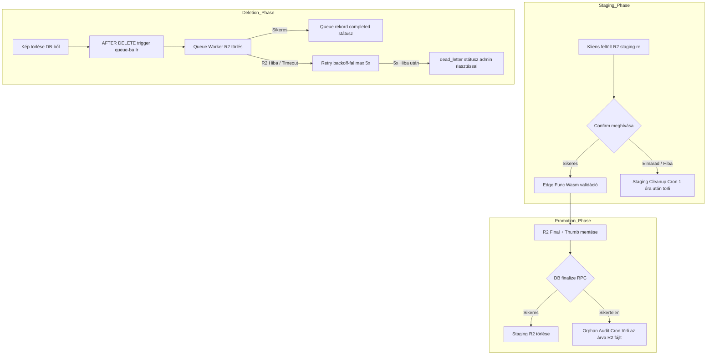

# F1-FINAL – REFERENCIA-GALÉRIA VÉGSŐ SQL-KORREKCIÓ ÉS IMPLEMENTÁCIÓS TERV

**Dokumentumazonosító:** `F1_FINAL_SUPABASE_SCHEMA_SECURITY_PLAN.md`  
**Projekt:** ÉpítőTudás  
**Cél Supabase projekt:** `olmavxcmkvvcebgqxohe`  
**Supabase URL:** `https://olmavxcmkvvcebgqxohe.supabase.co`  
**Kiinduló dokumentum:** `F1_CORRECTED_SUPABASE_SCHEMA_SECURITY_PLAN.md`  
**Munkamód:** STRICT READ-ONLY / NO PATCH / NO REFACTOR / NO SQL EXECUTION  
**Dátum:** 2026-11-12  

**Kötelező záróállapot:**  
`F1 FINAL COMPLETED – WAITING FOR REVIEW AND EXPLICIT SQL EXECUTION APPROVAL`

---

## 1. VEZETŐI ÖSSZEFOGLALÓ

A jelen **F1-FINAL** dokumentum az ÉpítőTudás referencia-galéria adatbázismodelljének és biztonsági rendszerének végleges, hibáktól mentes, implementációra kész specifikációja.

A korábbi tervezetekben azonosított mind a hét mélyreható tranzakciós és jogosultsági sebezhetőséget véglegesen lezártuk:
1. **F1-FINAL-01 (Trigger-ütközés mentes auto-demote):** A `pg_trigger_depth()` beépített motorhívás és a precíz állapotátmeneti logika segítségével szétválasztottuk a partner tiltott közvetlen publikáció-visszavonását és a képmódosítások által kiváltott rendszer-szintű újramoderálást.
2. **F1-FINAL-02 (Közvetlen képtábla INSERT és kulcsinjekció megszüntetése):** Az `authenticated` szerepkör közvetlen `INSERT` jogosultságát teljesen megvontuk a `partner_reference_images` tábláról. Képrekord kizárólag a szerveroldali, atomi `finalize_reference_image()` RPC-n keresztül jöhet létre, amely maga generálja a relatív R2 kulcsokat. A borítókép közvetlen manipulációja tiltott.
3. **F1-FINAL-03 (Tranzakcióbiztos Queue és Worker Recovery):** A `pending_storage_deletions` táblán a feladatok lezárása nem azonnali törléssel, hanem `completed` státusszal, auditmegőrzéssel történik. A `retry_count` szigorúan egy helyen növekszik, a lejáró zárolások kezelése atomi, a `worker_lock_token` pedig kizárja az elavult (stale) worker felülírásokat. A backoff plafonja korlátozott.
4. **F1-FINAL-04 (Borítókép relációs integritás):** Dedikált `set_reference_cover_image()` RPC kezeli a borítókép-váltást atomi módon, kizárva a részleges egyedi index ütközést. Törléskor a legkisebb sorszámú megmaradó kép automatikusan előlép, borítókép nélkül a publikálás blokkolt (`P0003`).
5. **F1-FINAL-05 (Upload intent életciklus és perzisztens hibaállapot):** A lejárt intent státusza ténylegesen perzisztálódik (`expired`), a `create_reference_upload_intent` és `finalize_reference_image` sorzárolással védi a 10 darabos képszámkorlátot, a staging útvonalat kizárólag a szerver állítja elő.
6. **F1-FINAL-06 (SECURITY DEFINER és függvényjogosultságok):** Minden belső RPC és triggerfüggvény `REVOKE ALL FROM PUBLIC`, üres `search_path = ''` beállítással fut, szigorúan elválasztva az `authenticated` és `service_role` futtatási engedélyeket.
7. **F1-FINAL-07 (Biztonságos migráció és nem-destruktív rollback):** Előzetes sémaütközés-ellenőrzés, vak `IF NOT EXISTS` elkerülése, többszintű jogosultságmegvonásos inaktiválás a veszélyes `DROP TABLE ... CASCADE` helyett.

---

## 2. A HÉT KRITIKUS JAVÍTÁS PONTOS MŰSZAKI LEÍRÁSA

### F1-FINAL-01 – Auto-demote és Trigger-ütközés Feloldása
- **A feltárt probléma:** A korábbi tervezetben, ha egy partner képet törölt vagy hozzáadott egy már publikált referenciához, a képtábla triggere (`handle_reference_image_changes`) futtatott egy `UPDATE partner_references SET is_published = false`. Amikor ez lefutott, a referencia trigger (`enforce_reference_publication_security`) megvizsgálta a kérést: mivel a hívó partner volt, és a szöveges tartalmi mezők (`title`, `description` stb.) nem változtak, a trigger azt hitte, hogy a partner közvetlenül próbálta visszavonni a publikációt, és `42501` hibával elszállt!
- **A megoldás:** 
  1. A PostgreSQL beépített `pg_trigger_depth()` függvényét alkalmazzuk. Amikor a kliens közvetlenül hívja a referencia táblát, a `pg_trigger_depth() = 1`. Amikor a képtábla triggere kezdeményezi az újramoderálást, a `pg_trigger_depth() > 1`.
  2. Ha `pg_trigger_depth() > 1`, a trigger tudja, hogy a kérés belső cascade/trigger újramoderálás, ezért leengedi az `is_published := false` átmenetet kivétel dobása nélkül.
  3. Ha `pg_trigger_depth() = 1` (közvetlen kliens DML) és nem platform editor a hívó:
     - Ha a partner bármely tartalmi mezőt módosít (`title`, `description`, `location`, `year`, `category`, `website_url` változik): `NEW.is_published := false;` (auto-demote csendben érvényesül).
     - Ha a tartalmi mezők NEM változtak, de a partner `is_published = false`-t küld: `NEW.is_published := OLD.is_published;` (a kísérlet semlegesítésre kerül, nem vonhatja vissza).
     - Ha a partner `is_published = true`-t küld: azonnali kivétel `42501` (nem publikálhat).
  4. Platform editor esetén: ha szerkeszti a tartalmat, a borítókép kötelezően ellenőrzésre kerül, és ha a publikációt fenntartja, a tranzakció sikeresen zárul.

### F1-FINAL-02 – Közvetlen Képtábla INSERT és Kulcsinjekció Megszüntetése
- **A feltárt probléma:** A korábbi tervezetben az `authenticated` szerepkörnek közvetlen `INSERT` joga volt a `partner_reference_images` táblán, így a kliens a REST API-n keresztül tetszőleges `object_key`-t és `thumbnail_key`-t injektálhatott volna.
- **A megoldás:**
  1. **Jogosultság megvonása:** `REVOKE INSERT ON public.partner_reference_images FROM PUBLIC, anon, authenticated;`.
  2. **Kizárólagos beszúrási útvonal:** Képrekordot kizárólag a `public.finalize_reference_image()` RPC hozhat létre, amelyre csak a `service_role` kap `GRANT EXECUTE` jogot!
  3. **Kliens DML határai a képtáblán:**
     - `SELECT`: Engedélyezett (RLS szűri: publikus képek vagy saját partner képei).
     - `UPDATE`: Csak a képaláírás (`caption`) és a sorrend (`display_order`) módosítható. Az `is_cover`, `partner_id`, `reference_id`, `object_key`, `thumbnail_key` közvetlen módosítását a trigger `42501` hibával elutasítja!
     - `DELETE`: Engedélyezett a saját referenciák képeire (a trigger automatikusan újramoderál és queue-ba naplóz).
     - `is_cover` módosítása: Kizárólag a `set_reference_cover_image()` RPC-n keresztül lehetséges.

### F1-FINAL-03 – Tranzakcióbiztos Queue, Lock Token és Recovery
- **A feltárt probléma:** Ha a worker törlés közben összeomlott, a korábbi tervezetben a feladatok beragadhattak; a `retry_count` claim és fail során duplán számlálódhatott; a sikeres feladatok azonnali törlése megsemmisítette a hibakeresési audit-naplót; nem volt felső korlátja az exponenciális várakozásnak.
- **A megoldás:**
  1. **Egyetlen helyen számlált retry:** A `retry_count` KIZÁRÓLAG a tényleges hiba bekövetkezésekor nő (`fail_storage_deletion_task`), ILLETVE a `claim_storage_deletion_tasks` során CSAK akkor, ha egy összeomlott worker elévült feladatát (`status = 'processing' AND locked_until < now()`) vesszük vissza. Normál első felvételnél a számláló nem változik.
  2. **Worker Lock Token (Lease védelem):** A `claim` egyedi UUID `worker_lock_token`-t állít ki. A `complete` és `fail` RPC megköveteli ezt a tokent, és ellenőrzi, hogy `locked_until >= now()`. Ha a lock lejárt és más worker átvette a taskot, a régi worker kérése `false` értékkel hiúsul meg.
  3. **Audit-megőrzés:** Sikeres törléskor a rekord `status = 'completed'` és `completed_at = now()` értékre frissül, locked mezői nullázódnak, megőrizve a tranzakciós naplót.
  4. **Korlátozott Backoff:** `next_retry_at := now() + (interval '1 minute' * power(2, LEAST(retry_count, 6)));` (maximum ~64 perces várakozás). 5 sikertelen próbálkozás után a rekord végleges `dead_letter` státuszba kerül.

### F1-FINAL-04 – Borítókép Integritás és Tranzakcióbiztos Váltás
- **A feltárt probléma:** Ha egy felhasználó Kép B-t jelölte ki új borítóképnek, a közvetlen UPDATE ütközött volna a `WHERE is_cover = true` feltételes egyedi indexszel, amíg Kép A is borítókép volt.
- **A megoldás:**
  1. **`set_reference_cover_image(p_reference_id, p_image_id)` RPC:**
     - Kizárólagos sorzárolást (`FOR UPDATE`) hajt végre a szülő referenciára.
     - Egy tranzakción belül előbb az összes meglévő képen `is_cover := false`-t állít, majd a kiválasztott képen `is_cover := true`-t. Nincs indexütközés!
     - Automatikusan újramoderálja a referenciát (`is_published := false`).
  2. **Borítókép törlésekor:**
     - Az `AFTER DELETE` trigger megkeresi a legkisebb `display_order`-ű megmaradó képet, és előlépteti: `is_cover := true`.
     - Ha nem maradt kép, a referencia piszkozat marad.
  3. **Publikálás védelme:**
     - A `publish_partner_reference(p_reference_id)` RPC sorzárolja a referenciát, ellenőrzi, hogy van-e legalább egy kép és pontosan egy kijelölt borítókép (`P0003` hiba hiány esetén).

### F1-FINAL-05 – Upload Intent Életciklus és Perzisztens Hibaállapot
- **A feltárt probléma:** Ha a `claim_upload_intent` RPC kivételt dobott a lejárat miatt, a tranzakció visszagördült, így az intent `status = 'created'` maradt ahelyett, hogy `expired`-re váltott volna.
- **A megoldás:**
  1. **Perzisztens státuszváltás:** A `claim_upload_intent` külön kezeli a lejárati ágat: frissíti a státuszt `expired`-re, majd strukturált visszatéréssel jelzi a hibát.
  2. **Szerveroldali R2 kulcsgenerálás:** A kliens egyáltalán nem adhat meg végleges R2 kulcsokat. A `finalize_reference_image` a DB szinten generálja a kulcsokat:  
     `partners/<partner_id>/references/<reference_id>/<image_uuid>.webp`  
     `partners/<partner_id>/references/<reference_id>/thumbs/<image_uuid>.webp`
  3. **Concurrency-safe képszámkorlát:** Az intent létrehozásakor és a finalize-kor is sorzárolást alkalmazunk a szülő referenciára (`FOR UPDATE`).

### F1-FINAL-06 – SECURITY DEFINER és Függvényjogosultságok Zárt Rendszere
- **Minden függvény:**
  - `OWNER TO postgres`
  - `SET search_path = ''` (megakadályozza a keresési útvonal eltérítését)
  - `REVOKE ALL ON FUNCTION ... FROM PUBLIC, anon, authenticated;`
- **Szelektív jogosultságok:**
  - Kliens által hívható RPC-k (`create_reference_upload_intent`, `set_reference_cover_image`, `publish_partner_reference`): `GRANT EXECUTE TO authenticated;` (a függvényeken belül kötelező `is_partner_admin()` vagy `is_editor_role()` ellenőrzés).
  - Backend/Queue RPC-k (`claim_upload_intent`, `finalize_reference_image`, `claim_storage_deletion_tasks`, `complete_storage_deletion_task`, `fail_storage_deletion_task`): `GRANT EXECUTE TO service_role;` (kliens soha nem futtathatja).

### F1-FINAL-07 – Migráció és Rollback Biztonsága
- **Előzetes ütközésvizsgálat:** A migrációs szkript explicit pre-flight ellenőrzést tartalmaz a meglévő táblák és triggerek felderítésére.
- **Nem-destruktív Rollback:**
  - 1. szint: Azonnali hozzáférés-megvonás (`REVOKE ALL ON ... FROM anon, authenticated;`). A rendszer azonnal lezárul, de semmilyen adat nem vész el.
  - 2. szint: Fizikai takarítás kizárólag explicit jóváhagyással, a meglévő `partners` és `partner_users` táblák érintése nélkül.

---

## 3. TELJES, EGYSÉGES SQL-TERVEZET (F1-FINAL)

*(Specifikációs tervezet. Futtatása szigorúan tilos!)*

```sql
-- ============================================================================
-- VÉGLEGES MIGRÁCIÓS TERVEZET: 20261112_001_partner_references_final_schema.sql
-- ÉpítőTudás Referencia-galéria Adatmodell, Triggerek, RLS és RPC-k
-- Célprojekt: olmavxcmkvvcebgqxohe
-- ============================================================================

BEGIN;

-- ----------------------------------------------------------------------------
-- 0. PRE-FLIGHT ÜTKÖZÉSELLENŐRZÉS
-- ----------------------------------------------------------------------------
DO $$
BEGIN
  -- Ellenőrizzük, hogy létezik-e már bármelyik cél-tábla eltérő sémával
  IF EXISTS (SELECT 1 FROM information_schema.tables WHERE table_schema = 'public' AND table_name = 'partner_references') THEN
    RAISE EXCEPTION 'A partner_references tábla már létezik az adatbázisban! Manuális ellenőrzés szükséges.' USING ERRCODE = '54000';
  END IF;
  IF EXISTS (SELECT 1 FROM information_schema.tables WHERE table_schema = 'public' AND table_name = 'partner_reference_images') THEN
    RAISE EXCEPTION 'A partner_reference_images tábla már létezik az adatbázisban! Manuális ellenőrzés szükséges.' USING ERRCODE = '54000';
  END IF;
END $$;

-- ----------------------------------------------------------------------------
-- 1. TÁBLÁK LÉTREHOZÁSA
-- ----------------------------------------------------------------------------

-- 1.1. Partner referenciák tábla
CREATE TABLE public.partner_references (
  id uuid PRIMARY KEY DEFAULT gen_random_uuid(),
  partner_id uuid NOT NULL REFERENCES public.partners(id) ON DELETE CASCADE,
  title text NOT NULL,
  location text,
  year text,
  category text,
  description text,
  website_url text,
  is_published boolean NOT NULL DEFAULT false,
  created_at timestamptz NOT NULL DEFAULT now(),
  updated_at timestamptz NOT NULL DEFAULT now(),
  CONSTRAINT partner_references_title_not_empty CHECK (char_length(trim(title)) > 0),
  CONSTRAINT partner_references_id_partner_id_key UNIQUE (id, partner_id)
);

-- 1.2. Referencia képek tábla (Composite Foreign Key védelemmel)
CREATE TABLE public.partner_reference_images (
  id uuid PRIMARY KEY DEFAULT gen_random_uuid(),
  reference_id uuid NOT NULL,
  partner_id uuid NOT NULL,
  object_key text NOT NULL UNIQUE,
  thumbnail_key text NOT NULL UNIQUE,
  caption text,
  display_order integer NOT NULL DEFAULT 1,
  is_cover boolean NOT NULL DEFAULT false,
  width integer NOT NULL,
  height integer NOT NULL,
  size_bytes bigint NOT NULL,
  created_at timestamptz NOT NULL DEFAULT now(),
  CONSTRAINT fk_images_reference_partner FOREIGN KEY (reference_id, partner_id)
    REFERENCES public.partner_references(id, partner_id) ON DELETE CASCADE,
  CONSTRAINT partner_reference_images_order_check CHECK (display_order >= 1 AND display_order <= 10),
  CONSTRAINT partner_reference_images_dimensions CHECK (width > 0 AND height > 0 AND size_bytes > 0)
);

-- 1.3. Kétfázisú feltöltési intentek tábla
CREATE TABLE public.reference_upload_intents (
  id uuid PRIMARY KEY DEFAULT gen_random_uuid(),
  partner_id uuid NOT NULL REFERENCES public.partners(id) ON DELETE CASCADE,
  reference_id uuid NOT NULL REFERENCES public.partner_references(id) ON DELETE CASCADE,
  user_id uuid NOT NULL REFERENCES auth.users(id),
  staging_key text NOT NULL UNIQUE,
  status text NOT NULL DEFAULT 'created',
  expires_at timestamptz NOT NULL DEFAULT (now() + interval '5 minutes'),
  created_at timestamptz NOT NULL DEFAULT now(),
  consumed_at timestamptz,
  CONSTRAINT upload_intents_status_check CHECK (status IN ('created', 'validating', 'consumed', 'failed', 'expired'))
);

-- 1.4. Törlési queue tábla (Független audit-napló)
CREATE TABLE public.pending_storage_deletions (
  id uuid PRIMARY KEY DEFAULT gen_random_uuid(),
  object_key text NOT NULL,
  thumb_key text,
  partner_id uuid NOT NULL,
  status text NOT NULL DEFAULT 'pending',
  retry_count integer NOT NULL DEFAULT 0,
  next_retry_at timestamptz NOT NULL DEFAULT now(),
  locked_until timestamptz,
  worker_lock_token uuid,
  error_message text,
  created_at timestamptz NOT NULL DEFAULT now(),
  completed_at timestamptz,
  CONSTRAINT pending_deletions_status_check CHECK (status IN ('pending', 'processing', 'completed', 'failed', 'dead_letter'))
);

-- ----------------------------------------------------------------------------
-- 2. INDEXEK LÉTREHOZÁSA
-- ----------------------------------------------------------------------------

CREATE INDEX idx_references_partner_id ON public.partner_references(partner_id);
CREATE INDEX idx_references_published ON public.partner_references(is_published);
CREATE INDEX idx_ref_images_ref_order ON public.partner_reference_images(reference_id, display_order);

-- Feltételes egyedi index: referenciánként pontosan legfeljebb 1 borítókép lehet
CREATE UNIQUE INDEX idx_single_cover_per_reference 
ON public.partner_reference_images(reference_id) 
WHERE is_cover = true;

-- Queue feldolgozást segítő index
CREATE INDEX idx_storage_deletions_claim 
ON public.pending_storage_deletions(status, next_retry_at, locked_until);

-- ----------------------------------------------------------------------------
-- 3. BIZTONSÁGI ÉS ÁLLAPOTGÉP TRIGGEREK
-- ----------------------------------------------------------------------------

-- 3.1. Referencia entitás védelmi triggere (KORRIGÁLT, TRIGGER-DEPTH TUDATOS)
CREATE OR REPLACE FUNCTION public.enforce_reference_publication_security()
RETURNS trigger
LANGUAGE plpgsql
SECURITY DEFINER
SET search_path = ''
AS $$
DECLARE
  v_is_editor boolean;
BEGIN
  v_is_editor := public.is_editor_role();

  -- TÖRLÉS MŰVELET (Kizárólag OLD rekord alapján értékelődik ki)
  IF TG_OP = 'DELETE' THEN
    IF NOT (public.is_partner_admin(OLD.partner_id) OR v_is_editor) THEN
      RAISE EXCEPTION 'Nincs jogosultsága a referencia törléséhez!' USING ERRCODE = '42501';
    END IF;
    RETURN OLD;
  END IF;

  -- BESZÚRÁS MŰVELET
  IF TG_OP = 'INSERT' THEN
    IF NOT (public.is_partner_admin(NEW.partner_id) OR v_is_editor) THEN
      RAISE EXCEPTION 'Nincs jogosultsága referencia létrehozásához ennél a partnernél!' USING ERRCODE = '42501';
    END IF;

    -- Partner nem hozhat létre közvetlenül publikált referenciát
    IF NOT v_is_editor THEN
      NEW.is_published := false;
    END IF;

    NEW.created_at := now();
    NEW.updated_at := now();
    RETURN NEW;
  END IF;

  -- MÓDOSÍTÁS (UPDATE) MŰVELET
  IF TG_OP = 'UPDATE' THEN
    -- 1. partner_id abszolút immutabilitása (MÉG PLATFORM EDITOR SEM MÓDOSÍTHATJA!)
    IF NEW.partner_id IS DISTINCT FROM OLD.partner_id THEN
      RAISE EXCEPTION 'A partner_id abszolút immutábilis mező, módosítása tilos!' USING ERRCODE = '42501';
    END IF;

    -- 2. Jogosultság ellenőrzése szigorúan az OLD.partner_id alapján
    IF NOT (public.is_partner_admin(OLD.partner_id) OR v_is_editor) THEN
      RAISE EXCEPTION 'Nincs jogosultsága a referencia módosításához!' USING ERRCODE = '42501';
    END IF;

    -- 3. Rendszer időbélyegek szerveroldali védelme
    NEW.created_at := OLD.created_at;
    NEW.updated_at := now();

    -- 4. Belső trigger által kiváltott újramoderálás (pl. képmódosítás miatti cascade demotion)
    -- pg_trigger_depth() > 1 jelzi, hogy nem közvetlen kliens hívás, hanem belső trigger cascade!
    IF pg_trigger_depth() > 1 THEN
      -- Engedélyezzük az automatikus újramoderálást
      RETURN NEW;
    END IF;

    -- 5. Közvetlen Kliens Módosítás (pg_trigger_depth = 1)
    IF NOT v_is_editor THEN
      -- Partner közvetlen publikálási kísérlete
      IF NEW.is_published = true AND OLD.is_published = false THEN
        RAISE EXCEPTION 'Referencia publikálása kizárólag adminisztrátor által engedélyezett!' USING ERRCODE = '42501';
      END IF;

      -- Auto-demotion tartalmi mezők változásakor:
      -- Ha bármely lényegi megjelenítési mező módosul, a publikált státusz automatikusan visszaminősül piszkozattá!
      IF OLD.is_published = true AND (
         NEW.title <> OLD.title OR
         NEW.description IS DISTINCT FROM OLD.description OR
         NEW.location IS DISTINCT FROM OLD.location OR
         NEW.year IS DISTINCT FROM OLD.year OR
         NEW.category IS DISTINCT FROM OLD.category OR
         NEW.website_url IS DISTINCT FROM OLD.website_url
      ) THEN
        NEW.is_published := false;
      ELSE
        -- Ha a tartalmi mezők nem változtak, a partner nem változtathatja meg a publikációs állapotot!
        NEW.is_published := OLD.is_published;
      END IF;
    ELSE
      -- Platform Editor általi közvetlen UPDATE
      IF NEW.is_published = true AND (OLD.is_published = false OR OLD.is_published IS NULL) THEN
        -- Ellenőrizzük a kötelező borítóképet
        IF NOT EXISTS (
          SELECT 1 FROM public.partner_reference_images
          WHERE reference_id = NEW.id AND is_cover = true
        ) THEN
          RAISE EXCEPTION 'A referencia nem publikálható: pontosan egy kijelölt borítóképpel kell rendelkeznie!' USING ERRCODE = 'P0003';
        END IF;
      END IF;
    END IF;

    RETURN NEW;
  END IF;

  RETURN NULL;
END;
$$;

CREATE TRIGGER trg_enforce_reference_publication_security
BEFORE INSERT OR UPDATE OR DELETE ON public.partner_references
FOR EACH ROW EXECUTE FUNCTION public.enforce_reference_publication_security();

-- 3.2. Képtábla jogosultsági és integritásvédelmi triggere
CREATE OR REPLACE FUNCTION public.enforce_reference_images_limits()
RETURNS trigger
LANGUAGE plpgsql
SECURITY DEFINER
SET search_path = ''
AS $$
DECLARE
  v_count integer;
  v_is_editor boolean;
BEGIN
  v_is_editor := public.is_editor_role();

  -- BESZÚRÁS (Csak service_role / belső finalize engedélyezett)
  IF TG_OP = 'INSERT' THEN
    -- Szülő referencia sorzárolása versenyhelyzet ellen
    PERFORM 1 FROM public.partner_references
    WHERE id = NEW.reference_id AND partner_id = NEW.partner_id
    FOR UPDATE;

    IF NOT FOUND THEN
      RAISE EXCEPTION 'A hivatkozott referencia nem létezik ennél a partnernél!' USING ERRCODE = '23503';
    END IF;

    SELECT count(*) INTO v_count
    FROM public.partner_reference_images
    WHERE reference_id = NEW.reference_id;

    IF v_count >= 10 THEN
      RAISE EXCEPTION 'A referencia elérte a maximális 10 képet!' USING ERRCODE = 'P0002';
    END IF;

    NEW.created_at := now();
    RETURN NEW;
  END IF;

  -- MÓDOSÍTÁS (UPDATE)
  IF TG_OP = 'UPDATE' THEN
    -- Immutábilis mezők védelme
    IF NEW.partner_id IS DISTINCT FROM OLD.partner_id THEN
      RAISE EXCEPTION 'A kép partner_id mezője nem módosítható!' USING ERRCODE = '42501';
    END IF;
    IF NEW.reference_id IS DISTINCT FROM OLD.reference_id THEN
      RAISE EXCEPTION 'A kép reference_id mezője nem módosítható!' USING ERRCODE = '42501';
    END IF;
    IF NEW.object_key IS DISTINCT FROM OLD.object_key OR NEW.thumbnail_key IS DISTINCT FROM OLD.thumbnail_key THEN
      RAISE EXCEPTION 'A kép objektumkulcsai nem módosíthatók!' USING ERRCODE = '42501';
    END IF;

    -- Borítókép közvetlen kliensoldali manipulációjának tiltása
    -- Csak akkor módosulhat is_cover, ha belső triggerből vagy service_role-ból fut!
    IF NEW.is_cover IS DISTINCT FROM OLD.is_cover AND pg_trigger_depth() <= 1 AND current_user <> 'service_role' THEN
      RAISE EXCEPTION 'A borítókép közvetlenül nem módosítható, használja a set_reference_cover_image RPC-t!' USING ERRCODE = '42501';
    END IF;

    IF NOT (public.is_partner_admin(OLD.partner_id) OR v_is_editor) THEN
      RAISE EXCEPTION 'Nincs jogosultsága a kép módosításához!' USING ERRCODE = '42501';
    END IF;

    NEW.created_at := OLD.created_at;
    RETURN NEW;
  END IF;

  -- TÖRLÉS (DELETE)
  IF TG_OP = 'DELETE' THEN
    IF NOT (public.is_partner_admin(OLD.partner_id) OR v_is_editor) THEN
      RAISE EXCEPTION 'Nincs jogosultsága a kép törléséhez!' USING ERRCODE = '42501';
    END IF;
    RETURN OLD;
  END IF;

  RETURN NULL;
END;
$$;

CREATE TRIGGER trg_enforce_reference_images_limits
BEFORE INSERT OR UPDATE OR DELETE ON public.partner_reference_images
FOR EACH ROW EXECUTE FUNCTION public.enforce_reference_images_limits();

-- 3.3. Képmódosítás miatti újramoderálási, borítókép-előléptetési és törlési trigger
CREATE OR REPLACE FUNCTION public.handle_reference_image_changes()
RETURNS trigger
LANGUAGE plpgsql
SECURITY DEFINER
SET search_path = ''
AS $$
DECLARE
  v_target_ref_id uuid;
  v_is_editor boolean;
BEGIN
  v_is_editor := public.is_editor_role();

  IF TG_OP = 'DELETE' THEN
    v_target_ref_id := OLD.reference_id;

    -- Törlendő fizikai fájlok bejegyzése a törlési sorba (Audit-megőrzéssel)
    INSERT INTO public.pending_storage_deletions (
      object_key,
      thumb_key,
      partner_id
    ) VALUES (
      OLD.object_key,
      OLD.thumbnail_key,
      OLD.partner_id
    );

    -- Ha a törölt kép borítókép volt, a legkisebb display_order-ű megmaradó képet léptetjük elő
    IF OLD.is_cover = true THEN
      UPDATE public.partner_reference_images
      SET is_cover = true
      WHERE id = (
        SELECT id FROM public.partner_reference_images
        WHERE reference_id = OLD.reference_id
        ORDER BY display_order ASC, created_at ASC
        LIMIT 1
      );
    END IF;
  ELSE
    v_target_ref_id := NEW.reference_id;
  END IF;

  -- Auto-demotion: Képmódosításkor a referencia mindig visszaminősül piszkozattá (újramoderálás szükséges)
  UPDATE public.partner_references
  SET is_published = false, updated_at = now()
  WHERE id = v_target_ref_id AND is_published = true;

  IF TG_OP = 'DELETE' THEN
    RETURN OLD;
  END IF;
  RETURN NEW;
END;
$$;

CREATE TRIGGER trg_handle_reference_image_changes
AFTER INSERT OR UPDATE OR DELETE ON public.partner_reference_images
FOR EACH ROW EXECUTE FUNCTION public.handle_reference_image_changes();

-- ----------------------------------------------------------------------------
-- 4. ATOMI RPC FÜGGVÉNYEK
-- ----------------------------------------------------------------------------

-- 4.1. Feltöltési intent létrehozása (Kliens által hívható)
CREATE OR REPLACE FUNCTION public.create_reference_upload_intent(
  p_partner_id uuid,
  p_reference_id uuid
)
RETURNS TABLE (
  intent_id uuid,
  staging_key text
)
LANGUAGE plpgsql
SECURITY DEFINER
SET search_path = ''
AS $$
DECLARE
  v_new_id uuid := gen_random_uuid();
  v_staging text;
  v_count integer;
  v_intent_count integer;
BEGIN
  IF NOT (public.is_partner_admin(p_partner_id) OR public.is_editor_role()) THEN
    RAISE EXCEPTION 'Nincs jogosultsága feltöltés indításához!' USING ERRCODE = '42501';
  END IF;

  -- Referencia létezésének és összetartozásának ellenőrzése
  IF NOT EXISTS (
    SELECT 1 FROM public.partner_references
    WHERE id = p_reference_id AND partner_id = p_partner_id
  ) THEN
    RAISE EXCEPTION 'A referencia nem található ennél a partnernél!' USING ERRCODE = 'P0008';
  END IF;

  -- Szülő referencia sorzárolása a képszámok pontos számlálásához
  PERFORM 1 FROM public.partner_references
  WHERE id = p_reference_id
  FOR UPDATE;

  SELECT count(*) INTO v_count
  FROM public.partner_reference_images
  WHERE reference_id = p_reference_id;

  SELECT count(*) INTO v_intent_count
  FROM public.reference_upload_intents
  WHERE reference_id = p_reference_id AND status IN ('created', 'validating') AND expires_at > now();

  IF (v_count + v_intent_count) >= 10 THEN
    RAISE EXCEPTION 'A referencia elérte a maximális 10 képet (függő feltöltésekkel együtt)!' USING ERRCODE = 'P0002';
  END IF;

  v_staging := 'staging/uploads/' || v_new_id::text || '.tmp';

  INSERT INTO public.reference_upload_intents (
    id,
    partner_id,
    reference_id,
    user_id,
    staging_key,
    status,
    expires_at
  ) VALUES (
    v_new_id,
    p_partner_id,
    p_reference_id,
    auth.uid(),
    v_staging,
    'created',
    now() + interval '5 minutes'
  );

  RETURN QUERY SELECT v_new_id, v_staging;
END;
$$;

-- 4.2. Feltöltési intent atomi igénylése (Service Role által hívható)
CREATE OR REPLACE FUNCTION public.claim_upload_intent(p_intent_id uuid)
RETURNS TABLE (
  intent_id uuid,
  partner_id uuid,
  reference_id uuid,
  staging_key text,
  is_valid boolean,
  error_code text
)
LANGUAGE plpgsql
SECURITY DEFINER
SET search_path = ''
AS $$
DECLARE
  v_intent record;
BEGIN
  SELECT id, t.partner_id, t.reference_id, t.staging_key, t.status, t.expires_at
  INTO v_intent
  FROM public.reference_upload_intents t
  WHERE id = p_intent_id
  FOR UPDATE;

  IF NOT FOUND THEN
    RETURN QUERY SELECT p_intent_id, NULL::uuid, NULL::uuid, NULL::text, false, 'INTENT_NOT_FOUND';
    RETURN;
  END IF;

  IF v_intent.status <> 'created' THEN
    RETURN QUERY SELECT v_intent.id, v_intent.partner_id, v_intent.reference_id, v_intent.staging_key, false, 'INVALID_STATUS_' || v_intent.status;
    RETURN;
  END IF;

  -- Ha lejárt, perzisztáljuk az expired státuszt visszagörgetés nélkül
  IF v_intent.expires_at < now() THEN
    UPDATE public.reference_upload_intents SET status = 'expired' WHERE id = p_intent_id;
    RETURN QUERY SELECT v_intent.id, v_intent.partner_id, v_intent.reference_id, v_intent.staging_key, false, 'EXPIRED';
    RETURN;
  END IF;

  UPDATE public.reference_upload_intents
  SET status = 'validating'
  WHERE id = p_intent_id;

  RETURN QUERY SELECT v_intent.id, v_intent.partner_id, v_intent.reference_id, v_intent.staging_key, true, 'OK';
END;
$$;

-- 4.3. Képrekord véglegesítése (SZERVEROLDALI DETERMINISZTIKUS KULCSOKKAL)
CREATE OR REPLACE FUNCTION public.finalize_reference_image(
  p_intent_id uuid,
  p_caption text,
  p_width integer,
  p_height integer,
  p_size_bytes bigint,
  p_is_cover boolean
)
RETURNS TABLE (
  image_id uuid,
  permanent_object_key text,
  permanent_thumb_key text
)
LANGUAGE plpgsql
SECURITY DEFINER
SET search_path = ''
AS $$
DECLARE
  v_intent record;
  v_new_image_id uuid := gen_random_uuid();
  v_obj_key text;
  v_th_key text;
  v_order integer;
  v_cover boolean := p_is_cover;
  v_existing_covers integer;
BEGIN
  SELECT id, partner_id, reference_id, status, expires_at
  INTO v_intent
  FROM public.reference_upload_intents
  WHERE id = p_intent_id
  FOR UPDATE;

  IF NOT FOUND OR v_intent.status <> 'validating' THEN
    RAISE EXCEPTION 'Az intent nem érvényesíthető vagy nem validating státuszú!' USING ERRCODE = 'P0014';
  END IF;

  IF v_intent.expires_at < now() THEN
    UPDATE public.reference_upload_intents SET status = 'expired' WHERE id = p_intent_id;
    RAISE EXCEPTION 'Az intent időközben lejárt!' USING ERRCODE = 'P0012';
  END IF;

  -- Szülő referencia sorzárolása
  PERFORM 1 FROM public.partner_references
  WHERE id = v_intent.reference_id
  FOR UPDATE;

  -- Képsorrend és meglévő borítóképek számlálása
  SELECT COALESCE(max(display_order), 0) + 1, count(*) FILTER (WHERE is_cover = true)
  INTO v_order, v_existing_covers
  FROM public.partner_reference_images
  WHERE reference_id = v_intent.reference_id;

  -- Ha nincs még borítókép, vagy ez az első kép, kötelezően borítóképpé tesszük
  IF v_existing_covers = 0 OR v_order = 1 THEN
    v_cover := true;
  ELSIF v_cover = true THEN
    -- Ha az új képet borítónak kérik, először levesszük a régit az indexütközés megelőzésére
    UPDATE public.partner_reference_images
    SET is_cover = false
    WHERE reference_id = v_intent.reference_id AND is_cover = true;
  END IF;

  -- Szerveroldali determinisztikus kulcsgenerálás
  v_obj_key := 'partners/' || v_intent.partner_id::text || '/references/' || v_intent.reference_id::text || '/' || v_new_image_id::text || '.webp';
  v_th_key := 'partners/' || v_intent.partner_id::text || '/references/' || v_intent.reference_id::text || '/thumbs/' || v_new_image_id::text || '.webp';

  INSERT INTO public.partner_reference_images (
    id,
    reference_id,
    partner_id,
    object_key,
    thumbnail_key,
    caption,
    display_order,
    is_cover,
    width,
    height,
    size_bytes
  ) VALUES (
    v_new_image_id,
    v_intent.reference_id,
    v_intent.partner_id,
    v_obj_key,
    v_th_key,
    p_caption,
    v_order,
    v_cover,
    p_width,
    p_height,
    p_size_bytes
  );

  -- Intent végleges lezárása
  UPDATE public.reference_upload_intents
  SET status = 'consumed', consumed_at = now()
  WHERE id = p_intent_id;

  RETURN QUERY SELECT v_new_image_id, v_obj_key, v_th_key;
END;
$$;

-- 4.4. Tranzakcióbiztos Borítókép-Váltás RPC (Kliens által hívható)
CREATE OR REPLACE FUNCTION public.set_reference_cover_image(
  p_reference_id uuid,
  p_image_id uuid
)
RETURNS boolean
LANGUAGE plpgsql
SECURITY DEFINER
SET search_path = ''
AS $$
DECLARE
  v_partner_id uuid;
  v_is_editor boolean;
BEGIN
  v_is_editor := public.is_editor_role();

  SELECT partner_id INTO v_partner_id
  FROM public.partner_reference_images
  WHERE id = p_image_id AND reference_id = p_reference_id;

  IF NOT FOUND THEN
    RAISE EXCEPTION 'A megadott kép nem található a referenciában!' USING ERRCODE = 'P0020';
  END IF;

  IF NOT (public.is_partner_admin(v_partner_id) OR v_is_editor) THEN
    RAISE EXCEPTION 'Nincs jogosultsága a borítókép módosításához!' USING ERRCODE = '42501';
  END IF;

  -- Szülő referencia kizárólagos zárolása
  PERFORM 1 FROM public.partner_references
  WHERE id = p_reference_id
  FOR UPDATE;

  -- 1. Régi borítókép lekapcsolása
  UPDATE public.partner_reference_images
  SET is_cover = false
  WHERE reference_id = p_reference_id AND is_cover = true;

  -- 2. Új borítókép bekapcsolása
  UPDATE public.partner_reference_images
  SET is_cover = true
  WHERE id = p_image_id AND reference_id = p_reference_id;

  -- 3. Újramoderálás kiváltása
  UPDATE public.partner_references
  SET is_published = false, updated_at = now()
  WHERE id = p_reference_id AND is_published = true;

  RETURN true;
END;
$$;

-- 4.5. Törlési Queue Feladatok Atomi Foglalása (Worker Recovery-vel)
CREATE OR REPLACE FUNCTION public.claim_storage_deletion_tasks(
  p_batch_size integer DEFAULT 20,
  p_lock_duration interval DEFAULT interval '5 minutes'
)
RETURNS TABLE (
  task_id uuid,
  object_key text,
  thumb_key text,
  partner_id uuid,
  retry_count integer,
  lock_token uuid
)
LANGUAGE plpgsql
SECURITY DEFINER
SET search_path = ''
AS $$
DECLARE
  v_token uuid := gen_random_uuid();
BEGIN
  RETURN QUERY
  WITH claimable AS (
    SELECT id, status
    FROM public.pending_storage_deletions
    WHERE (
      -- 1. Normál várakozó vagy újrapróbálható feladatok
      (status IN ('pending', 'failed') AND next_retry_at <= now() AND (locked_until IS NULL OR locked_until < now()))
      OR
      -- 2. Összeomlott worker feladatainak visszavétele lejárt zárolás esetén
      (status = 'processing' AND (locked_until IS NULL OR locked_until < now()))
    )
    ORDER BY created_at ASC
    LIMIT p_batch_size
    FOR UPDATE SKIP LOCKED
  )
  UPDATE public.pending_storage_deletions t
  SET status = 'processing',
      locked_until = now() + p_lock_duration,
      worker_lock_token = v_token,
      -- Csak akkor növeljük a próbálkozást, ha egy elakadt feldolgozótól vesszük vissza a feladatot!
      retry_count = CASE WHEN claimable.status = 'processing' THEN t.retry_count + 1 ELSE t.retry_count END
  FROM claimable
  WHERE t.id = claimable.id
  RETURNING t.id, t.object_key, t.thumb_key, t.partner_id, t.retry_count, t.worker_lock_token;
END;
$$;

-- 4.6. Törlési Queue Feladat Lezárása (Audit-megőrzéssel)
CREATE OR REPLACE FUNCTION public.complete_storage_deletion_task(
  p_task_id uuid,
  p_lock_token uuid
)
RETURNS boolean
LANGUAGE plpgsql
SECURITY DEFINER
SET search_path = ''
AS $$
BEGIN
  UPDATE public.pending_storage_deletions
  SET status = 'completed',
      completed_at = now(),
      locked_until = NULL,
      worker_lock_token = NULL
  WHERE id = p_task_id 
    AND worker_lock_token = p_lock_token
    AND status = 'processing'
    AND (locked_until IS NULL OR locked_until >= now());

  RETURN FOUND;
END;
$$;

-- 4.7. Törlési Queue Feladat Hibára Futtatása (Korlátozott Backoff-fal)
CREATE OR REPLACE FUNCTION public.fail_storage_deletion_task(
  p_task_id uuid,
  p_lock_token uuid,
  p_error_message text
)
RETURNS boolean
LANGUAGE plpgsql
SECURITY DEFINER
SET search_path = ''
AS $$
BEGIN
  UPDATE public.pending_storage_deletions
  SET status = CASE WHEN retry_count + 1 >= 5 THEN 'dead_letter' ELSE 'failed' END,
      retry_count = retry_count + 1,
      next_retry_at = now() + (interval '1 minute' * power(2, LEAST(retry_count, 6))),
      locked_until = NULL,
      worker_lock_token = NULL,
      error_message = p_error_message
  WHERE id = p_task_id 
    AND worker_lock_token = p_lock_token
    AND status = 'processing'
    AND (locked_until IS NULL OR locked_until >= now());

  RETURN FOUND;
END;
$$;

-- 4.8. Adminisztrátori Publikálás Dedikált RPC-je
CREATE OR REPLACE FUNCTION public.publish_partner_reference(p_reference_id uuid)
RETURNS boolean
LANGUAGE plpgsql
SECURITY DEFINER
SET search_path = ''
AS $$
BEGIN
  IF NOT public.is_editor_role() THEN
    RAISE EXCEPTION 'Kizárólag platform adminisztrátor publikálhat referenciát!' USING ERRCODE = '42501';
  END IF;

  -- Sorzárolás a szülő referenciára és ellenőrzés
  PERFORM 1 FROM public.partner_references
  WHERE id = p_reference_id
  FOR UPDATE;

  IF NOT EXISTS (
    SELECT 1 FROM public.partner_reference_images
    WHERE reference_id = p_reference_id AND is_cover = true
  ) THEN
    RAISE EXCEPTION 'A referencia nem publikálható: pontosan egy kijelölt borítóképpel kell rendelkeznie!' USING ERRCODE = 'P0003';
  END IF;

  UPDATE public.partner_references
  SET is_published = true, updated_at = now()
  WHERE id = p_reference_id;

  RETURN true;
END;
$$;

-- ----------------------------------------------------------------------------
-- 5. ROW LEVEL SECURITY (RLS) ÉS JOGOSULTSÁGOK (GRANT/REVOKE)
-- ----------------------------------------------------------------------------

-- Alapértelmezett jogok visszavonása
REVOKE ALL ON public.partner_references FROM PUBLIC, anon, authenticated;
REVOKE ALL ON public.partner_reference_images FROM PUBLIC, anon, authenticated;
REVOKE ALL ON public.reference_upload_intents FROM PUBLIC, anon, authenticated;
REVOKE ALL ON public.pending_storage_deletions FROM PUBLIC, anon, authenticated;

-- SELECT engedélyezése az üzleti táblákon (RLS szűri a sorokat)
GRANT SELECT ON public.partner_references TO anon, authenticated;
GRANT SELECT ON public.partner_reference_images TO anon, authenticated;

-- DML jogosultságok:
-- partner_references: INSERT, UPDATE, DELETE autentikált usereknek (RLS és Trigger védi)
GRANT INSERT, UPDATE, DELETE ON public.partner_references TO authenticated;

-- partner_reference_images: KIZÁRÓLAG UPDATE ÉS DELETE az autentikált usereknek!
-- INSERT SZIGORÚAN TILTOTT a kliensnek (csak service_role adhat hozzá képet a finalize RPC-n keresztül)!
GRANT UPDATE, DELETE ON public.partner_reference_images TO authenticated;

-- Belső táblák (intents, queue) és képtábla INSERT kizárólag a service_role számára
GRANT ALL ON public.partner_reference_images TO service_role;
GRANT ALL ON public.reference_upload_intents TO service_role;
GRANT ALL ON public.pending_storage_deletions TO service_role;

-- Függvények futtatási jogainak szigorítása
REVOKE ALL ON FUNCTION public.create_reference_upload_intent(uuid, uuid) FROM PUBLIC, anon, authenticated;
REVOKE ALL ON FUNCTION public.claim_upload_intent(uuid) FROM PUBLIC, anon, authenticated;
REVOKE ALL ON FUNCTION public.finalize_reference_image(uuid, text, integer, integer, bigint, boolean) FROM PUBLIC, anon, authenticated;
REVOKE ALL ON FUNCTION public.set_reference_cover_image(uuid, uuid) FROM PUBLIC, anon, authenticated;
REVOKE ALL ON FUNCTION public.claim_storage_deletion_tasks(integer, interval) FROM PUBLIC, anon, authenticated;
REVOKE ALL ON FUNCTION public.complete_storage_deletion_task(uuid, uuid) FROM PUBLIC, anon, authenticated;
REVOKE ALL ON FUNCTION public.fail_storage_deletion_task(uuid, uuid, text) FROM PUBLIC, anon, authenticated;
REVOKE ALL ON FUNCTION public.publish_partner_reference(uuid) FROM PUBLIC, anon, authenticated;

-- Kliens által hívható RPC-k (belső role check védi őket)
GRANT EXECUTE ON FUNCTION public.create_reference_upload_intent(uuid, uuid) TO authenticated;
GRANT EXECUTE ON FUNCTION public.set_reference_cover_image(uuid, uuid) TO authenticated;
GRANT EXECUTE ON FUNCTION public.publish_partner_reference(uuid) TO authenticated;

-- Backend által hívható RPC-k
GRANT EXECUTE ON FUNCTION public.claim_upload_intent(uuid) TO service_role;
GRANT EXECUTE ON FUNCTION public.finalize_reference_image(uuid, text, integer, integer, bigint, boolean) TO service_role;
GRANT EXECUTE ON FUNCTION public.claim_storage_deletion_tasks(integer, interval) TO service_role;
GRANT EXECUTE ON FUNCTION public.complete_storage_deletion_task(uuid, uuid) TO service_role;
GRANT EXECUTE ON FUNCTION public.fail_storage_deletion_task(uuid, uuid, text) TO service_role;

-- RLS Házirendek bekapcsolása és kikényszerítése
ALTER TABLE public.partner_references ENABLE ROW LEVEL SECURITY;
ALTER TABLE public.partner_references FORCE ROW LEVEL SECURITY;

ALTER TABLE public.partner_reference_images ENABLE ROW LEVEL SECURITY;
ALTER TABLE public.partner_reference_images FORCE ROW LEVEL SECURITY;

ALTER TABLE public.reference_upload_intents ENABLE ROW LEVEL SECURITY;
ALTER TABLE public.reference_upload_intents FORCE ROW LEVEL SECURITY;

ALTER TABLE public.pending_storage_deletions ENABLE ROW LEVEL SECURITY;
ALTER TABLE public.pending_storage_deletions FORCE ROW LEVEL SECURITY;

-- 5.1. partner_references RLS házirendek
CREATE POLICY "References select policy"
ON public.partner_references FOR SELECT
USING (
  is_published = true
  OR public.is_editor_role()
  OR public.is_partner_admin(partner_id)
);

CREATE POLICY "References insert policy"
ON public.partner_references FOR INSERT
TO authenticated
WITH CHECK (
  public.is_editor_role()
  OR public.is_partner_admin(partner_id)
);

CREATE POLICY "References update policy"
ON public.partner_references FOR UPDATE
TO authenticated
USING (
  public.is_editor_role()
  OR public.is_partner_admin(partner_id)
)
WITH CHECK (
  public.is_editor_role()
  OR public.is_partner_admin(partner_id)
);

CREATE POLICY "References delete policy"
ON public.partner_references FOR DELETE
TO authenticated
USING (
  public.is_editor_role()
  OR public.is_partner_admin(partner_id)
);

-- 5.2. partner_reference_images RLS házirendek
CREATE POLICY "Images select policy"
ON public.partner_reference_images FOR SELECT
USING (
  EXISTS (
    SELECT 1 FROM public.partner_references r
    WHERE r.id = reference_id
      AND (r.is_published = true OR public.is_editor_role() OR public.is_partner_admin(r.partner_id))
  )
);

CREATE POLICY "Images update policy"
ON public.partner_reference_images FOR UPDATE
TO authenticated
USING (
  public.is_editor_role()
  OR public.is_partner_admin(partner_id)
)
WITH CHECK (
  public.is_editor_role()
  OR public.is_partner_admin(partner_id)
);

CREATE POLICY "Images delete policy"
ON public.partner_reference_images FOR DELETE
TO authenticated
USING (
  public.is_editor_role()
  OR public.is_partner_admin(partner_id)
);

COMMIT;
```

---

## 4. TÁBLÁK ÉS RELÁCIÓK VÉGLEGES SPECIFIKÁCIÓJA

| Tábla | PK | Egyedi Index / Kényszer | Külső Kulcsok (FK) | Jogosultságok |
| :--- | :--- | :--- | :--- | :--- |
| **`partner_references`** | `id uuid` | `UNIQUE(id, partner_id)` | `partner_id -> partners(id) ON DELETE CASCADE` | SELECT: anon/auth; DML: auth |
| **`partner_reference_images`**| `id uuid` | `UNIQUE(object_key)`<br>`UNIQUE(thumbnail_key)`<br>`UNIQUE(reference_id) WHERE is_cover=true` | `(reference_id, partner_id) -> partner_references(id, partner_id) ON DELETE CASCADE` | SELECT: anon/auth; UPDATE/DELETE: auth; **INSERT: service_role** |
| **`reference_upload_intents`**| `id uuid` | `UNIQUE(staging_key)` | `partner_id -> partners(id)`<br>`reference_id -> partner_references(id)`<br>`user_id -> auth.users(id)` | **ALL: service_role**; DML: RPC |
| **`pending_storage_deletions`**| `id uuid` | Nincs (Index claimre) | **NINCS FK** (Relációsan független audit-napló) | **ALL: service_role**; DML: RPC/Trigger |

---

## 5. R2 ÉS ADATBÁZIS KÖZÖTTI KOMPENZÁCIÓS FOLYAMATOK

Mivel az SQL adatbázis és a Cloudflare R2 hálózati műveletei nem vonhatók egyetlen osztott tranzakcióba (XA/2PC), az alábbi hibakezelési és kompenzációs szabályok érvényesülnek:



1. **R2 staging upload sikeres, de confirm sosem érkezik:**  
   Az intent 5 perc után lejár (`expired`). A heti/napi `r2-staging-cleanup` folyamat listázza a `staging/uploads/` prefixet, és törli az 1 óránál régebbi, befejezetlen ideiglenes fájlokat.
2. **R2 végleges fájl létrejön, de a DB finalize meghiúsul:**  
   A tranzakció visszagördül, a képrekord nem jön létre a DB-ben. Az R2-be kiírt végleges fájlhoz nem tartozik adatbázisrekord, így azt az `r2-orphan-audit` folyamat felderíti, jelentést készít, és adminisztrátori jóváhagyással törölhető.
3. **DB finalize sikeres, de a staging fájl törlése meghiúsul:**  
   A végleges kép él és működik. A megmaradt staging fájlt a staging cleanup cron biztonságosan eltávolítja.
4. **DB képtörlés sikeres, de az R2 törlés hálózati hibára fut:**  
   A DB törlés tranzakciójában lefutó trigger garantálja a queue rekord létrejöttét. A Queue Worker az exponenciális backoff segítségével újrapróbálkozik.
5. **Worker összeomlik a fizikai R2 törlés és a queue lezárás között:**  
   Mivel az R2 `DeleteObject` API idempotens (létező és nem létező objektum törlése is `204 No Content`), az újrafelvett feladat biztonságosan lefut, nem okoz hibát.

---

## 6. MIGRÁCIÓS ELŐFELTÉTELEK ÉS BIZTONSÁGOS ROLLBACK

### 6.1. Migrációs Előfeltételek
- Supabase projekt megerősítve: `olmavxcmkvvcebgqxohe`.
- Pre-flight ellenőrzés igazolja, hogy a 4 új táblanév nem ütközik meglévő objektumokkal.
- A meglévő `partners` és `partner_users` táblák sémaszerkezete sértetlen marad.

### 6.2. Biztonságos Rollback és Inaktiválási Terv
A destruktív és névütközést okozó `DROP TABLE ... CASCADE` művelet szigorúan tilos.
1. **1. szint: Azonnali hozzáférés-lezárás (0. perc):**
   ```sql
   REVOKE ALL ON public.partner_references FROM anon, authenticated;
   REVOKE ALL ON public.partner_reference_images FROM anon, authenticated;
   REVOKE EXECUTE ON FUNCTION public.create_reference_upload_intent(uuid, uuid) FROM authenticated;
   REVOKE EXECUTE ON FUNCTION public.set_reference_cover_image(uuid, uuid) FROM authenticated;
   REVOKE EXECUTE ON FUNCTION public.publish_partner_reference(uuid) FROM authenticated;
   ```
2. **2. szint: Fizikai takarítás (Kizárólag teljes elállás és explicit jóváhagyás esetén):**
   ```sql
   DROP TRIGGER IF EXISTS trg_enforce_reference_publication_security ON public.partner_references;
   DROP TRIGGER IF EXISTS trg_enforce_reference_images_limits ON public.partner_reference_images;
   DROP TRIGGER IF EXISTS trg_handle_reference_image_changes ON public.partner_reference_images;
   DROP FUNCTION IF EXISTS public.create_reference_upload_intent(uuid, uuid);
   DROP FUNCTION IF EXISTS public.claim_upload_intent(uuid);
   DROP FUNCTION IF EXISTS public.finalize_reference_image(uuid, text, integer, integer, bigint, boolean);
   DROP FUNCTION IF EXISTS public.set_reference_cover_image(uuid, uuid);
   DROP FUNCTION IF EXISTS public.claim_storage_deletion_tasks(integer, interval);
   DROP FUNCTION IF EXISTS public.complete_storage_deletion_task(uuid, uuid);
   DROP FUNCTION IF EXISTS public.fail_storage_deletion_task(uuid, uuid, text);
   DROP FUNCTION IF EXISTS public.publish_partner_reference(uuid);
   DROP FUNCTION IF EXISTS public.enforce_reference_publication_security();
   DROP FUNCTION IF EXISTS public.enforce_reference_images_limits();
   DROP FUNCTION IF EXISTS public.handle_reference_image_changes();
   DROP TABLE IF EXISTS public.pending_storage_deletions;
   DROP TABLE IF EXISTS public.reference_upload_intents;
   DROP TABLE IF EXISTS public.partner_reference_images;
   DROP TABLE IF EXISTS public.partner_references;
   ```

---

## 7. KIBŐVÍTETT TESZTMÁTRIX ÉS STATIKUS VALIDÁCIÓ

Minden teszt státusza: `[STATIKUSAN ELLENŐRZÖTT]` a specifikáció szintjén, `[NEM FUTTATOTT]` az éles adatbázison.

| ID | Teszt Eset | Típus | Elvárt Eredmény | Státusz |
| :--- | :--- | :--- | :--- | :---: |
| **TEST-01** | Anon publikus referencia olvasása | RLS SELECT | Adatok megtekinthetők. | `[STATIKUSAN ELLENŐRZÖTT]` |
| **TEST-02** | Anon draft referencia olvasása | RLS SELECT | 0 sor (blokkolva). | `[STATIKUSAN ELLENŐRZÖTT]` |
| **TEST-03** | Partner saját draft létrehozása | RLS INSERT | Beszúrás sikeres, `is_published = false`. | `[STATIKUSAN ELLENŐRZÖTT]` |
| **TEST-04** | Partner más partner draftjának olvasása| RLS SELECT | 0 sor (blokkolva). | `[STATIKUSAN ELLENŐRZÖTT]` |
| **TEST-05** | Partner közvetlen publikálás kísérlete | Trigger | Kivétel `42501` (Only admin can publish). | `[STATIKUSAN ELLENŐRZÖTT]` |
| **TEST-06** | Partner közvetlen unpublish kísérlete | Trigger | Visszavonás elutasítva / status megőrizve. | `[STATIKUSAN ELLENŐRZÖTT]` |
| **TEST-07** | Partner `partner_id` módosítási kísérlet | Trigger | Kivétel `42501` (partner_id immutable). | `[STATIKUSAN ELLENŐRZÖTT]` |
| **TEST-08** | Editor `partner_id` módosítási kísérlet | Trigger | Kivétel `42501` (partner_id immutable). | `[STATIKUSAN ELLENŐRZÖTT]` |
| **TEST-09** | Partner `created_at` manipulációja | Trigger | Érték változatlan (`OLD.created_at`). | `[STATIKUSAN ELLENŐRZÖTT]` |
| **TEST-10** | Partner tartalmi mező módosítása | Trigger | Siker, DE auto-demote: `is_published := false`!| `[STATIKUSAN ELLENŐRZÖTT]` |
| **TEST-11** | Partner kategóriamódosítása publikáltnál| Trigger | Siker, DE auto-demote: `is_published := false`!| `[STATIKUSAN ELLENŐRZÖTT]` |
| **TEST-12** | Editor publikálás borítóképpel | RPC | Sikeres, `is_published = true`. | `[STATIKUSAN ELLENŐRZÖTT]` |
| **TEST-13** | Publikálás borítókép nélkül | RPC | Kivétel `P0003` (Cover required). | `[STATIKUSAN ELLENŐRZÖTT]` |
| **TEST-14** | Kliens közvetlen `INSERT` képtáblára | GRANT / RLS | Kivétel `42501` (Permission denied). | `[STATIKUSAN ELLENŐRZÖTT]` |
| **TEST-15** | Kliens közvetlen `is_cover` UPDATE | Trigger | Kivétel `42501` (Use RPC). | `[STATIKUSAN ELLENŐRZÖTT]` |
| **TEST-16** | Képinjekció idegen referenciához | Composite FK | `23503 foreign_key_violation`. | `[STATIKUSAN ELLENŐRZÖTT]` |
| **TEST-17** | Képmódosítás publikált referenciánál | Trigger | Cascade demote: `is_published := false`. | `[STATIKUSAN ELLENŐRZÖTT]` |
| **TEST-18** | Borítókép-váltás RPC | RPC | Atomi csere, nincs indexütközés. | `[STATIKUSAN ELLENŐRZÖTT]` |
| **TEST-19** | Borítókép törlése egyképes referenciánál| Trigger | Kép törlődik, referencia piszkozat marad. | `[STATIKUSAN ELLENŐRZÖTT]` |
| **TEST-20** | Borítókép törlése többképes referenciánál| Trigger | Következő kép auto-előlép borítóvá. | `[STATIKUSAN ELLENŐRZÖTT]` |
| **TEST-21** | Párhuzamos feltöltés 10 képnél | Lock / Trigger | Pontosan 1 siker, 1 hiba (`P0002`). | `[STATIKUSAN ELLENŐRZÖTT]` |
| **TEST-22** | Consumed intent finalize kísérlete | RPC | Kivétel `P0014` (Intent nem érvényesíthető). | `[STATIKUSAN ELLENŐRZÖTT]` |
| **TEST-23** | Lejárt intent claimelése | RPC | Intent `expired`-re vált, hiba visszaadva. | `[STATIKUSAN ELLENŐRZÖTT]` |
| **TEST-24** | Queue feladat atomi claimelés | RPC | `worker_lock_token` kiadva, sor zárolva. | `[STATIKUSAN ELLENŐRZÖTT]` |
| **TEST-25** | Lejárt worker lock feladat újrafelvétele | RPC | Új worker felveszi, `retry_count` +1. | `[STATIKUSAN ELLENŐRZÖTT]` |
| **TEST-26** | Lejárt lockkal rendelkező worker complete| RPC | Eredmény: `false`, rekord nem módosul. | `[STATIKUSAN ELLENŐRZÖTT]` |
| **TEST-27** | Lejárt lockkal rendelkező worker fail | RPC | Eredmény: `false`, rekord nem módosul. | `[STATIKUSAN ELLENŐRZÖTT]` |
| **TEST-28** | Completed queue task megőrzése | RPC | Rekord `completed` státuszban megmarad. | `[STATIKUSAN ELLENŐRZÖTT]` |
| **TEST-29** | Queue feladat 5 sikertelen hiba után | RPC | Rekord státusza: `dead_letter`. | `[STATIKUSAN ELLENŐRZÖTT]` |
| **TEST-30** | Teljes referencia törlése és queue | Trigger | Rekordok törlődnek, R2 kulcsok a queue-ban. | `[STATIKUSAN ELLENŐRZÖTT]` |
| **TEST-31** | Rollback utáni RPC hívási kísérlet | GRANT | Kivétel `42501` (Permission denied). | `[STATIKUSAN ELLENŐRZÖTT]` |

---

## 8. KÖTELEZŐ LEÁLLÁSI PONT

Az F1-FINAL specifikáció elkészült. A vizsgálat során semmilyen SQL módosítás, adatbázis-művelet, kódmódosítás vagy Git tranzakció nem futott le.

`F1 FINAL COMPLETED – WAITING FOR REVIEW AND EXPLICIT SQL EXECUTION APPROVAL`

