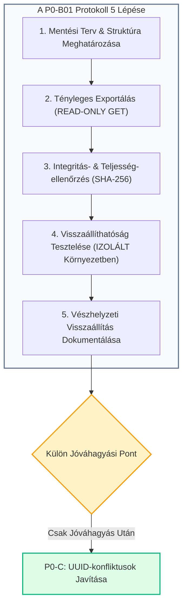

# P0-B01: Biztonsági Mentési és Visszaállítási Terv
## A `categories` Tábla és Konfigurációs Rekordjainak Védelmi Protokollja

**Dokumentum azonosító:** `P0_B01_BACKUP_AND_RESTORE_PLAN.md`  
**Dátum:** 2026. november 8.  
**Státusz:** Jóváhagyásra előterjesztett eljárásrend (PLANNING ONLY / NO EXECUTION)  
**Kapcsolódó felmérés:** [`P0_A01_SUPABASE_DATA_INVENTORY.md`](file:///c:/Users/User/Documents/epitotudas/project/P0_A01_SUPABASE_DATA_INVENTORY.md)  
**Projekt:** ÉpítőTudás Digitális Építőipari Platform (`c:\Users\User\Documents\epitotudas\project`)  
**Környezet:** Supabase Cloud PostgreSQL (`olmavxcmkvvcebgqxohe`)

---

## 1. CÉL ÉS STRATÉGIAI HÁTTÉR

A **P0-A01 adatbiztonsági leltár** igazolta, hogy a Supabase `categories` táblájában jelenleg **22 db éles rekord** található, amelyek közül **3 konfigurációs rekord pótolhatatlan, nagy értékű adatot képvisel**:
1. `...0009` – **Fogalomtár kategória-beállítások és egyedi ikonok:** **296 937 bájt** (~297 KB JSON).
2. `...0007` – **Építőipari szakmák részletes adatbázisa:** **58 181 bájt** (~58 KB JSON, 8 szakma adatai).
3. `...0001` – **Platform központi beállításai és arculata:** **270 201 bájt** (~270 KB JSON).
4. `...0008` – **Rólunk oldal tartalmi beállításai:** **1 748 bájt** (~1.7 KB JSON).
5. **8 db publikus szakmai kategória:** A teljes cikk- és útmutató-struktúra alapjai.

### A feladat célja:
Olyan **zárt, ellenőrzött és kockázatmentes biztonsági mentési és visszaállítási protokollt** létrehozni, amely:
- Garantálja a meglévő 22 rekord 100%-os sértetlenségét.
- Minden lehetséges jövőbeli javítási lépés (pl. P0-C UUID-rendezés) előtt **bizonyítottan visszaállítható állapotot** hoz létre.
- Szigorúan elkülöníti a mentés előkészítését, az exportálást, a tesztelést és az éles adatbázis-műveleteket.

---

## 2. SZIGORÚ MŰKÖDÉSI KORLÁTOZÁSOK ÉS GARANCIÁK

1. **Jelenleg CSAK a terv készül el:** Ez a dokumentum önmagában semmilyen adatbázis-exportot, módosítást vagy UUID-cserét nem hajt végre.
2. **Éles adatbázis védelme:** Az éles Supabase adatbázisban a mentési folyamat során kizárólag **READ-ONLY HTTP GET** művelet engedélyezett.
3. **Visszaállítás kizárólag izolált környezetben:** A visszaállítási folyamat tesztelése **kizárólag memóriabeli (in-memory / mock) izolált tesztkörnyezetben történhet**. Az éles adatbázisba történő bármilyen visszatöltés vagy felülírás **szigorúan tilos**, és külön írásbeli Termékfelelősi jóváhagyást igényel.
4. **Nincs UUID-módosítás:** Sem ebben a fázisban, sem a mentés során nem történik kód- vagy azonosítómódosítás.

---

## 3. AZ 5-LÉPÉSES MENTÉSI ÉS VISSZAÁLLÍTÁSI PROTOKOLL



---

### 1. Lépés: Mentési Terv és Struktúra Meghatározása
- **Célállomány formátuma:** Strukturált, metaadatokkal ellátott JSON csomag (`.json`).
- **Célkönyvtár:** `c:\Users\User\Documents\epitotudas\project\backups\` (helyi, nem verziózott, védett mentési mappa).
- **Fájlnév-konvenció:** `categories_backup_YYYY-MM-DDTHH-mm-ss.json` (pontos ISO időbélyeggel).
- **Mentési csomag szerkezete:**
  ```json
  {
    "metadata": {
      "exported_at": "ISO-8601 időbélyeg",
      "source_url": "https://olmavxcmkvvcebgqxohe.supabase.co",
      "table_name": "public.categories",
      "record_count": 22,
      "content_range": "0-21/22",
      "sha256_checksum": "HEX-kódolt SHA-256 ellenőrzőösszeg",
      "byte_size": 682517,
      "format_version": "1.0.0"
    },
    "data": [
      {
        "id": "UUID",
        "name": "Kategória vagy rendszerkonfiguráció neve",
        "slug": "kategoria-slug",
        "icon_name": null,
        "color": null,
        "description": "JSON string vagy leírás",
        "article_count": 0,
        "sort_order": 0,
        "created_at": "ISO-8601",
        "updated_at": "ISO-8601"
      }
    ]
  }
  ```

---

### 2. Lépés: Tényleges Exportálás Végrehajtási Terve
- **Módszer:** Szigorúan READ-ONLY HTTP GET kérés a PostgREST végpontra.
- **Végpont:** `https://olmavxcmkvvcebgqxohe.supabase.co/rest/v1/categories?select=*&order=id.asc`
- **Kötelező fejléc:** `Prefer: count=exact`
- **Feltétel a mentés érvényességéhez:**
  - A HTTP válaszkódnak `200 OK`-nak kell lennie.
  - A válasz `Content-Range` fejlécének kötelezően `0-21/22`-nek kell lennie.
  - A letöltött tömb hosszának pontosan **22 eleműnek** kell lennie. Ha a sorok száma bármi okból eltér a 22-től, a folyamat azonnal leáll hibaüzenettel, és nem hoz létre érvényes mentési fájlt.

---

### 3. Lépés: Integritás- és Teljesség-ellenőrzési Módszertan
A mentett fájl létrehozása után automatikus verifikáció fut le:
1. **Fájl visszaolvasása és Parse-olhatóság:** A lementett JSON fájl beolvasása lemezről és szintaktikai ellenőrzése (`JSON.parse`).
2. **SHA-256 Ellenőrzőösszeg összevetése:**
   - A letöltött nyers adatrekordokból képzett hash összehasonlítása a mentési fájlba rögzített hash-értékkel.
   - Bármilyen egyezési hiba esetén a mentés **érvénytelennek** tekintendő.
3. **Kritikus rekordok tételes vizsgálata (Deep Verification):**
   A mentett adathalmazban külön ellenőrizni kell a 4 kiemelt konfigurációs sort:
   - `...0009`: létezik, neve `__SYSTEM_CONFIG_GLOSSARY_CATEGORY_SETTINGS__`, mérete > 290 000 bájt.
   - `...0007`: létezik, neve `__SYSTEM_CONFIG_TRADES__`, mérete > 50 000 bájt (8 szakma).
   - `...0001`: létezik, neve `__SYSTEM_CONFIG_SITE_SETTINGS__`, mérete > 250 000 bájt.
   - `...0008`: létezik, neve `__SYSTEM_CONFIG_ABOUT_SETTINGS__`, mérete > 1 500 bájt.

---

### 4. Lépés: Visszaállíthatóság Tesztelése Kizárólag Izolált Környezetben
**Kifejezett biztonsági szabály:** A visszaállítási folyamat tesztelése **NEM érintheti a felhős adatbázist**.

#### A tesztelés menete elkülönített sandbox környezetben:
1. **Izolált In-Memory Adattár inicializálása:** Egy virtuális memória-tábla (`Map<string, CategoryRecord>`) létrehozása Node.js futtatókörnyezetben.
2. **Visszaállítási algoritmus futtatása:** A mentési JSON fájl `data` tömbjének betöltése a virtuális táblába.
3. **Rekord- és Mezőszintű ellenőrzés:**
   - Összehasonlítani a virtuális táblában létrejött objektumokat a letöltött eredeti sorokkal.
   - 100%-os egyezést kell igazolni mind a 22 sorra, az összes mezőre (`id`, `name`, `slug`, `description`, `article_count`, `sort_order`, `created_at`, `updated_at`).
4. **Sikeres teszt kimenete:** A teszt igazolja, hogy a mentett JSON csomagból egy céladatbázis rekordjai veszteségmentesen, bitről bitre rekonstruálhatók.

---

### 5. Lépés: Vészhelyzeti Visszaállítási Eljárás Dokumentálása
Ha a jövőbeni fejlesztések (pl. a P0-C UUID javítások) során bármilyen hiba vagy nem várt felülírás történne az éles adatbázisban, a helyreállítást az alábbi szigorú protokoll szerint kell elvégezni:

#### Visszaállítási Lépések Vészhelyzetben:
1. **Jóváhagyás:** A Termékfelelős írásos jóváhagyása az éles visszaállítás végrehajtására.
2. **Célzott rekord visszaállítása (Targeted Restore):**
   - Ha csak egyetlen rekord sérült (pl. a `...0007` sor felülíródott), nem az egész táblát kell felülírni, hanem a mentési JSON-ból kizárólag a sérült rekordot kell visszatölteni egyedi `UPDATE` hívással a mentett `description` szöveggel.
3. **Teljes tábla visszaállítása (Full Restore):**
   - Kritikus adatsérülés esetén egy dedikált visszaállító szkript soronként végigmegy a mentési fájl 22 elemén, és `upsert` művelettel visszaállítja az összes eredeti rekordot.
4. **Utólagos verifikáció:** A PostgREST lekérdezés újra-futtatása és az SHA-256 ellenőrzőösszeg újra-kalkulálása, bizonyítva a korábbi állapot pontos helyreállását.

---

## 4. FELELŐSSÉGI KÖRÖK ÉS KÖVETKEZŐ LÉPÉS

- **Jelenlegi státusz:** A P0-B01 eljárási terve elkészült.
- **Mi NEM történt meg?** Nem történt adatmentési futtatás, nem módosult forráskód, és nem változott az adatbázis.
- **Következő lépés:** A Termékfelelős jóváhagyása után a 2. és 3. lépés (a tényleges exportálás és az izolált környezetben történő tesztelés) elvégzése a fenti protokoll szerint.

