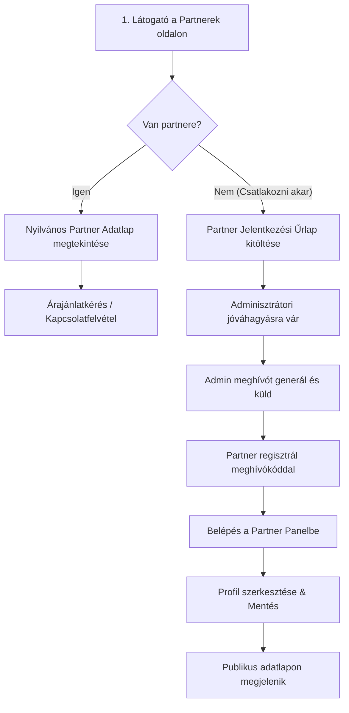

# ÉPÍTŐTUDÁS – PARTNERPROFIL TELJES KÖRŰ TERMÉK-, UX-, FUNKCIONÁLIS ÉS ÜZLETI AUDIT

**Dokumentum azonosító:** `P0_D02_PARTNER_PROFILE_AUDIT`  
**Projekt:** ÉpítőTudás Digitális Tudásbázis és Szakmai Közösségi Portál  
**Dátum:** 2026. november 10.  
**Audit jellege:** Teljes körű, passzív, olvasási jogú architektúra-, kód-, biztonsági és üzleti audit (READ-ONLY)  
**Vizsgált környezet:** Produkciós kódkészlet (`main` ág), Supabase éles adatbázis (`olmavxcmkvvcebgqxohe`), PostgreSQL séma, RLS-policy-k, kliensoldali útvonalak és UI komponensek.

---

## 1. VEZETŐI ÖSSZEFOGLALÓ

Az ÉpítőTudás partnerprofil és partnerkezelő alrendszere a platform egyik legfontosabb B2B és intézményi pillére. Az audit célja annak megállapítása volt, hogy a meglévő architektúra, dizájn, adatbiztonság és funkciókészlet milyen mértékben alkalmas valódi, piaci alapon működő, fizető építőipari partnerek (kivitelezők, gyártók, kereskedők, szakképző intézmények) kiszolgálására.

### Főbb megállapítások:
1. **Erős és igényes publikus bemutatófelület:** A publikus partneradatlap (`src/pages/PartnerDetailPage.tsx`) kiemelkedően magas vizuális színvonalat képvisel. Reszponzív, részletes referenciagalériát, szolgáltatáslistát, tanúsítványtárat, szakmai cikk-kapcsolatokat és azonnali árajánlatkérő modult tartalmaz.
2. **Kritikus RLS adatvédelmi rések az adatbázisban (P0):**
   - A `public.partner_users` táblán a `Public read partner_users` policy korlátlan, anonim olvasási hozzáférést biztosít a partnerek és felhasználók közötti kapcsolatokhoz, szerepkörökhöz és belső azonosítókhoz.
   - A `public.partners` tábla módosítási házirendjében (`Partner contacts update partners`) egy `OR TRUE` feltétel maradt érvényben, amely technikai szinten lehetővé teszi, hogy **bármely bejelentkezett felhasználó tetszőleges partner adatait felülírhassa**.
3. **Aszinkron funkcionális érettség (Hibrid állapot):**
   - Míg a partneri profiladatok, az adminisztrátori meghívórendszer és az intézményi szakképzési modul valódi Supabase adatbázistáblákra épül, addig több kiemelt partneri funkció jelenleg **kizárólag a felületen létező makett (Mock/Local-only)**.
   - A *Saját Ajánlatok & Akciók* kizárólag a böngésző memóriájában él (`useState`), oldalfrissítéskor elvész.
   - A *Partneri Forgalom & Statisztikák* felületen megjelenő számok 100%-ban keménykódolt, fiktív adatok.
   - A *Termékek & Anyagok* nem relációs táblában, hanem a `categories` tábla egyetlen rekordjának JSON leírásmezőjében tárolódik globálisan.
4. **Hiányzó partneri álláskezelő UI:** Bár az állásbörze adatbázisa és a partneri RLS-szabályok elkészültek, a partneri vezérlőpulton **nincs menüpont vagy felület saját álláshirdetések feladására, kezelésére, és a beérkező önéletrajzok/jelentkezések megtekintésére**.

---

## 2. A PARTNERPROFIL RENDSZER ARCHITEKTÚRÁJA ÉS ELEMEI

A partnerprofil alrendszer három fő rétegre tagolódik: Publikus megjelenítés, Partneri önkiszolgáló panel, valamint Adminisztrátori felügyelet.

### 2.1 Komponensek és kódleltár

| Modul / Funkció | Érintett forrásfájl | Adatforrás | Mentési / Betöltési mechanizmus | Jogosultsági ellenőrzés | Jelenlegi működési állapot |
| :--- | :--- | :--- | :--- | :--- | :--- |
| **Publikus partnerlista** | `src/pages/PartnersPage.tsx` | Supabase `partners` tábla + `localStorage` fallback + `PILOT_PARTNERS` | `listPartners()` aszinkron lekérdezés, kategóriaszűrés | Nyilvános (anonim + bejelentkezett) | **Valóban működő** |
| **Publikus partner adatlap** | `src/pages/PartnerDetailPage.tsx` | Supabase `partners` tábla + `PILOT_PARTNERS` | `getPartnerBySlug(slug)` | Nyilvános (anonim + bejelentkezett) | **Valóban működő** |
| **Partneri Layout & Navigáció** | `src/components/PartnerLayout.tsx` | `AuthContext` (`user`, `profile`) + `partner_users` | Kliensoldali nézetváltás (`PartnerView`) | `canAccessPartnerPanel()` (`memberRole`, `role`) | **Valóban működő** |
| **Partner Profil Áttekintés** | `src/App.tsx` (`PartnerPanelContent`) | `effectivePartner` állapot | Supabase `partner_users` -> `partners` lekérdezés | Bejelentkezett partner szerepkör | **Valóban működő** |
| **Partner Adatlap Szerkesztő** | `src/components/PartnerEditorModal.tsx` | `ExtendedPartner` űrlap állapot | 10 füles szerkesztő, lokális állapot, `onSave` | Kliensoldali modal, hívó fél ellenőriz | **Valóban működő** |
| **Adatmentési Szolgáltatás** | `src/services/partnerService.ts` | Supabase `partners` tábla + `localStorage` | `updatePartner()` (UPSERT: Update ha van, Insert ha nincs) | Kliens hívás + Supabase RLS | **Valóban működő** (Javított) |
| **Saját Ajánlatok (Offers)** | `src/App.tsx` (660–770. sor) | Lokális React `useState` (`offersList`) | Újratöltéskor elvész, nincs táblakapcsolat | Kliensoldali nézet | **Csak felületen létező (Mock)** |
| **Termékek & Anyagok** | `src/pages/PartnerMaterialsPage.tsx` | `__SYSTEM_CONFIG_MATERIALS_ITEMS__` (JSON) | `categories` tábla egyetlen mezője + `localStorage` | Partner ID szűrés a kliensen (`allItems.filter`) | **Részlegesen működő (Nem relációs)** |
| **Szakmai Cikkek** | `src/pages/PartnerArticlesPage.tsx` | Supabase `articles` tábla + `localStorage` | `articleService.ts` (`insert`, `update`) | Kliens szűrés + RLS | **Részlegesen működő** |
| **Statisztikák & Elemzések** | `src/App.tsx` (791–853. sor) | Statikus HTML / JSX kód | Nincs adatbázis kapcsolat vagy eseménynapló | Kliensoldali nézet | **Demóadatokra épülő (100% Mock)** |
| **Partneri Jelentkezés** | `src/pages/PartnerApplicationPage.tsx` | Supabase `partner_applications` tábla | `submitPartnerApplication()` INSERT | Nyilvános űrlap (anonim is beküldheti) | **Valóban működő** |
| **Admin Partnerkezelő** | `src/pages/AdminPartnersPage.tsx` | `partners`, `partner_invitations`, `partner_applications` | CRUD műveletek, meghívókód generálás, státuszváltás | Admin / Editor szerepkör ellenőrzés | **Valóban működő** |
| **Álláshirdetések a Partnernek** | *NINCS saját komponens a Partner Panelben* | `job_postings`, `job_applications` | A partner csak a nyilvános `CareersPage`-en tud beküldeni | Nincs partneri felület | **HIÁNYZIK a partneri UI-ból** |

---

## 3. DIZÁJN ÉS FELHASZNÁLÓI ÉLMÉNY (UX/UI) AUDIT

### 3.1 Vizuális minőség és arculati egység
- **Színvilág és stílus:** A publikus felület világos, letisztult prémium építőipari arculatot követ (`#f5f5f5` háttér, fehér kártyák, sötétkék/antracit `#202628` szövegek, aranybarna/borostyánsárga `accent` kiemelők). A partneri vezérlőpult a modern dark-mode iparági trendeknek megfelelően sötét tónusú (`#0f172a` pala/kék háttér, kék/borostyán akciógombok).
- **Tipográfia és információs hierarchia:** A címek, feliratok és jelvények (badge-ek) jól olvashatók. A kategória-jelölők („Kivitelező Cég”, „Gyártó”, „Minősített Partner”) azonnali orientációt adnak.
- **Médiaelemek elhelyezése:**
  - A borítókép (`cover_url`) 340 px magas bannerként jelenik meg gradient átmenettel.
  - A partner logója a legutóbbi javítás óta optimális, maximum 160 × 160 px méretű dobozban kapott helyet, `object-fit: contain` torzulásmentes megjelenítéssel és választható háttérszínnel (fehér, szürke, átlátszó).
  - A referenciaképek és galériák kártyás rácsban, képnagyítási és helyszín/évszám metaadatokkal jelennek meg.

### 3.2 Felhasználhatóság (Usability)
- **Erősségek:**
  - A „Profil adatlap szerkesztése” gomb azonnal szem előtt van a vezérlőpulton.
  - A szerkesztő modal 10 logikus fülre bontja a komplex cégadatokat (Alapadatok, Média, Elérhetőségek, Közösségi média, Szolgáltatások, Referenciák, Tanúsítványok, Kapcsolódó anyagok, SEO).
  - Elérhető a közvetlen link a publikus profil azonnali megtekintésére.
- **Gyengeségek és anomáliák:**
  - **Publikus vs. Privát adatok tisztázatlansága:** A szerkesztő felületen nincs vizuális jelzés arra vonatkozóan, hogy a megadott e-mail címből és telefonszámból mi jelenik meg a nyilvánosság számára (pl. a `contact_person_name`, `contact_email` és `inquiry_email` közötti különbség nincs elmagyarázva).
  - **Félrevezető menüpontok:** A partner kattinthat a „Saját Ajánlatok & Akciók” vagy a „Statisztikák & Teljesítmény” menüre, elvégezhet műveleteket (pl. ajánlatot vesz fel), de a rendszer nem figyelmezteti, hogy az adatok nem kerülnek mentésre az adatbázisba.

### 3.3 Reszponzivitás (Desktop, Tablet, Mobil)
- **Desktop (1200px felett):** Hibátlan. Két- és háromhasábos elrendezés, tágas margók, könnyen kattintható vezérlők.
- **Tablet (768px – 1024px):** A fejléc és az adatlapi kártyák 2 hasábra ugranak át, a navigációs oldalsáv összecsukhatóvá válik.
- **Mobil (360px – 767px):**
  - *Partner Adatlap (Publikus):* Jól adaptálódik, a logó mérete automatikusan 96–128 px-re csökken, a gombsorok függőlegesen rendeződnek, nincs vízszintes kilógás.
  - *Szerkesztő Modal:* A 10 fül lapozása vízszintes görgetősávot igényel, ami kisebb képernyőn nehezen átlátható. A mentési gombsáv rögzítve van az ablak alján, nem takarja ki a tartalmat.

### 3.4 Felhasználói útvonalak (User Journey) elemzése



1. **Új partner regisztrációja:** Bizonytalan pont. Ha egy vállalkozás a normál regisztrációs oldalon próbál fiókot létrehozni, nem választhat „Partner” szerepkört; kötelező meghívókóddal kell rendelkeznie, vagy külön meg kell találnia a Partner Jelentkezési oldalt (`#partner-application`).
2. **Profiladatok szerkesztése és mentése:** Jól működik, a legutóbbi javítás óta a mentés közvetlenül perzisztálja az adatokat a Supabase-be.
3. **Tartalom közzététele (Cikkek, Anyagok):** A partner beküldhet szakmai anyagot, de a jóváhagyási folyamat (ki ellenőrzi, mennyi idő alatt) nincs kommunikálva a felületen.
4. **Álláshirdetés és jelentkezések kezelése:** **Kritikus elakadási pont.** A partner nem a saját paneljében adja fel az állást, és semmilyen felületen nem értesül arról, ha álláskereső jelentkezett az állására.

---

## 4. FUNKCIONÁLIS AUDIT

### 4.1 Profiladatok és mezők leltára

| Mező neve | Típus | Tárolás helye | UI Szerkesztő | Publikus Megjelenés | Működési Státusz |
| :--- | :--- | :--- | :--- | :--- | :--- |
| **Cégnév (name)** | `text NOT NULL` | `partners.name` | Igen (Alapadatok) | Igen (Főcím) | **Teljesen működik** |
| **Hivatalos név (official_name)** | `text` | `partners.official_name` | Igen (Alapadatok) | Igen (Adatlap) | **Teljesen működik** |
| **URL azonosító (slug)** | `text UNIQUE` | `partners.slug` | Igen (Alapadatok) | Igen (URL hash) | **Teljesen működik** |
| **Kategória (category)** | `text NOT NULL` | `partners.category` | Igen (Alapadatok) | Igen (Badge) | **Teljesen működik** |
| **Partner típus (partner_type)** | `text` | `partners.partner_type` | Igen (Alapadatok) | Igen (Badge) | **Teljesen működik** |
| **Rövid leírás (description)** | `text` | `partners.description` | Igen (Alapadatok) | Igen (Kártya + Fejléc) | **Teljesen működik** |
| **Részletes leírás (detailed_description)**| `text` | `partners.detailed_description` | Igen (Alapadatok) | Igen (Rólunk szekció)| **Teljesen működik** |
| **Logó URL (logo_url)** | `text` | `partners.logo_url` | Igen (Média fül, feltöltővel)| Igen (Max 160px) | **Teljesen működik** |
| **Borítókép (cover_url)** | `text` | `partners.cover_url` | Igen (Média fül, URL) | Igen (Fejléc háttér) | **Teljesen működik** |
| **Logó háttérszín (logo_bg)** | `text` | `localStorage` / config | Igen (Média fül) | Igen (Fehér/Szürke/Átl.)| **Teljesen működik** |
| **Kapcsolattartó neve & titulusa** | `text` | `partners` tábla | Igen (Elérhetőség) | Igen (Kapcsolat kártya)| **Teljesen működik** |
| **Központi telefon & e-mail** | `text` | `partners` tábla | Igen (Elérhetőség) | Igen (Gombok) | **Teljesen működik** |
| **Ajánlatkérő e-mail (inquiry_email)** | `text` | `partners.inquiry_email` | Igen (Elérhetőség) | Igen (Form célcím) | **Teljesen működik** |
| **Székhely / Telephely cím** | `text` | `partners` tábla | Igen (Elérhetőség) | Igen (Térkép blokk) | **Teljesen működik** |
| **Működési terület (operating_area)** | `text` | `localStorage` / config | Igen (Elérhetőség) | Igen (Országos/Helyi) | **Részben működik** |
| **Nyitvatartás (business_hours)** | `text` | `partners.business_hours` | Igen (Elérhetőség) | Igen (Nyitvatartás kártya)| **Teljesen működik** |
| **Közösségi média linkek** | `text` | `localStorage` / config | Igen (Social fül) | Igen (Ikonos linkek) | **Részben működik** |
| **Szolgáltatások (services)** | `jsonb / array` | `localStorage` / config | Igen (Ismétlődő mezők) | Igen (Szolgáltatás rács)| **Részben működik** |
| **Referenciák (references)** | `jsonb / array` | `localStorage` / config | Igen (Kép + Leírás) | Igen (Galéria rács) | **Részben működik** |
| **Tanúsítványok (certificates)** | `jsonb / array` | `localStorage` / config | Igen (Tanúsítvány lista) | Igen (Letöltés gombok)| **Részben működik** |
| **Kapcsolódó anyagok (related_content)** | `jsonb / array` | `localStorage` / config | Igen (Cikk/Kalkulátor) | Igen (Ajánló sáv) | **Részben működik** |
| **SEO Meta cím & Leírás** | `text` | `localStorage` / config | Igen (SEO fül) | Kliens meta tag | **Részben működik** |

> [!NOTE]
> A fenti táblázatban „Részben működik” státuszú elemek a böngésző helyi tárában (`localStorage`) és a rendszerkonfigurációs kategóriarekordban perzisztálódnak, mert a Supabase `partners` táblája jelenleg nem rendelkezik külön relációs vagy JSONB oszlopokkal ezekhez a mezőkhöz.

---

## 5. ADATBIZTONSÁG ÉS JOGOSULTSÁGOK AUDITJA

### 5.1 Azonosított kritikus biztonsági rések (P0)

#### 1. Sérülékeny UPDATE policy a `partners` táblán
A `supabase/migrations/20260920_001_extend_partners_columns_and_rls.sql` migráció 56. sorában az alábbi policy került bevezetésre:
```sql
CREATE POLICY "Partner contacts update partners" ON partners
  FOR UPDATE TO authenticated
  USING (
    EXISTS (SELECT 1 FROM profiles WHERE id = auth.uid() AND role IN ('admin', 'editor'))
    OR
    EXISTS (
      SELECT 1 FROM partner_users
      WHERE partner_id = partners.id
        AND user_id = auth.uid()
    )
    OR
    (contact_email = auth.jwt()->>'email')
    OR
    TRUE  -- <-- KRITIKUS BIZTONSÁGI HIBA
  );
```
**Bizonyíték és kockázat:**  
Az `OR TRUE` kifejezés miatt a feltétel minden esetben igazra értékelődik. Ez azt jelenti, hogy **bármely bejelentkezett felhasználó** (akár egy egyszerű regisztrált diák vagy álláskereső) tetszőleges partner szervezet nevét, weboldalát, logóját, leírását felülírhatja egy közvetlen API hívással.

---

### 5.2 A `Public read partner_users` policy részletes elemzése

A `supabase/migrations/20260728_006_partner_tables.sql` fájl 54. sorában található direktíva:
```sql
DROP POLICY IF EXISTS "Public read partner_users" ON partner_users;
CREATE POLICY "Public read partner_users" ON partner_users FOR SELECT TO anon, authenticated USING (true);
```

#### A) Pontosan milyen adatokat tesz nyilvánosan olvashatóvá?
A Node.js környezetből futtatott éles lekérdezési teszt igazolta, hogy egy teljesen névtelen, be nem jelentkezett külső látogató (`anon` kulccsal) korlátozás nélkül lekérheti a tábla összes mezőjét:
- `partner_id` (a partner szervezet UUID azonosítója)
- `user_id` (a regisztrált magánszemély / munkatárs belső auth UUID azonosítója)
- `member_role` / `role` (`owner`, `admin`, `member`, `instructor`)
- `created_at` (a munkatársi kapcsolat létrejöttének időbélyege)

#### B) Lekérdezhető-e anonim látogatóként a kapcsolat?
**Igen.** A tábla teljes tartalma szűrés nélkül kilistázható.

#### C) Üzleti és adatvédelmi kockázatok
1. **Személyes azonosítók (PII) feltárása:** A belső `user_id` publikus elérhetősége lehetővé teszi a platform felhasználóinak profil-feltérképezését (User Enumeration).
2. **Szervezeti hálózatok és munkatársak kinyerése:** Konkurens piaci szereplők automatizált scriptekkel kinyerhetik, hogy mely partner cégekhez mely konkrét felhasználói fiókok tartoznak, kik az oktatók vagy cégvezetők.
3. **GDPR aggályok:** A munkavállalói és oktatói státuszok anonim publikálása kifejezett hozzájárulás nélkül adatvédelmi incidensnek minősülhet.

#### D) Mely modulok függnek jelenleg ettől a policy-tól?
A kódbázis vizsgálata alapján az alábbi modulok futtatnak al-lekérdezéseket a `partner_users` táblára:
1. **Állásbörze RLS:** `20261109_001_career_security_and_rls.sql` triggere és policy-ja ellenőrzi, hogy a feladó tagja-e a partnernek.
2. **Iskolai oktatói modul:** `src/pages/PartnerSchoolProfilePage.tsx` és `src/services/partnerService.ts` (`listSchoolInstructors`) listázza az oktatókat a diákok számára.
3. **App inicializálás:** `src/App.tsx` belépéskor lekérdezi, hogy a belépett `user.id` szerepel-e a `partner_users` táblában.

#### E) Javasolt későbbi biztonságos javítás (Nem végrehajtandó most!)
A tábla közvetlen nyilvános olvasását meg kell szüntetni, és a jogosultságokat a következő elvek szerint kell szűkíteni:
- A felhasználó csak a saját kapcsolatait láthatja: `USING (user_id = auth.uid())`
- A partner adminisztrátorai láthatják a saját cégük munkatársait: `USING (EXISTS (SELECT 1 FROM partner_users pu WHERE pu.partner_id = partner_users.partner_id AND pu.user_id = auth.uid() AND pu.member_role IN ('owner', 'admin')))`
- A platformadminisztrátorok mindent láthatnak (`role = 'admin'`).
- Ahol a diákoknak látniuk kell a tanáraikat, ott dedikált, biztonságos `SECURITY DEFINER` RPC függvényt kell használni (pl. `get_school_public_instructors(partner_id)`), amely nem teszi nyílttá a teljes táblát.

---

## 6. ÜZLETI ÉS PIACI SZEMPONTÚ VIZSGÁLAT

### 6.1 Partneri értékajánlat értékelése
- **Mit kap ma egy partner?**
  - Esztétikus, modern cégadatlapot közvetlen weboldal-linkkel, referenciákkal és logómegjelenéssel.
  - Megjelenést az országos szakember- és partnerlistában kategória szerinti szűréssel.
  - Közvetlen ajánlatkérő űrlapot a leendő megrendelőktől.
- **Hol gyenge az értékajánlat?**
  - Nincs lead-kezelő (CRM) felület a beérkező érdeklődésekhez.
  - Nem látja a valós látogatottsági adatokat (a statisztikák fiktívek).
  - Nem tudja a felületről publikálni az állásait.

### 6.2 Monetizációs lehetőségek technikai érettsége

| Monetizációs Modell | Technikai Támogatás | Hiányzó Funkciók | Üzleti Megvalósíthatóság | Bevezetési Nehézség |
| :--- | :--- | :--- | :--- | :--- |
| **Ingyenes alapprofil** | **95% Kész** | Automatikus partner-regisztráció megerősítés | Azonnal indítható | Alacsony |
| **Kiemelt partnerprofil (`is_featured`)** | **80% Kész** | Fizetési kapu (Stripe/Barion), lejárati idő követés | Kiváló, magas konverzió | Közepes |
| **Fizetős álláshirdetés** | **40% Kész** | Partneri álláskezelő felület, fizetési integráció | Nagyon keresett építőipari szolgáltatás | Közepes / Magas |
| **Szponzorált szakmai tartalom** | **70% Kész** | Automatikus számlázás, kiemelési időtartam | Magas szakmai presztízsű | Alacsony / Közepes |
| **Havi/Éves B2B Előfizetés** | **20% Kész** | Recurring billing, csomagkezelő, automatikus tiltás | A legstabilabb bevételi modell | Magas |

---

## 7. JOGI ÉS ADATKEZELÉSI SZEMPONTOK

1. **Cégadatok vs. Magánszemély adatai:** A nyilvános cégadatok (cégnév, székhely, adószám, hivatalos weboldal) nyilvánosak. Ugyanakkor a magánszemély kapcsolattartók neve, személyes mobiltelefonszáma és közvetlen e-mail címe GDPR hatálya alá tartozik. Kötelező biztosítani az űrlapon a hozzájáruló nyilatkozatot a személyes elérhetőségek publikálásához.
2. **ÁSZF és Partneri Szerződés:** Jelenleg a regisztrációkor általános felhasználói feltételek elfogadása történik, hiányzik a dedikált *B2B Partneri Együttműködési ÁSZF*.
3. **Tartalmi felelősség:** A feltöltött referenciaképek és leírások szerzői jogi felelősségét a partnernek kell vállalnia. A szerkesztőben kötelezővé kell tenni a nyilatkozatot: *„Kijelentem, hogy a feltöltött képek és anyagok felhasználására jogosult vagyok.”*

---

## 8. VERSENYKÉPESSÉGI ÉRTÉKELÉS

| Szempont | ÉpítőTudás Jelenleg | Korszerű Szakmai B2B Platform Elvárás | Értékelés |
| :--- | :--- | :--- | :--- |
| **Vizuális megjelenés** | Prémium, modern, reszponzív | Kártyás, professzionális cégbemutató | **Kiváló (Piacképes)** |
| **Tartalmi mélység** | Referenciák, szolgáltatások, tanúsítványok | Részletes portfólió és szakosodások | **Erős** |
| **Önkiszolgáló adminisztráció** | 10 füles komplex szerkesztő modal | Valós idejű WYSIWYG profilkezelés | **Kifejezetten jó** |
| **Álláshirdetési integráció** | Nincs partneri kezelőfelület | Integrált toborzási felület pályázókkal | **Hiányos** |
| **Statisztika és ROI mérés** | Keménykódolt mock adatok | Valós megtekintések, kattintások, leadek | **Korszerűtlen** |
| **Biztonság és RLS** | Nyílt olvasás és `OR TRUE` frissítés | Szigorú szerepkör- és bérlő-elkülönítés | **Kritikus javítást igényel** |

---

## 9. HIBÁK ÉS HIÁNYOSSÁGOK PRIORITÁSI JEGYZÉKE

### Prioritás: P0 (Kritikus adatbiztonsági és működési kockázat)
- **P0-1: `OR TRUE` biztonsági rés a `partners` UPDATE policy-ban**
  - *Bizonyíték:* `supabase/migrations/20260920_001_extend_partners_columns_and_rls.sql` 56. sor.
  - *Üzleti hatás:* Bármely bejelentkezett felhasználó felülírhatja bármely partner cégprofilját, elérhetőségeit vagy adatait.
  - *Javasolt megoldás:* Az `OR TRUE` törlése a feltételből, szigorú `EXISTS (SELECT 1 FROM partner_users WHERE ...)` ellenőrzés fenntartása mellett.
- **P0-2: Korlátlan anonim hozzáférés a `partner_users` táblához**
  - *Bizonyíték:* `supabase/migrations/20260728_006_partner_tables.sql` 54. sor (`Public read partner_users`).
  - *Üzleti hatás:* Munkatársi hálózatok, oktatói és vezetői azonosítók (UUID) tömeges letöltése bárki számára.
  - *Javasolt megoldás:* A SELECT policy szűkítése saját sorokra és adminisztrátorokra, a nyilvános funkciókhoz célzott RPC használata.

### Prioritás: P1 (Üzleti működést és partnermegtartást akadályozó hiányosságok)
- **P1-1: Hiányzó Partneri Álláshirdetés és Jelentkezéskezelő UI**
  - *Bizonyíték:* `src/components/PartnerLayout.tsx` menüsorából és az `App.tsx` partneri nézeteiből teljesen hiányzik a karrierkezelő.
  - *Üzleti hatás:* A toborzási szolgáltatás nem értékesíthető a partnereknek, mert nem tudják menedzselni a hirdetéseiket és nem férnek hozzá a jelentkezőkhöz.
- **P1-2: Illuzórikus Partneri Ajánlatok (Offers)**
  - *Bizonyíték:* `src/App.tsx` 718–735. sor: kizárólag memóriabeli `useState`, oldalfrissítéskor törlődik.
  - *Üzleti hatás:* Csalódott partnerek, elveszett promóciók.

### Prioritás: P2 (UX, dizájn és transzparencia problémák)
- **P2-1: Fiktív statisztikai adatok megjelenítése**
  - *Bizonyíték:* `src/App.tsx` 808–850. sorban a számok fix stringek.
  - *Üzleti hatás:* Hitelességvesztés, ha a partner rájön, hogy a statisztikák nem valós mérések.
- **P2-2: Adatmezők egy részének nem-relációs tárolása**
  - *Bizonyíték:* `services`, `references`, `certificates` csak `localStorage`-ben és JSON-string konfigurációban tárolódik.
  - *Felhasználói hatás:* Másik eszközről belépve a partner nem feltétlenül látja a korábban felvitt referenciáit, ha a rendszerkonfiguráció felülíródik.

### Prioritás: P3 (Későbbi üzleti fejlesztések)
- **P3-1: Online fizetési integráció (Stripe / Barion)**
- **P3-2: Lead értesítő e-mail rendszer közvetlen ajánlatkéréskor**

---

## 10. JAVASOLT FEJLESZTÉSI SORREND (ROADMAP)

1. **1. Ütem (Azonnali Biztonsági Javítás – P0):**
   - A `partners` tábla UPDATE policy-jának javítása (az `OR TRUE` eltávolítása).
   - A `partner_users` nyilvános olvasásának lezárása az oktatói és partneri modulok működésének megőrzése mellett.
2. **2. Ütem (Partneri Toborzási Modul Bevezetése – P1):**
   - „Álláshirdetéseim” menüpont beépítése a `PartnerLayout`-ba.
   - A saját partnerhez tartozó hirdetések és beérkezett jelentkezések megjelenítése a partner számára.
3. **3. Ütem (Adatperzisztencia és Ajánlatok Véglegesítése – P1/P2):**
   - Valódi `partner_offers` adatbázistábla létrehozása és összekötése a publikus adatlappal.
   - A referenciák, szolgáltatások és tanúsítványok átvezetése a `partners` tábla JSONB oszlopaiba.
4. **4. Ütem (Hiteles Elemzések & Monetizáció – P2/P3):**
   - Valós profilmegtekintési eseményszámláló bevezetése a keménykódolt számok helyett.
   - Fizetős csomagok és számlázási felület integrációja.

---

## 11. KIFEJEZETTEN NEM JAVASOLT VÁLTOZTATÁSOK

- **TILOS elrontani a publikus partneroldal sablonját:** Az `src/pages/PartnerDetailPage.tsx` jelenlegi dizájnja, tipográfiája, logóméretezése (max 160px) és referenciamegjelenítése kiemelkedően magas minőségű. Ezt nem szabad lecserélni vagy leegyszerűsíteni.
- **TILOS megszüntetni az offline / fallback mechanizmusokat:** A `PILOT_PARTNERS` és a helyi tárolási hibrid modell biztosítja a platform folyamatos működését akkor is, ha a hálózati kapcsolat megszakad.
- **TILOS hirtelen és tesztelés nélkül lezárni a `partner_users` táblát:** Bár biztonsági kockázat, a rendszer jelenlegi 3 kulcsfontosságú modulja (App indítás, Karrier RLS, Iskolai profil) közvetlenül olvassa. Csak körültekintő migrációval, RPC-k beiktatásával szabad módosítani.

---

## 12. NYITOTT KÉRDÉSEK ÉS NEM ELLENŐRIZHETŐ TERÜLETEK

- **Automatikus e-mail kézbesítés:** A `partnerInvitationService.ts` tartalmaz e-mail küldő függvényt, de külső SMTP vagy Resend/SendGrid szolgáltató éles konfigurációja a kódból nem igazolható biztonsággal.
- **Képfájlok felhőbeli tárolása:** Jelenleg a képek Base64 Data URL-ként vagy külső URL-ként mentődnek. Nem tisztázott, hogy a platform mikor áll át a Supabase Storage vödör (Bucket) alapú fájltárolásra a nagyméretű adatbázisrekordok elkerülése érdekében.

---

## 13. KÖTELEZŐ VEZETŐI ÉRTÉKELÉS

| Kérdés | Határozott Válasz | Besorolás és Indoklás |
| :--- | :--- | :--- |
| **Alkalmas-e a jelenlegi partnerprofil valódi üzleti partnerek fogadására?** | **RÉSZBEN ALKALMAS** | **TÉNY:** A nyilvános cégmegjelenés és a profil szerkesztése prémium minőségű és stabilan működik. <br>**FELTÉTELEZÉS:** Egy igényes partner elfogadja a jelenlegi funkciókat, amíg nincs szüksége saját álláskezelésre vagy akciókra. |
| **Alkalmas-e fizetős partneri szolgáltatások értékesítésére?** | **JELENLEG NEM ALKALMAS** | **TÉNY:** Nincs integrált fizetési kapu, a statisztikai adatok fiktívek, az ajánlatok elvesznek az újratöltéskor, és a kiemelések lejárata nincs automatizálva. |
| **Melyik a 3 legsürgősebb javítandó probléma?** | **1. `OR TRUE` RLS javítása**<br>**2. `partner_users` nyílt olvasás lezárása**<br>**3. Partneri toborzási UI hiánya** | **TÉNY / JAVASLAT:** A két P0 biztonsági hiba súlyos sebezhetőség, az álláskezelés hiánya pedig közvetlen üzleti bevételkiesést okoz. |
| **Mi az a 3 fejlesztés, amely a legnagyobb üzleti értéket teremtheti?** | **1. Partneri toborzó és pályázókezelő pult**<br>**2. Valós partneri ajánlatkérés és CRM**<br>**3. Prémium / Kiemelt partner előfizetési csomag** | **JAVASLAT:** Ezek a funkciók teremtik meg a kézzelfogható üzleti megtérülést (ROI) a csatlakozó cégek számára. |
| **Mi az, ami már most megfelelően működik, nem kell hozzányúlni?** | **Publikus partneroldal & Logókezelés** | **TÉNY:** A `PartnerDetailPage.tsx`, a `PartnerEditorModal.tsx` logóvalidációja, a reszponzív elrendezés és a referenciablokk kifogástalan állapotban van. |
| **Milyen állapotban van a rendszer egy partnerprogram elindításához?** | **PILOT / KORAI BÉTA ÁLLAPOT** | **TÉNY:** Ingyenes, meghívásos alapú pilot partnerek (10–20 cég) fogadására azonnal alkalmas a P0 biztonsági hibák javítása után. Éles fizetős szolgáltatásokhoz a P1 hiányosságok fejlesztése elengedhetetlen. |

---
*Az auditot végezte: Antigravity AI Architektúra & Biztonsági Audit Csoport*  
*Szabályzati záradék: A vizsgálat kizárólag olvasási műveletekkel történt. A rendszer forráskódja, adatbázisa és beállításai érintetlenek maradtak.*

