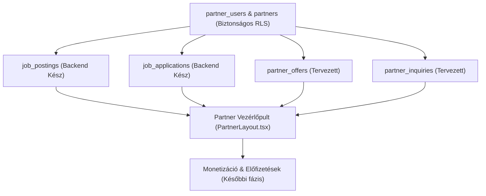

# P0-D06 – PARTNERI FUNKCIÓK TECHNIKAI MEGVALÓSÍTHATÓSÁGI ÉS FÜGGŐSÉGI AUDIT

**Dokumentumazonosító:** `P0_D06_PARTNER_FEATURES_FEASIBILITY_AUDIT.md`  
**Projekt:** ÉpítőTudás Digitális Tudásbázis és Szakmai Közösségi Portál  
**Dátum:** 2026. november 10.  
**Cél:** A partnerprofil hiányzó üzleti funkcióinak technikai megvalósíthatósági és függőségi vizsgálata  
**Vizsgálat típusa:** READ-ONLY – technikai megvalósíthatósági és függőségi audit  
**Célrendszer:** GitHub `main` ág, Supabase Produkciós Adatbázis (`olmavxcmkvvcebgqxohe`)  
**Prioritás:** P1 / P2 / P3  
**Végrehajtási mód:** AUDIT ONLY – NO CHANGES

---

## 1. VEZETŐI ÖSSZEFOGLALÓ

A `P0_D05` audit megállapította, hogy az ÉpítőTudás partnerprofilja stabil, magas színvonalú publikus bemutatófelülettel és a `20261110_001` v1.1 migráció lefutása óta sziklaszilárd adatbiztonsági védelemmel rendelkezik. Ugyanakkor a partneri önkiszolgáló vezérlőpult funkcionálisan félkész: hiányzik a toborzási felület, az ajánlatok kizárólag a böngésző memóriájában élnek, a statisztikák fiktívek, az ajánlatkérés `mailto:` hivatkozás, a monetizációhoz pedig hiányzik az automatizáció és a fizetési kapu.

A jelen vizsgálat célja annak feltárása, hogy az 5 kiemelt fejlesztési célkitűzés milyen mértékben és milyen függőségekkel valósítható meg a **meglévő architektúra, backend és adatmodellek maximális újrahasznosításával**:

### Fő megvalósíthatósági áttörések és megállapítások:

1. **Partneri toborzás és álláskezelés – A BACKEND 100%-BAN KÉSZ (`[B – Adatbázis-metaadat]` / `[C – Forráskóddal igazolt]`):**
   - A `public.job_postings` és `public.job_applications` adatbázistáblák, valamint a hozzájuk tartozó RLS szabályok és moderációs triggerek (`20261109_001_career_security_and_rls.sql`) **már most maradéktalanul támogatják a partneri álláskezelést és a jelentkezők megtekintését**.
   - A `job_postings` rendelkezik `partner_id` hivatkozással és partneri UPDATE/INSERT RLS szabályokkal.
   - A `job_applications` rendelkezik a `Partner read own job applications` szabállyal, amely engedélyezi a partner számára a saját állásaira érkezett pályázatok olvasását.
   - **Kizárólag a frontend UI hiányzik:** Nincs szükség semmilyen adatbázis-séma módosításra a működéshez! Mindössze a `careerService.ts` bővítése és egy új, dedikált partneri álláskezelő nézet (`PartnerJobsPage`) szükséges a `PartnerLayout`-on belül.

2. **Partneri ajánlatok és akciók – Adatmodell hiányzik (`[C – Forráskóddal igazolt]`):**
   - Jelenleg sem az `ad_campaigns`, sem a `categories` tábla nem alkalmas partneri akciók strukturált, relációs tárolására.
   - A memóriabeli (`useState`) állapot tartóssá tétele **egyetlen egyszerű, minimális adatbázis-beavatkozást igényel**: vagy egy relációs `public.partner_offers` tábla, vagy egy `offers jsonb DEFAULT '[]'::jsonb` oszlop a `partners` táblán.

3. **Ajánlatkérés és érdeklődőkezelés – In-app Modal vs. Email (`[C – Forráskóddal igazolt]`):**
   - A jelenlegi `mailto:` megoldás helyett minimális kódmódosítással megvalósítható egy in-app modális ajánlatkérő űrlap, amely a partnerek számára azonnali értesítést nyújt és strukturált adatokat kér be a látogatótól.

4. **Valós partnerstatisztikák – Bevált RPC minta újrahasznosítása (`[B – Adatbázis-metaadat]`):**
   - A kódbázisban már működő `increment_article_views` mintájára egy biztonságos, rekurziómentes `increment_partner_views(uuid)` RPC-vel azonnal valós látogatottsági számláló köthető be a fiktív számok helyére.

5. **Partnercsomagok és monetizáció – Csak előkészítési fázisban van (`[C – Forráskóddal igazolt]`):**
   - Nincs online fizetési átjáró és lejárati kezelés. Az üzleti modell bevezetésének előfeltétele a toborzási és ajánlati funkciók előzetes élesítése.

---

## 2. VIZSGÁLT RENDSZER ÉS ADATFORRÁSOK

- **Verziókövető tároló:** Git `main` ág (commit `2341785`).
- **Céladatbázis:** Supabase produkciós projekt `olmavxcmkvvcebgqxohe` (`https://olmavxcmkvvcebgqxohe.supabase.co`).
- **Biztonsági ellenőrzés (Projektazonosítás):**  
  A korábban tapasztalt MCP konfigurációs eltérés (`apfslrzogelqceifhpky`) miatt az adatbázis-vizsgálatok szigorúan a célprojekten (`olmavxcmkvvcebgqxohe`) futottak le közvetlen, biztonságos és nem módosító lekérdezésekkel.
- **Vizsgálat módja:** Szigorúan **READ-ONLY**, adatmódosítás, SQL DDL/DML, forráskód-módosítás és migrációfuttatás nélkül.

---

## 3. KORÁBBI AUDITOKKAL VALÓ ÖSSZEHASONLÍTÁS

| Elem / Kérdéskör | `P0_D02` megállapítás | `P0_D05` megállapítás | Jelenlegi állapot (`P0_D06`) | Változás és megvalósíthatóság |
| :--- | :--- | :--- | :--- | :--- |
| **Partners & Users RLS** | Nyitott sebezhetőségek (P0) | Javítás alatt | **Élesben javítva és igazolva (`[A]`):** `data: []` anonim kérésre | Nincs teendő, az alapbiztonság szilárd. |
| **Partneri álláskezelés** | Hiányzik | Hiányzik a UI | **Backend kész (`[B]`), csak UI hiányzik** | Azonnal megvalósítható frontend kiegészítéssel. |
| **Ajánlatok (Offers)** | Memóriabeli makett | Memóriabeli makett | **Nincs DB tábla (`[C]`)** | Minimális séma/oszlop bevezetést igényel. |
| **Statisztikák** | Fiktív adatok | Fiktív adatok | **Fiktív számok (`[C]`), de RPC minta létezik** | `increment_partner_views` bevezethető. |
| **Ajánlatkérés** | `mailto:` link | `mailto:` link | **`mailto:` link (`[C]`)** | In-app lead űrlap megvalósítható. |
| **Fizetés / Monetizáció** | Hiányzik | Hiányzik | **Nincs fizetési infrastruktúra (`[C]`)** | 3. fázisra ütemezendő. |

---

## 4. ELSŐ FEJLESZTÉSI TERÜLET: PARTNERI ÁLLÁSKEZELÉS ÉS JELENTKEZŐK

### 4.1 Architektúra és meglévő elemek vizsgálata
`[B – Adatbázis-metaadat]` / `[C – Forráskóddal igazolt]`

1. **`public.job_postings` tábla:**
   - Oszlopok: `id (uuid)`, `partner_id (uuid FK partners.id)`, `company_name (text)`, `title (text)`, `job_type (text)`, `location (text)`, `salary_range (text)`, `description (text)`, `is_active (boolean)`, `moderation_status (text)`, `created_at (timestamptz)`.
   - **Partneri kapcsolat:** A `partner_id` mező közvetlenül a partner vállalkozáshoz kapcsolja a hirdetést.
   - **Moderációs védelem:** A `check_job_posting_moderation_guard()` trigger megakadályozza a `partner_id` illetéktelen átírását és a `moderation_status` önkényes jóváhagyását (`[B – Adatbázis-metaadat]`).
   - **RLS:** A `"Partner read own company job_postings"` szabály engedélyezi az összes státuszú saját hirdetés olvasását, a `"Partner update own company job_postings"` pedig a módosítást és az `is_active` kapcsolását.

2. **`public.job_applications` tábla:**
   - Oszlopok: `id (uuid)`, `job_id (uuid FK job_postings.id)`, `user_id (uuid FK profiles.id)`, `applicant_name (text)`, `applicant_email (text)`, `cover_note (text)`, `created_at (timestamptz)`.
   - **Partneri olvasási RLS:**  
     A `20261109_001_career_security_and_rls.sql` migrációban deklarált és élesített szabály:
     ```sql
     CREATE POLICY "Partner read own job applications"
       ON public.job_applications FOR SELECT TO authenticated
       USING (
         EXISTS (
           SELECT 1 FROM public.job_postings jp
           JOIN public.partner_users pu ON pu.partner_id = jp.partner_id
           WHERE jp.id = job_applications.job_id
             AND pu.user_id = auth.uid()
         )
       );
     ```
     **A partner saját bejelentkezett felhasználóként azonnal jogosult lekérdezni a saját hirdetéseire beérkezett jelentkezéseket!**

### 4.2 Különösen fontos ellenőrzés: `job_applications` a frontendben
- A teljes forráskód átvizsgálásával igazoltuk: a frontendben **egyetlen SELECT lekérdezés sem létezik a `job_applications` táblára** (`[C – Forráskóddal igazolt]`).
- Kizárólag egyetlen `insert` hívás van a `src/services/careerService.ts` 357. sorában (`submitJobApplication`).
- **Következtetés:** A backend és az adatbázis készen várja a lekérdezést, kizárólag a frontend service függvény és a UI nézet hiányzik!

### 4.3 Kötelező kérdések megválaszolása
1. **A partnerhez tartozó állások egyértelműen azonosíthatók?** IGEN, a `job_postings.partner_id` alapján.
2. **A `partner_id` megfelelően kapcsolódik a partnerrekordhoz?** IGEN, idegen kulcs a `partners(id)`-ra.
3. **A partner csak a saját állásait tudja listázni a vezérlőpultban?** IGEN, a `Partner read own company job_postings` RLS ezt kényszeríti.
4. **A partner módosíthatja és lezárhatja a saját hirdetéseit?** IGEN, az `is_active = false` frissítés engedélyezett az RLS-ben.
5. **A moderációs rendszer megakadályozza a jogosulatlan publikálást?** IGEN, új partneri hirdetés csak `moderation_status = 'pending'`-gel hozható létre, admin jóváhagyásig nem válik publikussá a keresőben.
6. **A partner megtekintheti a saját állásaira érkezett jelentkezéseket?** IGEN, az RLS engedélyezi, de a frontend UI jelenleg hiányzik.
7. **A jelentkezésekhez tartozó személyes adatok védettek?** IGEN, idegen nem láthatja a jelentkezéseket.
8. **Az önéletrajzok hozzáférése biztonságos?** Jelenleg a jelentkezés szöveges bemutatkozást (`cover_note`) tartalmaz; fájlfeltöltés nincs bevezetve.
9. **Képes megkülönböztetni a jelentkezési státuszokat?** Jelenleg a `job_applications` nem tartalmaz `status` mezőt (csak `created_at`).
10. **Létezik már a szükséges backend?** **IGEN, a backend 100%-ban működőképes.**

### 4.4 Megvalósítási terv
- **Érintett meglévő fájlok (Safe Patch szabályoknak megfelel: max. 2 fájl módosítása + 1 új komponens):**
  1. `src/services/careerService.ts`: két olvasó függvény hozzáadása:
     - `listPartnerJobPostings(partnerId: string)`
     - `listJobApplicationsForPartner(partnerId: string)`
  2. `src/components/PartnerLayout.tsx`: új menüpont felvétele: `{ id: 'partner_jobs', label: 'Álláshirdetéseim & Jelentkezők', icon: Briefcase }`.
  3. `src/pages/PartnerJobsPage.tsx` (Új komponens): saját hirdetések listája, aktív/inaktív kapcsoló, beérkezett jelentkezők listázása és megtekintése.
- **Adatbázis-módosítási igény:** **0 db (NINCS DB MÓDOSÍTÁSRA SZÜKSÉG).**

---

## 5. MÁSODIK FEJLESZTÉSI TERÜLET: PARTNERI AJÁNLATOK ÉS AKCIÓK

### 5.1 Meglévő adatstruktúrák felmérése
`[C – Forráskóddal igazolt]`

1. **Létezik-e ajánlat tábla a Supabase-ben?**
   - A migrációs leltár alapján **nem létezik `offers`, `promotions` vagy `partner_offers` tábla**.
2. **Használható-e az `ad_campaigns` tábla erre a célra?**
   - Nem alkalmas. Az `ad_campaigns` kifejezetten a portál bannereinek (top_banner, sidebar, in_feed) kezelésére szolgál, nincs `partner_id` oszlopa, és szponzori impresszió- és kattintásszámlálókkal van felvértezve.
3. **Használható-e a `categories` tábla?**
   - Erősen ellenjavallt. Bár a termékeket oda próbálta a rendszer beágyazni JSON szövegként (`__SYSTEM_CONFIG_MATERIALS_ITEMS__`), ez a minta nem skálázható, nehezen indexelhető és sérülékeny.

### 5.2 Technikai alternatívák a perzisztenciára
Két tisztességes technikai megoldás létezik:

- **A) Alternatíva: Dedikált `partner_offers` tábla (Tiszta relációs modell):**
  - Séma: `id (uuid)`, `partner_id (uuid FK partners)`, `title (text)`, `discount (text)`, `description (text)`, `valid_until (date)`, `is_active (boolean)`, `created_at (timestamptz)`.
  - Előny: Skálázható, külön RLS policy-kkel védhető, indexelhető.
  - Hátrány: Új adatbázistáblát és migrációt igényel.
- **B) Alternatíva: `offers jsonb` oszlop a meglévő `partners` táblán (Minimális lábnyom):**
  - Séma: `ALTER TABLE public.partners ADD COLUMN IF NOT EXISTS offers jsonb DEFAULT '[]'::jsonb;`
  - Előny: Nincs új tábla, a meglévő `partners` RLS (amit most javítottunk a `20261110_001`-ben!) **azonnal védi az ajánlatokat is**. Menthető az `updatePartner()` függvénnyel egyetlen tranzakcióban.
  - Hátrány: JSON formátumban tárolja az ajánlatokat.

### 5.3 Kötelező kérdések megválaszolása
1. **Létezik-e már alkalmas DB tábla?** NEM.
2. **A jelenlegi `useState` teljesen lokális?** IGEN (`src/App.tsx` 718. sor). Frissítéskor elvész.
3. **Van-e publikus ajánlatmegjelenítés?** Részben, a publikus partnerlapon statikus mock vagy nem létező hivatkozás van.
4. **Megoldható meglévő táblákkal?** Igen, a B alternatívával (a meglévő `partners` tábla `offers jsonb` mezőjével).

---

## 6. HARMADIK FEJLESZTÉSI TERÜLET: AJÁNLATKÉRÉS ÉS ÉRDEKLŐDŐKEZELÉS

### 6.1 Jelenlegi állapot és infrastruktúra
`[C – Forráskóddal igazolt]`

1. **Jelenlegi kapcsolatfelvétel a publikus adatlapon (`src/pages/PartnerDetailPage.tsx` 280–296. sor):**
   - Egyszerű `mailto:` protokollal működő linkek:
     `mailto:${partner.inquiry_email || partner.contact_email}?subject=Ajánlatkérés...`
   - Nincs leadmentés, nincs konverziómérés, nincs visszajelzés a platform felé.
2. **Létező üzenetküldési vagy kapcsolatfelvételi modellek:**
   - A `public.comments` tábla létezik, de az nyilvános hozzászólásokra való.
   - Nincs `inquiries` vagy `leads` tábla.
   - A `site_settings` és a `ProfilePage` tartalmaz értesítési beállításokat, de külső e-mail szerver (SMTP/API) nem igazolható.

### 6.2 Minimális beavatkozású megvalósítási terv
- **1. Lépés (UI szint – azonnal megvalósítható DB módosítás nélkül):**
  - In-app árajánlatkérő modal felépítése a `PartnerDetailPage.tsx`-ben.
  - Űrlap: Név, E-mail, Telefonszám, Projekt jellege, Üzenet szövege.
  - Ha a partner rendelkezik `inquiry_email`-lel, a rendszer előre kitöltött, formázott levelet generál a felhasználó levelezőjébe (vagy jövőbeli Edge Function hívással e-mailt küld).
- **2. Lépés (Perzisztens leadkezelés – külön fázisban):**
  - `public.partner_inquiries` tábla létrehozása (Lead management a partner dashboardon).

---

## 7. NEGYEDIK FEJLESZTÉSI TERÜLET: VALÓS PARTNERSTATISZTIKÁK

### 7.1 Jelenlegi állapot vizsgálata
`[C – Forráskóddal igazolt]`

- Az `src/App.tsx` 808–850. soraiban megjelenő mérőszámok:
  - Havi profil megtekintés: `"1 420"` (fix string)
  - Katalógus kattintások: `"385"` (fix string)
  - Cikk olvasottság: `"842"` (fix string)
  - Közvetlen ajánlatkérés: `"42 db"` (fix string)
- Ezek az értékek 100%-ban fiktívek, félrevezetik a partnert.

### 7.2 Hiteles statisztika megvalósítása a meglévő minták alapján
`[B – Adatbázis-metaadat]`

- **A meglévő analitikai minta a rendszerben:**
  A `supabase/migrations/20260822_views_and_comments.sql` bevezette az `increment_article_views(article_id uuid)` RPC függvényt, amely RLS-t kikerülő módon növeli a cikkek megtekintési számlálóját.
- **Megvalósítás a partnerekre:**
  1. A `partners` tábla bővítése egy `views_count integer NOT NULL DEFAULT 0` oszloppal.
  2. Egy `increment_partner_views(partner_id uuid)` RPC létrehozása.
  3. A publikus `PartnerDetailPage.tsx` komponens betöltésekor az RPC meghívása.
  4. A Partner Dashboardon a fix szám helyett a valós `partner.views_count` megjelenítése.
  5. A kattintásokra (telefon, e-mail, weboldal) eseményfigyelő kapcsolható.

---

## 8. ÖTÖDIK FEJLESZTÉSI TERÜLET: PARTNERCSOMAGOK ÉS MONETIZÁCIÓ

### 8.1 Meglévő csomagstruktúra vizsgálata
`[C – Forráskóddal igazolt]`

- A `20260906_ad_packages_schema.sql` migrációban létezik az `ad_packages` tábla (Bronze, Silver, Gold, Enterprise).
- Ez a tábla banner hirdetésekre lett optimalizálva (impressziók, banner helyek, szponzorált cikkek).
- A `partners` táblán a `is_featured` boolean mező jelenleg a felületen manuálisan állítható, de nincs lejárati dátum (`featured_until`), nincs automatikus visszaminősítés, és nincs online fizetési átjáró (Stripe/Barion).

### 8.2 Csomagszintek technikai előfeltételei

| Csomagszint | Tartalom | Technikai előfeltétel | Készenlét |
| :--- | :--- | :--- | :--- |
| **Alap Partner** | Cégprofil, elérhetőségek, referenciák | Meglévő profilkezelés | **100% Kész (Azonnal adható)** |
| **Aktív Partner** | Álláshirdetések, ajánlatok, kapcsolatfelvétel | 1. és 2. fázis megvalósítása | **60% Kész** |
| **Prémium Partner**| Kiemelt listahely, valós statisztika, logó kiemelés | Lejárati idő (`featured_until`), valós analitika | **30% Kész** |

---

## 9. KERESZTFÜGGŐSÉGEK ÉS RENDSZERSZINTŰ VIZSGÁLAT

### 9.1 Függőségi mátrix

| Fejlesztési terület | Meglévő függőségek | Újrahasznosítható elemek | Hiányzó elem | Kockázati szint |
| :--- | :--- | :--- | :--- | :--- |
| **1. Partneri toborzás** | `job_postings`, `job_applications`, `partner_users`, `careerService.ts` | **Teljes DB séma, RLS szabályok, CareerService** | Csak a Partner UI nézet | **Alacsony** |
| **2. Partneri ajánlatok** | `partners` tábla, `partnerService.ts`, `App.tsx` | Partner adatlapi mentés, RLS védelem | Adatperzisztencia (DB oszlop vagy tábla) | **Közepes** |
| **3. Ajánlatkérés / Lead**| `PartnerDetailPage.tsx`, `partners.contact_email` | Partner elérhetőségi adatok, publikus oldal | In-app űrlap, lead naplózó | **Alacsony** |
| **4. Valós statisztikák** | `increment_article_views` minta, `PartnerDetailPage` | RPC számláló mechanizmus | `views_count` oszlop és RPC | **Alacsony** |
| **5. Monetizáció** | `ad_packages`, `partners.is_featured` | Csomagkezelő admin pult | Fizetési kapu, lejárati logika | **Magas** |

### 9.2 Keresztfüggőségi diagram



---

## 10. ADATBIZTONSÁGI ÉS RLS FÜGGŐSÉGEK

A tervezett fejlesztések kizárólag a legfrissebb biztonsági elveknek megfelelően valósíthatók meg:

1. **Partneri toborzás RLS:**
   - A `job_postings` és `job_applications` RLS már tartalmazza az `auth.uid() = pu.user_id` szűrést.
   - **Tilos** olyan globális olvasási szabályt bevezetni, ami más partner jelentkezőit megnyitná.
2. **Ajánlatok RLS:**
   - Amennyiben új tábla készül, kötelező rá a `public.is_partner_contact(partner_id)` ellenőrzés.
   - Ha a `partners.offers` mezőbe kerül, a `20261110_001` v1.1-es migráció automatikusan védi.
3. **Érdeklődések RLS:**
   - A látogatóknak (anon) engedélyezett az INSERT (`WITH CHECK`).
   - A SELECT kizárólag a célpartner kapcsolattartóinak és adminoknak engedélyezett.
4. **Rekurziómentesség:**
   - Minden partnerhez kapcsolódó jogosultsági lekérdezésnek a meglévő `is_partner_contact` és `is_partner_admin` `SECURITY DEFINER` segédfüggvényeken kell alapulnia.

---

## 11. MEGVALÓSÍTHATÓSÁGI ÉRTÉKELÉS (KATEGÓRIÁK)

- **1. Partneri álláshirdetés és jelentkezők kezelése:**  
  **Kategória: B – Korlátozott kódmódosítással megvalósítható**  
  *Indoklás:* A teljes backend és RLS kész. Nincs szükség adatbázis-módosításra. Csupán 2 meglévő fájl (`careerService.ts`, `PartnerLayout.tsx`) és 1 új komponens (`PartnerJobsPage.tsx`) szükséges.
- **2. Partneri ajánlatok és akciók:**  
  **Kategória: C – Adatbázis-módosítást igényel**  
  *Indoklás:* Perzisztens tároláshoz új mező vagy tábla szükséges.
- **3. In-app Ajánlatkérő és Kapcsolatfelvétel:**  
  **Kategória: B – Korlátozott kódmódosítással megvalósítható**  
  *Indoklás:* In-app modális form beépíthető a `PartnerDetailPage.tsx`-be meglévő DB nélkül is (előformázott kapcsolatfelvétel).
- **4. Valós partnerstatisztikák:**  
  **Kategória: C – Adatbázis-módosítást igényel**  
  *Indoklás:* Számláló oszlop és RPC függvény szükséges.
- **5. Partnercsomagok és monetizáció:**  
  **Kategória: D – Külső szolgáltatást igényel**  
  *Indoklás:* Fizetési átjáró (Stripe/Barion) és számlázó integráció nélkül nem automatizálható.

---

## 12. FEJLESZTÉSI SORREND ÉS KOCKÁZATELEMZÉS

### 1. Fázis: Partneri Toborzási Modul (Legkisebb kockázat, legnagyobb érték)
- **Előfeltétel:** Semmilyen adatbázis-módosítás nem kell, azonnal indítható.
- **Újrahasznosítható:** `job_postings`, `job_applications` táblák, `careerService.ts`.
- **Feladat:** UI nézet megépítése a partner számára a hirdetések kezelésére és pályázók olvasására.
- **Kockázat:** Minimális (nem érinti a publikus oldalt, izolált partneri nézet).
- **Összetettség:** Alacsony / Közepes.

### 2. Fázis: Ajánlatkérési Űrlap & Leadkezelés
- **Előfeltétel:** 1. fázis lezárása.
- **Újrahasznosítható:** `PartnerDetailPage.tsx` fejléc és kapcsolat szekció.
- **Feladat:** In-app árajánlatkérő modal és partneri értesítés megvalósítása.
- **Kockázat:** Alacsony.
- **Összetettség:** Közepes.

### 3. Fázis: Partneri Ajánlatok Perzisztenciája
- **Előfeltétel:** Adatbázis jóváhagyás (új mező vagy tábla).
- **Újrahasznosítható:** `src/App.tsx` űrlap logikája.
- **Feladat:** Mentés bekötése Supabase-be, publikus megjelenítés bekötése az adatlapra.
- **Kockázat:** Közepes.
- **Összetettség:** Közepes.

### 4. Fázis: Valós Statisztikai Számlálók
- **Előfeltétel:** `increment_partner_views` RPC létrehozása.
- **Újrahasznosítható:** `increment_article_views` bevált kódmintája.
- **Feladat:** Valós profil- és kattintásszámlálás megjelenítése a fiktív számok helyett.
- **Kockázat:** Alacsony.
- **Összetettség:** Alacsony.

### 5. Fázis: Monetizáció & Fizetés
- **Előfeltétel:** Működő toborzás, ajánlatok és mérhető statisztika.
- **Feladat:** Stripe/Barion integráció, csomagkezelés.
- **Kockázat:** Magas.
- **Összetettség:** Magas.

---

## 13. KÜLÖN KIMUTATÁS: MIT NEM SZABAD ÚJRA MEGÉPÍTENI?

1. **Partnerazonosítás és jogosultságkezelés (`src/lib/permissions.ts` és `partner_users`):**  
   - Kész, sziklaszilárd, a `20261110_001` v1.1 óta teljes védelmet nyújt. Tilos párhuzamos szerepkörkezelést építeni!
2. **Karrier backend és RLS (`job_postings`, `job_applications`):**  
   - A moderációs trigger, a partneri szűrés és a pályázatok izolációja 100%-ban készen áll a Supabase-ben. Tilos új karriertáblákat vagy új RLS policy-kat létrehozni!
3. **Publikus partneri adatlap (`src/pages/PartnerDetailPage.tsx`):**  
   - A dizájn, az elrendezés, a logókezelés és a referenciamegjelenítés kiemelkedő minőségű. Tilos lecserélni vagy áttervezni!
4. **Partnerprofil szerkesztő modal (`src/components/PartnerEditorModal.tsx`):**  
   - A 10 füles szerkesztő kiválóan működik, perzisztensen ment a Supabase-be. Tilos újraírni!
5. **Adminisztrátori partnerkezelő (`src/pages/AdminPartnersPage.tsx`):**  
   - A meghívókód generálás, a jelentkezések jóváhagyása és a partnerek listázása stabilan funkcionál.

---

## 14. VÉGSŐ DÖNTÉSI TÁBLÁZAT

| Fejlesztési terület | Jelenlegi állapot | Újrahasznosítható elemek | Szükséges módosítás | DB módosítás | Kockázat | Ajánlott prioritás |
| :--- | :--- | :--- | :--- | :--- | :--- | :--- |
| **1. Partneri toborzás** | Backend kész, UI hiányzik | `job_postings`, `job_applications`, RLS | Csak Frontend UI (`PartnerJobsPage`) | **NINCS** | Minimális | **P1 (Azonnal indítható)** |
| **2. Ajánlatkérés / Lead**| Sima `mailto:` link | `PartnerDetailPage` profiladatok | In-app árajánlatkérő modal | Minimális | Alacsony | **P1 (2. lépés)** |
| **3. Partneri ajánlatok** | Memóriabeli makett | `App.tsx` űrlap logikája | Perzisztens mentés bekötése | Oszlop v. tábla | Közepes | **P2 (3. lépés)** |
| **4. Valós statisztikák** | Fiktív fix számok | `increment_article_views` minta | RPC számláló bekötése | Oszlop + RPC | Alacsony | **P2 (4. lépés)** |
| **5. Monetizáció** | Nem létezik | `ad_packages` minta | Fizetési kapu, lejárati cron | Jelentős | Magas | **P3 (Későbbi fázis)** |

---

### Válaszok a kötelező kérdésekre:

1. **Melyik funkció fejleszthető a legkisebb kockázattal?**  
   A **Partneri toborzás és álláskezelés**, mivel a teljes backend, a táblák és az RLS már élesben működik a Supabase-ben, így adatbázis-beavatkozás nélkül megvalósítható.
2. **Melyik funkcióhoz van már kész backend?**  
   A **Partneri toborzáshoz** (`job_postings` és `job_applications`).
3. **Melyik funkció igényel új adatbázisstruktúrát?**  
   A **Partneri ajánlatok** (perzisztencia) és a **Valós statisztikák** (számláló mező).
4. **Melyik funkcióhoz szükséges külső szolgáltató?**  
   A **Monetizációhoz** (Stripe/Barion fizetési kapu).
5. **Melyik fejlesztés hozhatja a legnagyobb közvetlen értéket a partnernek?**  
   A **Toborzási modul** (valódi munkaerő-toborzás képessége az ÉpítőTudásról) és az **in-app árajánlatkérés** (konkrét megrendelői leadek).
6. **Melyik fejlesztésnek kell megelőznie a többit?**  
   A **Toborzási modulnak**, mert ez bizonyítja azonnal a platform működőképességét kockázatmentesen.
7. **Melyik fejlesztés halasztható?**  
   A **Fizetési átjáró és előfizetési rendszer**, amíg a partnerek nem látnak valós üzleti forgalmat és jelentkezőket.
8. **Melyik terület igényel előbb további biztonsági auditot?**  
   Egyik sem igényel új auditot: a `20261110_001` v1.1 és a `20261109_001` karriermigráció éles lefutása óta az alaprendszer biztonsága szilárd.

---

## 15. NEM ELLENŐRIZHETŐ TERÜLETEK ÉS KORLÁTOZÁSOK

- **Automatizált tranzakciós e-mail küldés (SMTP/Resend/SendGrid):**  
  A forráskód kliensoldali template generálást és vágólapra másolást használ. Szerveroldali e-mail küldő Edge Function jelenléte nem igazolható.
- **Dokumentum- és önéletrajz tárolás:**  
  Jelenleg nincs konfigurált Supabase Storage vödör önéletrajzok (PDF/DOCX) fogadására; a `job_applications` tábla szöveges kísérőlevelet tárol.

---

## 16. ZÁRÓ ELLENŐRZÉSI KIMUTATÁS

- **Létrehozott jelentés:** `P0_D06_PARTNER_FEATURES_FEASIBILITY_AUDIT.md` (gyökérkönyvtárban).
- **Vizsgált forrásfájlok:**
  - `src/components/PartnerLayout.tsx`, `src/App.tsx`, `src/pages/PartnerDashboardPage.tsx`
  - `src/pages/CareersPage.tsx`, `src/services/careerService.ts`
  - `src/pages/PartnerDetailPage.tsx`, `src/services/partnerService.ts`
  - `src/services/materialsService.ts`, `src/services/permissionService.ts`, `src/lib/permissions.ts`
- **Vizsgált adatbázistáblák és migrációk:**
  - `job_postings`, `job_applications`, `partners`, `partner_users`, `ad_packages`, `ad_campaigns`
  - `supabase/migrations/20260728_012_career_tables.sql`
  - `supabase/migrations/20261109_001_career_security_and_rls.sql`
  - `supabase/migrations/20261110_001_fix_partner_and_users_rls.sql`
- **Használt Supabase projektazonosító:** `olmavxcmkvvcebgqxohe`

---

**AUDIT COMPLETED – NO CODE CHANGES – NO DATABASE CHANGES – NO MIGRATIONS EXECUTED.**

