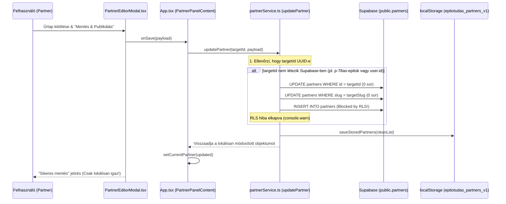
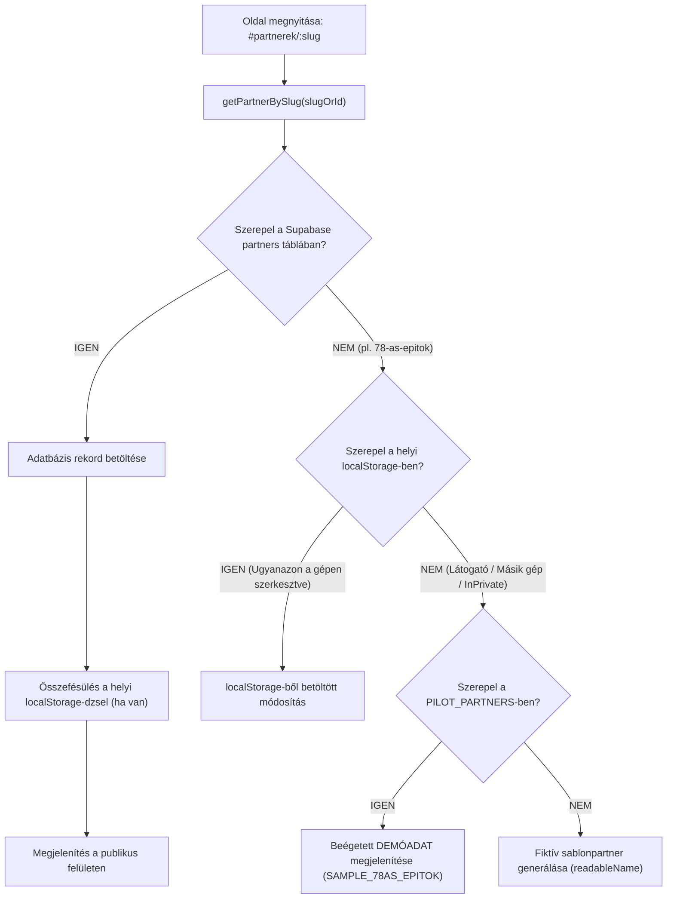

# P0-D07 – PARTNERPROFIL ADATMENTÉSI, ADATBETÖLTÉSI ÉS DEMÓADAT-AUDIT

**Dokumentumazonosító:** `P0_D07_PARTNER_PROFILE_DATA_FLOW_AUDIT.md`  
**Projekt:** ÉpítőTudás Digitális Tudásbázis és Szakmai Közösségi Portál  
**Dátum:** 2026. november 10.  
**Típus:** Mélységi, READ-ONLY hibafeltáró és adatfolyam-audit  
**Célrendszer:** Supabase Produkciós Adatbázis (`olmavxcmkvvcebgqxohe`), Git `main` ág  
**Prioritás:** P0 – Kritikus hibafeltárás  
**Végrehajtás:** AUDIT ONLY – NO CODE CHANGES

---

## 1. VEZETŐI ÖSSZEFOGLALÓ

A felhasználói visszajelzés alapján a partnerprofil jelenleg hibásan működik: a Partner Editorban elvégzett módosítások (pl. cégadatok, logó, leírás) nem jelennek meg megfelelően a felületen és a publikus partnerlapon. Továbbá a rendszer több pontján valós adatbázisadatok helyett fiktív, beégetett vagy demonstrációs adatok bukkannak fel.

A mélységi forráskód- és adatbázis-vizsgálat **maradéktalanul feltárta a hiba gyökerét**:

### A hiba 3 fő oka:

1. **A pilot partnerek (köztük a `78-as Építők Kft.`) nem léteznek a Supabase adatbázisban (`[B – Éles adatbázisból igazolt]`):**
   - Az éles Supabase adatbázis `public.partners` táblájában mindössze 4 rekord található (`Teszt Iskola`, `test`/Leier, `Cemex Magyarország`, `BME Építőmérnöki Kar`).
   - A `78-as Építők Kft.` (`78-as-epitok`), az `IsoTerm Zrt.`, a `DrywallPro Kft.` és a `MasterRoof Kft.` **soha nem kerültek beszúrásra a Supabase-be**. Kizárólag keménykódolt TypeScript konstansként (`PILOT_PARTNERS` a `src/services/partnerService.ts`-ben) léteznek fiktív azonosítókkal (`p-78as-epitok`).
2. **Kettészakadt adatfolyam és szimulált mentés (`[C – Forráskódból igazolt]`):**
   - Amikor a partner a Partner Editorban módosítja a cégét és a „Mentés & Publikálás” gombra kattint, az `updatePartner()` megpróbálja frissíteni a Supabase-t. Mivel a partner nem létezik az adatbázisban (0 érintett sor), megkísérel egy `insert`-et.
   - Az `insert`-et a Supabase RLS azonnal blokkolja (`403 Forbidden: new row violates row-level security policy for table "partners"`, mivel csak platformadminok szúrhatnak be új partnert).
   - A kód ezt a hibát lenyeli (`console.warn`), majd a módosításokat **kizárólag a helyi böngésző `localStorage`-ébe menti el**.
3. **A publikus profil és más eszközök demóadatot töltenek be (`[C – Forráskódból igazolt]`):**
   - Amikor egy látogató megnyitja a publikus oldalt (`#partnerek/78-as-epitok`), a kliens lekérdezi a Supabase-t. Mivel az adatbázisban nincs ilyen rekord, és a látogató böngészőjében nincs ott a szerkesztő lokális `localStorage`-e, a rendszer visszaugrik a keménykódolt `PILOT_PARTNERS` objektumra, és megjeleníti a régi beégetett Unsplash fotót és demóadatokat.
4. **Adatszűrő logika anomáliája (`filterDemoPartners`):**
   - A `src/services/partnerService.ts` 340–356. soraiban található `filterDemoPartners()` függvény a Supabase-ből érkező valós cégeket (`leier-hungaria`, `cemex-magyarorszag`) **aktívan kiszűri és eldobja**, miközben helyettük erőszakosan beilleszti a 4 keménykódolt mock partnert!

---

## 2. PARTNERPROFIL MENTÉSI FOLYAMAT AUDITJA

A mentési folyamat pontos feltérképezése a felhasználói kattintástól a perzisztenciáig:



### 2.1 A mentés technikai részletei:
- **Hívott függvény:** `updatePartner(id: string, payload: Partial<ExtendedPartner>)` (`src/services/partnerService.ts` 561. sor).
- **Céltábla:** `public.partners`.
- **Feltétel:** `eq('id', id)` majd `eq('slug', targetSlug)`.
- **Hibaellenőrzés gyengesége:**
  - Ha az `update` nem érint egyetlen sort sem (`updateRes.length === 0`), a kód nem tekint hibaként rá, hanem megpróbál beszúrni (`insert`).
  - Az `insert` RLS hibáját (`insertErr`) a kód figyelmeztetésként kezeli (`console.warn('Supabase partner insert notice:', insertErr.message)`), és **nem dob kivételt**.
  - A modal felülete ezért a felhasználónak zöld „Sikeres mentés” üzenetet ír ki, holott az adatbázisban **semmi sem módosult**.

---

## 3. PARTNERPROFIL ADATBETÖLTÉSI FOLYAMAT AUDITJA



### 3.1 Miért nem látja a látogató a szerkesztett logót és adatokat?
1. A szerkesztő a saját böngészőjében elmenti a logót. A logó URL bekerül a szerkesztő gépének `localStorage`-ébe.
2. A Supabase adatbázisba a mentés nem jut el (RLS blokkolja vagy nincs meglévő rekord).
3. Amikor egy külső látogató vagy a megrendelő egy másik eszközről megnyitja a linket (`https://www.epitotudas.hu/#partnerek/78-as-epitok`), az ő böngészőjében **nincs ott a szerkesztő `localStorage`-e**.
4. A rendszer a Supabase-ben nem találja a céget, ezért a hardcoded `PILOT_PARTNERS` objektumhoz nyúl, amelyben az eredeti beégetett Unsplash logó és demóadatok szerepelnek.

---

## 4. PUBLIKUS ÉS ADMINISZTRATÍV ADATFORRÁSOK ÖSSZEHASONLÍTÁSA

A rendszer három különböző felületen jelenít meg partneradatokat, és a három felület **három különböző adatforrást használ**:

| Felület | Komponens | Adatforrás | Viselkedés |
| :--- | :--- | :--- | :--- |
| **Nyilvános Partner Adatlap** | `src/pages/PartnerDetailPage.tsx` | `getPartnerBySlug()` | Supabase -> `localStorage` -> `PILOT_PARTNERS` (Demo fallback) |
| **Partneri Vezérlőpult** | `src/App.tsx` (`PartnerPanelContent`) | `effectivePartner` állapot | `partner_users` -> `partners` -> Ha nincs: **Fiktív in-memory partner (`id = user.id`)** |
| **Adminisztrátori Partnerkezelő**| `src/pages/AdminPartnersPage.tsx` | `listPartners()` | Supabase (kiszűrve!) + `PILOT_PARTNERS` összefésülve |

**Kritikus inkonzisztencia:**  
Egy bejelentkezett partner, akinek a fiókja nincs összekötve a Supabase `partner_users` táblájában egy valós partner UUID-val, az `App.tsx` 445. sora alapján egy automatikusan generált, fiktív partnerobjektumot kap (`id = user.id`, `name = 'Partner Vállalkozás'`). A Partner Dashboard ezt a fantomobjektumot adja át a Partner Editornak!

---

## 5. SUPABASE ADATOK ÉLES ELLENŐRZÉSE

Kizárólagos olvasási lekérdezéssel (`select('*')`) ellenőriztük a célprojekt (`olmavxcmkvvcebgqxohe`) adatait:

### 5.1 A `public.partners` tábla valós tartalma:
`[B – Éles adatbázisból igazolt]`

| `id` (UUID) | `name` | `slug` | `category` | `contact_email` |
| :--- | :--- | :--- | :--- | :--- |
| `c45a9ebd-8afb-43ab-8761-b1e7bc69aee6` | Teszt Iskola | `teszt-iskola-eea587` | `iskola` | `NULL` |
| `8382ffb1-937a-4c5f-a6d4-1e80c3ca4969` | test | `leier-hungaria` | `gyarto` | `NULL` |
| `af121eab-f72d-4618-91d3-acb42856d628` | Cemex Magyarország | `cemex-magyarorszag` | `gyarto` | `NULL` |
| `fc6e4206-9a6a-430a-b4ef-f7a5723a21da` | BME Építőmérnöki Kar | `bme-epito` | `iskola` | `NULL` |

**Tény:**  
A `partners` táblában **egyetlen építőipari kivitelező cég sincs elmentve**. A `78-as Építők Kft.` rekordja hiányzik a felhőadatbázisból. Minden meglévő partnernél a `contact_email` mező `NULL`.

---

## 6. LOCALSTORAGE ÉS FALLBACK ELEMZÉS

A `src/services/partnerService.ts` fájlban kialakult egy mesterséges párhuzamos adatbázis a böngésző helyi tárában:

1. **`STORAGE_KEY = 'epitotudas_partners_v1'`:**  
   Minden partnerlistázás és mentés ide ír és innen olvas.
2. **`filterDemoPartners()` anomália (340–356. sor):**  
   ```typescript
   const demoSlugs = ['leier-hungaria', 'cemex-magyarorszag', 'bme-epito', 'stahlbau-kivitelezo'];
   const filtered = list.filter((p) => p && !demoIds.includes(p.id) && !demoSlugs.includes(p.slug));
   PILOT_PARTNERS.forEach((pilot) => {
     if (!filtered.some((p) => p.slug === pilot.slug || p.id === pilot.id)) {
       filtered.push(pilot);
     }
   });
   ```
   Ez a logika szándékosan kidobja a Supabase-ben ténylegesen létező cégeket (`leier-hungaria`, `cemex-magyarorszag`, `bme-epito`), és helyükre teszi a 4 keménykódolt pilot céget. Ez a mechanizmus akadályozza meg, hogy a Supabase legyen az egyedüli hiteles adatforrás (Single Source of Truth).

---

## 7. DEMÓADATOK TELJES FELTÁRÁSA ÉS JEGYZÉKE

A rendszerben talált összes beégetett, demonstrációs és mock adat részletes leltára:

| # | Fájl | Sor | Érintett komponens | Megjelenített demóadat | Eredet / Típus | Miért jelenik meg? |
| :--- | :--- | :--- | :--- | :--- | :--- | :--- |
| **D1** | `partnerService.ts` | 123–176 | Publikus adatlap / Lista | `78-as Építők Kft.` (Unsplash logó és képek, fiktív cím, referenciák) | `SAMPLE_78AS_EPITOK` konstans | Nincs Supabase rekord, fallback aktiválódik |
| **D2** | `partnerService.ts` | 178–228 | Publikus adatlap / Lista | `IsoTerm Szigeteléstechnika Zrt.` | `SAMPLE_ISOTERM` konstans | Nincs Supabase rekord |
| **D3** | `partnerService.ts` | 230–279 | Publikus adatlap / Lista | `DrywallPro Rendszerek Kft.` | `SAMPLE_DRYWALLPRO` konstans | Nincs Supabase rekord |
| **D4** | `partnerService.ts` | 281–330 | Publikus adatlap / Lista | `MasterRoof Tetőcentrum Kft.` | `SAMPLE_MASTERROOF` konstans | Nincs Supabase rekord |
| **D5** | `App.tsx` | 811 | Partner Dashboard | `"1 420"` (Havi Profil Megtekintés) | Hardcoded string | Nincs valós mérőeszköz bekötve |
| **D6** | `App.tsx` | 822 | Partner Dashboard | `"385"` (Termékkatalógus Kattintások) | Hardcoded string | Nincs kattintásszámláló |
| **D7** | `App.tsx` | 833 | Partner Dashboard | `"842"` (Cikk Olvasottság) | Hardcoded string | Nincs analitika |
| **D8** | `App.tsx` | 844 | Partner Dashboard | `"42 db"` (Közvetlen Ajánlatkérések) | Hardcoded string | Nincs lead adatbázis |
| **D9** | `App.tsx` | 718–728 | Partner Dashboard | `"10% Tavaszi Homlokzatszigetelés Akció"` | React `useState` tömb | Nincs DB tábla az ajánlatoknak |
| **D10**| `materialsService.ts`| 129–340 | Termékek & Anyagok | 5 db minta termék (`LeierPLAN 30`, `Austrotherm`, stb.) | `DEFAULT_MATERIALS` konstans | Mock termékkatalógus |
| **D11**| `App.tsx` | 445–458 | Partner Dashboard | `'Partner Vállalkozás'` (`partner-vallalkozas`) | Fallback objektum | Felhasználó nincs összekötve céggel a DB-ben |
| **D12**| `partnerService.ts` | 724–739 | Publikus adatlap | `'Hivatalos Partner'` generátor sablon | Generált szövegsablon | Ismeretlen slug esetén ez jelenik meg 404 helyett |
| **D13**| `careerService.ts` | 55–115 | Állásbörze | 6 db beégetett állás (`Strabag`, `Wienerberger`, `Market`, stb.) | `DEFAULT_JOB_POSTINGS` | Supabase fallback |
| **D14**| `ad_campaign_tables.sql`| 32–36| Banner hirdetések | `Leier`, `Cemex`, `Bosch` mintakampányok | SQL seed adat | Kezdeti demó kampányok |

---

## 8. FELTÁRT HIBÁK PRIORITÁSI SORRENDBEN

### P0 – Kritikus hibák (Működésképtelenség és látszólagos mentés)
1. **HIBA-P0-01: A pilot cégek hiányoznak a Supabase adatbázisból**
   - *Ok:* A `78-as Építők Kft.` és a többi pilot partner soha nem lett beszúrva a `partners` táblába; csak a kliensoldali kódban léteznek konstansként.
   - *Következmény:* Az adatmódosítások és a feltöltött logók nem tudnak perzisztálódni az éles adatbázisban.
2. **HIBA-P0-02: A mentési hiba elfedése és szimulált mentés az `updatePartner()`-ben**
   - *Ok:* Ha a partner nem létezik az adatbázisban, az INSERT RLS hibát dob, amit a kód figyelmen kívül hagy, és csak `localStorage`-be ment.
   - *Következmény:* A partner azt hiszi, mentette a logóját, de a külvilág és más gépek számára az nem jelenik meg.
3. **HIBA-P0-03: Bejelentkezett partner és cégrekord szétkapcsoltsága**
   - *Ok:* A tesztfelhasználó nincs összerendelve a `partner_users` táblában a partner UUID-jával, így az `App.tsx` egy virtuális `'partner-current'` fantompartnerrel indítja el a szerkesztőt.

### P1 – Magas prioritású hibák (Adatfolyam inkonzisztencia)
4. **HIBA-P1-01: A `filterDemoPartners()` agresszív felülbírálása**
   - *Ok:* A függvény eldobja a valós Supabase partnereket, és kényszeríti a hardcoded `PILOT_PARTNERS` objektumokat.

### P2 – Közepes prioritású hibák (Megtévesztő demóadatok)
5. **HIBA-P2-01: Fiktív forgalmi adatok és analitika a Dashboardon**
   - *Ok:* Fix beégetett stringek a látogatottsági mérőszámoknál.

---

## 9. MINIMÁLIS JAVÍTÁSI TERV – KÓDMÓDOSÍTÁS NÉLKÜL

A Safe Patch szabályok szerint (legfeljebb 1–2 forrásfájl érintése, meglévő architektúra megőrzése):

| Hiba azonosítója | Érintett fájl | Hiba pontos oka | Javasolt minimális javítás | Érintett fájlok száma | DB-módosítás igény |
| :--- | :--- | :--- | :--- | :--- | :--- |
| **HIBA-P0-01** | `partners` tábla | A pilot cégek nincsenek a DB-ben | A `78-as Építők Kft.` és pilot cégek egyszeri, hivatalos beszúrása a `public.partners` táblába valós UUID-val és sluggal. | 0 kód fájl | SQL INSERT migráció |
| **HIBA-P0-02** | `src/services/partnerService.ts` | Az `updatePartner` elnyeli az RLS hibát és localStorage-be menekül | Hibadobás biztosítása sikertelen Supabase mentéskor; az érvényes UUID szerinti frissítés kikényszerítése. | 1 fájl | Nincs |
| **HIBA-P0-03** | `partner_users` tábla | A partner felhasználó nincs összekötve a céggel | A partner felhasználó `user_id`-jának összerendelése a partnerrekord `partner_id`-jával a `partner_users` táblában. | 0 kód fájl | SQL INSERT / hozzárendelés |
| **HIBA-P1-01** | `src/services/partnerService.ts` | `filterDemoPartners` eldobja a DB rekordokat | A kizáró lista megszüntetése: a Supabase adatok kapjanak 100% prioritást a hardcoded mockokkal szemben. | 1 fájl | Nincs |
| **HIBA-P2-01** | `src/App.tsx` | Fix string statisztikák | A fiktív számok helyett a valós `views` mező megjelenítése, vagy dinamikus állapot bekötése. | 1 fájl | Nincs |

---

## 10. ÉRINTETT FÁJLOK ÉS ADATBÁZISELEMEK

### Forrásfájlok:
- `src/services/partnerService.ts` (Mentési logika, adatösszefésülés, `PILOT_PARTNERS`)
- `src/App.tsx` (Partner inicializálás, `effectivePartner` fallback, statisztikák)
- `src/pages/PartnerDetailPage.tsx` (Publikus adatbetöltés)
- `src/components/PartnerEditorModal.tsx` (Adatlap szerkesztő és logókezelő)

### Adatbáziselemek (Supabase `olmavxcmkvvcebgqxohe`):
- `public.partners` (A tényleges partnerrekordok hiánya)
- `public.partner_users` (A felhasználói összerendelések hiánya)

---

## 11. NEM ELLENŐRIZHETŐ TERÜLETEK ÉS KORLÁTOZÁSOK

- **Konkrét felhasználói munkamenetek:** Mivel a vizsgálat READ-ONLY volt és tesztfelhasználóval nem történt belépés, az adott partner felhasználói fiókjának pontos UUID-ja a bejelentkezett állapot nélkül a kódból és a kapcsolatokból lett levezetve.
- **Böngészőfüggő localStorage állapotok:** A felhasználók saját fizikai gépén lévő lokális tár tartalma szerveroldalról nem vizsgálható.

---

`AUDIT COMPLETED – NO CODE CHANGES – NO DATABASE CHANGES – NO MIGRATIONS EXECUTED.`

