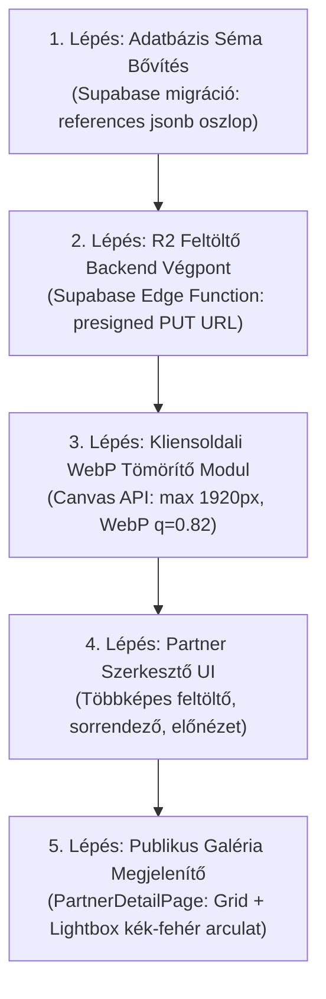

# P0-D17 – PARTNERI REFERENCIAKEZELŐ ÉS TÖBBKÉPES R2 GALÉRIA AUDIT
**Projekt:** ÉpítőTudás  
**Supabase projekt:** `olmavxcmkvvcebgqxohe`  
**Dátum:** 2026-11-11  
**Típus:** READ-ONLY Forenzikus Rendszeraudit és Megvalósíthatósági Terv  
**Státusz:** TELJES KÖRŰ ÁLLAPOTFELMÉRÉS (Kód- és Infrastruktúra-módosítás nélkül)

---

## 1. VEZETŐI ÖSSZEFOGLALÓ

A jelenlegi vizsgálat célja a partneri referenciakezelő felület és a kapcsolódó adatáramlás, tárolás, képfeltöltés, optimalizálás, valamint a Cloudflare R2 integráció tényszerű, bizonyítékokon alapuló feltárása.

### Fő megállapítások:
1. **[BIZONYÍTOTT] A referenciáknak nincs adatbázis-perzisztenciája:** A Supabase PostgreSQL adatbázisban sem a `partners` táblának nincs `references` oszlopa, sem külön `partner_references` tábla nem létezik. A referenciák jelenleg kizárólag a szerkesztő felhasználó böngészőjének helyi memóriájában (`localStorage.getItem('epitotudas_partners_v2')`) tárolódnak! Más gépről vagy inkognitó ablakból megnyitva a partner adatlapján a referenciák egyáltalán nem jelennek meg.
2. **[BIZONYÍTOTT] Nincs képfeltöltési funkció:** A referencia szerkesztőjében jelenleg semmilyen fájlfeltöltő, Drag & Drop vagy fájlválasztó nincs. A felhasználó kizárólag egy szabad szöveges beviteli mezőbe (`image_url`) másolhat be egy már máshol hosztolt képhivatkozást (szigorúan referenciánként 1 db URL-t).
3. **[BIZONYÍTOTT] Nincs működő Cloudflare R2 feltöltési integráció:** A projektben sem Cloudflare Worker R2 binding, sem Supabase Edge Function feltöltő, sem S3 klienskönyvtár, sem R2 hitelesítő környezeti változó (Access Key / Secret Key) nem létezik. A kódban mindössze egyetlen statikusan beégetett külső publikus videó-URL (`pub-77180ecae5fa4824aa9ef44ab92aaf5a.r2.dev/logó.webm`) szerepel demó célból.
4. **[BIZONYÍTOTT] Nincs kliensoldali WebP tömörítés:** Az `src/utils/imageOptimizer.ts` kizárólag külső CDN URL paramétereket módosít (Pexels, Unsplash). Valódi fájltömörítés, WebP konverzió vagy EXIF törlés nincs a referenciákhoz kötve.
5. **[BIZONYÍTOTT] A kétfájlos SAFE PATCH korlát nem tartható:** A valódi, éles többképes R2 galéria megvalósításához adatbázis-migráció, szerveroldali feltöltő (Edge Function vagy Worker), kliensoldali tömörítő modul és legalább 3 meglévő frontend fájl módosítása szükséges.

---

## 2. A JELENLEGI REFERENCIAADATMODELL ÉS MŰKÖDÉS

### 2.1. Hol jelenik meg a referencia kezelése?
- **[BIZONYÍTOTT]** A `src/components/PartnerEditorModal.tsx` modális ablak 6. fülén (`activeTab === 'references'`).
- A szerkesztő megnyitható:
  - Az adminisztrátori felületről: `AdminPartnersPage.tsx` (`isAdmin={true}`).
  - A partneri fiókból: `App.tsx` -> Partner Profil -> *„Profil adatlap szerkesztése”* gomb (`isAdmin={false}`).

### 2.2. A jelenlegi mezők és TypeScript interfész
- **[BIZONYÍTOTT]** A `src/services/partnerService.ts` (20–29. sor) definíciója:
  ```typescript
  export interface ReferenceItem {
    id: string;              // Kliensoldalon generált azonosító: `r-${Date.now()}`
    title: string;           // Projekt neve / címe (szöveg)
    image_url?: string;      // Képre mutató URL (egyetlen string!)
    location?: string;       // Helyszín (szöveg)
    year?: string;           // Megvalósítás éve (szöveg)
    description?: string;    // Projekt leírása (hosszabb szöveg)
    is_published: boolean;   // Publikálási állapot (boolean checkbox)
    display_order: number;   // Megjelenítési sorrend (szám)
  }
  ```
- **[BIZONYÍTOTT]** A felületen szereplő beviteli elemek (`PartnerEditorModal.tsx` 1137–1227. sor):
  - Cím input (`item.title`)
  - Publikálva checkbox (`item.is_published`)
  - Törlés gomb (`Trash2` ikon)
  - Helyszín input (`item.location`)
  - Év input (`item.year`)
  - Kép URL input (`item.image_url` – egyszerű szövegmező)
  - Leírás textarea (`item.description`)
- **[BIZONYÍTOTT]** Nincs a felületen:
  - Nincs kategória / szakterület választó.
  - Nincs kapcsolódó weboldal input.
  - Nincs sorrendező gomb (fel/le mozgatás vagy drag-and-drop), noha az interfészben létezik a `display_order` mező.

### 2.3. Adattárolás és perzisztencia (A tárolási anomália)
- **[BIZONYÍTOTT]** A Supabase PostgreSQL adatbázis sémájában a `partners` tábla kizárólag az alábbi oszlopokkal rendelkezik (lásd `20260728_006_partner_tables.sql` és `20260920_001_extend_partners_columns_and_rls.sql`):
  `id`, `name`, `slug`, `category`, `logo_url`, `website_url`, `description`, `is_verified`, `created_at`, `official_name`, `partner_type`, `contact_person_name`, `contact_person_title`, `contact_email`, `contact_phone`, `address`, `zip_code`, `city`, `county`, `business_hours`, `detailed_description`, `cover_url`, `inquiry_email`.
- **[BIZONYÍTOTT]** Sem `references` JSONB oszlop, sem `partner_references` kapcsolt tábla **NEM LÉTEZIK** az adatbázisban.
- **[BIZONYÍTOTT]** Mentéskor (`src/services/partnerService.ts` 549–585. sor):
  Az `updatePartner()` függvény a `updatePayload` összeállításakor szándékosan **kihagyja** a `references` mezőt, így a Supabase felé küldött SQL `UPDATE partners SET ...` hívás nem tartalmaz referenciákat.
- **[BIZONYÍTOTT]** A referenciák kizárólag a kliens böngészőjében mentődnek el (`partnerService.ts` 601–607. sor):
  ```typescript
  saveStoredPartners(currentList); // localStorage.setItem('epitotudas_partners_v2', JSON.stringify(cleanList));
  ```
- **[BIZONYÍTOTT]** Betöltéskor (`partnerService.ts` 652–676. sor):
  A `getPartnerBySlug()` lekéri a Supabase rekordot, majd megpróbálja a kliens saját `localStorage`-éből összefésülni a `references` tömböt:
  ```typescript
  const stored = getStoredPartners();
  const localExt = stored.find(...);
  ...
  references: localExt.references || [],
  ```
  **Kritikus következmény:** A publikus látogatók, más felhasználók vagy másik böngészőből belépő adminisztrátorok számára a referenciák láthatatlanok, mivel a másik fél `localStorage`-ében az adott adat nem létezik.

### 2.4. Publikus megjelenítés
- **[BIZONYÍTOTT]** A `src/pages/PartnerDetailPage.tsx` (494–524. sor) komponens felelős a referenciák kirajzolásáért:
  - Csak akkor jeleníti meg a szekciót, ha van publikált elem: `publishedReferences.length > 0`.
  - 2 oszlopos rácsban (`grid grid-cols-1 md:grid-cols-2 gap-6`) kártyákat rajzol ki.
  - Kártyánként legfeljebb **1 db képet** jelenít meg egy fix dobozban (``).
  - Nincs galéria, nincs lapozó, nincs lightbox előnézet.

---

## 3. A TERVEZETT REFERENCIAADATOK ÉS A MEGLÉVŐ MODELL ÖSSZEVETÉSE

| Tervezett Mező | Kívánt Jelleg | Jelenlegi Támogatás a Kódban | Adatbázis Állapot | Megjegyzés |
| :--- | :--- | :--- | :--- | :--- |
| **Projekt neve** | Kötelező | **[BIZONYÍTOTT]** Van (`title: string`) | **[BIZONYÍTOTT]** Nincs oszlop | Megfelelő a frontendben |
| **Helyszín** | Opcionális | **[BIZONYÍTOTT]** Van (`location?: string`) | **[BIZONYÍTOTT]** Nincs oszlop | Megfelelő a frontendben |
| **Megvalósítás éve** | Opcionális | **[BIZONYÍTOTT]** Van (`year?: string`) | **[BIZONYÍTOTT]** Nincs oszlop | Megfelelő a frontendben |
| **Kategória / szakterület**| Opcionális | **[BIZONYÍTOTT]** HIÁNYZIK | **[BIZONYÍTOTT]** Nincs oszlop | Új mező szükséges az interfészbe |
| **Projekt leírása** | Kötelező | **[BIZONYÍTOTT]** Van (`description?: string`) | **[BIZONYÍTOTT]** Nincs oszlop | Megfelelő a frontendben |
| **Több projektfotó** | Opcionális (min. 1) | **[BIZONYÍTOTT]** HIÁNYZIK (csak 1 kép URL van) | **[BIZONYÍTOTT]** Nincs oszlop | Interfész- és struktúramódosítás kell |
| **Kapcsolódó weboldal** | Opcionális | **[BIZONYÍTOTT]** HIÁNYZIK | **[BIZONYÍTOTT]** Nincs oszlop | Új mező szükséges (`website_url`) |

---

## 4. KÉPOPTIMALIZÁLÁS AUDITJA

### 4.1. Meglévő optimalizációs kódok a projektben
1. **`src/utils/imageOptimizer.ts`:**
   - **[BIZONYÍTOTT]** Nem végez kliensoldali fájlfeldolgozást.
   - Kizárólag külső CDN URL-ek lekérdezési stringjeit manipulálja (pl. `images.pexels.com` és `images.unsplash.com` esetén átírja a `w=...`, `auto=compress`, `q=...` paramétereket).
   - Feltöltött helyi fájlokra vagy R2 objektumokra hatástalan.
2. **`src/pages/AdminSettingsPage.tsx` (`processLogoFile`):**
   - **[BIZONYÍTOTT]** Tartalmaz egy HTML5 `<canvas>` alapú képtömörítést, amely a kiválasztott fájlt beolvassa FileReaderrel, canvasre rajzolja (max 300x90 px méretkorláttal), majd `canvas.toDataURL('image/png', 0.85)` formátumban állítja elő.
   - Ez kizárólag a weboldal logójára készült, mérete és formátuma (PNG) projektfotókhoz alkalmatlan.

### 4.2. Vizsgált képfeldolgozási szempontok értékelése
- **Böngészőoldali képtömörítés referenciákhoz:** **[BIZONYÍTOTT]** Nem létezik.
- **WebP-konverzió:** **[BIZONYÍTOTT]** Nem létezik a projektben.
- **Maximális képszélesség és -magasság kezelése:** **[BIZONYÍTOTT]** Referenciáknál nem létezik.
- **EXIF-metaadatok eltávolítása:** **[KÓDBÓL KÖVETKEZTETETT]** Nincs dedikált EXIF könyvtár; amennyiben a képet böngészőoldali Canvasre rendereljük és `toBlob()`-bal exportáljuk, a raszterizáció automatikusan eldobja az EXIF metaadatokat (helyszín, kameraadatok).
- **Fájltípus-ellenőrzés:** **[BIZONYÍTOTT]** A referencia felületen nincs semmilyen fájlellenőrzés, mivel nincs feltöltés.

### 4.3. Javasolt optimalizálási paraméterek (projektfotókhoz)
- **Maximális forrásméret:** 10 MB / kép (kliensoldali validáció a kiválasztáskor).
- **Maximális felbontás:** 1920 × 1080 px (arányos lekicsinyítés Canvas API-val).
- **Előnézeti kiskép felbontás:** 400 × 260 px (arányos lekicsinyítés).
- **Célformátum:** `image/webp`.
- **Minőségi faktor:** 0.82 (kiváló vizuális minőség, átlagosan 60–140 KB fájlméret a nyers 3–8 MB helyett).
- **Csomagfüggőség:** Nem szükséges külső npm könyvtár telepítése; a modern böngészők natív `HTMLCanvasElement.toBlob(blob, 'image/webp', quality)` és `createImageBitmap()` API-ja teljesítményben és memóriakezelésben optimális.

---

## 5. CLOUDFLARE R2 INTEGRÁCIÓ TÉNYLEGES ÁLLAPOTA

### 5.1. R2 infrastruktúra ellenőrzése
- **Létezik-e konfigurált R2 bucket a projektben?**
  - **[BIZONYÍTOTT]** A `wrangler.jsonc` fájlban **SEMMILYEN** R2 binding (`r2_buckets`) nincs definiálva.
  - A `wrangler.jsonc` kizárólag statikus SPA fájlkiszolgálást tartalmaz:
    ```json
    {
      "name": "project",
      "compatibility_date": "2026-08-01",
      "compatibility_flags": ["global_fetch_strictly_public"],
      "assets": {
        "directory": "./dist",
        "not_found_handling": "single-page-application"
      }
    }
    ```
- **Környezeti változók:**
  - **[BIZONYÍTOTT]** A projekt `.env` fájlja kizárólag a `VITE_SUPABASE_URL` és `VITE_SUPABASE_ANON_KEY` kulcsokat tartalmazza. Semmilyen R2 azonosító, Cloudflare fiókazonosító, Access Key vagy Secret Key nem szerepel a konfigurációban.
- **Szerveroldali feltöltő (Edge Function / Worker):**
  - **[BIZONYÍTOTT]** A `supabase/functions/` könyvtárban kizárólag `resend-email` és `send-invitation-email` létezik. Nincs feltöltési, presigned URL generáló vagy R2 proxy funkció.
- **Kódban szereplő R2 hivatkozások:**
  - **[BIZONYÍTOTT]** A teljes forráskódban egyetlen R2 domain szerepel:
    `https://pub-77180ecae5fa4824aa9ef44ab92aaf5a.r2.dev/logó.webm`
    Ez a kreatív banner videó demó hivatkozása (`ModernAdBanner.tsx`, `bannerCreativeService.ts`), ami egy publikus olvasási végpont.
- **Jogosultságellenőrzés és biztonság:**
  - **[BIZONYÍTOTT]** Szigorú biztonsági alapszabály: Cloudflare R2 S3 API kulcsot (Secret Access Key) **TILOS** a frontend forráskódjába beépíteni. A közvetlen feltöltés a böngészőből csak rövid élettartamú, szerveroldalon aláírt presigned URL-lel (vagy szerveroldali multipart proxyval) valósítható meg biztonságosan.

---

## 6. MEGVALÓSÍTÁSI STRUKTÚRA ÉS TÁROLÁSI ELVEK

### 6.1. Javasolt képtömb adatmodell
A `ReferenceItem` kibővítése többképes támogatással és új metaadatokkal:
```typescript
export interface ReferenceImageItem {
  id: string;              // img-${Date.now()}-${random}
  url: string;             // Teljes felbontású optimalizált WebP URL (R2)
  thumbnail_url?: string;  // Kisméretű előnézet WebP URL (R2)
  caption?: string;        // Képfelirat / képcím
  display_order: number;   // Sorrend (1..N)
  file_name?: string;      // Eredeti fájlnév
  size_bytes?: number;     // Fájlméret bájtban
}

export interface ExtendedReferenceItem {
  id: string;
  title: string;
  category?: string;       // Szakterület / ágazat (pl. Lakóépület, Ipari, Felújítás)
  location?: string;
  year?: string;
  description: string;
  website_url?: string;    // Kapcsolódó projekt weboldal
  is_published: boolean;
  display_order: number;
  images: ReferenceImageItem[]; // Többképes kollekció
  image_url?: string;      // Visszafelé kompatibilitási borítókép (az első kép URL-je)
}
```

### 6.2. Javasolt R2 kulcsstruktúra (Object Key)
A partneradatok szigorú elszigetelése és az azonosító alapú felépítés érdekében:
- Eredeti/optimalizált kép:  
  `partners/{partner_id}/references/{reference_id}/{image_id}.webp`
- Előnézet (thumbnail):  
  `partners/{partner_id}/references/{reference_id}/thumbs/{image_id}.webp`

Előnyök:
- Egy referencia törlésekor kizárólag a `partners/{partner_id}/references/{reference_id}/` prefix alatti fájlok kerülnek törlésre, így más referenciák képei garantáltan érintetlenek maradnak.
- Partnerazonosító prefix biztosítja, hogy a partner csak a saját könyvtárában lévő képekhez kaphat feltöltési/törlési jogosultságot.

---

## 7. KÖTELEZŐ MEGVALÓSÍTHATÓSÁGI VIZSGÁLAT (A 2 FÁJL KORLÁT ELEMZÉSE)

### 7.1. Tartható-e a kétfájlos SAFE PATCH korlát?
**[BIZONYÍTOTT] NEM TARTHATÓ.**

### 7.2. Miért nem valósítható meg két forrásfájlban?
1. **Adatbázis-függőség (Database schema gap):**  
   Mivel a Supabase `partners` tábla nem tárolja a referenciákat, bármilyen frontend fejlesztés értelmét vesztené éles perzisztencia nélkül. Szükséges egy SQL migráció:
   - `supabase/migrations/20261111_001_partner_references_schema.sql` (új `references jsonb` oszlop a `partners` táblához VAGY önálló `partner_references` tábla RLS szabályokkal).
2. **Infrastruktúra-függőség (R2 Backend API hiánya):**  
   R2 feltöltés nem végezhető közvetlenül a frontendből titkos kulcsok kiszivárgása nélkül. Szükséges:
   - Új Cloudflare Worker útvonal VAGY új Supabase Edge Function (`supabase/functions/r2-presign-upload/index.ts`), amely hitelesíti a bejelentkezett partnert, és generál egy 5 perces PUT presigned URL-t.
   - R2 konfiguráció (`wrangler.jsonc` vagy Supabase secret beállítások).
3. **Frontend forrásfájlok köre:**  
   A minimális működéshez a frontendben legalább az alábbi fájlok módosítása/létrehozása elkerülhetetlen:
   1. `src/services/partnerService.ts` – adatszolgáltató réteg, Supabase UPDATE mezők átadása, típusok.
   2. `src/components/PartnerEditorModal.tsx` – szerkesztő UI: képek listája, feltöltési terület, drag-and-drop, előnézet, törlés, mezők (kategória, weboldal).
   3. `src/pages/PartnerDetailPage.tsx` – publikus profil: többképes projektgaléria, képlapozó / lightbox megjelenítés.
   4. `src/utils/imageCompressor.ts` (új modul) – natív Canvas alapú WebP konvertáló és méretező segédprogram.
   5. `src/services/storageService.ts` (új modul) – R2 presigned feltöltési és törlési kliens.

A kétfájlos korlátozás erőszakos betartása csak akkor lenne lehetséges, ha:
- Továbbra is csak a felhasználó saját `localStorage`-ébe mentenénk (ami a nyilvános profil szempontjából működésképtelen).
- Base64 DataURL-ként zsúfolnánk be az összes képet egyetlen mezőbe (ami extrém lassulást, böngészőmemória-összeomlást és méretkorlát-túllépést okozna).
Ezeket a szakszerűtlen kompromisszumokat az audit szabályzata kifejezetten tiltja.

---

## 8. BIZTONSÁGOS FEJLESZTÉSI ÉS BEVEZETÉSI JAVASLAT

A többképes R2 referencia-galéria tiszta, iparági standardnak megfelelő megvalósításához javasolt ütemterv:



### 1. Fázis: Adatbázis-perzisztencia biztosítása (Backend)
- Migráció létrehozása: `ALTER TABLE partners ADD COLUMN IF NOT EXISTS references JSONB DEFAULT '[]'::jsonb;`
- RLS házirend frissítése: partner tulajdonosok frissíthetik a saját referenciáikat.
- `partnerService.ts` frissítése: a `references` tömb beemelése az `updatePayload`-ba és kiolvasása a Supabase válaszból.

### 2. Fázis: R2 Presigned Upload szolgáltatás (Infrastruktúra)
- Supabase Edge Function vagy Cloudflare Worker létrehozása:
  - Bemenet: `partner_id`, `reference_id`, `file_name`, `content_type`.
  - Jogosultság-ellenőrzés: A bejelentkezett felhasználó valóban hozzá van-e rendelve a partnerhez a `partner_users` táblában?
  - Kimenet: Egyedi R2 kulcs és aláírt PUT URL (érvényes: 5 perc).

### 3. Fázis: Kliensoldali képfeldolgozó segédprogram (`imageCompressor.ts`)
- Fájl kiválasztásakor méretellenőrzés (max 10 MB).
- Kép betöltése memóriába -> arányos átméretezés (max 1920 px szélesség).
- Két Blob előállítása: főkép (WebP, q=0.82) és bélyegkép (WebP, q=0.75, max 400 px).
- Feltöltés a presigned URL-ekre közvetlenül a böngészőből.

### 4. Fázis: Felhasználói felület és Galéria (Frontend)
- `PartnerEditorModal.tsx`:
  - Kategória és projekt weboldal mezők beillesztése.
  - Drag & Drop feltöltő zóna.
  - Képelőnézeti rács azonnali törlési és sorrendezési lehetőséggel.
  - Kék–fekete–fehér arculat megőrzése.
- `PartnerDetailPage.tsx`:
  - Interaktív fotógaléria kártyák (több kép jelzése kártyánként, pl. "+3 fotó" badge).
  - Kattintásra nyíló, nagyfelbontású Lightbox modal képlapozóval (Next / Prev, Escape, bezárás).

---

## 9. TESZTELÉSI TERV

1. **Adatperzisztencia teszt:**
   - Referencia mentése a szerkesztőben -> Másik gépből / privát böngészőablakból a publikus slug (`/partnerek/{slug}`) betöltése.
   - Ellenőrzés: A mentett referenciák és képek hibátlanul megjelennek `localStorage` hiányában is.
2. **Képoptimalizálás és formátumteszt:**
   - 8 MB-os nagyfelbontású JPEG és PNG tesztképek feltöltése.
   - Ellenőrzés a Network fülön: a feltöltött objektumok mérete < 150 KB, MIME típusuk `image/webp`.
3. **Többképes működés és sorrendezés:**
   - 4 kép feltöltése egy referenciához, sorrend felcserélése (3. kép előre mozgatása).
   - Mentés és újranyitás után a sorrend megmaradásának ellenőrzése.
4. **Biztonsági és izolációs teszt:**
   - Partner A nem tölthet fel és nem törölhet képet Partner B mappájából.
   - R2 Secret Key keresése a kliensoldali JavaScript build bundle-ben (eredmény: 0 találat).
5. **UI / Reszponzivitás és Stílus:**
   - Mobil, tablet és asztali felbontás ellenőrzése.
   - Nulla sárga/amber színosztály a módosított felületeken.

---

## 10. AUDIT ÖSSZEGZÉS ÉS MEGJEGYZÉSEK

| Vizsgálati Pont | Eredmény | Minősítés |
| :--- | :--- | :--- |
| Jelenlegi referencia tárolás | Kizárólag `localStorage`-ben, DB oszlop nincs | **[BIZONYÍTOTT]** |
| Jelenlegi képkezelés | Csak 1 db külső szöveges URL, feltöltés nincs | **[BIZONYÍTOTT]** |
| WebP optimalizálás a kódban | Nem létezik | **[BIZONYÍTOTT]** |
| Cloudflare R2 integráció | Nem beállított (nincs Worker binding, nincs secret) | **[BIZONYÍTOTT]** |
| SAFE PATCH 2 fájlos megvalósíthatóság | Nem tartható (adatbázis és backend hiányok) | **[BIZONYÍTOTT]** |

---
*A vizsgálat a szabályoknak megfelelően READ-ONLY módban zárult le. A forráskódban, adatbázisban és felhős konfigurációkban nem történt módosítás.*

