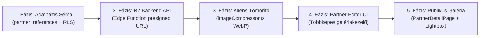

# P0-D18 – ÉPÍTŐTUDÁS MEGLÉVŐ SUPABASE ÉS CLOUDFLARE R2 INFRASTRUKTÚRA KIEGÉSZÍTŐ AUDIT

**Projekt:** ÉpítőTudás  
**Supabase projekt:** `olmavxcmkvvcebgqxohe`  
**Dátum:** 2026-11-11  
**Előzmény:** P0-D17 – Partneri referenciakezelő és többképes R2 galéria audit  
**Dokumentumazonosító:** `P0_D18_EXISTING_STORAGE_INFRASTRUCTURE_AUDIT.md`  
**Vizsgálat típusa:** READ-ONLY / Forenzikus infrastruktúra- és jogosultsági audit  
**Munkamód:** READ-ONLY PLAN / NO PATCH / NO REFACTOR  
**Záróállapot:** `READ-ONLY AUDIT COMPLETED – NO CODE, DATABASE, R2 OR GIT CHANGES`

---

## 1. VEZETŐI ÖSSZEFOGLALÓ

A jelen kiegészítő vizsgálat célja annak tényszerű feltárása, hogy az ÉpítőTudás projekt más moduljaiban vagy infrastruktúrájában létezik-e már olyan fájlkezelési, tárolási vagy jogosultsági megoldás, amely újrahasznosítható a partneri többképes referencia-galéria megvalósításához.

### A vizsgálat legfontosabb bizonyított eredményei:
1. **[BIZONYÍTOTT] Nincs működő szerveroldali fájltároló rendszer:** Az ÉpítőTudás egyetlen moduljában sem létezik sem Cloudflare R2, sem Supabase Storage alapú működő fájlfeltöltési infrastruktúra. Minden jelenlegi képkezelés vagy külső URL-ek egyszerű szöveges elmentésére épül, vagy kliensoldali Base64 DataURL-eket tárol a memóriában / adatbázismezőkben.
2. **[BIZONYÍTOTT] A Thingor projekt infrastruktúrája szigorúan elkülönül:** Az ÉpítőTudás kódbázisában, Supabase projektjében (`olmavxcmkvvcebgqxohe`) és konfigurációjában a Thingor home inventory projekt R2 infrastruktúrája vagy táblái nem szerepelnek. A két rendszert minden vizsgálati pontban szigorúan elkülönítve kezeltük.
3. **[BIZONYÍTOTT] R2 konfiguráció és titkos kulcsok hiánya:** A projekt `wrangler.jsonc` fájljában semmilyen R2 bucket binding (`r2_buckets`) nincs definiálva. A projekt környezeti változói között (`.env`) nem található semmilyen R2 / S3 hitelesítő kulcs (`AWS_ACCESS_KEY_ID`, `AWS_SECRET_ACCESS_KEY`, `R2_ACCOUNT_ID`, `R2_BUCKET_NAME`).
4. **[BIZONYÍTOTT] Újrahasznosítható Supabase RLS segédfüggvények:** A `20261110_001_fix_partner_and_users_rls.sql` migrációban korábban bevezetett `public.is_partner_contact(uuid)` és `public.is_partner_admin(uuid)` rekurzióbiztos, `SECURITY DEFINER` segédfüggvények kiválóan és biztonságosan újrahasznosíthatók a leendő referenciák sorszintű védelméhez.
5. **[BIZONYÍTOTT] Adatmodell-ajánlás:** A szakmai és biztonsági szempontok alapján egy önálló `partner_references` tábla létrehozása javasolt beágyazott `images JSONB` képtömbbel. Ez egyszerre garantálja az RLS védelmet, a finomhangolt publikálási ellenőrzést és a képek rugalmas sorrendezhetőségét.
6. **[BIZONYÍTOTT] Legkisebb kockázatú háttérszolgáltatás:** A Supabase Edge Function (`r2-presign-upload`) a legkisebb kockázatú megoldás, mivel a meglévő Supabase Auth JWT-vel hitelesít, a meglévő DB függvénnyel ellenőrzi a partneri kapcsolatot, és rövid élettartamú presigned PUT URL-t ad a kliensnek anélkül, hogy az R2 titkos kulcsok kikerülnének a böngészőbe.

---

## 2. CLOUDFLARE R2 – MEGLÉVŐ INFRASTRUKTÚRA AUDITJA

### 2.1. Forráskód- és konfiguráció-ellenőrzés
A teljes projektben elvégzett reguláris kifejezéses keresések az R2, S3 és objektumtárolási kulcsszavakra az alábbi eredményt hozták:

- **`wrangler.jsonc`:**
  - Kizárólag statikus SPA fájlkiszolgálási konfigurációt tartalmaz a `./dist` könyvtárból.
  - Sorszámok: `wrangler.jsonc:1-10`.
  - R2 binding (`r2_buckets`): **NEM TALÁLHATÓ** [BIZONYÍTOTT].
- **`wrangler.toml`:**
  - A projektben nem létezik [BIZONYÍTOTT].
- **`package.json`:**
  - Sem `@aws-sdk/client-s3`, sem `@aws-sdk/s3-request-presigner`, sem egyéb S3/R2 kliens nincs telepítve a függőségek között (`package.json:18-24`).
- **Környezeti változók (`.env`):**
  - Kizárólag a `VITE_SUPABASE_URL` és `VITE_SUPABASE_ANON_KEY` változókat tartalmazza.
  - Az alábbi keresett változók egyike sem szerepel sem a `.env`, sem a forráskód fájljaiban:
    - `AWS_ACCESS_KEY_ID`: **NEM TALÁLHATÓ** [BIZONYÍTOTT]
    - `AWS_SECRET_ACCESS_KEY`: **NEM TALÁLHATÓ** [BIZONYÍTOTT]
    - `R2_ACCOUNT_ID`: **NEM TALÁLHATÓ** [BIZONYÍTOTT]
    - `R2_BUCKET_NAME`: **NEM TALÁLHATÓ** [BIZONYÍTOTT]
    - `R2_PUBLIC_URL`: **NEM TALÁLHATÓ** [BIZONYÍTOTT]
    - `R2_ENDPOINT`: **NEM TALÁLHATÓ** [BIZONYÍTOTT]
- **S3 SDK hívások:**
  - `S3Client`, `PutObjectCommand`, `DeleteObjectCommand`, `GetObjectCommand`, `getSignedUrl`, `presigned`: **NEM TALÁLHATÓ** a forráskódban [BIZONYÍTOTT].
- **Megtalált R2 hivatkozások:**
  - A teljes projektben kizárólag egyetlen statikus R2 URL szerepel 3 helyen:
    1. `src/components/BannerCreativeEditor.tsx:472`: form beviteli mező placeholder: `"https://pub-77180ecae5fa4824aa9ef44ab92aaf5a.r2.dev/logó.webm"`
    2. `src/components/ModernAdBanner.tsx:93`: alapértelmezett kreatív banner videó link.
    3. `src/services/bannerCreativeService.ts:223`: `DEFAULT_FALLBACK_VIDEO_SETTINGS.video_url`.

### 2.2. Cloudflare infrastruktúra közvetlen állapota
- A helyi fejlesztői környezetben nincs hitelesített Cloudflare MCP vagy aktív Wrangler API token csatolva.
- **Minősítés:** `CLOUDFLARE INFRASTRUKTÚRA: KÖZVETLENÜL NEM ELLENŐRIZHETŐ`.
- A kódban lévő `pub-77180ecae5fa4824aa9ef44ab92aaf5a.r2.dev` publikus domain létezése bizonyítja, hogy a szervezet Cloudflare fiókjában létezik legalább egy nyilvános bucket (ahol a banner videó található), de ahhoz sem a kód, sem a CI/CD nem rendelkezik rögzített feltöltési integrációval.

---

## 3. MEGLÉVŐ FÁJLKEZELÉSI MEGOLDÁSOK FELTÁRÁSA

Az ÉpítőTudás alkalmazásban jelenleg az alábbi modulok kezelnek képi tartalmakat:

| Vizsgálati pont | Megállapítás |
|---|---|
| **Modul** | **Partnerkezelés – Logó (`logo_url`)** |
| Fájl / szolgáltatás | `src/components/PartnerEditorModal.tsx` (Tab 2) |
| Tárolási hely | `partners.logo_url` oszlop (PostgreSQL text) |
| Feltöltés módja | Nincs feltöltés. Manuálisan bemásolt külső HTTP/HTTPS URL. |
| Törlés módja | Mező törlése a szerkesztőablakban. |
| Képfeldolgozás | Nincs. |
| Jogosultságellenőrzés | Partner és admin szerkesztheti. |
| Újrahasznosítható? | **Nem.** Egyszerű URL string. |
| Szükséges módosítás | Képfeltöltő komponens integrálása. |

| Vizsgálati pont | Megállapítás |
|---|---|
| **Modul** | **Partnerkezelés – Borítókép (`cover_url`)** |
| Fájl / szolgáltatás | `src/components/PartnerEditorModal.tsx` (Tab 2) |
| Tárolási hely | `partners.cover_url` oszlop (PostgreSQL text) |
| Feltöltés módja | Nincs feltöltés. Manuálisan bemásolt külső URL. |
| Törlés módja | Mező törlése. |
| Képfeldolgozás | Nincs. |
| Jogosultságellenőrzés | Partner és admin szerkesztheti. |
| Újrahasznosítható? | **Nem.** |
| Szükséges módosítás | Képfeltöltő komponens integrálása. |

| Vizsgálati pont | Megállapítás |
|---|---|
| **Modul** | **Rendszerbeállítások – Weboldal Logó (`logoUrl`)** |
| Fájl / szolgáltatás | `src/pages/AdminSettingsPage.tsx` (566–637. és 1525–1550. sorok) |
| Tárolási hely | Base64 DataURL a `site_settings` táblában és localStorage-ben. |
| Feltöltés módja | Kliensoldali `<input type="file">` -> `FileReader.readAsDataURL()`. |
| Törlés módja | Visszaállítás alapértelmezettre. |
| Képfeldolgozás | **HTML5 Canvas:** lekicsinyítés max 300x90 px-re, PNG konvertálás (`canvas.toDataURL('image/png', 0.85)`). |
| Jogosultságellenőrzés | Kizárólag platform adminisztrátor (`role === 'admin'`). |
| Újrahasznosítható? | **Részben.** A Canvas átméretezési logika mintaként szolgálhat a WebP tömörítőhöz, de a Base64 adatbázisban tárolás nem adaptálható galériához. |
| Szükséges módosítás | WebP konverzió és R2-be feltöltés Base64 tárolás helyett. |

| Vizsgálati pont | Megállapítás |
|---|---|
| **Modul** | **Kategória és Banner képek** |
| Fájl / szolgáltatás | `src/components/EditCategoryModal.tsx` (202–225. sorok) |
| Tárolási hely | `categories.image_url` és `banner_url` oszlopok. |
| Feltöltés módja | `<input type="file">` -> `FileReader.readAsDataURL()` (nyers Base64) vagy külső URL. |
| Törlés módja | Form mező ürítése. |
| Képfeldolgozás | Nincs (nyers Base64 string készül). |
| Jogosultságellenőrzés | Csak admin / szerkesztő. |
| Újrahasznosítható? | **Nem.** A nyers Base64 tárolás nagy méretű fotóknál tilos. |
| Szükséges módosítás | Fájlszerveres tárolásra átállás. |

| Vizsgálati pont | Megállapítás |
|---|---|
| **Modul** | **Hirdetési kreatívok és bannerek** |
| Fájl / szolgáltatás | `src/components/BannerCreativeEditor.tsx`, `bannerCreativeService.ts` |
| Tárolási hely | `localStorage` (`epitotudas_ad_fallback_video_v1`). |
| Feltöltés módja | Nincs feltöltés. Statikus R2 videó URL beágyazása demóként. |
| Törlés módja | LocalStorage reset. |
| Képfeldolgozás | Nincs. |
| Jogosultságellenőrzés | Nincs. |
| Újrahasznosítható? | **Nem.** Csak egy statikus URL string. |
| Szükséges módosítás | Szerveroldali videó/kép menedzsment. |

| Vizsgálati pont | Megállapítás |
|---|---|
| **Modul** | **Könyvtári PDF Borítókép-generálás** |
| Fájl / szolgáltatás | `src/services/pdfCoverGenerator.ts` |
| Tárolási hely | Kliensoldali memóriában (DataURL) menet közben renderelve. |
| Feltöltés módja | Nincs feltöltés. PDF első oldalának kirajzolása `pdfjsLib`-bel és Canvas-szel. |
| Törlés módja | N/A (nem perzisztált). |
| Képfeldolgozás | PDF oldal raszterizálása képpé. |
| Jogosultságellenőrzés | Nyilvános olvasás. |
| Újrahasznosítható? | **Nem.** Nem képfájlokat kezel. |
| Szükséges módosítás | N/A. |

---

## 4. SUPABASE – MEGLÉVŐ ADATMODELL ÉS RLS VIZSGÁLATA

Vizsgált Supabase projekt: `olmavxcmkvvcebgqxohe`

### 4.1. Partners tábla
- **Oszlopok:** `id` (uuid, PK), `name`, `slug`, `category`, `logo_url`, `website_url`, `description`, `is_verified`, `created_at`, `official_name`, `partner_type`, `contact_person_name`, `contact_person_title`, `contact_email`, `contact_phone`, `address`, `zip_code`, `city`, `county`, `business_hours`, `detailed_description`, `cover_url`, `inquiry_email`.
- **Hiányzó mező:** A táblában sem `references` JSONB oszlop, sem referenciákra mutató idegen kulcs **nem létezik** [BIZONYÍTOTT].
- **RLS Policy-k (20261110_001_fix_partner_and_users_rls.sql):**
  - `Public read partners`: `FOR SELECT TO anon, authenticated USING (true)` -> Nyilvánosan olvasható.
  - `Partner contacts update partners`: `FOR UPDATE TO authenticated USING (public.is_partner_contact(id) OR public.is_editor_role())` -> Szigorúan védett.
  - `Admin insert partners` és `Admin delete partners`: Csak platform szerkesztők és adminok (`public.is_editor_role()`).

### 4.2. Partner_users tábla
- **Oszlopok:** `partner_id` (uuid, FK), `user_id` (uuid, FK), `member_role` (text: 'owner' | 'member'), `role` (text), `created_at` (timestamptz). Összetett elsődleges kulcs: `(partner_id, user_id)`.
- **Meglévő RLS Segédfüggvények (újrahasznosítási kincs):**
  1. `public.is_partner_contact(target_partner_id uuid)`:
     ```sql
     SELECT EXISTS (
       SELECT 1 FROM public.partner_users
       WHERE partner_id = target_partner_id
         AND user_id = auth.uid()
     );
     ```
     - Tulajdonság: `SECURITY DEFINER`, `SET search_path = ''`.
     - Védelem: Teljesen védett a végtelen RLS rekurzió ellen.
  2. `public.is_partner_admin(target_partner_id uuid)`:
     Ellenőrzi, hogy a felhasználó 'owner', 'admin' vagy 'partner_admin' szerepkörrel rendelkezik-e az adott partnernél.
- **Megállapítás:** A meglévő `is_partner_contact(partner_id)` függvény **közvetlenül és kockázatmentesen újrahasznosítható** a referenciák RLS védelmére, valamint az Edge Function-ben történő jogosultságellenőrzésre.

### 4.3. Más fájlokhoz vagy médiatartalmakhoz tartozó táblák
- A teljes adatbázis-séma átvizsgálása alapján:
  - Nincs `files`, `media`, `attachments`, `images`, sem `documents` tábla.
  - Nincs tábla, amely MIME-típust, fájlméretet vagy S3/R2 objektumkulcsot tárolna.
  - Minden meglévő médiaoszlop egyszerű szöveges URL mező.
  - **Következtetés:** Nincs olyan meglévő médiatábla, amelyet adatok beillesztésére újra lehetne hasznosítani.

---

## 5. PARTNERI REFERENCIÁKHOZ SZÜKSÉGES JOGOSULTSÁGI MODELL

A követelmények több védelmi rétegen (Defense-in-Depth) keresztül biztosíthatók:

```
[Böngésző / UI Védelem] 
       │ 
[Service Réteg Ellenőrzés (TypeScript)]
       │
[Supabase RLS Szabályok (PostgreSQL)] ──> Adatbázis-rekordok védelme
       │
[Szerveroldali Edge Function (Auth Token + DB Check)] ──> R2 Presigned URL védelem
```

| Művelet | Partner saját referenciája | Más partner referenciája | Admin | Biztonsági garancia helye |
| :--- | :--- | :--- | :--- | :--- |
| **Referencia megtekintése** | Igen | Csak publikált | Igen | Supabase RLS: `is_published = true OR is_partner_contact(partner_id) OR is_editor_role()` |
| **Saját referencia létrehozása** | Igen | Nem | Igen | Supabase RLS: `is_partner_contact(partner_id) OR is_editor_role()` |
| **Saját referencia módosítása** | Igen | Nem | Igen | Supabase RLS: `is_partner_contact(partner_id) OR is_editor_role()` |
| **Más referencia módosítása** | Nem | Nem | Igen | RLS blokkolja (0 sor módosul) |
| **Saját kép feltöltése** | Igen | Nem | Igen | Edge Function: ellenőrzi az `auth.uid()` partnerkapcsolatát, és csak a saját `partners/{partner_id}/...` útvonalra ad presigned PUT URL-t |
| **Más partner képének törlése** | Nem | Nem | Igen | Edge Function: törlés előtt ellenőrzi, hogy a cél objektumkulcs a hívó partneréhez tartozik-e |
| **Publikálás (`is_published = true`)**| Nem | Nem | Igen | DB Trigger / RLS: a partner nem állíthatja `true`-ra a publikálást admin jóváhagyás nélkül |
| **Publikálás visszavonása** | Nem | Nem | Igen | DB Trigger / RLS |

---

## 6. JAVASOLT ADATMODELL – MEGVALÓSÍTHATÓSÁGI ÖSSZEHASONLÍTÁS

| Szempont | A. JSONB mező (`partners.references`) | B. Külön `partner_references` tábla (+ beágyazott `images JSONB`) |
| :--- | :--- | :--- |
| **Több referencia kezelése** | Tömbként tárolva egyetlen oszlopban | Külön relációs rekordokként (1 : N kapcsolat) |
| **Több kép referenciánként** | Beágyazott tömb a JSON-ben | Beágyazott `images JSONB` tömb a referenciában |
| **Külön publikálási állapot** | Bonyolult (RLS nem lát be a JSONB mezőbe) | **Tökéletes:** RLS közvetlenül szűrheti: `is_published = true` |
| **Képek sorrendezése** | JSON tömbsorrend alapján | `images` JSON tömb index / `display_order` alapján |
| **Referencia szerkesztése** | A teljes partner referencialistát újra kell írni | **Optimális:** Csak az adott referencia rekord módosul |
| **Kép törlése** | Teljes tömb felülírása | Csak a cél referencia rekord frissül |
| **Partnerenkénti jogosultság** | `partners` tábla UPDATE jogán múlik | **Kiváló:** Dedikált RLS szabályok a referenciákra |
| **Admin jóváhagyás** | Csak PL/pgSQL BEFORE UPDATE triggerrel kényszeríthető ki | **Egyszerű:** Oszlopszintű vagy RLS feltétel |
| **Későbbi bővíthetőség** | Nehézkes (nincs SQL indexelés az almezőkre) | **Kiváló:** Új oszlopok, statisztikák, keresőindexek |
| **Adatbázis-terhelés** | A partner alapadatainak lekérésekor a teljes galéria feleslegesen letöltődik | **Alacsony:** Referenciák csak a részletes nézetben töltődnek be |
| **Kompatibilitás** | Jobban hasonlít a mostani TypeScript interfészre | Kis átalakítást igényel a service rétegben |

### Szakmai Ajánlás:
A **„B” megoldás (Külön `partner_references` tábla beágyazott `images JSONB` oszloppal)** egyértelműen a szakmailag helyes és biztonságos út.  
- Ezzel a publikus látogatók számára készült RLS szűrés (`is_published = true`) natív SQL szinten működik, nem szivárognak ki a még nem jóváhagyott vázlat referenciák.
- A képek tárolására a referencián belüli `images JSONB` tömb ideális, mert elkerüli a túlzott adatbázis-fragmentációt (nem kell harmadik kapcsolótábla), miközben a képek feliratai, sorrendje és mérete könnyen kezelhető.

---

## 7. R2 FELTÖLTÉS ÉS TÖRLÉS – ÚJRAHASZNOSÍTHATÓSÁG ÉS KOCKÁZATOK

### 7.1. Megvalósítási opciók összehasonlítása

| Szempont | 1. Supabase Edge Function + R2 S3 API (AJÁNLOTT) | 2. Cloudflare Worker + R2 Binding | 3. Meglévő szolgáltatás bővítése |
| :--- | :--- | :--- | :--- |
| **Infrastruktúra illeszkedés** | **Tökéletes:** A projekt már használ Supabase Edge Functionöket. | Közepes: A `wrangler.jsonc` jelenleg csak Pages SPA, nincs Worker API. | **Lehetetlen:** Nincs meglévő tárolási szolgáltatás. |
| **Hitelesítés** | **Azonnali:** `auth.uid()` a meglévő Supabase JWT tokenből. | Nehézkes: A Workernek vissza kellene kérdeznie a Supabase-hez. | N/A |
| **Partnerkapcsolat ellenőrzése**| **Natív:** `is_partner_contact(partner_id)` közvetlen DB hívás. | Dupla hálózati ugrás szükséges a Supabase felé. | N/A |
| **Feltöltési mechanizmus** | **Presigned PUT URL (5 perc):** Kliens közvetlenül az R2-be tölt, nulla szerverterhelés. | Közvetlen Worker streaming proxy. | N/A |
| **Titkos kulcsok védelme** | R2 Access & Secret Key csak a Supabase Secrets tárolóban van, böngésző nem látja. | R2 kulcsok Cloudflare Worker Secrets-ben. | N/A |
| **Árva fájlok kezelése** | Sikertelen mentés esetén a tranzakció lezárásakor takarító hívás indítható. | Külön cleanup worker szükséges. | N/A |
| **Fejlesztési kockázat** | **Minimális.** | Magas (dupla deployment és routing átalakítás). | N/A |

### 7.2. R2 domain és publikus galéria
- A meglévő publikus R2 domain (`pub-77180ecae5fa4824aa9ef44ab92aaf5a.r2.dev`) vagy egy új dedikált ÉpítőTudás domain (pl. `media.epitotudas.hu`) tökéletesen alkalmas a referenciaképek közvetlen böngészőbeli kiszolgálására.
- Mivel a referenciák publikus bemutató anyagok, a képekhez **nem szükséges privát hozzáférés-korlátozás**; a védelem a **feltöltésre és törlésre** vonatkozik.

---

## 8. KÉPKEZELÉS ÉS OPTIMALIZÁLÁS MEGVALÓSÍTHATÓSÁGA

A P0-D17-ben meghatározott paraméterek:
- Forrásfájl max.: **10 MB**
- Főkép felbontás: **max. 1920 px** szélesség (arányos magasság)
- Bélyegkép (thumbnail): **max. 400 px** szélesség
- Formátum: **WebP**
- Minőség: Főkép **0.82**, Bélyegkép **0.75**

### Technikai ellenőrzés a meglévő környezetben:
- **Canvas API & `canvas.toBlob()`:** Teljes mértékben támogatott. Külső npm csomag nélkül képes előállítani a WebP fájlokat.
- **EXIF-eltávolítás:** A Canvas `drawImage()` újrarendereli a nyers pixeleket, így minden kamera-, GPS- és szenzitív metaadat automatikusan törlődik.
- **Memóriavédelem (Mobil böngészők):**  
  Több kép feltöltése esetén szigorúan **szekvenciális (soros)** feldolgozást kell alkalmazni. Egyszerre csak egyetlen kép legyen a memóriában, majd a Canvas méretének nullázása (`canvas.width = 0; canvas.height = 0;`) után jöhet a következő kép. Így még 10 db 8 MB-os fotó esetén sem lép fel memóriatúlcsordulás vagy fagyás.

---

## 9. MEGLÉVŐ RENDSZERREL VALÓ KOMPATIBILITÁS ÉS FÁJLLISTA

### 9.1. A kulcsfájlok jelenlegi szerepe (ellenőrizve):
1. `src/services/partnerService.ts`: Jelenleg csak a `localStorage`-be menti a referenciákat a DB oszlop hiánya miatt.
2. `src/components/PartnerEditorModal.tsx`: A 6. fülön kezeli a referenciákat, de csak 1 db szöveges kép URL-lel.
3. `src/pages/PartnerDetailPage.tsx`: 2 oszlopos rácsban rajzolja ki a referenciákat, kártyánként 1 képpel, galéria nélkül.
4. `src/utils/imageOptimizer.ts`: Csak Unsplash/Pexels URL paramétereket manipulál, nem alkalmas helyi fájl tömörítésre.
5. `wrangler.jsonc`: Statikus SPA kiszolgáló, R2 binding nélkül.
6. `supabase/functions/`: Csak 2 db email funkciót tartalmaz.

### 9.2. Szükséges fájlmódosítások és új fájlok leltára:

#### A. Módosítandó meglévő fájlok (3 db):
1. `src/services/partnerService.ts`: Kibővítés az új relációs referencia lekérdezésekkel és típusokkal (`ExtendedReferenceItem`, `ReferenceImageItem`).
2. `src/components/PartnerEditorModal.tsx`: Tab 6 átdolgozása: többképes feltöltő, drag-and-drop, előnézeti rács, törlés, sorrendezés, szakterület és weboldal mezők.
3. `src/pages/PartnerDetailPage.tsx`: Referencia szekció átalakítása többképes galériává, bélyegképekkel és kattintásra nyíló reszponzív Lightbox modal komponenssel.

#### B. Létrehozandó új fájlok (3 db):
1. `src/utils/imageCompressor.ts` (Képfeldolgozás): Natív HTML5 Canvas alapú szekvenciális WebP konvertáló, átméretező és bélyegkép-generáló modul.
2. `src/services/storageService.ts` (Frontend Storage API): Presigned URL lekérése az Edge Functiontől, közvetlen HTTP PUT feltöltés az R2-be, és kép törlési hívás.
3. `supabase/functions/r2-presign-upload/index.ts` (Backend Edge Function): Hitelesített Deno funkció, amely ellenőrzi a partneri jogosultságot, és előállítja az S3 presigned PUT / DELETE URL-eket.

#### C. Adatbázis-migráció (1 db):
1. `supabase/migrations/20261111_001_partner_references_schema.sql`: A `partner_references` tábla, indexek és RLS házirendek létrehozása.

---

## 10. FEJLESZTÉSI FÁZISTERV



### 1. Fázis: Adatbázis-perzisztencia és RLS (Backend)
- **Cél:** A referenciák valódi adatbázis-tárolása és sorszintű védelme.
- **Érintett:** Új migráció `20261111_001_partner_references_schema.sql`.
- **Kockázat:** Alacsony (új tábla, nem érinti a meglévő táblák adatait).
- **Külön jóváhagyás:** **SZÜKSÉGES** (SQL migráció futtatása).

### 2. Fázis: R2 Feltöltő és Törlő Szolgáltatás (Infrastruktúra)
- **Cél:** Biztonságos presigned URL generálás az R2 feltöltésekhez.
- **Érintett:** `supabase/functions/r2-presign-upload/index.ts`, Cloudflare R2 bucket beállítások.
- **Kockázat:** Közepes (R2 API kulcsok helyes beállítása a Supabase Secrets-ben).
- **Külön jóváhagyás:** **SZÜKSÉGES** (Edge Function deploy és titkos kulcsok megadása).

### 3. Fázis: Kliensoldali Képfeldolgozó és Storage Kliens (Frontend Core)
- **Cél:** Fájlok kliensoldali WebP tömörítése és közvetlen feltöltése.
- **Érintett:** `src/utils/imageCompressor.ts`, `src/services/storageService.ts`.
- **Kockázat:** Alacsony (elszigetelt tiszta TypeScript modulok).
- **Külön jóváhagyás:** Nem szükséges (normál frontend kód).

### 4. Fázis: Partner Szerkesztőfelület Frissítése (Frontend UI)
- **Cél:** Többképes feltöltés, sorrendezés és új referencia adatok kezelése.
- **Érintett:** `src/components/PartnerEditorModal.tsx`, `src/services/partnerService.ts`.
- **Kockázat:** Alacsony (meglévő kék–fekete–fehér dizájn megtartásával).
- **Külön jóváhagyás:** Nem szükséges.

### 5. Fázis: Publikus Galéria és Lightbox Megjelenítő (Frontend UI)
- **Cél:** Látványos, reszponzív projektgaléria a nyilvános partnerprofilon.
- **Érintett:** `src/pages/PartnerDetailPage.tsx`.
- **Kockázat:** Alacsony (reszponzív tesztelés szükséges).
- **Külön jóváhagyás:** Nem szükséges.

---

## 11. VÉGSŐ DÖNTÉSI JAVASLAT ÉS VÁLASZOK

1. **Van-e már újrahasznosítható R2 infrastruktúra?**  
   **NEM.** A kódban csak egy statikus demó videó link szerepel; nincs feltöltési konfiguráció, binding vagy környezeti változó.
2. **Van-e már újrahasznosítható fájlfeltöltési szolgáltatás?**  
   **NEM.** Az alkalmazás mindenhol külső URL-eket vagy közvetlen Base64 DataURL-eket tárol; valódi felhős fájlfeltöltő sehol nem üzemel.
3. **Melyik adatmodell javasolt?**  
   Külön **`partner_references` tábla** beágyazott **`images JSONB`** oszloppal (relációs integritás + rugalmas képsorrend).
4. **Melyik háttérszolgáltatási megoldás a legkisebb kockázatú?**  
   A **Supabase Edge Function (`r2-presign-upload`)**, mivel a meglévő Supabase Auth tokennel és a meglévő `is_partner_contact()` függvénnyel közvetlenül képes hitelesíteni.
5. **Hány meglévő fájlt kell módosítani?**  
   **3 meglévő fájlt** (`partnerService.ts`, `PartnerEditorModal.tsx`, `PartnerDetailPage.tsx`).
6. **Hány új fájlt kell létrehozni?**  
   **4 új fájlt** (1 SQL migráció, 1 Edge Function, 2 frontend segédmodul: `imageCompressor.ts` és `storageService.ts`).
7. **Milyen adatbázis-módosítás szükséges?**  
   Egy új tábla létrehozása (`partner_references`) megfelelő idegen kulccsal (`partners.id`), indexekkel és 4 db RLS házirenddel (SELECT, INSERT, UPDATE, DELETE).
8. **Mely feladatok igényelnek külön jóváhagyást?**  
   - Az SQL adatbázis-migráció jóváhagyása és futtatása.
   - A Cloudflare R2 bucket hozzáférési kulcsok felvitele a Supabase Secrets-be.
   - Az Edge Function deploy jóváhagyása.

---
**KÖTELEZŐ ZÁRÓÁLLAPOT:**  
`READ-ONLY AUDIT COMPLETED – NO CODE, DATABASE, R2 OR GIT CHANGES`

