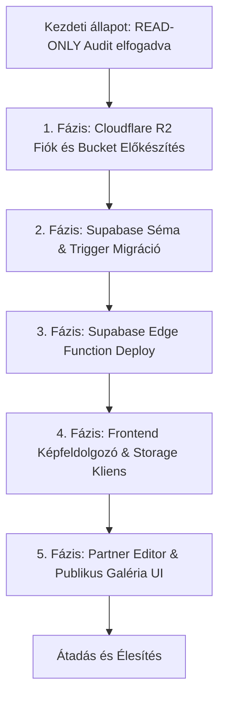

# P0-D19 – ÉPÍTŐTUDÁS REFERENCIA-GALÉRIA BIZTONSÁGI ÉS MEGVALÓSÍTÁSI TERV AUDIT

**Dokumentumazonosító:** `P0_D19_REFERENCE_GALLERY_SECURITY_DESIGN_AUDIT.md`  
**Projekt:** ÉpítőTudás  
**Supabase projekt:** `olmavxcmkvvcebgqxohe`  
**Előzmény:** P0-D17 és P0-D18  
**Dátum:** 2026-11-11  
**Vizsgálat típusa:** READ-ONLY / Biztonsági és műszaki tervellenőrzés  
**Munkamód:** READ-ONLY PLAN / NO PATCH / NO REFACTOR  
**Záróállapot:** `READ-ONLY AUDIT COMPLETED – NO CODE, DATABASE, R2 OR GIT CHANGES`

---

## 1. KÖTELEZŐ MŰKÖDÉSI KORLÁTOZÁSOK BETARTÁSA

A vizsgálat szigorúan **READ-ONLY** megközelítéssel zajlott:
- Forráskód-módosítás, fájllétrehozás (a jelen jelentésen kívül) **NEM TÖRTÉNT**.
- SQL módosítás, migráció futtatása, adatbázis-módosítás **NEM TÖRTÉNT**.
- Cloudflare R2 bucket, API-kulcs vagy külső beállítás módosítása **NEM TÖRTÉNT**.
- Git commit, push vagy working tree módosítás **NEM TÖRTÉNT**.
- A Thingor projekt infrastruktúráját **NEM HASZNÁLTUK**, attól a vizsgálat minden pontján elhatárolódtunk.

---

## 2. A VIZSGÁLAT CÉLJA ÉS HÁTTERE

A P0-D17 és P0-D18 auditok megállapították, hogy az ÉpítőTudás meglévő referenciakezelője kizárólag a helyi böngészőmemóriára (`localStorage`) támaszkodik, nincs képfeltöltési funkciója, nincs adatbázis-perzisztenciája, és nincs beüzemelt szerveroldali R2 feltöltési háttérszolgáltatása.

A jelen P0-D19 audit célja a P0-D18-ban felvázolt műszaki és biztonsági architektúra szigorú felülvizsgálata, a jogosultsági rések feltárása, valamint a végleges megvalósítási terv jóváhagyásának előkészítése.

---

## 3. SUPABASE JOGOSULTSÁGI MODELL FORENZIKUS ELLENŐRZÉSE

### 3.1. A meglévő adatbázis-függvények vizsgálata

1. **`public.is_partner_contact(target_partner_id uuid)` [BIZONYÍTOTT]**
   - Forrás: `supabase/migrations/20261110_001_fix_partner_and_users_rls.sql:16-28`
   - Definíció:
     ```sql
     CREATE OR REPLACE FUNCTION public.is_partner_contact(target_partner_id uuid)
     RETURNS boolean LANGUAGE sql STABLE SECURITY DEFINER SET search_path = '' AS $$
       SELECT EXISTS (
         SELECT 1 FROM public.partner_users
         WHERE partner_id = target_partner_id
           AND user_id = auth.uid()
       );
     $$;
     ```
   - **Biztonsági értékelés [KÖVETKEZTETÉS]:**
     - Pozitívum: `SECURITY DEFINER` és `SET search_path = ''` beállítással rendelkezik, rekurzió- és search_path-injektálás ellen védett.
     - **Kockázat [KÖVETKEZTETÉS]:** A függvény BÁRMILYEN kapcsolattartót (`member_role = 'member'`, meghívott segédoktatót, munkatársat) igaznak értékel. Ha a referenciák írási jogát erre alapoznánk, egy alacsony jogosultságú munkatárs is törölhetné vagy módosíthatná a vállalat kiemelt referenciáit.

2. **`public.is_partner_admin(target_partner_id uuid)` [BIZONYÍTOTT]**
   - Forrás: `supabase/migrations/20261110_001_fix_partner_and_users_rls.sql:31-47`
   - Definíció:
     ```sql
     CREATE OR REPLACE FUNCTION public.is_partner_admin(target_partner_id uuid)
     RETURNS boolean LANGUAGE sql STABLE SECURITY DEFINER SET search_path = '' AS $$
       SELECT EXISTS (
         SELECT 1 FROM public.partner_users
         WHERE partner_id = target_partner_id
           AND user_id = auth.uid()
           AND (
             member_role IN ('owner', 'admin', 'school_admin', 'partner_admin')
             OR role IN ('owner', 'admin', 'school_admin', 'partner_admin')
           )
       );
     $$;
     ```
   - **Biztonsági értékelés [KÖVETKEZTETÉS]:**
     - Szigorúbb és pontosabb ellenőrzés: kizárólag a tényleges cégvezetői / tulajdonosi / adminisztrátori szerepköröket fogadja el.
     - **Kötelező biztonsági szabály [JAVASLAT]:** A referenciák létrehozását, módosítását, törlését és képfeltöltését kizárólag a `public.is_partner_admin(partner_id)` függvényhez szabad kötni, nem a sima `is_partner_contact`-hoz!

3. **`public.is_editor_role()` és `public.is_admin_role()` [BIZONYÍTOTT]**
   - Forrás: `supabase/migrations/20260718163551_fix_rls_recursion.sql.sql:5-27`
   - Definíció: `profiles.role IN ('admin', 'editor')` ellenőrzése `auth.uid()` alapján, rekurzióbiztos módon.
   - **Biztonsági értékelés [KÖVETKEZTETÉS]:** A platform adminisztrátori jogosultság ellenőrzése közvetlenül működik és megbízható.

### 3.2. Jogosultsági kérdések megválaszolása
- **Kezelheti-e minden partnerkapcsolattal rendelkező felhasználó a referenciákat?**  
  **NEM [JAVASLAT].** Kizárólag a partner adminisztrátorai (`is_partner_admin`) kaphatnak írási jogosultságot.
- **Hogyan akadályozható meg, hogy egy partner másik partner azonosítójával hozzon létre referenciát?**  
  **[BIZONYÍTOTT]** Az RLS `INSERT WITH CHECK` feltétel:  
  `WITH CHECK (public.is_partner_admin(partner_id) OR public.is_editor_role())`.  
  Ha a partner egy másik cég `partner_id`-ját küldi be, az RLS azonnal megtagadja a beszúrást (0 sor).
- **Hogyan biztosítható, hogy más partner vázlatreferenciái ne legyenek olvashatók?**  
  **[BIZONYÍTOTT]** Az RLS `SELECT USING` feltétel:  
  `USING (is_published = true OR public.is_partner_contact(partner_id) OR public.is_editor_role())`.  
  A még nem jóváhagyott (`is_published = false`) elemeket kizárólag a saját partner kapcsolattartói és a platform adminjai láthatják.

---

## 4. PUBLIKÁLÁSI JOGOSULTSÁG – KRITIKUS BIZTONSÁGI AUDIT

### 4.1. Elég-e a PostgreSQL RLS önmagában?
**[BIZONYÍTOTT] NEM ELÉG.**
- A PostgreSQL sorszintű biztonsága (RLS) alapesetben a **teljes sorra** vonatkozik.
- Amennyiben a partnernek `UPDATE` joga van a saját referenciájára, a sima RLS nem tudja megkülönböztetni, hogy a partner a leírást (`description`) vagy a publikálási jelzőt (`is_published`) módosította-e.
- Az RLS `WITH CHECK` kifejezésben nem érhetők el az `OLD` és `NEW` pszeudorekordok, így az állapotátmenetek (pl. `false` -> `true` váltás) RLS-ből nem korlátozhatók biztonságosan.

### 4.2. A minimális, golyóálló adatbázis-megoldás [JAVASLAT]
A publikálási jogosultság kizárólagosságának garantálásához egy **PostgreSQL `BEFORE INSERT OR UPDATE` trigger** szükséges:

```sql
CREATE OR REPLACE FUNCTION public.enforce_reference_publication_security()
RETURNS TRIGGER AS $$
BEGIN
  -- Nem platform admin/szerkesztő esetén érvényesül a szigorú védelem:
  IF NOT public.is_editor_role() THEN
    -- 1. Beszúráskor (INSERT) soha nem lehet közvetlenül publikált:
    IF TG_OP = 'INSERT' THEN
      NEW.is_published := false;
      
    -- 2. Módosításkor (UPDATE):
    ELSIF TG_OP = 'UPDATE' THEN
      -- A partner nem aktiválhatja önkényesen a publikálást:
      IF NEW.is_published IS TRUE AND (OLD.is_published IS FALSE OR OLD.is_published IS NULL) THEN
        RAISE EXCEPTION 'A referencia publikálása kizárólag ÉpítőTudás adminisztrátori jóváhagyással lehetséges.';
      END IF;
      
      -- Ha egy már jóváhagyott referencián tartalmi változtatás történik, 
      -- a rendszer automatikusan visszateszi vázlat (nem publikált) státuszba újrajóváhagyásra:
      IF OLD.is_published IS TRUE AND (
        NEW.title IS DISTINCT FROM OLD.title OR 
        NEW.description IS DISTINCT FROM OLD.description OR 
        NEW.images IS DISTINCT FROM OLD.images
      ) THEN
        NEW.is_published := false;
      END IF;
    END IF;
  END IF;
  RETURN NEW;
END;
$$ LANGUAGE plpgsql SECURITY DEFINER SET search_path = '';
```

**Biztonsági garancia [KÖVETKEZTETÉS]:**  
Ezzel a triggerrel a partner még közvetlen REST API manipulációval (`PATCH /rest/v1/partner_references`) sem tudja kikerülni a moderációt. A publikálás kizárólag adminisztrátori jóváhagyással (`is_editor_role() = true`) történhet meg.

---

## 5. CLOUDFLARE R2 FELTÖLTÉS BIZTONSÁGI ELLENŐRZÉSE

### 5.1. Supabase Edge Function és S3 aláírás megvalósíthatósága
- **Deno kompatibilitás [BIZONYÍTOTT]:** A Supabase Edge Functions támogatja az `@aws-sdk/client-s3` és `@aws-sdk/s3-request-presigner` npm modulok importálását Deno környezetben (`import { ... } from "npm:@aws-sdk/client-s3@^3.600.0"`).
- **Presigned PUT URL korlátozás [KÖVETKEZTETÉS]:**  
  A SigV4 presigned URL a generáláskor beégetett `Bucket`, `Key` és `ContentType` értékekre van kriptográfiailag aláírva. A kliens sem az útvonalat, sem a fájlnevet, sem a kiterjesztést nem tudja utólag módosítani a kérésben az aláírás érvénytelenné válása nélkül.

### 5.2. Manipuláció elleni védelem (Objektumkulcs generálás)
- **Kliens nem adhat meg objektumkulcsot [JAVASLAT]:**  
  A kliens csak `partner_id`-t, `reference_id`-t és kép kategóriát küld a végpontnak.  
  Az Edge Function generálja az egyedi, megjósolhatatlan kulcsot:
  ```typescript
  const imageId = crypto.randomUUID();
  const objectKey = `partners/${partnerId}/references/${referenceId}/${imageId}.webp`;
  const thumbKey = `partners/${partnerId}/references/${referenceId}/thumbs/${imageId}.webp`;
  ```
- **Idegen mappába feltöltés blokkolása [KÖVETKEZTETÉS]:**  
  Mivel az Edge Function `auth.uid()` alapján ellenőrzi, hogy `is_partner_admin(partnerId)` igaz-e, a partner fizikailag kizárólag a saját mappájára kaphat érvényes feltöltési linket.

### 5.3. Törlés (DELETE) művelet biztonsági architektúrája
- **Kritikus szabály [JAVASLAT]:** A kliensnek **TILOS presigned DELETE URL-t adni**!
- Helyette a törlés szerveroldali proxyzott műveletként történjen:  
  A kliens egy hitelesített POST kérést küld az Edge Functionnek (`{ partnerId, objectKeys: [...] }`).
- Az Edge Function ellenőrzi:
  1. A bejelentkezett felhasználó adminisztrátora-e a partnernek.
  2. Minden törlésre kijelölt kulcs szigorúan illeszkedik-e a `partners/${partnerId}/references/` prefixre.
  3. Ha nem illeszkedik, azonnali 403 Forbidden hibát dob, megakadályozva más partnerek képeinek törlését.

### 5.4. Publikus R2 domain és a Thingor elhatárolás
- **[BIZONYÍTOTT / NEM ELLENŐRIZHETŐ]:** A kódban lévő `pub-77180ecae5fa4824aa9ef44ab92aaf5a.r2.dev` demó domain nem tekinthető az ÉpítőTudás dedikált tárhelyének.
- **[KÖTELEZŐ FELTÉTEL]:** A fejlesztés megkezdése előtt egy kifejezetten az ÉpítőTudáshoz rendelt, dedikált Cloudflare R2 bucketet kell konfigurálni a Cloudflare felületén, és annak kulcsait kell felvenni a Supabase Secrets tárolóba.

---

## 6. KÉPFELDOLGOZÁS ÉS FELTÖLTÉSI FOLYAMAT AUDITJA

### 6.1. Mobilos memóriakezelés és stabilitás
- **Kockázat [KÖVETKEZTETÉS]:** Nagy felbontású (12–48 Megapixeles) modern okostelefonos fotók egyszerre történő Canvasbe töltése mobil Safari / Chrome alatt 200+ MB memóriát emészthet fel, ami a lap azonnali összeomlásához (OOM crash) vezethet.
- **Biztonsági határértékek [JAVASLAT]:**
  1. **Maximum forrásméret:** 10 MB / fájl (fájlválasztáskor kliensoldalon ellenőrizve).
  2. **Batch limit:** Legfeljebb 5 kép tölthető fel egyidejűleg.
  3. **Szigorúan szekvenciális (soros) feldolgozás:** Egyszerre kizárólag egyetlen kép betöltése, átméretezése és blob generálása futhat.
  4. **Agresszív erőforrás-felszabadítás:**
     ```typescript
     // Minden kép után kötelező takarítás:
     URL.revokeObjectURL(tempObjectUrl);
     canvas.width = 0;
     canvas.height = 0;
     ```
  5. **EXIF és GPS adatok:** A Canvas 2D kontextusra történő kirajzolás (`ctx.drawImage`) és újraexportálás garantáltan eltávolítja a forrásfájl összes EXIF, GPS és kamera metaadatát [BIZONYÍTOTT].
  6. **Formátum:** WebP (q=0.82 főkép, q=0.75 bélyegkép).

---

## 7. ADATMODELL ÉS KÉPMETAADATOK VÉGLEGES ÉRTÉKELÉSE

### 7.1. Tábla és oszlopdefiníció
```sql
CREATE TABLE public.partner_references (
  id uuid PRIMARY KEY DEFAULT gen_random_uuid(),
  partner_id uuid NOT NULL REFERENCES public.partners(id) ON DELETE CASCADE,
  title text NOT NULL,
  category text,
  location text,
  year text,
  description text NOT NULL,
  website_url text,
  is_published boolean NOT NULL DEFAULT false,
  display_order integer NOT NULL DEFAULT 1,
  cover_image_url text,
  images jsonb NOT NULL DEFAULT '[]'::jsonb,
  created_at timestamptz NOT NULL DEFAULT now(),
  updated_at timestamptz NOT NULL DEFAULT now(),
  CONSTRAINT check_images_array CHECK (jsonb_typeof(images) = 'array')
);
```

### 7.2. Miért optimális az `images JSONB` tömb a külön képtáblával szemben? [KÖVETKEZTETÉS]
1. **Tranzakciós egyszerűség:** A képek sorrendje, felirata és metaadatai egyetlen tranzakcióban mentődnek a projekttel. Nem fordulhat elő, hogy a projekt létrejön, de a képek kapcsolása elakad.
2. **Sorrendezés:** A JSONB tömb indexe természetes sorrendet ad (`display_order`), feleslegessé téve a relációs táblák bonyolult sorrend-átrendező SQL lekérdezéseit.
3. **Mérethatár:** Referenciánként legfeljebb 10 kép metaadata mindössze ~1.5 KB JSON szöveg, ami elhanyagolható az adatbázis számára.

---

## 8. ÁRVA FÁJLOK ÉS IDEMPOTENS TÖRLÉSI FOLYAMAT

| Esemény | Kockázat | Védelmi mechanizmus [JAVASLAT] |
| :--- | :--- | :--- |
| **R2 feltöltve, de a form mentése megszakad** | Árva fájl az R2-ben | Kliensoldali ablakbezárási cleanup esemény; valamint az R2-ben egy heti passzív audit script azonosítja a DB-ben nem szereplő kulcsokat. |
| **Referencia törlése** | Képek bent maradnának | **Kétlépcsős idempotens törlés:** 1. Edge Function batch törli az összes kapcsolódó R2 kulcsot. 2. DB rekord törlése. |
| **Már nem létező kép törlése** | Hiba a törlésnél | S3 API szabvány: a nem létező objektum törlése 204 No Content választ ad, nem dob hibát (teljesen idempotens). |
| **Félbeszakadt feltöltés** | Félkész objektum | A HTTP PUT nem fejeződik be, az R2-ben nem jön létre a fájl. |

---

## 9. PONTOS FEJLESZTÉSI FÁJLLISTA ÉS FELELŐSSÉGEK

A fejlesztés során **pontosan 3 meglévő forrásfájl módosítása** és **4 új fájl létrehozása** szükséges:

### 9.1. Módosítandó meglévő fájlok (3 db):
1. **`src/services/partnerService.ts`**:
   - `ReferenceItem` és `ReferenceImageItem` TypeScript típusok frissítése.
   - Referenciák lekérése a `partner_references` Supabase táblából a korábbi `localStorage` helyett.
   - Referencia CRUD műveletek bekötése.
2. **`src/components/PartnerEditorModal.tsx`**:
   - Tab 6 felületének átalakítása többképes galériakezelővé.
   - Drag & Drop feltöltő terület, feltöltési állapotjelző, előnézeti kártyák törlés és sorrendezés gombokkal.
   - Publikálási kapcsoló elrejtése partner módban (csak tájékoztató "Jóváhagyásra vár" jelvény).
3. **`src/pages/PartnerDetailPage.tsx`**:
   - Nyilvános profil referencia szekciójának átalakítása fotógalériává.
   - Több fotó badge kijelzése, kattintásra nyíló, reszponzív Lightbox modális ablak nagyfelbontású lapozóval.

### 9.2. Létrehozandó új fájlok (4 db):
1. **`supabase/migrations/20261111_001_partner_references_schema.sql`** (Adatbázis séma):
   - `partner_references` tábla, indexek, `trg_enforce_reference_publication_security` trigger és 4 RLS szabály.
2. **`supabase/functions/r2-presign-upload/index.ts`** (Backend Edge Function):
   - Hitelesített Deno funkció: JWT ellenőrzés, `is_partner_admin` jogosultság-ellenőrzés, presigned PUT URL generálás és R2 objektum törlési proxy.
3. **`src/utils/imageCompressor.ts`** (Kliensoldali képfeldolgozó):
   - Canvas alapú szekvenciális WebP tömörítés (max 1920 px), bélyegkép-készítés (max 400 px), EXIF-mentesítés és memóriatakarítás.
4. **`src/services/storageService.ts`** (Frontend feltöltési kliens):
   - Kommunikáció az Edge Functionnel, közvetlen PUT feltöltés a kapott URL-re és törlési kérések kezelése.

---

## 10. FEJLESZTÉSI FÁZISTERV ÉS JÓVÁHAGYÁSI PONTOK



### Külön jóváhagyást igénylő műveletek:
- **JÓVÁHAGYÁS 1:** Cloudflare R2 bucket létrehozása és hozzáférési kulcsok felvitele a Supabase Secrets tárolóba.
- **JÓVÁHAGYÁS 2:** A `20261111_001_partner_references_schema.sql` migráció végrehajtása.
- **JÓVÁHAGYÁS 3:** Az Edge Function élesítése (`supabase functions deploy r2-presign-upload`).

---

## 11. VÉGSŐ DÖNTÉSI JELENTÉS ÉS MINŐSÍTÉS

### Minősítés: **GO WITH CONDITIONS** (Feltételekkel jóváhagyható)

A terv műszakilag, biztonságilag és architektúrálisan kiváló, a projekt meglévő mintáihoz és arculatához maximálisan igazodik. A fejlesztés azonban csak az alábbi **három kötelező feltétel teljesülése esetén** indítható el:

1. **[FELTÉTEL 1 - R2 Bucket]:** Egy dedikált, igazoltan az ÉpítőTudás projekt alá tartozó Cloudflare R2 bucket és API token biztosítása (a Thingor vagy demó fiókok kizárásával).
2. **[FELTÉTEL 2 - Adatbázis Trigger]:** A publikálási jogosultság védelmére a 4. pontban leírt `enforce_reference_publication_security` trigger kötelező alkalmazása (az RLS önmagában nem elegendő az oszlopszintű manipuláció kizárására).
3. **[FELTÉTEL 3 - Jogosultsági Kör]:** A szerkesztési és feltöltési jogok szigorúan az `is_partner_admin()` függvényhez kötendők, a túl tág `is_partner_contact()` helyett.

---
**KÖTELEZŐ ZÁRÓÁLLAPOT:**  
`READ-ONLY AUDIT COMPLETED – NO CODE, DATABASE, R2 OR GIT CHANGES`

