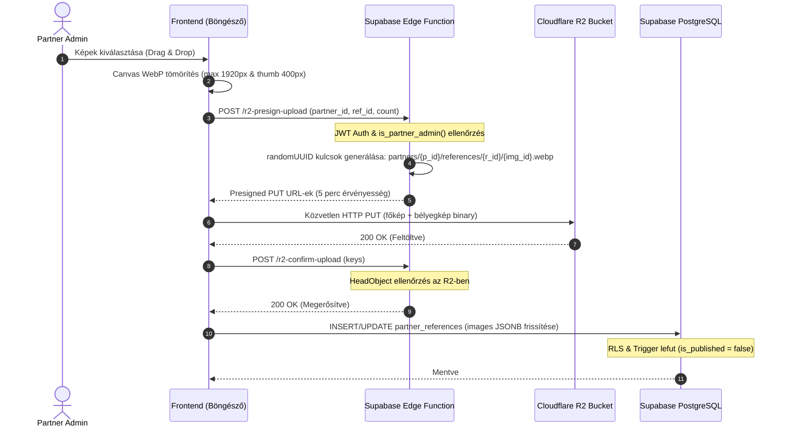
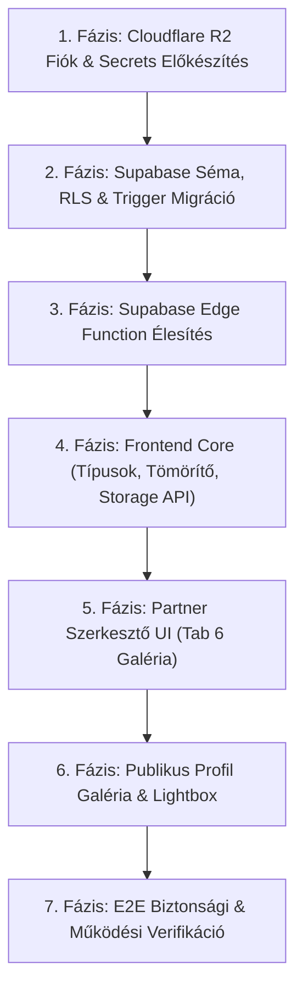

# P0-D20 – ÉPÍTŐTUDÁS REFERENCIA-GALÉRIA VÉGLEGES ADATMODELL-, JOGOSULTSÁGI ÉS HIBAKEZELÉSI SPECIFIKÁCIÓ

**Dokumentumazonosító:** `P0_D20_REFERENCE_GALLERY_FINAL_TECHNICAL_SPEC.md`  
**Projekt:** ÉpítőTudás  
**Supabase projekt:** `olmavxcmkvvcebgqxohe`  
**Előzmények:** P0-D17, P0-D18, P0-D19  
**Dátum:** 2026-11-11  
**Vizsgálat típusa:** READ-ONLY / FINAL DESIGN VALIDATION  
**Munkamód:** READ-ONLY PLAN / NO PATCH / NO REFACTOR  
**Záróállapot:** `READ-ONLY FINAL DESIGN AUDIT COMPLETED – NO CODE, DATABASE, R2, EDGE FUNCTION OR GIT CHANGES`

---

## 1. KÖTELEZŐ MŰKÖDÉSI KORLÁTOZÁSOK BETARTÁSA

A jelen specifikáció kizárólag műszaki tervezési és biztonsági ellenőrzési dokumentum.
- Forráskód-módosítás, SQL-futtatás, migráció-alkalmazás **NEM TÖRTÉNT**.
- Cloudflare R2 bucket, API-kulcs vagy Supabase Secrets módosítás **NEM TÖRTÉNT**.
- Git commit, push vagy working tree módosítás **NEM TÖRTÉNT**.
- A Thingor projekt infrastruktúrája szigorúan elhatárolva maradt, azt a jelen specifikáció semmilyen formában nem használja.
- Minden dokumentációs SQL-kód kizárólag specifikációs célokat szolgál, futtatásuk szigorúan tilos az audit fázisban.

---

## 2. A VIZSGÁLAT ÉS A SPECIFIKÁCIÓ CÉLJA

A P0-D17, D18 és D19 vizsgálatokra építve jelen dokumentum meghatározza az ÉpítőTudás partneri többképes referencia-galériájának végleges, zárt architektúráját.
A célrendszer alappillérei:
1. **Adatbázis-perzisztencia és RLS:** Valódi PostgreSQL relációs tárolás a Supabase-ben (`partner_references`), sorszintű biztonsággal és automatikus moderációs triggerrel.
2. **Kizárólagos partneri adminisztráció:** Kizárólag a partner igazolt adminisztrátorai (`is_partner_admin`) kezelhetik a cég referenciáit.
3. **Kizárólagos platform adminisztrátori publikálás:** A partnerek nem publikálhatnak közvetlenül; a publikálás és a publikáció visszavonása kizárólag platform adminisztrátori / szerkesztői művelet (`is_editor_role`).
4. **Felhős tárhely (Cloudflare R2):** Képek tárolása egyedi, dedikált R2 bucketben, rövid élettartamú SigV4 presigned PUT URL-eken keresztül.
5. **Kliensoldali WebP tömörítés:** Böngészőoldali Canvas API feldolgozás szigorú memóriakorlátokkal és EXIF-törléssel.
6. **ÉpítőTudás arculat:** Kék–fekete–fehér modern, reszponzív felület.

---

## 3. PUBLIKÁLÁSI TRIGGER TELJES BIZTONSÁGI MODELLJE

### 3.1. Miért nem elegendő az RLS önmagában? [BIZONYÍTOTT]
A PostgreSQL sorszintű biztonsága (RLS) binárisan engedélyezi vagy tiltja a sorok módosítását (`UPDATE`). Amikor a partner adminisztrátor szerkeszti a referenciáját, a sorra érvényes `UPDATE` jogosultsággal rendelkezik. Az RLS nem képes detektálni, hogy az UPDATE kérés melyik oszlopot változtatta meg (nincs hozzáférése az `OLD` és `NEW` rekordokhoz az állapotátmenet vizsgálatához).  
Ezért a publikálási állapot manipulációjának megakadályozására egy **`BEFORE INSERT OR UPDATE` PL/pgSQL trigger** alkalmazása kötelező.

### 3.2. A jogosultságok elhatárolása a triggerben [KÖVETKEZTETÉS]
A trigger a `public.is_editor_role()` és `public.is_partner_admin(NEW.partner_id)` függvényekkel választja szét a szerepköröket:
- **Platform Editor / Admin (`is_editor_role() = true`):** Teljes felügyeleti jog: szabadon állíthatja az `is_published` mezőt (`true` / `false`), jóváhagyhat, visszavonhat.
- **Partner Adminisztrátor (`is_partner_admin(NEW.partner_id) = true`):** Kizárólag tartalmi mezőket szerkeszthet vázlat állapotban; a publikálást közvetlenül nem aktiválhatja.
- **Mindenki más:** Kivétel kiváltása (`RAISE EXCEPTION`), a művelet megszakítása.

### 3.3. Tartalmi módosítás esetén automatikus visszavonás (Auto-demotion) [JAVASLAT]
Ha egy referencia már jóváhagyott, publikus státuszban van (`OLD.is_published = true`), és a partner utólag módosítja a projekt tartalmát (pl. leírást, címet, helyszínt, évet, weboldalt vagy a képeket), a rendszer **automatikusan visszavonja a publikálást** (`NEW.is_published := false`). Ez megakadályozza, hogy egy partner egy jóváhagyott, szabályos projektet utólag nem megfelelő tartalomra vagy képekre cseréljen le anélkül, hogy a moderátor újra ellenőrizné.

### 3.4. A trigger dokumentációs SQL-tervezete [JAVASLAT]
*(Kizárólag specifikációs tervezet – futtatása tilos!)*

```sql
-- ============================================================================
-- SPECIFIKÁCIÓS TERVEZET: Referencia publikáció-védelmi trigger függvény
-- ============================================================================
CREATE OR REPLACE FUNCTION public.enforce_reference_publication_security()
RETURNS TRIGGER AS $$
DECLARE
  v_is_platform_editor boolean;
  v_is_partner_adm boolean;
BEGIN
  -- 1. Szerepkörök meghatározása
  v_is_platform_editor := public.is_editor_role();
  v_is_partner_adm := public.is_partner_admin(NEW.partner_id);

  -- 2. Alapvető jogosultság ellenőrzése
  IF NOT (v_is_platform_editor OR v_is_partner_adm) THEN
    RAISE EXCEPTION 'Hozzáférés megtagadva: Nincs jogosultsága a partner referenciáinak kezelésére.'
      USING ERRCODE = '42501';
  END IF;

  -- 3. Platform editor esetén a művelet azonnal engedélyezett (szabad moderáció)
  IF v_is_platform_editor THEN
    NEW.updated_at := now();
    RETURN NEW;
  END IF;

  -- ==========================================================================
  -- 4. PARTNER ADMINISZTRÁTORRA VONATKOZÓ SZABÁLYOK (Szigorú védelem)
  -- ==========================================================================

  -- A) INSERT művelet:
  IF TG_OP = 'INSERT' THEN
    -- Partner által beküldött referencia KÖTELEZŐEN vázlatként (nem publikáltként) jön létre:
    NEW.is_published := false;
    NEW.created_at := now();
    NEW.updated_at := now();
    RETURN NEW;
  END IF;

  -- B) UPDATE művelet:
  IF TG_OP = 'UPDATE' THEN
    -- B.1. A partner_id értéke SOHA nem módosítható utólag:
    IF NEW.partner_id <> OLD.partner_id THEN
      RAISE EXCEPTION 'Biztonsági hiba: A referencia partnerazonosítója nem módosítható.'
        USING ERRCODE = '42501';
    END IF;

    -- B.2. A partner közvetlenül nem állíthatja true-ra a publikálási jelzőt:
    IF NEW.is_published IS TRUE AND (OLD.is_published IS FALSE OR OLD.is_published IS NULL) THEN
      RAISE EXCEPTION 'Jogosultsági hiba: A referencia publikálása kizárólag platform adminisztrátori jóváhagyással lehetséges.'
        USING ERRCODE = '42501';
    END IF;

    -- B.3. Automatikus visszavonás tartalmi módosításkor:
    -- Ha egy már publikált referenciát módosít a partner, a státusz visszakerül moderációra (false):
    IF OLD.is_published IS TRUE THEN
      IF (
        NEW.title IS DISTINCT FROM OLD.title OR
        NEW.description IS DISTINCT FROM OLD.description OR
        NEW.category IS DISTINCT FROM OLD.category OR
        NEW.location IS DISTINCT FROM OLD.location OR
        NEW.year IS DISTINCT FROM OLD.year OR
        NEW.website_url IS DISTINCT FROM OLD.website_url OR
        NEW.images IS DISTINCT FROM OLD.images
      ) THEN
        NEW.is_published := false; -- Visszavonás újrajóváhagyásra
      END IF;
    END IF;

    NEW.updated_at := now();
    RETURN NEW;
  END IF;

  RETURN NEW;
END;
$$ LANGUAGE plpgsql SECURITY DEFINER SET search_path = '';
```

---

## 4. RLS ÉS TÁBLASZINTŰ JOGOSULTSÁGOK TELJES SQL-TERVEZETE

### 4.1. Táblaszintű GRANT / REVOKE alapok [BIZONYÍTOTT]
A Supabase PostgREST Data API architektúrájában az RLS szabályok csak akkor értékelődnek ki, ha a szerepkörök táblaszintű jogosultsággal rendelkeznek.
- `anon`: Kizárólag `SELECT` jog (publikus olvasás). Minden `INSERT`, `UPDATE`, `DELETE` tiltva.
- `authenticated`: `SELECT, INSERT, UPDATE, DELETE` jogok (a tényleges szűrést az RLS végzi).
- `PUBLIC`: Minden jog visszavonva.

```sql
-- SPECIFIKÁCIÓS TERVEZET: Táblaszintű jogosultságok
REVOKE ALL ON TABLE public.partner_references FROM PUBLIC;
REVOKE ALL ON TABLE public.partner_references FROM anon;
GRANT SELECT ON TABLE public.partner_references TO anon;
GRANT SELECT, INSERT, UPDATE, DELETE ON TABLE public.partner_references TO authenticated;
```

### 4.2. A 4 RLS Szabály tervezete [JAVASLAT]

```sql
-- RLS bekapcsolása és kikényszerítése
ALTER TABLE public.partner_references ENABLE ROW LEVEL SECURITY;
ALTER TABLE public.partner_references FORCE ROW LEVEL SECURITY;

-- 1. SELECT SZABÁLY (Olvasás)
-- Publikusan elérhető minden jóváhagyott referencia (anon és auth).
-- Vázlatokat kizárólag a partner igazolt adminisztrátorai és a platform adminjai láthatnak.
CREATE POLICY "Select partner_references"
ON public.partner_references
FOR SELECT
TO anon, authenticated
USING (
  is_published = true
  OR (
    auth.role() = 'authenticated'
    AND (
      public.is_partner_admin(partner_id)
      OR public.is_editor_role()
    )
  )
);

-- 2. INSERT SZABÁLY (Létrehozás)
-- Csak a partner adminisztrátora vagy platform adminisztrátor hozhat létre rekordot.
CREATE POLICY "Insert partner_references"
ON public.partner_references
FOR INSERT
TO authenticated
WITH CHECK (
  public.is_partner_admin(partner_id)
  OR public.is_editor_role()
);

-- 3. UPDATE SZABÁLY (Módosítás)
-- Csak a partner adminisztrátora módosíthatja a sajátját, vagy platform adminisztrátor.
CREATE POLICY "Update partner_references"
ON public.partner_references
FOR UPDATE
TO authenticated
USING (
  public.is_partner_admin(partner_id)
  OR public.is_editor_role()
)
WITH CHECK (
  public.is_partner_admin(partner_id)
  OR public.is_editor_role()
);

-- 4. DELETE SZABÁLY (Törlés)
-- Csak a partner adminisztrátora törölheti a sajátját, vagy platform adminisztrátor.
CREATE POLICY "Delete partner_references"
ON public.partner_references
FOR DELETE
TO authenticated
USING (
  public.is_partner_admin(partner_id)
  OR public.is_editor_role()
);
```

---

## 5. CLOUDFLARE R2 FELTÖLTÉSI BIZTONSÁG ÉS FOLYAMAT

### 5.1. Presigned PUT biztonsági határai [KÖVETKEZTETÉS]
A SigV4 presigned PUT URL önmagában garantálja:
- A cél `Key` (objektum elérési út) rögzítését (a kliens nem írhat másik fájlba).
- A `Content-Type: image/webp` kötelező egyezését.
- A lejárati időt (5 perc).

**A presigned PUT korlátja:** Nem vizsgálja a fájl belső bináris szerkezetét (magic bytes). Ezért a végleges architektúrában egy **kétlépcsős verifikációt** alkalmazunk:
1. Kliensoldalon a Canvas API raszterizál és konvertál WebP-re (megsemmisítve a káros szkripteket).
2. A feltöltés befejezésekor a kliens megerősítő hívást küld az Edge Functionnek (`confirm-upload`), amely egy `HeadObjectCommand` segítségével a szerver oldalon ellenőrzi az R2-ben lévő fájl pontos méretét és létezését, mielőtt a metaadat bekerülne az adatbázisba.

### 5.2. A feltöltési folyamat lépésről lépésre



---

## 6. HIBAFORGATÓKÖNYV-MÁTRIX ÉS ÁRVA FÁJLOK KEZELÉSE

| Hibaesemény | Következmény | Helyreállítás / Újrapróbálás módja | Idempotencia garancia | Bent maradó fájlok azonosítása |
| :--- | :--- | :--- | :--- | :--- |
| **1. R2 feltöltés sikeres, de a DB mentés elhasal** | A kép ott van az R2-ben, de nincs a DB-ben (árva fájl). | A kliens a DB hiba elkapásakor azonnal meghívja a `DELETE /r2-delete-objects` végpontot a feltöltött kulcsokra. | Teljesen idempotens; a törlés nem okoz DB inkonzisztenciát. | Ha a hálózat teljesen megszakad, az éjszakai szinkronizáló audit script kiszűri a DB-ben nem hivatkozott kulcsokat. |
| **2. DB mentés sikeres, de R2 feltöltés megszakad** | A DB rekord nem jöhet létre, mert a folyamat szigorú sorrendű: a DB mentés CSAK a sikeres R2 megerősítés után fut le. | A tranzakció el sem indul a DB-ben. Felhasználó hibaüzenetet kap: „Feltöltés megszakadt, próbálja újra.” | Nincs félkész DB rekord. | Nincs árva adat. |
| **3. Kép törlése sikeres az R2-ből, de a DB frissítés meghiúsul** | Az R2-ből törlődött, de a DB JSONB még tartalmazza a hivatkozást (törött kép). | **Megfordított sorrend alkalmazása:** Először a DB-ben töröljük a JSONB tömbből a képet. Ha ez sikeres, utána hívjuk az R2 törlést. | Ha az R2 törlés késlekedik, az R2 objektum törlése bármikor újrapróbálható hiba nélkül. | Nincs törött kép a felhasználónak. |
| **4. DB frissítés sikeres, de R2 törlés sikertelen** | A kép lekerül a profilról, de ott marad az R2 tárhelyen. | Az R2 törlési hívás retry logikát kap (3x újrapróbálás). Ha mind elbukik, a kulcs bekerül egy `pending_storage_deletions` audit táblába. | Az R2 `DeleteObject` idempotens (ismételt hívásra 204 No Content). | A `pending_storage_deletions` táblából háttérfeladat üríti. |
| **5. Teljes referencia törlése közben megszakad a hálózat** | Részleges törlés. | A referenciát a DB-ben töröljük, majd a tárolt összes képkulcsra kiadjuk az R2 batch törlést. | Idempotens törlés. | Nem marad árva rekord. |
| **6. Ismételt törlési kérés érkezik ugyanarra az objektumra** | Duplikált hívás. | Az S3/R2 API natívan IDEMPOTENS: nem létező kulcs törlésekor 204 No Content választ ad, hiba nem keletkezik. | 100%-os idempotencia. | N/A |
| **7. Már nem létező R2 objektum törlése** | Nincs teendő. | Sikeresként kezeli a rendszer. | 100%-os idempotencia. | N/A |
| **8. Részleges batch törlés (pl. 5 képből 3 törlődik)** | Néhány fájl bent marad az R2-ben. | Az Edge Function válaszában visszaadja a sikeres és sikertelen kulcsok listáját; a sikertelenek újrapróbálhatók. | Idempotens batch törlés. | A sikertelen lista naplózva van. |

---

## 7. VÉGLEGES IMAGES JSONB ADATMODELL ÉS MEGOLDÁS A DUPLIKÁCIÓRA

### 7.1. A kettős adatforrás felszámolása [JAVASLAT]
A korábbi modellben párhuzamosan létezett `cover_image_url` és `images`. Ez adatinkonzisztenciához vezet (pl. ha a borítóképet törlik a galériából, a borító oszlopban ott marad).  
**Végleges döntés:**
1. A borítókép kijelölése kizárólag az `images` JSONB tömbön belül történik egy `"is_cover": true` mezővel.
2. A tábla `cover_image_url` oszlopát megszüntetjük, VAGY kizárólag generált/származtatott oszlopként kezeljük, amely automatikusan az `"is_cover": true` kép URL-jét tükrözi visszafelé kompatibilitási célból:
   `cover_image_url text GENERATED ALWAYS AS (...) STORED` vagy frontend getter segítségével (`getCoverImage(ref)`).

### 7.2. Az `images` JSONB tömb pontos elemsémája
```typescript
export interface ReferenceImageItem {
  id: string;              // Stabil egyedi azonosító (UUID v4)
  key: string;             // Teljes R2 kulcs: "partners/{p_id}/references/{r_id}/{img_id}.webp"
  thumb_key: string;       // Bélyegkép R2 kulcs: "partners/{p_id}/references/{r_id}/thumbs/{img_id}.webp"
  url: string;             // Teljes CDN URL a nagyméretű képhez
  thumb_url: string;       // Teljes CDN URL a bélyegképhez
  caption?: string;        // Opcionális képfelirat (max 150 karakter)
  display_order: number;   // Sorrend (1..10)
  is_cover: boolean;       // Pontosan egy képre true, a többire false
  width: number;           // Optimalizált szélesség (px)
  height: number;          // Optimalizált magasság (px)
  size_bytes: number;      // Tömörített fájlméret bájtban (pl. 142500)
  created_at: string;      // Feltöltés időpontja (ISO8601)
}
```

### 7.3. Kereszt-partner kulcsbeszúrás elleni védelem [KÖVETKEZTETÉS]
Annak megakadályozására, hogy egy partner manipulált REST API kéréssel egy másik partner R2 képkulcsát mentse be a saját JSONB mezőjébe, az adatbázisban egy ellenőrző constraint vagy trigger vizsgálja:
- Minden beágyazott `key` kötelezően a saját partner azonosítójával kell kezdődjön:  
  `key LIKE 'partners/' || partner_id::text || '/%'`.

---

## 8. KÉPOPTIMALIZÁLÁS ÉS MOBILOS MŰKÖDÉS VÉGLEGES PARAMÉTEREI

| Paraméter | Érték | Indoklás |
| :--- | :--- | :--- |
| **Maximális forrásméret** | **10 MB** / fájl | Böngésző összeomlás megelőzése kliensoldali előszűréssel. |
| **Optimalizált főkép max. méret** | **1920 × 1080 px** (Full HD) | Építőipari fotókhoz prémium minőség, éles részletek a Lightboxban. |
| **Bélyegkép (thumbnail) max. méret**| **400 × 260 px** | Kártyanézetekhez és mobilos rácshoz ultra-gyors betöltés. |
| **Célformátum** | **WebP** | Átlagosan 30–45%-kal kisebb méret a JPEG-nél azonos vizuális minőség mellett. |
| **Főkép minőségi faktor** | **0.82** | Láthatatlan tömörítési veszteség, átlagos méret: 80–180 KB. |
| **Bélyegkép minőségi faktor** | **0.75** | Gyors renderelés, átlagos méret: 15–30 KB. |
| **Egyidejű feldolgozás (Concurrency)** | **Szigorúan 1 (Soros)** | Mobil Safari / Chrome memóriavédelem (egyszerre csak 1 Canvas a memóriában). |
| **Batch méret (fájlválasztáskor)** | **Legfeljebb 5 kép** | Felhasználói élmény és stabilitás egyensúlya. |
| **Max. képszám referenciánként** | **10 kép** | Áttekinthető projektportfólió, elkerülhető a túlterhelés. |
| **EXIF / GPS törlés** | **Automatikus** | A Canvas 2D újrarajzolás fizikailag eldob minden kamera és GPS metaadatot. |

---

## 9. VÉGLEGES FEJLESZTÉSI FÁJLLISTA

A fejlesztés során **3 meglévő fájl módosítása** és **5 új fájl létrehozása** szükséges (összesen 8 fájl):

### 9.1. Módosítandó meglévő forrásfájlok (3 db):
1. **`src/services/partnerService.ts`**:
   - Korábbi `localStorage` hivatkozások felszámolása a referenciáknál.
   - Referencia lekérdezések átirányítása a Supabase `partner_references` táblára.
   - CRUD service funkciók (`getPartnerReferences`, `savePartnerReference`, `deletePartnerReference`).
2. **`src/components/PartnerEditorModal.tsx`**:
   - Tab 6 felületének átalakítása többképes galériakezelővé.
   - Drag & Drop feltöltő zóna, feltöltési progress bar, előnézeti kártyák törlés és sorrendezés gombokkal.
   - Borítókép kijelölő gomb (csillag ikon).
   - Publikálási kapcsoló elrejtése partner módban (csak tájékoztató "Jóváhagyásra vár" státusz).
3. **`src/pages/PartnerDetailPage.tsx`**:
   - Nyilvános profil referencia kártyák áttervezése többképes miniatűrökkel (+X fotó badge).
   - Kattintásra nyíló, reszponzív Lightbox modális ablak nagyfelbontású lapozóval és képfeliratokkal (kék–fekete–fehér arculat).

### 9.2. Létrehozandó új fájlok (5 db):
1. **`src/types/reference.ts`** (Típusdefiníciók):
   - `PartnerReference`, `ReferenceImageItem`, `CreateReferencePayload`, `UpdateReferencePayload` tiszta típusok.
2. **`src/utils/imageCompressor.ts`** (Képfeldolgozó):
   - HTML5 Canvas alapú soros WebP konvertáló, arányos méretező és bélyegkép-generáló segédprogram.
3. **`src/services/storageService.ts`** (Tárolási kliens):
   - Kommunikáció az Edge Functionnel, közvetlen PUT feltöltés az R2-be, és biztonságos törlési kérések.
4. **`supabase/functions/r2-presign-upload/index.ts`** (Edge Function):
   - Deno backend: JWT hitelesítés, `is_partner_admin` ellenőrzés, SigV4 presigned PUT URL generálás, szerveroldali DELETE proxy.
5. **`supabase/migrations/20261111_001_partner_references_schema.sql`** (Adatbázis migráció):
   - `partner_references` tábla, indexek, `trg_enforce_reference_publication_security` trigger, táblaszintű GRANT-ek és 4 db RLS házirend.

---

## 10. FÁZISOKRA BONTOTT VÉGREHAJTÁSI TERV



### 1. Fázis: Cloudflare R2 Előkészítés és Secrets
- **Feladat:** Dedikált `epitotudas-media` R2 bucket és API token konfigurálása a Cloudflare-ben.
- **Titkos kulcsok beállítása:** `R2_ACCOUNT_ID`, `R2_ACCESS_KEY_ID`, `R2_SECRET_ACCESS_KEY`, `R2_BUCKET_NAME`, `R2_PUBLIC_URL` hozzáadása a Supabase Secrets tárolóhoz.
- **Külön jóváhagyás:** **KÖTELEZŐ** (Infrastruktúra-hozzáférés).

### 2. Fázis: Supabase Séma, RLS és Trigger Migráció
- **Feladat:** `20261111_001_partner_references_schema.sql` futtatása.
- **Érintett objektumok:** `partner_references` tábla, 4 RLS szabály, publikációs trigger, táblaszintű GRANT-ek.
- **Rollback lehetőség:** `DROP TABLE public.partner_references CASCADE;`.
- **Külön jóváhagyás:** **KÖTELEZŐ** (SQL migráció futtatása).

### 3. Fázis: Supabase Edge Function Deploy
- **Feladat:** `r2-presign-upload` funkció feltöltése és élesítése (`supabase functions deploy`).
- **Teszt:** Mock JWT-vel teszt presigned URL kérése és feltöltési próba.
- **Külön jóváhagyás:** **KÖTELEZŐ** (Backend deploy).

### 4. Fázis: Frontend Core (Képfeldolgozás és Típusok)
- **Feladat:** `src/types/reference.ts`, `src/utils/imageCompressor.ts`, `src/services/storageService.ts` elkészítése.
- **Kockázat:** Alacsony (izolált TypeScript modulok, nem érintik a meglévő UI-t).
- **Külön jóváhagyás:** Nem szükséges.

### 5. Fázis: Partner Szerkesztőfelület Frissítése
- **Feladat:** `PartnerEditorModal.tsx` Tab 6 és `partnerService.ts` frissítése.
- **Kockázat:** Alacsony (meglévő arculat megőrzésével).
- **Külön jóváhagyás:** Nem szükséges.

### 6. Fázis: Publikus Galéria és Lightbox
- **Feladat:** `PartnerDetailPage.tsx` referencia szekciójának átalakítása fotógalériává és Lightbox modal integrálása.
- **Kockázat:** Alacsony.
- **Külön jóváhagyás:** Nem szükséges.

### 7. Fázis: E2E Biztonsági és Működési Verifikáció
- **Feladat:** Jogosultsági tesztek (partner nem publikálhat, más céghez nem férhet hozzá), mobilos feltöltési teszt, képminőség-ellenőrzés.
- **Külön jóváhagyás:** Nem szükséges.

---

## 11. VÉGSŐ DÖNTÉSI JELENTÉS

### Minősítés: **GO WITH CONDITIONS (Feltételekkel jóváhagyható)**

A műszaki és biztonsági architektúra a fenti triggerrel, RLS-sel, idempotens törlési mátrixszal és Deno Edge Functionnel **teljes körűen kiforrott, robusztus és biztonságos**.

### Értékelési szempontok összefoglalása:
- **Jogosultsági modell:** Kiváló. A szigorú `is_partner_admin` szűrés kizárja az illetéktelen csapattagokat.
- **Publikálási védelem:** Golyóálló. A `BEFORE INSERT OR UPDATE` trigger megbízhatóan megakadályozza a jogosulatlan publikálást és automatikusan moderációra küldi a módosított tartalmakat.
- **RLS:** Teljes. Sorszinten védi a SELECT, INSERT, UPDATE, DELETE műveleteket anon és authenticated felhasználókra.
- **R2 feltöltés és törlés:** Biztonságos. Kriptográfiailag zárt presigned PUT URL-ek és szerveroldali ellenőrzött DELETE proxy.
- **Képfeldolgozás:** Stabilitásra optimalizált. Soros WebP Canvas konverzió szigorú memóriatakarítással és EXIF-törléssel.
- **Árva fájlok kezelése:** Teljes mátrixszal lefedve, megfordított törlési sorrenddel és idempotens műveletekkel.

### A fejlesztés elindításának 3 kötelező előfeltétele:
1. **[FELTÉTEL 1]:** Az ÉpítőTudás dedikált Cloudflare R2 bucketjének létrehozása és hitelesítő adatainak rögzítése a Supabase Secrets tárolóban.
2. **[FELTÉTEL 2]:** A 4. fejezet szerinti adatbázis-migráció és trigger végrehajtásának jóváhagyása.
3. **[FELTÉTEL 3]:** A megvalósítás szigorúan a 10. fejezet szerinti 7 fázisban, lépésenkénti ellenőrzéssel történjen.

---
**KÖTELEZŐ ZÁRÓÁLLAPOT:**  
`READ-ONLY FINAL DESIGN AUDIT COMPLETED – NO CODE, DATABASE, R2, EDGE FUNCTION OR GIT CHANGES`

