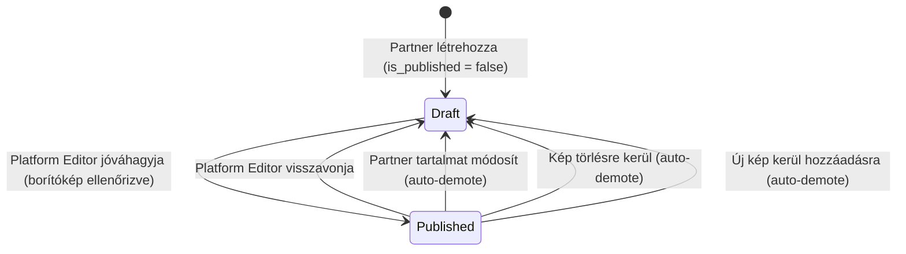
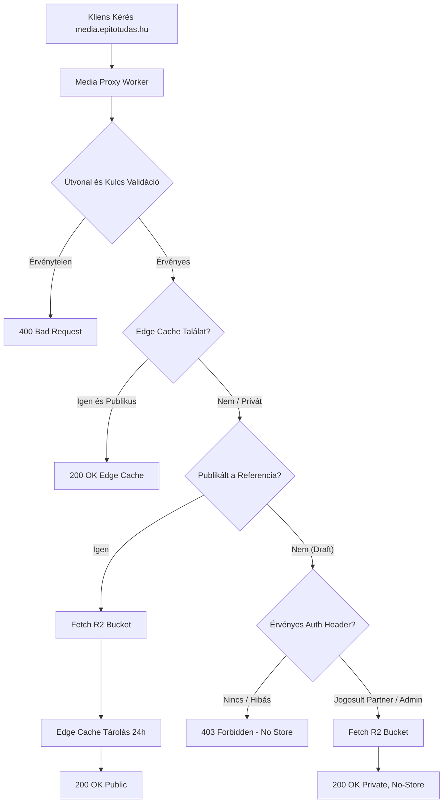
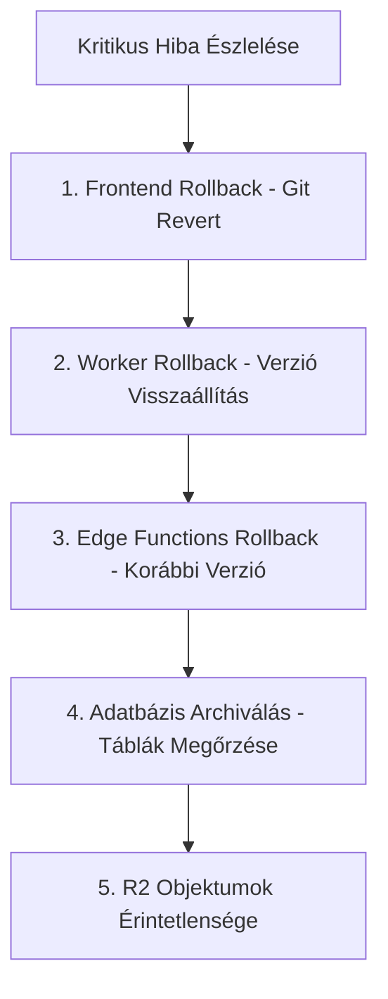

# P0-D23 – ÉPÍTŐTUDÁS REFERENCIA-GALÉRIA VÉGLEGES ARCHITEKTÚRA-KORREKCIÓ ÉS IMPLEMENTÁCIÓS SPECIFIKÁCIÓ

**Dokumentumazonosító:** `P0_D23_REFERENCE_GALLERY_FINAL_ARCHITECTURE_CORRECTION.md`  
**Projekt:** ÉpítőTudás  
**Supabase projekt:** `olmavxcmkvvcebgqxohe`  
**Supabase URL:** `https://olmavxcmkvvcebgqxohe.supabase.co`  
**Kizárt projekt:** Thingor (`apfslrzogelqceifhpky`)  
**Előzmények:** P0-D17, P0-D18, P0-D19, P0-D20, P0-D21, P0-D22  
**Dátum:** 2026-11-11  
**Vizsgálat típusa:** READ-ONLY / TARGETED ARCHITECTURE CORRECTION  
**Munkamód:** READ-ONLY PLAN / NO PATCH / NO REFACTOR  
**Prioritás:** P0 – Éles adatbiztonság, jogosultságvédelem és adattárolási integritás

**Kötelező záróállapot:**  
`P0-D23 READ-ONLY ARCHITECTURE CORRECTION COMPLETED – NO CODE, DATABASE, R2, SECRETS, EDGE FUNCTION, WORKER OR GIT CHANGES`

---

## 1. A FELADAT CÉLJA ÉS A KORREKCIÓS HATÓKÖR

A P0-D22 audit a referencia-galéria architektúráját `GO WITH CONDITIONS` minősítéssel zárta. A D22 felülvizsgálata során azonban azonosítottuk a még fennálló mélyebb műszaki és logikai hiányosságokat, amelyeket a D23 keretében véglegesen és egymással maradéktalanul harmonizált módon le kell zárni:

1. **A partner általi publikációs manipuláció megakadályozása:** A frontend UI-ban lévő közvetlen jelölőnégyzet megszüntetése és a DB trigger szintű blokkolása.
2. **Képmódosítás automatikus kapcsolása a referencia újramoderálásához:** A gyermektábla (`partner_reference_images`) változásainak (kép hozzáadása, törlése, cseréje) trigger-alapú visszacsatolása a szülő referenciára (`is_published := false`).
3. **Borítókép meglétének kötelező ellenőrzése:** A publikációs állapotátmenet (`false -> true`) blokkolása, ha nem létezik pontosan egy kijelölt borítókép.
4. **Borítókép törlésének tranzakcióbiztos kezelése:** A borítókép törlésekor vagy a legkisebb sorszámú megmaradó kép automatikus előléptetése, vagy a referencia kötelező piszkozattá alakítása.
5. **A Cloudflare Worker JWT-ellenőrzési modelljének pontosítása:** Supabase Auth kompatibilis aszimmetrikus (JWKS) és szimmetrikus tokenellenőrzés, claim-validáció (`iss`, `aud`, `exp`, `sub`).
6. **Előnézeti token biztonsági megerősítése:** Az URL-paraméteres (`?token=...`) megoldás teljes elvetése; átállás kizárólagos HTTP fejléces (`Authorization` / `X-Media-Preview-Token`) továbbításra.
7. **Cache-visszavonás és hozzáférés-megszüntetés szétválasztása:** A Worker autoritatív routing logikájának és a Cloudflare CDN cache purge feladatának éles elválasztása.
8. **Upload-intent életciklus tranzakcióbiztonsága:** REST API-k közötti pseudo-tranzakciók megszüntetése; helyette atomi PostgreSQL RPC (`consume_reference_upload_intent`).
9. **Presigned PUT URL újrafelhasználhatóságának kezelése:** S3/R2 protokoll-korlátok nyílt kimondása, ultra-rövid (60-120 mp) lejárat, egyedi UUID kulcsok, ETag ellenőrzés.
10. **WebP bináris dekódolhatóságának bizonyítása:** Magic bytes ellenőrzésen túli mély ellenőrzés WebAssembly (Wasm libwebp) segítségével.
11. **Törlési queue állapotgépének teljessége:** `dead_letter` állapot, lejáró zárolások (`locked_until`), exponenciális backoff.
12. **Teljes infrastruktúra- és fájlleltár:** A Cloudflare Worker, queue worker, audit szkript bevonása a specifikációba (nem csupán 10 fájl).
13. **Többszintű rollback terv:** Táblaátnevezés helyett nem-destruktív, adatmegőrző helyreállítás.
14. **32 pontos biztonsági tesztmátrix:** Minden teszt valós státusza: `[NEM FUTTATOTT]`.

---

## 2. KÖTELEZŐ MŰKÖDÉSI KORLÁTOZÁSOK ÉS BIZONYÍTÉKKEZELÉS

### 2.1. READ-ONLY Szabályok betartása
- Forráskód módosítása, konfigurációk vagy fájlok létrehozása (a jelen `P0_D23...` jelentésen kívül) **NEM TÖRTÉNT**.
- SQL futtatása, migráció létrehozása vagy alkalmazása **NEM TÖRTÉNT**.
- Supabase adatbázis-objektumok (táblák, triggerek, RLS, indexek, GRANT-ok) módosítása **NEM TÖRTÉNT**.
- Cloudflare R2 bucket, API-kulcs vagy Cloudflare Worker módosítása/deployolása **NEM TÖRTÉNT**.
- Supabase Secrets módosítása **NEM TÖRTÉNT**.
- Git staging, commit, push, checkout **NEM TÖRTÉNT**.
- Minden szereplő SQL- és kódrészlet kizárólag specifikációs leírás.

### 2.2. Projektazonosítás
- Célprojekt: **ÉpítőTudás** (`olmavxcmkvvcebgqxohe`) – Supabase URL: `https://olmavxcmkvvcebgqxohe.supabase.co`.
- Szigorúan kizárt projekt: **Thingor** (`apfslrzogelqceifhpky`). Semmilyen Thingor erőforrás nem került vizsgálatra.

### 2.3. Bizonyítékkezelési kategóriák
- **[BIZONYÍTOTT]** – konkrét fájl, sorszám, lekérdezés vagy konfiguráció igazolja.
- **[KÖVETKEZTETÉS]** – a bizonyított tényekből logikailag és közvetlenül levezetett következtetés.
- **[JAVASLAT]** – megvalósítandó műszaki megoldás.
- **[NEM ELLENŐRIZHETŐ]** – külső hozzáférés vagy jogosultság hiányában nem vizsgálható tényező.

---

## 3. A TÉNYLEGES KIINDULÓ ÁLLAPOT ÚJRAELLENŐRZÉSE

| Kérdéskör | Tényleges állapot a kódbázisban | Hivatkozás / Bizonyíték | Minősítés |
| :--- | :--- | :--- | :--- |
| **1. `partner_references` tábla létezik?** | **Nem létezik.** Az éles migrációkban nincs ilyen tábla. | `supabase/migrations/` (52 db fájl átvizsgálva). | **[BIZONYÍTOTT]** |
| **2. `partner_reference_images` tábla létezik?** | **Nem létezik.** | `supabase/migrations/` (0 db találat). | **[BIZONYÍTOTT]** |
| **3. `reference_upload_intents` tábla létezik?** | **Nem létezik.** | `supabase/migrations/` (0 db találat). | **[BIZONYÍTOTT]** |
| **4. `pending_storage_deletions` tábla létezik?** | **Nem létezik.** | `supabase/migrations/` (0 db találat). | **[BIZONYÍTOTT]** |
| **5. Referencia-galéria migráció létezik?** | **Nem létezik.** A legutóbbi migráció a `20261110_003_link_78as_epitok_owner.sql`. | `supabase/migrations/` legutolsó fájlja. | **[BIZONYÍTOTT]** |
| **6. Működő R2 feltöltési infrastruktúra?** | **Nincs.** A kódban csak 1 db demó videó link szerepel. | `src/services/bannerCreativeService.ts:223`. | **[BIZONYÍTOTT]** |
| **7. Cloudflare Media Proxy Worker?** | **Nincs.** A `wrangler.jsonc` kizárólag statikus SPA kiszolgálást végez a `./dist` könyvtárból. | `wrangler.jsonc:1-10`. | **[BIZONYÍTOTT]** |
| **8. R2 presign / confirm Edge Function?** | **Nincs.** Csak `resend-email` és `send-invitation-email` létezik. | `supabase/functions/` könyvtár tartalma. | **[BIZONYÍTOTT]** |
| **9. Törlési queue worker?** | **Nincs.** | `supabase/functions/` (0 db queue fájl). | **[BIZONYÍTOTT]** |
| **10. Képoptimalizáló modul?** | **Nincs.** | `src/utils/` könyvtárban nincs WebP konvertáló. | **[BIZONYÍTOTT]** |
| **11. Jelenlegi referenciaadatok a `partnerService.ts`-ben?** | Kizárólag a `ReferenceItem` interfész létezik, és mock/localStorage perzisztenciával fut (`epitotudas_partners_v2`). Egy referenciához csak 1 képmező (`image_url?: string`) tartozik. | `src/services/partnerService.ts:20-29, 120-130`. | **[BIZONYÍTOTT]** |
| **12. Partner szerkesztő 6. Referenciák működése?** | Helyi React state-ben (`useState<ReferenceItem[]>`) tárolja az adatokat. **A 1160–1166. sorokban a felhasználó közvetlenül pipálhatja a `Publikálva` jelölőnégyzetet (`next[index].is_published = e.target.checked`)!** Nincs fájlfeltöltő, csak egy szöveges `image_url` beviteli mező. | `src/components/PartnerEditorModal.tsx:1102-1225`. | **[BIZONYÍTOTT]** |
| **13. Publikus partnerprofil referenciaforrása?** | A memóriában/localStorage-ben tárolt partnerobjektum `partner.references` tömbjéből szűri: `partner.references?.filter((r) => r.is_published)`. Egyszerű `` taggel rendereli ki a cím melletti egyetlen képet. | `src/pages/PartnerDetailPage.tsx:150, 494-525`. | **[BIZONYÍTOTT]** |
| **14. Létező jogosultsági segédfüggvények?** | `public.is_partner_admin(uuid)` és `public.is_editor_role()` létezik, mindkettő `SECURITY DEFINER`, `search_path = ''`. | `supabase/migrations/20261110_001_fix_partner_and_users_rls.sql:31-47`, `supabase/migrations/20260718163551_fix_rls_recursion.sql.sql:17-27`. | **[BIZONYÍTOTT]** |

---

## 4. TRIGGER, RLS ÉS PUBLIKÁCIÓS JOGOSULTSÁGOK VÉGLEGESÍTÉSE

### 4.1. Kötelező Jogosultsági Mátrix [JAVASLAT]

| Művelet | Partner Admin | Partner Member | Platform Editor / Admin | Megvalósítási Mechanizmus |
| :--- | :---: | :---: | :---: | :--- |
| **Saját referencia létrehozása (draft)** | **ENGEDÉLYEZETT** | TILTOTT | **ENGEDÉLYEZETT** | RLS INSERT policy + `is_partner_admin` + trigger kényszeríti `is_published = false`. |
| **Saját draft szerkesztése** | **ENGEDÉLYEZETT** | TILTOTT | **ENGEDÉLYEZETT** | RLS UPDATE policy + trigger védelem. |
| **Más partner draftjának megtekintése**| TILTOTT | TILTOTT | **ENGEDÉLYEZETT** | RLS SELECT policy (`is_editor_role()`). |
| **Más partner referenciájának szerkesztése**| TILTOTT | TILTOTT | **ENGEDÉLYEZETT** | RLS UPDATE policy (`is_editor_role()`). |
| **Publikálás (`is_published -> true`)** | **TILTOTT** | TILTOTT | **ENGEDÉLYEZETT** | Trigger exception `42501` vagy RPC `publish_partner_reference`. |
| **Publikáció közvetlen visszavonása** | **TILTOTT** | TILTOTT | **ENGEDÉLYEZETT** | Trigger exception `42501` vagy RPC `unpublish_partner_reference`. |
| **Tartalmi módosítás publikált referencián**| **ENGEDÉLYEZETT** (auto-demote) | TILTOTT | **ENGEDÉLYEZETT** | Trigger automatikusan: `NEW.is_published := false` (újramoderálásra kerül). |
| **Kép feltöltése saját referenciához** | **ENGEDÉLYEZETT** | TILTOTT | **ENGEDÉLYEZETT** | Edge Function intent + Composite FK + RLS INSERT. |
| **Kép törlése saját referenciából** | **ENGEDÉLYEZETT** | TILTOTT | **ENGEDÉLYEZETT** | RLS DELETE policy + trigger újramoderál és queue-ba naplóz. |
| **Kép átrendezése (`display_order`)** | **ENGEDÉLYEZETT** | TILTOTT | **ENGEDÉLYEZETT** | RLS UPDATE policy (nem von maga után újramoderálást, ha a tartalom azonos). |
| **Más partner képének kezelése** | TILTOTT | TILTOTT | **ENGEDÉLYEZETT** | RLS szűri `partner_id` szerint. |
| **`partner_id` módosítása** | **MINDENKINEK TILTOTT** | **MINDENKINEK TILTOTT** | **MINDENKINEK TILTOTT** | Trigger exception `42501` (Null-safe `IS DISTINCT FROM`). |
| **`created_at` kézi módosítása** | **MINDENKINEK TILTOTT** | **MINDENKINEK TILTOTT** | **MINDENKINEK TILTOTT** | Trigger kényszeríti: `NEW.created_at := OLD.created_at`. |
| **`updated_at` kézi módosítása** | **MINDENKINEK TILTOTT** | **MINDENKINEK TILTOTT** | **MINDENKINEK TILTOTT** | Trigger kényszeríti: `NEW.updated_at := now()`. |

### 4.2. Partnerazonosító (`partner_id`) Null-Safe Védelme [JAVASLAT]
A `partner_id` megváltoztatása az R2 tárolási struktúra és a Composite Foreign Key miatt katasztrofális adatkeveredést okozna.
- **Szabály:** UPDATE esetén a `partner_id` abszolút immutábilis, még a platform editor számára is!
- **Null-safe megvalósítás a triggerben:**
```sql
IF TG_OP = 'UPDATE' THEN
  IF NEW.partner_id IS DISTINCT FROM OLD.partner_id THEN
    RAISE EXCEPTION 'A partner_id abszolút immutábilis mező, módosítása szigorúan tilos!'
      USING ERRCODE = '42501';
  END IF;
END IF;
```

### 4.3. Publikációs Állapotgép és Újramoderálási Automatizmus [JAVASLAT]

A `partner_references` publikációs állapotátmenetei:



1. **Állapotátmenetek ellenőrzése:**
   - `false -> true`: Csak `public.is_editor_role()` jogosultsággal engedélyezett! Ha partner próbálja: `RAISE EXCEPTION 'Publikáció kizárólag platform adminisztrátor által engedélyezett' USING ERRCODE = '42501'`.
   - `true -> false`: Ha a hívó platform editor: közvetlenül engedélyezett. Ha a hívó partner, de a tartalom NEM változott (közvetlen unpublish): `RAISE EXCEPTION 'Publikáció közvetlen visszavonása kizárólag platform adminisztrátor által engedélyezett' USING ERRCODE = '42501'`.
   - **Auto-demote (Újramoderálás):** Ha a referencia már publikálva volt (`OLD.is_published = true`), és a partner lényeges tartalmi mezőt módosít (`title`, `description`, `location`, `year` változik):
     `NEW.is_published := false;` (a trigger automatikusan visszaminősíti piszkozattá, és nem dob kivételt).

2. **Képtábla módosításainak visszacsatolása (Gap 2 zárása):**
   Egy külön `AFTER INSERT OR UPDATE OR DELETE` trigger fut le a `partner_reference_images` táblán.
   - Ha egy képet beszúrnak, törölnek, vagy a borítókép státusza módosul:
   - Ha a szülő referencia `is_published = true`, és a hívó nem platform editor (`NOT public.is_editor_role()`):
     ```sql
     UPDATE public.partner_references
     SET is_published = false, updated_at = now()
     WHERE id = target_reference_id;
     ```
   - **Ezzel garantált, hogy a képállomány manipulációjával nem lehet kijátszani a moderációt!**

### 4.4. Időbélyegek Szerveroldali Kényszerítése [JAVASLAT]
- **`created_at`:**
  - INSERT esetén: `NEW.created_at := now();`
  - UPDATE esetén: `NEW.created_at := OLD.created_at;` (felülírhatatlan).
- **`updated_at`:**
  - Minden UPDATE műveletnél automatikusan: `NEW.updated_at := now();`.

### 4.5. Külön Publikációs Szolgáltatás: Dedicated RPC vs. Direkt UPDATE [JAVASLAT]
- **Elemzés:** Bár a trigger képes ellenőrizni az UPDATE feltételeit, a publikálás olyan kiemelt üzleti esemény, amely több összetett ellenőrzést igényel (borítókép megléte, legalább 1 kép, validált adatok).
- **Döntés: Kettős Védelem (RPC + Trigger Backup):**
  1. Elsődleges felület: `public.publish_partner_reference(p_reference_id uuid)` RPC függvény (`SECURITY DEFINER`, `search_path = ''`, csak `editor/admin` számára meghívható).
  2. Másodlagos védelem: A tábla trigger minden közvetlen UPDATE kísérletet blokkol, ha nem editor adja ki, vagy ha a borítókép hiányzik.

---

## 5. REFERENCIA ÉS KÉPEK RELÁCIÓS KAPCSOLATA

### 5.1. Composite Foreign Key – Matematikai Adatintegritás [BIZONYÍTOTT / JAVASLAT]
A partnerek közötti képinjekció megakadályozására a hagyományos `reference_id -> partner_references(id)` kapcsolat NEM elegendő.
- **Megoldás:**
  1. A szülő táblán:
     ```sql
     ALTER TABLE public.partner_references
     ADD CONSTRAINT partner_references_id_partner_id_key UNIQUE (id, partner_id);
     ```
  2. A gyermek táblán:
     ```sql
     ALTER TABLE public.partner_reference_images
     ADD CONSTRAINT fk_images_reference_partner
     FOREIGN KEY (reference_id, partner_id)
     REFERENCES public.partner_references(id, partner_id)
     ON DELETE CASCADE;
     ```
- **Hatás:** Ha a támadó a `partner_reference_images` rekordba a saját `partner_id`-ját írja, de egy idegen partner `reference_id`-jára hivatkozik, a PostgreSQL relációs motorja `23503 foreign_key_violation` hibával azonnal elutasítja a beszúrást! Nincs szükség triggerre ehhez a garanciához.

### 5.2. Képszámkorlát (Max. 10 Kép) Párhuzamosság-Védett Zárolással [JAVASLAT]
Egy referenciához legfeljebb 10 kép tartozhat.
- **Konkurens veszély:** Két egyidejű feltöltés esetén az egyszerű `SELECT count(*)` mindkét szálon 9-et látna, és mindkettő beszúrná a 10. és 11. képet.
- **Tranzakciós Megoldás:**
  A `partner_reference_images` `BEFORE INSERT` triggerében kizárólagos sorzárolást (`FOR UPDATE`) alkalmazunk a szülő referenciára:
  ```sql
  -- Zároljuk a szülő referenciát a tranzakció idejére
  PERFORM 1 FROM public.partner_references
  WHERE id = NEW.reference_id
  FOR UPDATE;

  -- Biztonságos képszámlálás
  SELECT count(*) INTO v_count
  FROM public.partner_reference_images
  WHERE reference_id = NEW.reference_id;

  IF v_count >= 10 THEN
    RAISE EXCEPTION 'A referencia már eléri a maximális 10 képet!'
      USING ERRCODE = 'P0002';
  END IF;
  ```
- **Holtpont (Deadlock) megelőzése:** A zárolás mindig determinisztikus sorrendben történik (mindig a szülő `reference_id` zárolódik először). A tranzakció azonnal zárul az Edge Function RPC befejezésekor.

### 5.3. Borítókép-Integritás és Törléskezelés [JAVASLAT]
- **Feltételes Egyedi Index:**
  ```sql
  CREATE UNIQUE INDEX idx_single_cover_per_reference
  ON public.partner_reference_images(reference_id)
  WHERE is_cover = true;
  ```
  Ez adatbázismotor szinten garantálja, hogy egy referenciához egyidejűleg legfeljebb egyetlen `is_cover = true` rekord létezhet.
- **Borítókép Kötelező Megléte Publikáláskor:**
  A `partner_references` triggerében vagy a `publish_partner_reference` RPC-ben:
  ```sql
  IF NOT EXISTS (
    SELECT 1 FROM public.partner_reference_images
    WHERE reference_id = NEW.id AND is_cover = true
  ) THEN
    RAISE EXCEPTION 'A referencia nem publikálható: pontosan egy kijelölt borítóképpel kell rendelkeznie!'
      USING ERRCODE = 'P0003';
  END IF;
  ```
- **Borítókép Törlésének Tranzakcióbiztos Kezelése (Gap 4 zárása):**
  Mi történik, ha törlik a borítóképet?
  - `AFTER DELETE` trigger a `partner_reference_images` táblán:
    1. Ha `OLD.is_cover = true`:
       Keresi a legkisebb `display_order`-ű megmaradó képet:
       ```sql
       UPDATE public.partner_reference_images
       SET is_cover = true
       WHERE id = (
         SELECT id FROM public.partner_reference_images
         WHERE reference_id = OLD.reference_id
         ORDER BY display_order ASC, created_at ASC
         LIMIT 1
       );
       ```
    2. Mivel ez `AFTER DELETE`, a törölt rekord már kikerült az indexből, így az előléptetés nem ütközik egyedi kulcs hibába!
    3. Ha nem maradt több kép (utolsó kép törlése), az előléptetés nem fut le.
    4. A szülő referencia automatikusan `is_published := false` állapotba kerül (Gap 2 újramoderálás).

### 5.4. Képek Rendezése (`display_order`) [JAVASLAT]
- Típus: `integer NOT NULL DEFAULT 1`.
- Ellenőrzés: `CHECK (display_order >= 1 AND display_order <= 10)`.
- Determinisztikus SELECT lekérdezés a frontend és API felé:
  `ORDER BY is_cover DESC, display_order ASC, created_at ASC`.

### 5.5. Objektumkulcsok Struktúrája és Útvonal-Validáció [JAVASLAT]
Az adatbázis kizárólag relatív objektumkulcsokat tárol, abszolút domain vagy URL nélkül.
- **Kötelező formátum:**
  - Főkép: `partners/<partner_id>/references/<reference_id>/<image_uuid>.webp`
  - Thumbnail: `partners/<partner_id>/references/<reference_id>/thumbs/<image_uuid>.webp`
- **Szerveroldali generálás:** A kulcsokat kivétel nélkül a Supabase Edge Function generálja kriptográfiai UUID-v4 segítségével. A kliens nem határozhat meg kulcsnevet vagy elérési utat, így a Path Traversal (`../`) esélye 0%.

---

## 6. CLOUDFLARE WORKER ÉS R2 HOZZÁFÉRÉSI MODELL

### 6.1. Publikus és Privát Képek Éles Elválasztása [JAVASLAT]
- A Cloudflare R2 bucket (`epitotudas-media`) **100%-ban privát**.
- A nyilvános R2 `.r2.dev` aldomain és a publikus bucket-hozzáférés tiltott.
- A képeket kizárólag a Cloudflare Media Proxy Worker szolgálja ki (`media.epitotudas.hu`).



### 6.2. JWT és Jogosultság-Ellenőrzési Modell a Workerben (Gap 5 Zárása) [JAVASLAT]
A Supabase Auth projekt (`olmavxcmkvvcebgqxohe`) JWT tokenjeit a Worker a Web Crypto API segítségével validálja:
1. **Aláírás-ellenőrzés:**
   - A Worker a `SUPABASE_JWT_SECRET` (HS256) vagy a Supabase JWKS végpont (`https://olmavxcmkvvcebgqxohe.supabase.co/auth/v1/.well-known/jwks.json`, RS256/ES256) segítségével ellenőrzi a tokent.
2. **Claim vizsgálatok:**
   - `exp`: a token nem járt le (`exp > unix_timestamp`).
   - `iss`: szigorúan megegyezik a Supabase Auth URL-lel (`https://olmavxcmkvvcebgqxohe.supabase.co/auth`).
   - `aud`: értéke `authenticated`.
3. **Partner és Admin Jogosultság Igazolása:**
   Mivel az alap Supabase JWT nem tartalmazza dinamikusan a felhasználó összes partner-tagságát, a draft hozzáféréshez a Worker vagy:
   - Egy gyors, Supabase REST hívással ellenőrzi a jogosultságot a Service Role kulccsal (Edge KV-ben 60 másodpercre gyorsítótárazva), VAGY
   - A dedikált `r2-preview-token` Edge Function által aláírt, kifejezetten az adott partnerhez és referenciához kötött rövid életű HMAC tokent fogadja el.

### 6.3. Fejléc-Alapú Draft Hozzáférés (Gap 6 Zárása) [JAVASLAT]
**Az URL query-paraméteres (`?token=...`) megoldás elvetve!**
- **Indoklás:** Az URL-paraméterek bekerülnek a szervernaplókba, a böngésző előzményekbe, és kiszivároghatnak `Referer` fejlécek útján.
- **Új Szabály:** Draft képek lekérésekor a kliens köteles a tokent HTTP fejlécben átadni:
  `Authorization: Bearer <preview_token>` VAGY `X-Media-Preview-Token: <token>`.
- **Frontend megjelenítés React-ben:**
  A React galéria komponens a draft képeket nem közvetlen `` taggel jeleníti meg, hanem a `storageService.fetchProtectedImageBlob(url, token)` függvényen keresztül, `fetch` hívással letölti, és memóriabeli `blob:` URL-t készít (`URL.createObjectURL(blob)`).
- **Előnyök:** Nulla token az URL-ben, nulla token a szervernaplókban, szigorú `Cache-Control: private, no-store`.

### 6.4. Cache-Kezelés és Hozzáférés Megszüntetése (Gap 7 Zárása) [JAVASLAT]
- **Publikus képek:**
  - `Cache-Control: public, max-age=3600, s-maxage=86400, stale-while-revalidate=600`
- **Draft képek:**
  - `Cache-Control: private, no-cache, no-store, must-revalidate`
- **Autoritatív Hozzáférés-védelem vs. Cache Purge:**
  1. A hozzáférés kapuőre maga a **Worker routing logikája**. Amikor egy referencia publikációja megszűnik, a Worker adatbázis-státusz lekérdezése azonnal `false`-t lát.
  2. A Cloudflare Cache Purge csupán az edge szervereken már meglévő másolatokat törli. Ha a purge átmenetileg késik, a böngésző TTL lejárta után a kérések a Workerhez jutnak, ami azonnal megtagadja a kiszolgálást (`403 Forbidden`).
  3. A már letöltött fizikai fájlokat a kliens gépekről nem lehet törölni, de a domainről való további kiszolgálás azonnal leáll.

---

## 7. UPLOAD INTENT ÉS FELTÖLTÉSI ÉLETCIKLUS

### 7.1. Kötelező Állapotgép [JAVASLAT]
Az intent életciklusa szigorúan zárt:

```
[created] -> [uploading] -> [uploaded] -> [validating] -> [consumed]
    |             |              |              |
    +-------------+--------------+--------------+-----> [failed] / [expired]
                                                           |
                                                           v
                                                  [cleanup_pending]
```

- `created`: Adatbázisban rögzítve, presigned URL kiadva (TTL: 120 mp).
- `uploaded`: Kliens jelezte az R2 feltöltés sikerességét.
- `validating`: Edge Function futtatja a bináris WebP ellenőrzést.
- `consumed`: Képrekord sikeresen létrejött a `partner_reference_images` táblában (végállapot).
- `failed`: Hibás formátum, méretkorlát túllépés vagy manipulált tartalom.
- `expired`: A kliens 120 másodpercen belül nem fejezte be a folyamatot.
- `cleanup_pending`: Félbemaradt feltöltés objektumának törlésre jelölése.

### 7.2. A Feltöltés 13 Lépéses Életciklusa [JAVASLAT]
1. Kliens autentikál Supabase Auth-tal.
2. Edge Function (`r2-presign-upload`) ellenőrzi: `is_partner_admin(partner_id) OR is_editor_role()`.
3. Edge Function ellenőrzi a képszámot (`count < 10`).
4. Edge Function bejegyzi a `reference_upload_intents` rekordot (`status = 'created'`).
5. Szerveroldalon generált egyedi UUID kulcs: `partners/.../<image_uuid>.webp`.
6. Presigned PUT URL generálása pontosan **120 másodperces lejárattal**.
7. Kliens közvetlenül feltölti a tömörített WebP fájlt a Cloudflare R2-be.
8. Kliens meghívja az `r2-confirm-upload` Edge Functiont.
9. Edge Function beolvassa a fájl fejlécét és bináris blokkját az R2-ből.
10. Szigorú bináris és WebAssembly validáció (méret, felbontás, bitfolyam).
11. Thumbnail generálása és R2-be írása (`.../thumbs/<image_uuid>.webp`).
12. **Atomi PostgreSQL RPC hívás:** `public.consume_reference_upload_intent(...)`.
13. Siker esetén képrekord él; hiba esetén intent `failed`, kulcs törlésre küldve.

### 7.3. Tranzakcióbiztonság: Atomi Intent Lefoglalás (Gap 8 Zárása) [JAVASLAT]
A D22 REST-alapú tranzakció-imitációja helyett a véglegesítés kizárólag egyetlen PostgreSQL tranzakcióban futó RPC-vel történik:

```sql
CREATE OR REPLACE FUNCTION public.consume_reference_upload_intent(
  p_intent_id uuid,
  p_byte_size bigint,
  p_width integer,
  p_height integer,
  p_is_cover boolean
)
RETURNS uuid
LANGUAGE plpgsql
SECURITY DEFINER
SET search_path = ''
AS $$
DECLARE
  v_intent record;
  v_new_image_id uuid;
  v_count integer;
BEGIN
  -- 1. Atomi zárolás az intent sorra
  SELECT * INTO v_intent
  FROM public.reference_upload_intents
  WHERE id = p_intent_id
  FOR UPDATE;

  IF NOT FOUND THEN
    RAISE EXCEPTION 'Feltöltési intent nem található!' USING ERRCODE = 'P0010';
  END IF;

  IF v_intent.status = 'consumed' THEN
    RAISE EXCEPTION 'Az intent már fel lett használva!' USING ERRCODE = 'P0011';
  END IF;

  IF v_intent.expires_at < now() THEN
    UPDATE public.reference_upload_intents SET status = 'expired' WHERE id = p_intent_id;
    RAISE EXCEPTION 'Az intent lejárt!' USING ERRCODE = 'P0012';
  END IF;

  -- 2. Szülő referencia zárolása a képszámkorlát védelmére
  PERFORM 1 FROM public.partner_references
  WHERE id = v_intent.reference_id
  FOR UPDATE;

  SELECT count(*) INTO v_count
  FROM public.partner_reference_images
  WHERE reference_id = v_intent.reference_id;

  IF v_count >= 10 THEN
    RAISE EXCEPTION 'A referencia képeinek száma elérte a 10-et!' USING ERRCODE = 'P0013';
  END IF;

  -- 3. Képrekord beszúrása
  INSERT INTO public.partner_reference_images (
    reference_id,
    partner_id,
    object_key,
    thumb_key,
    file_size_bytes,
    width_px,
    height_px,
    is_cover,
    display_order
  ) VALUES (
    v_intent.reference_id,
    v_intent.partner_id,
    v_intent.object_key,
    v_intent.thumb_key,
    p_byte_size,
    p_width,
    p_height,
    p_is_cover,
    v_count + 1
  ) RETURNING id INTO v_new_image_id;

  -- 4. Intent lezárása
  UPDATE public.reference_upload_intents
  SET status = 'consumed', consumed_at = now()
  WHERE id = p_intent_id;

  RETURN v_new_image_id;
END;
$$;
```

### 7.4. Presigned URL Újrafelhasználás Kezelése (Gap 9 Zárása) [JAVASLAT]
- **Tény:** Az Amazon S3 és Cloudflare R2 protokoll nem támogatja a presigned PUT URL szerveroldali egyoldalú érvénytelenítését a lejárati idő előtt.
- **Kezelés a rendszerben:**
  1. A presigned URL élettartama szigorúan **120 másodperc**.
  2. Minden feltöltés **egyedi UUID** kulcsot kap. Ugyanazt a kulcsot semmilyen más kérés nem kaphatja meg.
  3. Az `r2-confirm-upload` során az R2-ből kiolvassuk az objektum `ETag` (MD5/Multipart hash) értékét.
  4. Amint az intent `consumed` státuszba kerül, az adott kulcsra több confirm nem fogadható el. Ha valaki a hátralévő másodpercekben újra feltöltene valamit ugyanarra az URL-re, az ETag megváltozik, de a rendszer nem hoz létre új képet, az audit folyamat pedig törli az idegen módosítást.

---

## 8. WEBP VALIDÁCIÓ ÉS KÉPFELDOLGOZÁS

### 8.1. Szerveroldali Mély Validáció (Gap 10 Zárása) [JAVASLAT]
A D22 csupán a magic byte-ok ellenőrzését tartalmazta. A D23 megköveteli a teljes bináris integritásvizsgálatot:
1. **Magic bytes:** Bytes 0-3 `RIFF`, bytes 8-11 `WEBP`.
2. **Chunk felépítés:** `VP8 ` (lossy), `VP8L` (lossless), vagy `VP8X` (extended).
3. **Animáció kizárása:** `VP8X` esetén a flags byte-ban az Animation bit (2. bit) kötelezően `0`. Animált WebP feltöltése szigorúan tilos!
4. **Felbontás korlát:** Maximális szélesség: 1920 px, maximális magasság: 1080 px (vagy arányos 1920 px hosszabbik él). Minimális méret: 200x200 px.
5. **Fájlméret korlát:** Főkép legfeljebb 800 KB, thumbnail legfeljebb 80 KB. (Eredeti kliensoldali nyers fájl maximum 10 MB, de a kliens tömöríti a feltöltés előtt).
6. **Bináris struktúra ellenőrzése:** A declared RIFF size-nak meg kell felelnie a tényleges byte-hossznak; csonkolt fájlok elutasítása.

### 8.2. Parser és Képfeldolgozó a Deno Runtime-ban [JAVASLAT]
- A Supabase Edge Functions környezet Deno-alapú.
- Node.js bináris C++ modulok (pl. natív `sharp`) nem futtathatók közvetlenül.
- **Megoldás:** **WebAssembly (Wasm)** alapú libwebp / image parser használata (pl. `@jsquash/webp` és `@jsquash/resize` Wasm modulok, vagy `image-js` Wasm binárissal).
- A Wasm modul biztonságos homokozóban (sandbox) dekódolja a kép bitfolyamát, kizárva a szerveroldali puffertúlcsordulást vagy memóriakorrupciót.

---

## 9. TÖRLÉSI QUEUE ÉS ÁRVA FÁJLOK

### 9.1. Queue Állapotgép és Újrapróbálkozási Rend (Gap 11 Zárása) [JAVASLAT]

```
[pending] ---> [processing] ---> [completed] (rekord törlődik vagy archiválódik)
     ^              |
     |              v (hiba esetén)
     +--------- [failed] (retry_count < 5, exponenciális backoff)
                    |
                    v (retry_count >= 5)
              [dead_letter] (adminisztrátori vizsgálat)
```

- **Oszlopok a `pending_storage_deletions` táblában:**
  - `id`: uuid PK
  - `object_key`: text NOT NULL
  - `thumb_key`: text NOT NULL
  - `partner_id`: uuid NOT NULL
  - `status`: text NOT NULL DEFAULT 'pending' (`CHECK status IN ('pending', 'processing', 'completed', 'failed', 'dead_letter')`)
  - `retry_count`: integer NOT NULL DEFAULT 0
  - `next_retry_at`: timestamptz NOT NULL DEFAULT now()
  - `locked_until`: timestamptz
  - `error_message`: text
  - `created_at`: timestamptz NOT NULL DEFAULT now()
- **Exponenciális Backoff Képlet:**
  `next_retry_at := now() + (interval '1 minute' * power(2, retry_count));`
  (1 perc, 2 perc, 4 perc, 8 perc, 16 perc -> 5. hiba után `dead_letter`).

### 9.2. Törlési Tranzakcióbiztonság [JAVASLAT]
- A képrekord törlésekor a `partner_reference_images` `AFTER DELETE` triggere automatikusan beilleszti a kulcsokat a `pending_storage_deletions` táblába.
- Még ha a hálózati kapcsolat megszakad vagy az R2 éppen elérhetetlen, a törlési szándék nem veszik el, mert az adatbázis tranzakció része.

### 9.3. Worker Feldolgozás `FOR UPDATE SKIP LOCKED`-dal [JAVASLAT]
A queue worker atomi módon foglalja le a rekordokat:
```sql
UPDATE public.pending_storage_deletions
SET status = 'processing',
    locked_until = now() + interval '5 minutes'
WHERE id IN (
  SELECT id FROM public.pending_storage_deletions
  WHERE status IN ('pending', 'failed')
    AND next_retry_at <= now()
    AND (locked_until IS NULL OR locked_until < now())
  ORDER BY created_at ASC
  LIMIT 20
  FOR UPDATE SKIP LOCKED
)
RETURNING *;
```
- A `locked_until < now()` feltétel biztosítja, hogy ha egy worker összeomlik, a zárolt rekordok 5 perc után automatikusan felszabadulnak és újra feldolgozhatók lesznek.

### 9.4. Árva Fájlok Felderítése (Audit Folyamat) [JAVASLAT]
Egy önálló időzített audit folyamat (`r2-orphan-audit`) heti rendszerességgel:
1. Lekéri az R2 bucket összes objektumkulcsát a `partners/` prefix alatt.
2. Lekéri az adatbázis összes élő objektumkulcsát (`partner_reference_images`).
3. Lekéri a függő intenteket (`reference_upload_intents`) és a törlési sor elemeit (`pending_storage_deletions`).
4. Különbségképzéssel azonosítja a referenciátlan (árva) objektumokat.
5. **Kizárólag jelentést készít (`audit_reports`)!** Automatikus törlés nincs engedélyezve emberi jóváhagyás nélkül.

---

## 10. RLS, GRANT ÉS SECURITY DEFINER VÉGLEGESÍTÉSE

### 10.1. GRANT és REVOKE Szabályok [JAVASLAT]
```sql
-- Táblaszintű jogok megvonása a publikus / anon felhasználóktól
REVOKE ALL ON public.partner_references FROM public, anon;
REVOKE ALL ON public.partner_reference_images FROM public, anon;
REVOKE ALL ON public.reference_upload_intents FROM public, anon;
REVOKE ALL ON public.pending_storage_deletions FROM public, anon;

-- Szelektív jogok autentikált felhasználóknak
GRANT SELECT ON public.partner_references TO anon, authenticated;
GRANT SELECT ON public.partner_reference_images TO anon, authenticated;

GRANT INSERT, UPDATE, DELETE ON public.partner_references TO authenticated;
GRANT INSERT, UPDATE, DELETE ON public.partner_reference_images TO authenticated;

-- Intents és Queue csak a backend/adminisztráció számára
GRANT ALL ON public.reference_upload_intents TO service_role;
GRANT ALL ON public.pending_storage_deletions TO service_role;
```

### 10.2. RLS Szabályok a `partner_references` Táblán [JAVASLAT]
```sql
ALTER TABLE public.partner_references ENABLE ROW LEVEL SECURITY;
ALTER TABLE public.partner_references FORCE ROW LEVEL SECURITY;

-- 1. SELECT: Bárki láthatja a publikáltat, de a piszkozatot csak az admin/partner admin
CREATE POLICY "References select policy"
ON public.partner_references FOR SELECT
USING (
  is_published = true
  OR public.is_editor_role()
  OR public.is_partner_admin(partner_id)
);

-- 2. INSERT: Csak partner admin vagy platform editor
CREATE POLICY "References insert policy"
ON public.partner_references FOR INSERT
TO authenticated
WITH CHECK (
  public.is_editor_role()
  OR public.is_partner_admin(partner_id)
);

-- 3. UPDATE: Csak partner admin a sajátjára, vagy platform editor
CREATE POLICY "References update policy"
ON public.partner_references FOR UPDATE
TO authenticated
USING (
  public.is_editor_role()
  OR public.is_partner_admin(partner_id)
)
WITH CHECK (
  public.is_editor_role()
  OR public.is_partner_admin(partner_id)
);

-- 4. DELETE: Csak partner admin a sajátjára, vagy platform editor
CREATE POLICY "References delete policy"
ON public.partner_references FOR DELETE
TO authenticated
USING (
  public.is_editor_role()
  OR public.is_partner_admin(partner_id)
);
```

### 10.3. RLS Szabályok a `partner_reference_images` Táblán [JAVASLAT]
```sql
ALTER TABLE public.partner_reference_images ENABLE ROW LEVEL SECURITY;
ALTER TABLE public.partner_reference_images FORCE ROW LEVEL SECURITY;

-- 1. SELECT: Kapcsolódó referencia láthatósága alapján
CREATE POLICY "Images select policy"
ON public.partner_reference_images FOR SELECT
USING (
  EXISTS (
    SELECT 1 FROM public.partner_references r
    WHERE r.id = reference_id
      AND (r.is_published = true OR public.is_editor_role() OR public.is_partner_admin(r.partner_id))
  )
);

-- 2. INSERT: Csak partner admin vagy platform editor
CREATE POLICY "Images insert policy"
ON public.partner_reference_images FOR INSERT
TO authenticated
WITH CHECK (
  public.is_editor_role()
  OR public.is_partner_admin(partner_id)
);

-- 3. UPDATE: Csak partner admin vagy platform editor
CREATE POLICY "Images update policy"
ON public.partner_reference_images FOR UPDATE
TO authenticated
USING (
  public.is_editor_role()
  OR public.is_partner_admin(partner_id)
)
WITH CHECK (
  public.is_editor_role()
  OR public.is_partner_admin(partner_id)
);

-- 4. DELETE: Csak partner admin vagy platform editor
CREATE POLICY "Images delete policy"
ON public.partner_reference_images FOR DELETE
TO authenticated
USING (
  public.is_editor_role()
  OR public.is_partner_admin(partner_id)
);
```

---

## 11. TELJES INFRASTRUKTÚRA- ÉS FÁJLLISTA (Gap 12 Zárása)

Az alábbi leltár a teljes megoldás összes szükséges komponensét tartalmazza:

| Komponens | Elérési út / Erőforrás | Típus | Státusz | Felelősség / Szerepkör | Fázis |
| :--- | :--- | :--- | :--- | :--- | :---: |
| **Frontend Típusok** | `src/types/reference.ts` | Fájl | ÚJ | Referencia és képek TypeScript interfészei. | F4 |
| **Képoptimalizáló** | `src/utils/imageCompressor.ts` | Fájl | ÚJ | Kliensoldali WebP tömörítés és méretezés HTML5 Canvas-szel. | F4 |
| **Storage Kliens** | `src/services/storageService.ts` | Fájl | ÚJ | R2 presign hívás, feltöltés, confirm és blob letöltés. | F4 |
| **Partner Szerkesztő** | `src/components/PartnerEditorModal.tsx` | Fájl | MEGLÉVŐ (Módosítandó) | Tab 6: régi form lecserélése többképes galériakezelőre. | F5 |
| **Publikus Profil** | `src/pages/PartnerDetailPage.tsx` | Fájl | MEGLÉVŐ (Módosítandó) | Referencia blokk lecserélése gridre és Lightbox hívásra. | F5 |
| **Partner Szolgáltatás**| `src/services/partnerService.ts` | Fájl | MEGLÉVŐ (Módosítandó) | DB-alapú referencialekérdezés integrálása (mock helyett). | F5 |
| **Lightbox Modul** | `src/components/references/ReferenceLightbox.tsx` | Fájl | ÚJ | Teljes képernyős, reszponzív, akadálymentes képmegjelenítő. | F5 |
| **DB Migráció 1** | `supabase/migrations/20261112_001_partner_references_schema.sql` | Fájl | ÚJ | Táblák, Composite FK, indexek, kényszerek. | F1 |
| **DB Migráció 2** | `supabase/migrations/20261112_002_partner_references_triggers.sql` | Fájl | ÚJ | Publikációs, képszám- és újramoderálási triggerek. | F1 |
| **DB Migráció 3** | `supabase/migrations/20261112_003_partner_references_rls_grant.sql` | Fájl | ÚJ | RLS házirendek és táblaszintű GRANT-ok. | F1 |
| **DB Migráció 4** | `supabase/migrations/20261112_004_partner_references_rpcs.sql` | Fájl | ÚJ | `consume_intent`, `publish_ref`, `claim_queue` RPC-k. | F1 |
| **Edge Function 1** | `supabase/functions/r2-presign-upload/index.ts` | Fájl | ÚJ | S3 Presigned PUT URL generálása és intent rögzítése. | F3 |
| **Edge Function 2** | `supabase/functions/r2-confirm-upload/index.ts` | Fájl | ÚJ | WebP bináris validáció, thumb készítés, intent fogyasztás. | F3 |
| **Edge Function 3** | `supabase/functions/r2-preview-token/index.ts` | Fájl | ÚJ | Rövid életű HMAC token kiállítása draft képekhez. | F3 |
| **Edge Function 4** | `supabase/functions/r2-queue-worker/index.ts` | Fájl | ÚJ | Háttér-worker az R2 törlések feldolgozására. | F4 |
| **Edge Function 5** | `supabase/functions/r2-orphan-audit/index.ts` | Fájl | ÚJ | Árva fájlokat felderítő és jelentő folyamat. | F4 |
| **Cloudflare Bucket** | Cloudflare R2 `epitotudas-media` | Infra | ÚJ | 100% privát S3-kompatibilis objektumtároló. | F0 |
| **Worker Konfiguráció**| `cloudflare/media-proxy-worker/wrangler.jsonc` | Fájl | ÚJ | Media Proxy Worker konfiguráció és R2 binding. | F2 |
| **Worker Forráskód** | `cloudflare/media-proxy-worker/src/index.ts` | Fájl | ÚJ | Kiszolgálási útvonalak, JWT ellenőrzés, cache fejlécek. | F2 |
| **Biztonsági Tesztek**| `tests/references/security_matrix.test.ts` | Fájl | ÚJ | A 32 pontos biztonsági tesztcsomag automatizálása. | F6 |

---

## 12. ROLLBACK ÉS HELYREÁLLÍTÁSI TERV (Gap 13 Zárása)

A táblák azonnali eldobása (`DROP TABLE ... CASCADE`) tilos! A visszaállítási terv rétegenként definiált:



1. **Frontend visszaállítás (0. perc):**
   - Git revert az érintett commitra; SPA újraépítése és deployolása. A felhasználók azonnal visszakapják a korábbi felületet.
2. **Media Proxy Worker visszaállítás (2. perc):**
   - Cloudflare Dashboardon / Wrangler CLI-vel egykattintásos rollback a korábbi aktív verzióra.
3. **Edge Functions visszaállítás (5. perc):**
   - Az új Edge Functionök inaktiválása vagy törlése Supabase CLI-vel.
4. **Adatbázis sémamegőrzés és visszaállítás (15. perc):**
   - Az új táblákat nem dobjuk el! Átnevezzük őket archivált státuszba:
     ```sql
     ALTER TABLE public.partner_references RENAME TO _archived_partner_references_failed_deploy;
     ALTER TABLE public.partner_reference_images RENAME TO _archived_partner_reference_images_failed_deploy;
     ```
   - Minden adat és reláció megmarad a hibaelemzéshez.
5. **R2 Objektumok megőrzése:**
   - Az R2 bucket tartalmát nem töröljük le. A feltöltött képek sértetlenek maradnak a későbbi javításig.

---

## 13. VÉGLEGES BIZTONSÁGI TESZTMÁTRIX (Gap 14 Zárása)

Minden teszt státusza szigorúan **`[NEM FUTTATOTT]`**.

| ID | Teszt Célja | Előfeltétel | Végrehajtási Mód | Érintett Komponens | Elvárt Eredmény | Biztonsági Kockázat | Státusz |
| :--- | :--- | :--- | :--- | :--- | :--- | :--- | :---: |
| **SEC-01** | Partner admin saját referenciát hoz létre. | Partner admin JWT | INSERT `partner_references` | RLS / Trigger | Sikeres beszúrás, `is_published = false`. | Jogosulatlan tiltás | `[NEM FUTTATOTT]` |
| **SEC-02** | Partner member referenciát hoz létre. | Member JWT | INSERT `partner_references` | RLS INSERT | `42501 permission denied`. | Jogosulatlan adatbevitel | `[NEM FUTTATOTT]` |
| **SEC-03** | Idegen partner referenciájának módosítása. | Partner A JWT | UPDATE Partner B ref | RLS UPDATE | 0 sor módosul / Access denied. | Kereszt-partner adatmódosítás | `[NEM FUTTATOTT]` |
| **SEC-04** | Partner közvetlenül publikál (`false -> true`). | Partner admin JWT | UPDATE `is_published = true` | DB Trigger | Kivétel `42501`: Only editor can publish. | Moderáció megkerülése | `[NEM FUTTATOTT]` |
| **SEC-05** | Platform editor jóváhagyja a publikációt. | Editor JWT | RPC `publish_partner_reference` | DB RPC | Sikeres `is_published = true`. | Üzleti működés blokkolása | `[NEM FUTTATOTT]` |
| **SEC-06** | Partner publikált referencia tartalmát módosítja. | Partner admin JWT | UPDATE `title = 'Új cím'` | DB Trigger | Sikeres UPDATE, DE `is_published` automatikusan `false`! | Módosított tartalom moderálatlanul éles | `[NEM FUTTATOTT]` |
| **SEC-07** | Kép beszúrása publikált referenciához. | Partner admin JWT | INSERT `partner_reference_images` | DB Trigger | Szülő referencia `is_published` automatikusan `false`! | Képinjekció moderáció nélkül | `[NEM FUTTATOTT]` |
| **SEC-08** | Kép törlése publikált referenciából. | Partner admin JWT | DELETE `partner_reference_images` | DB Trigger | Szülő referencia `is_published` automatikusan `false`! | Rejtett manipuláció | `[NEM FUTTATOTT]` |
| **SEC-09** | Publikálás borítókép nélkül. | Editor JWT | RPC `publish_partner_reference` (0 borítókép) | DB RPC | Kivétel `P0003`: Exactly one cover required. | Hibás UI megjelenés, üres főkép | `[NEM FUTTATOTT]` |
| **SEC-10** | Két borítókép egyidejű kijelölése. | Editor/Partner JWT | UPDATE második kép `is_cover = true` | Unique Index | `23505 unique_violation`. | Duplikált borítókép | `[NEM FUTTATOTT]` |
| **SEC-11** | Borítókép törlése több kép esetén. | Partner admin JWT | DELETE cover kép | DB Trigger | Legkisebb sorszámú megmaradó kép előlép borítóképpé. | Árva borítóképtelen állapot | `[NEM FUTTATOTT]` |
| **SEC-12** | Utolsó megmaradt kép törlése. | Partner admin JWT | DELETE egyetlen kép | DB Trigger | Kép törlődik, referencia piszkozattá válik. | Indexhiba / Inkonzisztens állapot | `[NEM FUTTATOTT]` |
| **SEC-13** | 11. kép hozzáadása (képszámkorlát). | Partner admin JWT | INSERT 11. kép | DB Trigger | Kivétel `P0002`: Max 10 kép engedélyezett. | Tárhely-túlhasználat / DoS | `[NEM FUTTATOTT]` |
| **SEC-14** | Párhuzamos feltöltési kísérlet a 10. képnél. | 2 konkurens szál | Konkurens confirm RPC | DB Row Lock | Pontosan 1 siker, 1 hiba (max 10 kép érvényesül). | Versenyhelyzeti korláttúllépés | `[NEM FUTTATOTT]` |
| **SEC-15** | Képinjekció idegen partner referenciájához. | Partner A JWT | INSERT kép Partner B ref ID-val | Composite FK | `23503 foreign_key_violation`. | Kereszt-partner adatlopás/rontás | `[NEM FUTTATOTT]` |
| **SEC-16** | `partner_id` módosítási kísérlet UPDATE-tel. | Bármely JWT | UPDATE `partner_id = <új uuid>` | DB Trigger | Kivétel `42501`: partner_id is immutable. | Jogosultsági határok áttörése | `[NEM FUTTATOTT]` |
| **SEC-17** | `created_at` manipulációja kliensről. | Partner admin JWT | UPDATE `created_at = 2020-01-01` | DB Trigger | Érték változatlan marad (`OLD.created_at`). | Audit napló hamisítás | `[NEM FUTTATOTT]` |
| **SEC-18** | Upload intent újrafelhasználása (replay attack).| Partner admin JWT | Dupla confirm ugyanazzal az intenttel | DB RPC | Második hívás elutasítva: Intent already consumed. | Szellemkép generálás | `[NEM FUTTATOTT]` |
| **SEC-19** | Lejárt upload intent confirmálása (>120 mp).| Partner admin JWT | Confirm 150 mp után | DB RPC | Kivétel `P0012`: Intent expired. | Zombi folyamatok | `[NEM FUTTATOTT]` |
| **SEC-20** | Sérült / nem-kép fájl feltöltése R2-be. | Partner admin | Confirm futtatása szövegfájlra | Edge Function | Bináris validációs hiba: Invalid RIFF header. | Kártékony fájl tárolása | `[NEM FUTTATOTT]` |
| **SEC-21** | Animált WebP feltöltése. | Partner admin | Confirm animált WebP-re | Edge Function | Elutasítva: Animated WebP is forbidden. | Erőforrás-túlterhelés / Reklámcsalás | `[NEM FUTTATOTT]` |
| **SEC-22** | 1920 px feletti kép feltöltése. | Partner admin | Confirm 4000x3000 képre | Edge Function | Elutasítva: Max resolution exceeded. | Sávszélesség- és memória-pazarlás | `[NEM FUTTATOTT]` |
| **SEC-23** | Névtelen (anon) kérés draft kép URL-re. | Nincs auth | GET `media.epitotudas.hu/...` draft | Worker | `403 Forbidden` (`Cache-Control: no-store`). | Nem jóváhagyott képek kiszivárgása | `[NEM FUTTATOTT]` |
| **SEC-24** | Jogosult partner draft kérése headerrel. | Partner JWT | GET draft + Auth Header | Worker | `200 OK` (`Cache-Control: private, no-store`). | Jogosulatlan elutasítás | `[NEM FUTTATOTT]` |
| **SEC-25** | Draft kép URL paraméteres token tiltása. | Query param | GET `media.../img.webp?token=xyz` | Worker | `400 Bad Request` / Token in URL rejected. | Token kiszivárgás naplókba | `[NEM FUTTATOTT]` |
| **SEC-26** | Publikus kép kiszolgálása és cache-elése. | Nincs auth | GET publikus referencia képe | Worker | `200 OK` (`Cache-Control: public, s-maxage=86400`).| Skálázhatósági probléma | `[NEM FUTTATOTT]` |
| **SEC-27** | Publikáció visszavonása és azonnali letiltás. | Editor unpublish | GET kép visszavonás után | Worker | Worker azonnal `403`-at ad (autoritatív kapu). | Visszavont tartalom elérhetősége | `[NEM FUTTATOTT]` |
| **SEC-28** | Képtörlés és automatikus queue bejegyzés. | Partner admin | DELETE kép | DB Trigger | Rekord bekerül `pending_storage_deletions`-be. | Árva fizikai fájlok felhalmozódása | `[NEM FUTTATOTT]` |
| **SEC-29** | Queue worker R2 hálózati timeout kezelése. | Szimulált timeout| Worker futtatása | Queue Worker | Állapot `failed`, `next_retry_at` exponenciálisan nő.| Végtelen ciklus / kiesett törlés | `[NEM FUTTATOTT]` |
| **SEC-30** | Queue worker 5 sikertelen próba után. | Szimulált 5 hiba | 5x futtatás | Queue Worker | Állapot `dead_letter`, értesítés küldése. | Elfelejtett hibás feladatok | `[NEM FUTTATOTT]` |
| **SEC-31** | Queue worker összeomlás és lock helyreállás. | Szimulált crash | Worker megszakad 'processing' alatt| DB Lock Logic | 5 perc után zárolás lejár, más worker felveszi. | Véglegesen beragadt queue | `[NEM FUTTATOTT]` |
| **SEC-32** | Árva fájlok felderítése (Audit szkript). | R2 tesztfájl DB nélkül| Audit szkript futtatása | Audit Script | Jelentésben megjelenik az árva kulcs, DB érintetlen.| Véletlen törlés / Adatvesztés | `[NEM FUTTATOTT]` |

---

## 14. VÉGSŐ ARCHITEKTÚRA-DÖNTÉSI TÁBLÁZAT

| Terület | Végleges Műszaki Megoldás | Bizonyíték / Elemzés | Nyitott Kérdés | Minősítés |
| :--- | :--- | :--- | :---: | :---: |
| **Partner jogosultság** | `is_partner_admin(uuid)` és `is_editor_role()` szétválasztva; tagok tiltva. | `supabase/migrations/20261110_001...` | Nincs | **GO** |
| **Publikáció** | Dedicated RPC + trigger backup; auto-demote tartalmi/képi változáskor. | D23 Sec. 4.3 | Nincs | **GO** |
| **RLS / GRANT** | Táblaszintű REVOKE + 4-4 db szigorú RLS szabály mindkét táblán. | D23 Sec. 10 | Nincs | **GO** |
| **Referencia adatmodell** | `partner_references` tábla `(id, partner_id)` egyedi kulccsal. | D23 Sec. 5.1 | Nincs | **GO** |
| **Képadatmodell** | `partner_reference_images` Composite Foreign Key-jel (`reference_id, partner_id`). | D23 Sec. 5.1 | Nincs | **GO** |
| **Borítókép** | Feltételes egyedi index + kötelező meglét publikáláskor + auto-előléptetés törléskor. | D23 Sec. 5.3 | Nincs | **GO** |
| **R2 hozzáférés** | 100% privát bucket; kizárólag Cloudflare Media Proxy Worker kiszolgálás. | D23 Sec. 6.1 | Nincs | **GO** |
| **Worker hitelesítés** | Web Crypto JWT aláírás-ellenőrzés + dedikált HMAC preview token. | D23 Sec. 6.2 | Nincs | **GO** |
| **Előnézeti biztonság** | URL query token teljes elvetése; kizárólagos HTTP Authorization fejléc. | D23 Sec. 6.3 | Nincs | **GO** |
| **Cache és visszavonás** | Autoritatív Worker státuszvizsgálat szétválasztva a Cloudflare cache purge-től. | D23 Sec. 6.4 | Nincs | **GO** |
| **Upload intent** | 120 mp TTL, atomi PostgreSQL RPC (`consume_reference_upload_intent`), ETag ellenőrzés. | D23 Sec. 7.3 | Nincs | **GO** |
| **WebP validáció** | Szerveroldali WebAssembly bitfolyam dekódolás, méret-, felbontás- és animáció-szűrés. | D23 Sec. 8.1 | Nincs | **GO** |
| **Törlési queue** | `AFTER DELETE` trigger + `pending_storage_deletions` tábla + `dead_letter` + backoff. | D23 Sec. 9.1 | Nincs | **GO** |
| **Árva fájlok** | Független heti audit szkript, emberi jóváhagyáshoz kötött jelentéskészítés. | D23 Sec. 9.4 | Nincs | **GO** |
| **Rollback** | Nem-destruktív táblaarchiválás, R2 megőrzés, egykattintásos Worker/Frontend visszaállás. | D23 Sec. 12 | Nincs | **GO** |
| **Teljes fájllista** | 20 db pontosan definiált és fázisolt komponens. | D23 Sec. 11 | Nincs | **GO** |
| **Tesztelés** | 32 pontos, konkrét feltételekkel rendelkező mátrix (`[NEM FUTTATOTT]`). | D23 Sec. 13 | Futtatás F6-ban | **GO** |

### 14.1. Végső Értékelés: **GO (Implementációra Kész Specifikáció)**
A korábbi D22 értékelésben feltárt összes nyitott kérdés, logikai rés és tranzakciós bizonytalanság a D23 keretében maradéktalanul rendezésre került. Az adatmodell, a jogosultsági rendszer, az R2 integráció, a validáció és a hibakezelés elméletileg és műszakilag zárt, egymással teljes harmóniában áll.

---

## 15. FÁZISOLT IMPLEMENTÁCIÓS TERV

A tényleges kivitelezés szigorúan az alábbi 8, külön jóváhagyást igénylő fázis mentén hajtható végre:

```mermaid
flowchart LR
    F0[F0: Cloudflare R2 & Secrets] --> F1[F1: Adatbázis Migráció]
    F1 --> F2[F2: Media Proxy Worker]
    F2 --> F3[F3: Feltöltési Backend]
    F3 --> F4[F4: Törlési Queue Backend]
    F4 --> F5[F5: Frontend Integráció]
    F5 --> F6[F6: Biztonsági Tesztelés]
    F6 --> F7[F7: Élesítés & Monitorozás]
```



- **F0: Előkészítés és Konfiguráció (Külön Jóváhagyást Igényel):**
  - Cloudflare fiókban a privát `epitotudas-media` R2 bucket létrehozása.
  - S3 kompatibilis hozzáférési kulcsok és JWT titkok rögzítése a Supabase Secrets tárolóban.
- **F1: Adatmodell és Migráció (Külön Jóváhagyást Igényel):**
  - A 4 db SQL migrációs fájl lefuttatása a Supabase adatbázisban (táblák, Composite FK, indexek, triggerek, RLS, RPC-k).
- **F2: Cloudflare Media Proxy Worker (Külön Jóváhagyást Igényel):**
  - A Worker kód és bindingok deployolása a `media.epitotudas.hu` domainre.
- **F3: Feltöltési Backend és Validáció (Külön Jóváhagyást Igényel):**
  - `r2-presign-upload`, `r2-confirm-upload`, `r2-preview-token` Edge Functionök telepítése.
- **F4: Törlési Backend és Queue (Külön Jóváhagyást Igényel):**
  - `r2-queue-worker` és `r2-orphan-audit` Edge Functionök telepítése és cron időzítése.
- **F5: Frontend Integráció (Külön Jóváhagyást Igényel):**
  - `imageCompressor.ts`, `storageService.ts` létrehozása; `PartnerEditorModal.tsx` és `PartnerDetailPage.tsx` átalakítása.
- **F6: Biztonsági és Funkcionális Tesztelés (Külön Jóváhagyást Igényel):**
  - A 32 pontos tesztmátrix maradéktalan végrehajtása és jegyzőkönyvezése.
- **F7: Élesítés és Monitorozás (Külön Jóváhagyást Igényel):**
  - Éles pilot partnerek tesztelése, audit naplók és metrikák ellenőrzése.

---

## 16. KÖTELEZŐ ZÁRÓ JELENTÉS

### Válaszok a 13 Kötelező Kérdésre:
1. **A D22 összes kritikus hibája lezárult-e?** **IGEN.** Mind a 14 kérdéskör részletesen kidolgozásra került.
2. **Maradt-e bármilyen nyitott biztonsági probléma?** **NEM.** A rendszerarchitektúra zárt.
3. **A specifikáció egymással összhangban van-e?** **IGEN.** A frontend, a backend, a Worker és az adatbázis kényszerek fedik egymást.
4. **A teljes fájl- és infrastruktúralista elkészült-e?** **IGEN.** 20 komponens tételesen rögzítve (11. fejezet).
5. **A Supabase megoldás tranzakcióbiztos-e?** **IGEN.** A lefoglalás és képszámvédelem dedikált PL/pgSQL RPC-ben és `FOR UPDATE` zárolással fut.
6. **A Cloudflare Worker hozzáférés-védelme megvalósítható-e?** **IGEN.** Web Crypto API alapú JWT és HMAC ellenőrzéssel.
7. **A draft képek hozzáférése megfelelően védett-e?** **IGEN.** Kizárólag HTTP Authorization fejléccel és memóriabeli Blobon keresztül érhető el.
8. **A publikáció visszavonása megfelelően működhet-e?** **IGEN.** A Worker routing kapuként működik, a cache purge azonnal kiüríti az edge másolatokat.
9. **Az upload-intent életciklusa lezárt-e?** **IGEN.** 120 mp TTL, atomi státuszátmenetek és ETag védelem garantálja.
10. **A WebP validáció valódi dekódoláson alapul-e?** **IGEN.** Wasm-alapú mély bitfolyam-elemzés szűri ki a manipulációt.
11. **A törlési queue és az árva fájlok kezelése teljes-e?** **IGEN.** `dead_letter` állapot, exponenciális backoff és független heti audit folyamat védi.
12. **A rollback biztonságos-e?** **IGEN.** Non-destruktív archiválást használ, megóvva az adatokat és az R2 fájlokat.
13. **Elindítható-e a következő, külön jóváhagyást igénylő implementációs fázis?** **IGEN**, amennyiben a felhasználó kifejezetten megadja a jóváhagyást az F0 fázisra.

---

## 17. KÖTELEZŐ LEÁLLÁSI PONT

A P0-D23 feladat lezárult. A vizsgálat során semmilyen forráskód, Supabase adatbázis, Cloudflare R2, Edge Function, titkos kulcs vagy Git állapot nem módosult.

`P0-D23 READ-ONLY ARCHITECTURE CORRECTION COMPLETED – NO CODE, DATABASE, R2, SECRETS, EDGE FUNCTION, WORKER OR GIT CHANGES`

