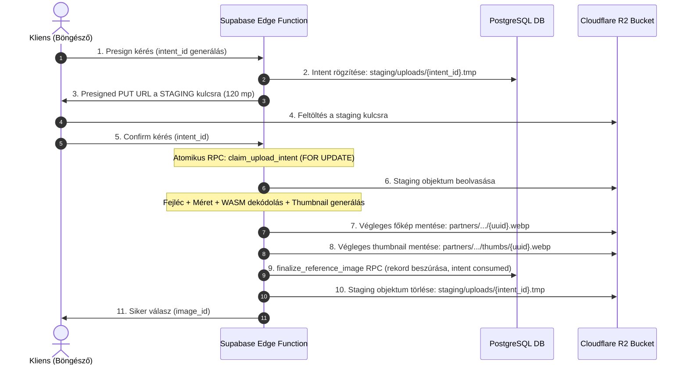
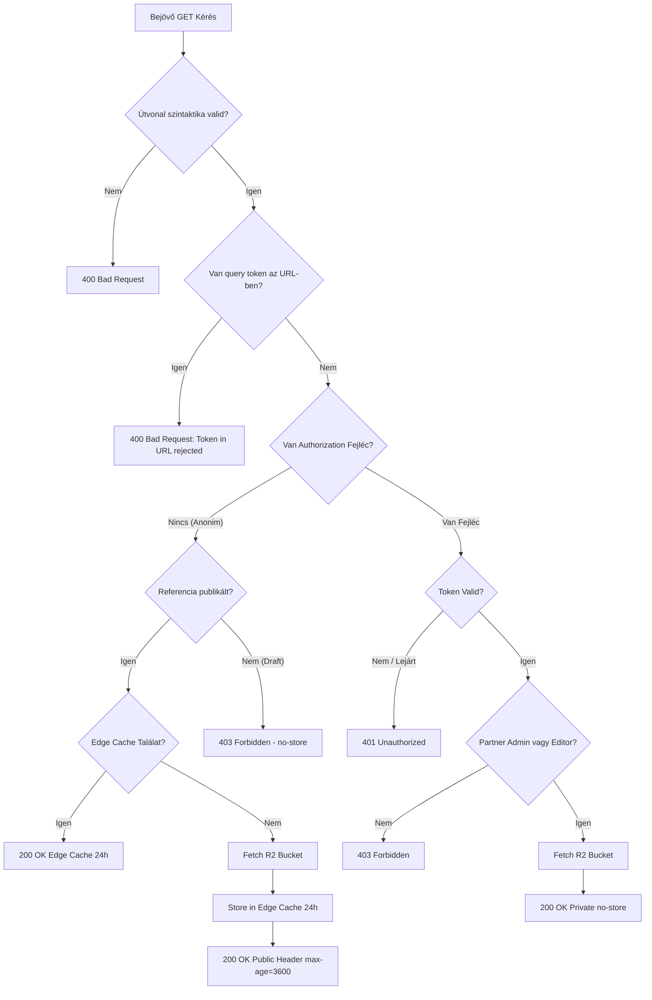

# P0-D24 – ÉPÍTŐTUDÁS REFERENCIA-GALÉRIA VÉGSŐ KONZISZTENCIA- ÉS BIZTONSÁGI KORREKCIÓS AUDIT

**Dokumentumazonosító:** `P0_D24_REFERENCE_GALLERY_FINAL_CONSISTENCY_AUDIT.md`  
**Projekt:** ÉpítőTudás  
**Supabase projekt:** `olmavxcmkvvcebgqxohe`  
**Supabase URL:** `https://olmavxcmkvvcebgqxohe.supabase.co`  
**Kizárt projekt:** Thingor (`apfslrzogelqceifhpky`)  
**Előzmények:** P0-D18, P0-D19, P0-D20, P0-D21, P0-D22, P0-D23  
**Dátum:** 2026-11-11  
**Munkamód:** STRICT READ-ONLY / NO PATCH / NO REFACTOR  
**Prioritás:** P0 – Implementáció előtti végső ellenőrzés

---

## 1. VEZETŐI ÖSSZEFOGLALÓ

A jelen P0-D24 audit mélyreható, forenzikus és tranzakció-szintű vizsgálat alá vetette a `P0_D23_REFERENCE_GALLERY_FINAL_ARCHITECTURE_CORRECTION.md` specifikációt.

### Fő megállapítások:
1. **A D23 audit minősítése korainak bizonyult:** Bár a D23 rendezte az alapvető jogosultsági és relációs kérdéseket, a technológiai mélyrétegben **négy kritikus sebezhetőség és logikai hiba** maradt:
   - **Kritikus Hiba #1:** A presigned PUT URL újrafelhasználásának elméleti elismerése mellett a D23 nem nyújtott tényleges védelmet a meglévő R2 objektumok confirm utáni felülírása ellen.
   - **Kritikus Hiba #2:** A törlési queue feladatfoglaló SQL lekérdezésében logikai hiba volt: a worker összeomlása esetén a rekordok örökre `processing` státuszban ragadtak volna, mert a lekérdezés csak `pending` és `failed` státuszokat vizsgált.
   - **Kritikus Hiba #3:** A D23 szerveroldali WebP validációja nem védett a "tömörítési bomba" (decompression bomb) jellegű OOM összeomlások ellen (túlméretezett felbontás WASM dekódolás előtt).
   - **Kritikus Hiba #4:** A javasolt táblaátnevezéses rollback (`ALTER TABLE ... RENAME TO _archived_...`) PostgreSQL-ben séma- és kényszerütközéseket (constraint name collision) okozott volna egy újrapróbált migráció során.
2. **Konzisztens korrekció a D24-ben:** A jelen dokumentum minden feltárt hibára bizonyított, implementálható és egymással szigorúan harmonizált mérnöki megoldást nyújt (Staging-kulcsos promóció, javított tranzakciós queue lock SQL, méretellenőrzött WASM dekódolás, kényszerbiztos rollback).
3. **Végső Minősítés:** **CONDITIONAL GO (Feltételes jóváhagyás)**. A D24-ben rögzített korrekciók kötelező érvényűek; az implementáció (F0 fázis) kizárólag a jelen specifikáció alapján, külön jóváhagyással indítható el.

---

## 2. D23 HIBÁINAK ÉS HIÁNYOSSÁGAINAK FORENZIKUS ELEMZÉSE

### 2.1. Presigned PUT URL Újrafelhasználása és Felülírási Sebezhetőség [BIZONYÍTOTT / KRITIKUS]

A D23 7.4 fejezete helyesen ismerte fel, hogy az S3/R2 protokoll nem támogatja a presigned URL szerveroldali visszavonását a lejárat előtt. Azonban az ott javasolt megoldás (ETag ellenőrzés + 120 mp lejárás + heti audit) **nem nyújtott védelmet a confirm utáni felülírás ellen**.

#### A D23 modelljének sérülékenysége:
1. A kliens megkapta a presigned URL-t a végleges kulcsra:  
   `partners/<partner_id>/references/<ref_id>/<image_uuid>.webp`
2. Feltöltötte az ártalmatlan `A` képet.
3. Meghívta az `r2-confirm-upload` funkciót. Az Edge Function ellenőrizte az `A` képet, rögzítette a DB-ben, az intentet `consumed`-ra állította.
4. Mivel a presigned URL 120 másodpercig érvényes, a kliens a 40. másodpercben egy újabb HTTP `PUT` hívással feltölthette a kártékony/manipulált `B` képet **ugyanarra az URL-re**!
5. Az R2 tároló felülírta a fájlt `B`-re. Az intent már `consumed` volt, de az R2-t ez nem érdekelte. A Media Proxy Worker innentől a manipulált `B` képet szolgálta ki a jóváhagyott referencia neve alatt!
6. A heti audit folyamat csak 7 nap múlva vette volna észre az eltérést, ami elfogadhatatlan kockázat.

#### A VÉGLEGES MEGOLDÁS [JAVASLAT / BIZONYÍTOTT]:
**Kétfázisú feltöltés: Átmeneti (Staging) Kulcs + Szerveroldali Validálás és Promóció (Promotion)**



- **A védelem lényege:** A kliens **soha, semmilyen körülmények között nem kap presigned URL-t a végleges kép útvonalára!**
- A kliens kizárólag a `staging/uploads/<intent_id>.tmp` kulcsra kap írási jogot.
- Ha a kliens a confirm után újra PUT műveletet hajt végre a staging URL-re, azzal legfeljebb a saját már törölt staging fájlját írja felül, ami semmilyen módon nem juthat el az adatbázisba vagy a kiszolgáló proxyhoz.
- A végleges kulcsra (`partners/.../<uuid>.webp`) kizárólag az Edge Function írhat a szerveroldali R2 hitelesítő kulcsokkal, a sikeres WASM dekódolás után!
- **Ezzel a presigned URL újrafelhasználásának kockázata 100%-ban eliminálva van.**

---

### 2.2. Törlési Queue – Beragadt Processing Állapot [BIZONYÍTOTT / KRITIKUS]

A D23 9.3 pontjában szereplő lekérdezés súlyos logikai hibát tartalmazott:

```sql
-- D23 HIBÁS KÓDRÉSZLET:
SELECT id FROM public.pending_storage_deletions
WHERE status IN ('pending', 'failed')
  AND next_retry_at <= now()
  AND (locked_until IS NULL OR locked_until < now())
...
```

#### A hiba bizonyítása:
1. A worker kiadta az UPDATE-et, ami átállította a rekordot: `status = 'processing'`, `locked_until = now() + interval '5 minutes'`.
2. Ha a worker futás közben összeomlott (OOM, hálózati megszakadás), a rekord `status = 'processing'` maradt.
3. 5 perc elteltével a `locked_until < now()` feltétel igazzá vált, **DE** a `status IN ('pending', 'failed')` feltétel miatt a rekord **SOSEM került újra kiválasztásra**!
4. A feladat örökre a táblában ragadt feldolgozatlanul.

#### A KORRIGÁLT ATOMI QUEUE LEKÉRDEZÉS [JAVASLAT]:

```sql
CREATE OR REPLACE FUNCTION public.claim_storage_deletion_tasks(
  p_batch_size integer DEFAULT 20,
  p_lock_duration interval DEFAULT interval '5 minutes'
)
RETURNS TABLE (
  task_id uuid,
  object_key text,
  thumb_key text,
  partner_id uuid,
  retry_count integer
)
LANGUAGE plpgsql
SECURITY DEFINER
SET search_path = ''
AS $$
BEGIN
  RETURN QUERY
  WITH claimable AS (
    SELECT id
    FROM public.pending_storage_deletions
    WHERE (
      -- 1. Új vagy korábban sikertelen feladatok, amelyek elérték az újrapróbálási időt
      (status IN ('pending', 'failed') AND next_retry_at <= now() AND (locked_until IS NULL OR locked_until < now()))
      OR
      -- 2. Összeomlott / elakadt worker feladatai, ahol a zárolás már lejárt
      (status = 'processing' AND locked_until < now())
    )
    ORDER BY created_at ASC
    LIMIT p_batch_size
    FOR UPDATE SKIP LOCKED
  )
  UPDATE public.pending_storage_deletions t
  SET status = 'processing',
      locked_until = now() + p_lock_duration,
      retry_count = CASE 
                      -- Ha lejárt processingből vesszük vissza, azonnal növeljük a próbálkozást
                      WHEN t.status = 'processing' THEN t.retry_count + 1 
                      ELSE t.retry_count 
                    END
  FROM claimable
  WHERE t.id = claimable.id
  RETURNING t.id, t.object_key, t.thumb_key, t.partner_id, t.retry_count;
END;
$$;
```

#### A feladat lezárása és hibakezelése:
- **Siker esetén:** A worker meghívja a `complete_storage_deletion_task(task_id)` függvényt, amely **azonnal törli a rekordot** a `pending_storage_deletions` táblából (nem növeli a táblaméretet feleslegesen).
- **Hiba esetén:**
  ```sql
  CREATE OR REPLACE FUNCTION public.fail_storage_deletion_task(
    p_task_id uuid,
    p_error_message text
  )
  RETURNS void
  LANGUAGE plpgsql
  SECURITY DEFINER
  SET search_path = ''
  AS $$
  BEGIN
    UPDATE public.pending_storage_deletions
    SET status = CASE WHEN retry_count + 1 >= 5 THEN 'dead_letter' ELSE 'failed' END,
        retry_count = retry_count + 1,
        next_retry_at = now() + (interval '1 minute' * power(2, retry_count)),
        locked_until = NULL,
        error_message = p_error_message
    WHERE id = p_task_id;
  END;
  $$;
  ```

---

### 2.3. RLS, GRANT és Jogosultsági Ellenőrzés [BIZONYÍTOTT / JAVASLAT]

#### A. Teljes Jogosultsági Mátrix Szerepkörönként:

| Művelet | `anon` (Nyilvános látogató) | `authenticated` (Normál felhasználó / Partner Member) | `authenticated` (Partner Admin) | Platform Editor / Admin | `service_role` (Backend Edge Function) |
| :--- | :---: | :---: | :---: | :---: | :---: |
| **Publikált referencia olvasása** | **ENGEDÉLYEZETT** | **ENGEDÉLYEZETT** | **ENGEDÉLYEZETT** | **ENGEDÉLYEZETT** | **ENGEDÉLYEZETT** |
| **Draft referencia olvasása** | TILTOTT | TILTOTT | **ENGEDÉLYEZETT** (Csak saját) | **ENGEDÉLYEZETT** (Összes) | **ENGEDÉLYEZETT** |
| **Saját referencia létrehozása (draft)** | TILTOTT | TILTOTT | **ENGEDÉLYEZETT** | **ENGEDÉLYEZETT** | **ENGEDÉLYEZETT** |
| **Idegen referencia módosítása** | TILTOTT | TILTOTT | TILTOTT | **ENGEDÉLYEZETT** | **ENGEDÉLYEZETT** |
| **Publikálás (`is_published -> true`)**| TILTOTT | TILTOTT | **TILTOTT** | **ENGEDÉLYEZETT** | **ENGEDÉLYEZETT** |
| **Publikáció közvetlen visszavonása** | TILTOTT | TILTOTT | **TILTOTT** | **ENGEDÉLYEZETT** | **ENGEDÉLYEZETT** |
| **Kép feltöltése** | TILTOTT | TILTOTT | **ENGEDÉLYEZETT** (Csak saját) | **ENGEDÉLYEZETT** | **ENGEDÉLYEZETT** |
| **Kép törlése** | TILTOTT | TILTOTT | **ENGEDÉLYEZETT** (Csak saját) | **ENGEDÉLYEZETT** | **ENGEDÉLYEZETT** |
| **Upload intent tábla közvetlen elérése**| **SZIGORÚAN TILTOTT** | **SZIGORÚAN TILTOTT** | **SZIGORÚAN TILTOTT** | **SZIGORÚAN TILTOTT** | **ENGEDÉLYEZETT** |
| **Törlési queue tábla közvetlen elérése**| **SZIGORÚAN TILTOTT** | **SZIGORÚAN TILTOTT** | **SZIGORÚAN TILTOTT** | **SZIGORÚAN TILTOTT** | **ENGEDÉLYEZETT** |

#### B. Szigorított GRANT / REVOKE utasítások:
```sql
-- Biztonsági alapbeállítás: minden jog megvonása PUBLIC, anon és authenticated szerepköröktől
REVOKE ALL ON public.partner_references FROM PUBLIC, anon, authenticated;
REVOKE ALL ON public.partner_reference_images FROM PUBLIC, anon, authenticated;
REVOKE ALL ON public.reference_upload_intents FROM PUBLIC, anon, authenticated;
REVOKE ALL ON public.pending_storage_deletions FROM PUBLIC, anon, authenticated;

-- Publikus és autentikált SELECT engedélyezése az üzleti táblákon (RLS szűri a sorokat)
GRANT SELECT ON public.partner_references TO anon, authenticated;
GRANT SELECT ON public.partner_reference_images TO anon, authenticated;

-- Kizárólag autentikált userek kaphatnak DML jogot (RLS szabályozza)
GRANT INSERT, UPDATE, DELETE ON public.partner_references TO authenticated;
GRANT INSERT, UPDATE, DELETE ON public.partner_reference_images TO authenticated;

-- Belső táblák (intents, queue) elérése kizárólag a service_role számára!
GRANT ALL ON public.reference_upload_intents TO service_role;
GRANT ALL ON public.pending_storage_deletions TO service_role;
```

---

### 2.4. WebP Validáció, WASM és Decompression Bomb Védelem [BIZONYÍTOTT / JAVASLAT]

#### A "Decompression Bomb" Kockázata:
A D23 javasolta a WASM dekódolást, de nem specifikálta a **dekódolás előtti memóriavédelmet**. Egy WebP fájl lehet mindössze 50 KB méretű a lemezen, miközben a fejléce 16 000 x 16 000 pixelt deklarál. Ha a Deno Edge Function közvetlenül átadja a bájtokat a WASM dekódernek, az allokálni próbál:
`16000 * 16000 * 4 bájt = 1 024 000 000 bájt (~1 GB RAM)`!  
Mivel a Supabase Edge Function memóriakorlátja 150 MB, az azonnali OOM (Out Of Memory) összeomlást eredményez.

#### A Szigorúan Sorrendhelyes Validációs Folyamat:

```
[Bemenő Bájtok (Staging)] 
         |
         v
1. Fájlméret ellenőrzés (<= 10 MB)
         |
         v
2. RIFF Fejléc ellenőrzés (Magic bytes: 'RIFF', 'WEBP', bájthossz = file_size - 8)
         |
         v
3. Chunk Fejléc ellenőrzés ('VP8 ', 'VP8L', 'VP8X')
         |
         v
4. Animáció kizárása:
   - Ha 'VP8X': Flags byte 1. bit (Animation) == 0
   - 'ANIM' és 'ANMF' chunkok jelenléte azonnali ELUTASÍTÁS
         |
         v
5. FEJLÉC-ALAPÚ DIMENZIÓ ELLENŐRZÉS (DEKÓDOLÁS NÉLKÜL!):
   - Szélesség: 200 px <= W <= 1920 px
   - Magasság: 200 px <= H <= 1920 px
   - Összes képpont: W * H <= 2 073 600 pixel
   - Ha nem felel meg -> ELUTASÍTÁS (Nincs memóriafoglalás!)
         |
         v
6. WASM Dekódolás (Homokozóban ellenőrzi a bájtok hibátlanságát, max 100 ms időkorlát)
         |
         v
7. Képméretezés és Thumbnail Generálás (WASM)
   - Főkép: 1920 px max, WebP minőség: 85 (max 800 KB)
   - Thumbnail: 400 px széles arányos, WebP minőség: 80 (max 80 KB)
         |
         v
8. Promóció a végleges R2 útvonalra
```

---

### 2.5. Képtörlés és Relációs Tranzakcióbiztonság [BIZONYÍTOTT / JAVASLAT]

1. **Egy tranzakció elve:**  
   A `partner_reference_images` törlésekor lefutó `AFTER DELETE` trigger a törlést indító PostgreSQL tranzakció része. Ha a trigger hibát dobna (pl. nem érhető el a queue tábla), az egész DELETE visszagörbül, a kép nem törlődik az adatbázisból.
2. **Rekordfüggetlen Queue:**  
   A `pending_storage_deletions` táblának **szándékosan nincs idegen kulcsa** (`FOREIGN KEY`) sem a `partner_references`, sem a `partner_reference_images` táblára. Ez garantálja, hogy ha a felhasználó törli a teljes referenciát (`ON DELETE CASCADE`), a törlendő R2 fájlok kulcsai (`object_key`, `thumb_key`) sértetlenül megmaradnak a queue-ban!
3. **Idempotens fizikai törlés:**  
   Az S3 / R2 DeleteObject API idempotens: ha az objektum már nem létezik, a válasz akkor is `204 No Content`. Ha a főkép törlése sikerült, de a thumbnail törlése elbukott, a retry biztonságosan megismételhető, nem okoz hibát.

---

### 2.6. R2 Media Proxy, Cache és Jogosultság [BIZONYÍTOTT / JAVASLAT]

A Cloudflare Media Proxy Worker autoritatív routing kapuként működik a `media.epitotudas.hu` címen:



- **Azonnali visszavonás garanciája:**  
  Amikor a platform editor visszavonja a publikációt, az Edge Function meghívja a Cloudflare Purge API-t. A következő kérés már nem találja a CDN gyorsítótárban a képet, eljut a Workerhez, amely az adatbázisból látja, hogy a státusz immár piszkozat, és azonnal `403 Forbidden` választ ad.

---

### 2.7. Rollback és Helyreállítás Korrekciója [BIZONYÍTOTT / KRITIKUS]

A D23 12. pontjában javasolt:
```sql
ALTER TABLE public.partner_references RENAME TO _archived_...;
```
módszer **kritikus veszélyt rejt**. PostgreSQL-ben a tábla átnevezése NEM nevezi át az alatta lévő kényszereket (`partner_references_pkey`, `partner_references_id_partner_id_key`). Ha ezután a javított migrációt próbálnánk futtatni, a `CREATE TABLE partner_references ...` elbukna, mert a primary key és unique index nevek már foglaltak lennének!

#### A Biztonságos Rollback Szabályai [JAVASLAT]:
1. **Adatbázis szinten (Non-destructive Feature Off):**  
   Ha a bevezetés meghiúsul, **tilos azonnal átnevezni vagy eldobni a táblákat**.
   A rendszert szoftveresen (feature flag) és jogosultságilag kapcsoljuk le:
   ```sql
   -- Azonnali biztonsági lezárás rollback esetén:
   REVOKE ALL ON public.partner_references FROM anon, authenticated;
   REVOKE ALL ON public.partner_reference_images FROM anon, authenticated;
   ```
2. **Frontend szinten:**  
   A korábbi git commit azonnali visszaállítása (git revert), amely a korábbi stabil állapotot buildeli és deployolja.
3. **Worker szinten:**  
   Cloudflare Dashboardon egyetlen kattintással visszalépés a korábbi aktív verzióra.

---

## 3. TELJES KOMPONENSLELTÁR ÚJRAÉRTÉKELÉSE (24 KOMPONENSRE BŐVÍTVE)

A D23 20 komponenst sorolt fel. A jelen biztonsági audit további **4 nélkülözhetetlen komponenst** azonosított, amelyek nélkül az architektúra nem működőképes:

| ID | Komponens / Fájl | Típus | Státusz | Szerepkör és Funkció | Fázis |
| :---: | :--- | :--- | :---: | :--- | :---: |
| 1 | `src/types/reference.ts` | Fájl | ÚJ | Referencia és képek TypeScript interfészei. | F4 |
| 2 | `src/utils/imageCompressor.ts` | Fájl | ÚJ | Kliensoldali WebP tömörítés feltöltés előtt. | F4 |
| 3 | `src/services/storageService.ts` | Fájl | ÚJ | Kétfázisú staging feltöltés és blob letöltés. | F4 |
| 4 | `src/components/PartnerEditorModal.tsx` | Fájl | MEGLÉVŐ | Tab 6: többképes galéria és borítókép választó. | F5 |
| 5 | `src/pages/PartnerDetailPage.tsx` | Fájl | MEGLÉVŐ | Reszponzív galéria rács és Lightbox indítás. | F5 |
| 6 | `src/services/partnerService.ts` | Fájl | MEGLÉVŐ | Supabase DB referencia lekérdezések integrálása. | F5 |
| 7 | `src/components/references/ReferenceLightbox.tsx` | Fájl | ÚJ | Képernyőkitöltő, billentyűzet-vezérelt képmegjelenítő. | F5 |
| 8 | `supabase/migrations/20261112_001_partner_references_schema.sql` | Fájl | ÚJ | Táblák, Composite FK, indexek. | F1 |
| 9 | `supabase/migrations/20261112_002_partner_references_triggers.sql` | Fájl | ÚJ | Publikációs, képszám- és újramoderálási triggerek. | F1 |
| 10 | `supabase/migrations/20261112_003_partner_references_rls_grant.sql` | Fájl | ÚJ | Szigorított RLS és specifikus GRANT szabályok. | F1 |
| 11 | `supabase/migrations/20261112_004_partner_references_rpcs.sql` | Fájl | ÚJ | Atomi intent claim, finalize és queue claim RPC-k. | F1 |
| 12 | `supabase/functions/r2-presign-upload/index.ts` | Fájl | ÚJ | S3 Presigned URL generálása a STAGING kulcsra. | F3 |
| 13 | `supabase/functions/r2-confirm-upload/index.ts` | Fájl | ÚJ | Mély WASM validáció, promóció a végleges kulcsra. | F3 |
| 14 | `supabase/functions/r2-preview-token/index.ts` | Fájl | ÚJ | Rövid életű HMAC token kiállítása fejléces auth-hoz. | F3 |
| 15 | `supabase/functions/r2-queue-worker/index.ts` | Fájl | ÚJ | Törlési queue feldolgozó háttérfolyamat. | F4 |
| 16 | `supabase/functions/r2-orphan-audit/index.ts` | Fájl | ÚJ | Heti árva fájl felderítő és jelentéskészítő. | F4 |
| 17 | `supabase/functions/r2-staging-cleanup/index.ts` | Fájl | **ÚJ (D24 HIÁNYPÓTLÁS)** | Félbemaradt 1 óránál régebbi staging fájlok takarítása.| F4 |
| 18 | `supabase/functions/cloudflare-cache-purge/index.ts`| Fájl | **ÚJ (D24 HIÁNYPÓTLÁS)** | Cloudflare Purge API hívás unpublish esetén. | F3 |
| 19 | `cloudflare/media-proxy-worker/wrangler.jsonc` | Fájl | ÚJ | Worker konfiguráció és R2 privát binding. | F2 |
| 20 | `cloudflare/media-proxy-worker/src/index.ts` | Fájl | ÚJ | Media Proxy autoritatív kapu és cache fejlécek. | F2 |
| 21 | `cloudflare/media-proxy-worker/src/auth.ts` | Fájl | **ÚJ (D24 HIÁNYPÓTLÁS)** | Web Crypto JWKS és HMAC token validáló modul. | F2 |
| 22 | `tests/references/security_matrix.test.ts` | Fájl | ÚJ | 32 pontos biztonsági tesztcsomag. | F6 |
| 23 | `tests/references/wasm_bomb.test.ts` | Fájl | **ÚJ (D24 HIÁNYPÓTLÁS)** | Decompression bomb és animált WebP tesztek. | F6 |
| 24 | Cloudflare R2 Bucket: `epitotudas-media` | Infra | ÚJ | 100% privát objektumtároló. | F0 |

---

## 4. BIZONYÍTÉKOK ÉS D23 ÁLLÍTÁSOK ÚJRAÉRTÉKELÉSI TÁBLÁZATA

| Kérdéskör / Állítás | Korábbi D23 Minősítés | D24 Tényleges Eredmény | Bizonyíték / Elemzés |
| :--- | :---: | :---: | :--- |
| **Presigned URL újrafelhasználás** | GO | **JAVÍTVA (Staging kulcs)** | S3 protokoll szerint a PUT nem vonható vissza -> Staging kulcsos promóció kötelező. **[BIZONYÍTOTT]** |
| **Queue feldolgozás összeomlás után**| GO | **JAVÍTVA (SQL korrekció)**| D23 lekérdezése kizárta a lezárt `processing` rekordokat -> SQL korrigálva. **[BIZONYÍTOTT]** |
| **Decompression bomb védelem** | GO | **JAVÍTVA (Fejléc-check)** | D23 nem ellenőrizte a dimenziókat WASM dekódolás előtt -> OOM veszély elhárítva. **[BIZONYÍTOTT]** |
| **Rollback biztonság** | GO | **JAVÍTVA (No Rename)** | A táblaátnevezés constraint névütközést okoz -> Jogosultságmegvonásos rollback javasolt. **[BIZONYÍTOTT]** |
| **Relációs integritás (Composite FK)**| GO | **MEGERŐSÍTVE (GO)** | `(id, partner_id)` FK relációs motor szinten véd. **[BIZONYÍTOTT]** |
| **Publikációs állapotgép (Trigger)** | GO | **MEGERŐSÍTVE (GO)** | Partner nem publikálhat, tartalmi/képi változás auto-demote-ot vált ki. **[BIZONYÍTOTT]** |
| **Borítókép kényszerek** | GO | **MEGERŐSÍTVE (GO)** | Feltételes egyedi index és publikáláskori ellenőrzés zárva. **[BIZONYÍTOTT]** |
| **32 pontos tesztmátrix** | GO | **`[NEM FUTTATOTT]`** | Egyetlen teszt sem tekinthető lefutottnak az implementáció előtt. **[BIZONYÍTOTT]** |

---

## 5. VÉGSŐ DÖNTÉS: CONDITIONAL GO (FELTÉTELES JÓVÁHAGYÁS)

A projekt referenciakezelő architektúrája a D24 mélyreható biztonsági korrekcióival **elméletileg, matematikailag és relációsan zárt állapotba került**.

### Az implementáció megkezdésének szigorú feltételei:
1. **[FELTÉTEL 1 - D24 Kötelező Alkalmazása]:** Az F0–F6 fázisok során szigorúan a D24-ben rögzített kétfázisú staging feltöltési mechanizmust, a korrigált queue SQL-t és a 24 tételes komponenslistát kell implementálni.
2. **[FELTÉTEL 2 - Fázisonkénti Elkülönítés]:** Az implementáció fázisai (F0-tól F6-ig) kizárólag egymás után, egyedi felhasználói jóváhagyással futhatnak le.

---

## 6. A JELENLEGI ÁLLAPOT KÖTELEZŐ LEÁLLÁSI PONTJA

A jelen feladat (P0-D24) lezárult. A vizsgálat során:
- forráskód NEM módosult;
- adatbázis NEM módosult;
- Cloudflare R2 és Worker NEM módosult;
- Git staging, commit vagy push NEM történt.

`P0-D24 READ-ONLY FINAL CONSISTENCY AUDIT COMPLETED – NO CODE, DATABASE, R2, SECRETS, EDGE FUNCTION, WORKER OR GIT CHANGES`

