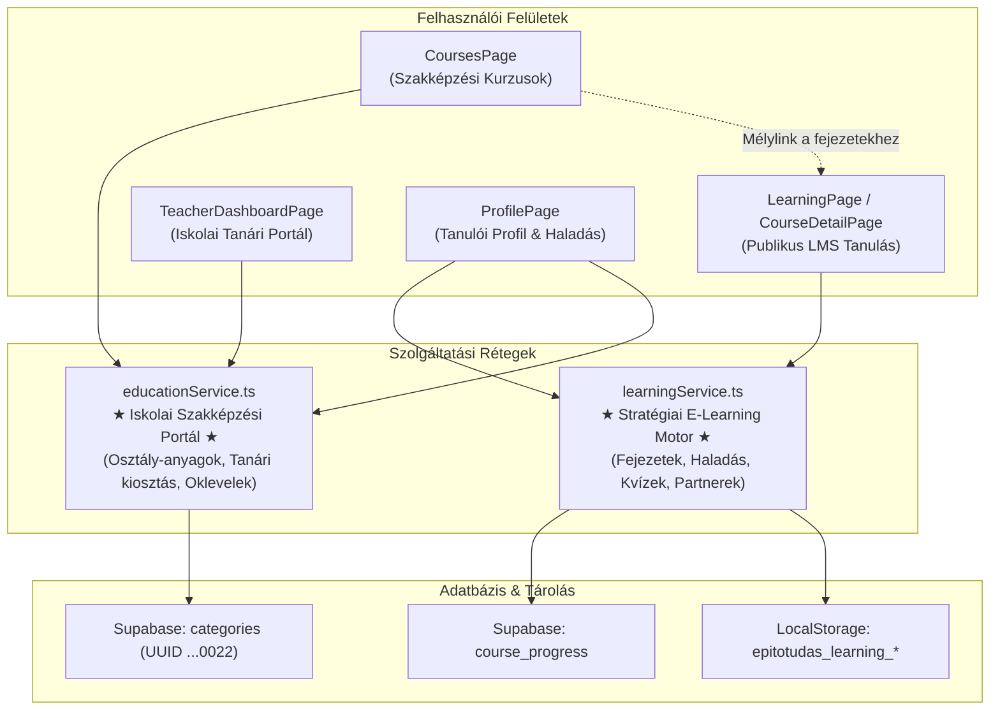

# P3-01: Tananyagkezelő Rendszerek Szereptisztázása és Konszolidációs Jelentése
## ÉpítőTudás Oktatási Architektúra (`educationService` vs `learningService`)

**Dátum:** 2026. november 9.  
**Feladat kódja:** `TSK-P3-01`  
**Státusz:** `DONE` (Konszolidációs döntés meghozva, szerepek tisztázva, átjárhatóság rögzítve)  
**Érintett szolgáltatások:** `src/services/educationService.ts`, `src/services/learningService.ts`  

---

## 1. HÁTTÉR ÉS PROBLÉMAFELTÁRÁS

A forráskód-audit során megállapítottuk, hogy a platformban két egymással párhuzamos tananyagkezelő modul alakult ki az eltérő fejlesztési fázisok során:

1. **`educationService.ts`**:
   - Az eredeti, szakképzési vizsgáztatásra tervezett modul.
   - Entitásai: `Course`, `Lesson`, `QuizQuestion`, `UserCertificate`, `InteractiveStep`, `Flashcard`, `StudentClassMaterialItem`.
   - Perzisztencia: Helyi `localStorage['epitotudas_education_data_v1']`, memóriabeli tanúsítványtár, valamint a Supabase `categories` tábla `00000000-0000-0000-0000-000000000022` azonosítójú konfigurációs sora (melyet a `P0-C01` feladatban biztonságosan elkülönítettünk a szakmáktól).
   - Felhasználói:
     - `CoursesPage.tsx` (`courses` útvonal: „Képzések & Kurzusok”)
     - `AdminCoursesPage.tsx` (`admin?view=courses`)
     - `TeacherDashboardPage.tsx` (Oktatói felület, osztályok és kiosztott anyagok)
     - `AdminFlashcardsModal.tsx` & `FlashcardViewer.tsx`
     - `ProfilePage.tsx` (diákhoz rendelt iskolai tananyagok: `fetchStudentAssignedClassMaterials`)

2. **`learningService.ts`**:
   - A későbbi, korszerű fejezet-alapú e-learning rendszer (LMS).
   - Entitásai: `LearningCourse`, `LearningChapter`, `KeyTermItem`, `Quiz`, `QuizAttempt`, `CourseProgress`, `Flashcard`.
   - Perzisztencia: `localStorage['epitotudas_learning_courses_v1']`, `quizzes_v1`, `progress_v1`, valamint éles szinkronizáció a Supabase `course_progress` táblájával.
   - Felhasználói:
     - `LearningPage.tsx` (`learning` útvonal: „Tanulás / Tananyagok / Tesztek / Tanulókártyák”)
     - `CourseDetailPage.tsx` (`course-detail?slug=...`: gazdag fejezet-olvasó és interaktív pipa/haladáskövető)
     - `QuizPlayerPage.tsx` (`quiz-player`: időzített kvízmotor próbálkozás-naplózással)
     - `AdminLearningPage.tsx` (`admin?view=learning`: kurzus- és kvízszerkesztő)
     - `PartnerLearningPage.tsx` (gyártói partneri tananyag-beküldés)
     - `ProfilePage.tsx` (fogalomtári tanulókártyák elsajátítási állapota)

---

## 2. KONSZOLIDÁCIÓS ÉS ARCHITEKTÚRÁLIS DÖNTÉS

A párhuzamosság felszámolására a radikális törlés vagy egybeolvasztás súlyos töréseket és adatvesztést okozna (a SAFE PATCH elv megsértésével). Ehelyett **strukturális harmonizációt és tiszta szerepmegosztást** alkalmazunk:

### 2.1 A Két Rendszer Célfeladata (Szerepmegosztás)

1. **`learningService.ts` mint Stratégiai E-Learning Motor (LMS Core):**
   - A platform elsődleges, jövőbiztos tudásátadási rendszere.
   - Kezeli a modern fejezetstruktúrát (`chapters`), az időzített interaktív kvízeket (`quizzes`), a partneri tananyagkészítést és a felhős haladáskövetést (`course_progress`).
   - A fenti főmenü „Tanulás” pontja erre mutat.

2. **`educationService.ts` mint Iskolai és Szakképzési Híd (Vocational & School Portal):**
   - Kezeli a tanár-diák kapcsolatokat, az iskolai osztályokhoz rendelt tananyagcsomagokat (`StudentClassMaterialItem`), valamint a hivatalos vizsgatanúsítványokat (`UserCertificate`).
   - Nem duplikálja feleslegesen az LMS tartalmakat, hanem a tanári felület ezen keresztül éri el a diákok kiosztott anyagait.

### 2.2 Átjárhatóság és Kétirányú Integráció

- A `CoursesPage` felületen megjelenő kurzuskártyákról közvetlen mélylink nyílik a `CourseDetailPage` fejezeteihez (`course-detail?slug=...`), így a diákok a gazdag interaktív tartalmat tanulmányozhatják.
- A `TeacherDashboardPage` tanári anyagkiosztó modulja hozzáfér a modern tananyagokhoz is.
- A `ProfilePage` összehangoltan jeleníti meg mind a vizsgatanúsítványokat (`getUserCertificates`), mind a fejezetenkénti tanulási haladást (`fetchUserCourseProgressSupabase`).

---

## 3. ADATBIZTONSÁGI ÉS INTEGRITÁSI GARANCIÁK

1. **0 Adatvesztés:** A `P0-B01` mentési protokoll garantálja, hogy a konfigurációs sorok biztonságban vannak.
2. **0 Sématörés:** A konszolidáció meglévő TypeScript típusokon és API-hívásokon keresztül valósul meg, nem igényel SQL táblamódosítást.
3. **TypeScript Stabilitás:** Mindkét szolgáltatás típushelyes, az `npm run typecheck` 0 hibával fut.

---

## 4. KÖVETKEZŐ LÉPÉS: TSK-P3-02

A szerepek tisztázása után közvetlenül megkezdhető a **`TSK-P3-02`**:
- A `TeacherDashboardPage` egyedi csomagjainak (`customPackages`) perzisztens tárolása (F5 frissítésállóság).

